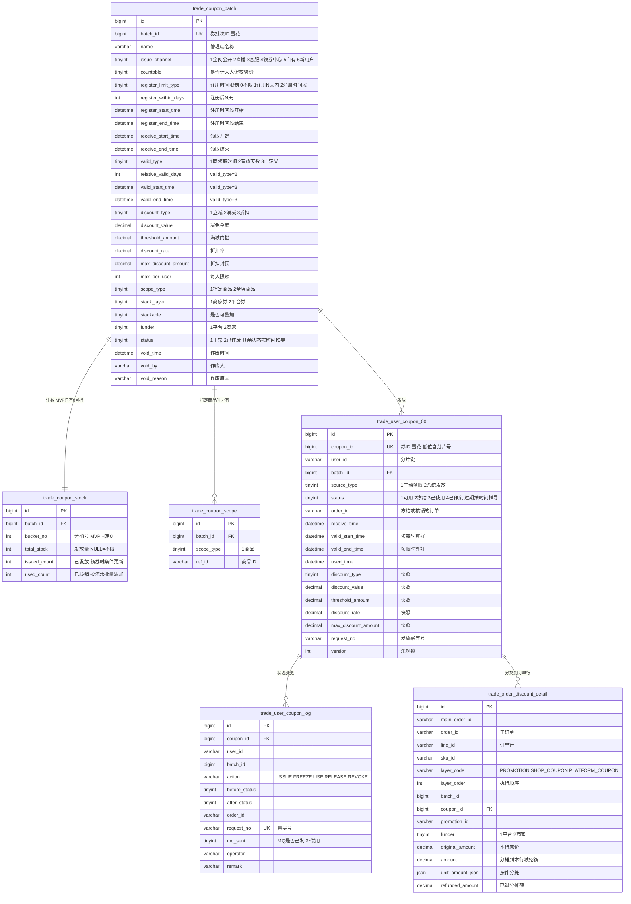

## 建券页面 → 字段

| 页面区块 | 控件 | 字段 |
|---|---|---|
| 基础规则 | 推广方式 | `trade_coupon_batch.issue_channel` |
| | 不计入大促校验价 | `trade_coupon_batch.countable` |
| | 新用户渠道：注册时间 | `register_limit_type` + `register_within_days` 或 `register_start_time` / `register_end_time` |
| | 优惠券名称 | `trade_coupon_batch.name` |
| | 领取时间 | `receive_start_time` / `receive_end_time` |
| | 使用时间三选一 | `valid_type` + 对应字段 |
| 优惠设置 | 立减 | `discount_type=1` + `discount_value` |
| | 满 20 减 10 | `discount_type=2` + `threshold_amount=20` + `discount_value=10` |
| | 折扣 | `discount_type=3` + `discount_rate` |
| | 券发放量：不限 / 10000 张 | `trade_coupon_stock.total_stock`：NULL / 10000 |
| | 每人限领 | `trade_coupon_batch.max_per_user` |
| | 指定商品（商品券） | `scope_type=1` + `trade_coupon_scope` 多行 |
| | 全店商品（店铺券） | `scope_type=2`，不写范围表 |

## 主要流程用到哪些表

**建券**：同一事务写 `trade_coupon_batch` 一行、`trade_coupon_stock` 一行；指定商品时再写 `trade_coupon_scope`。

**领券**：
1. 读 `trade_coupon_batch` 校验状态和领取时间（走缓存）
2. 查 `trade_user_coupon_xx` 统计这个人领了几张，校验每人限领
3. 条件更新 `trade_coupon_stock.issued_count`，影响 0 行就是领完了
4. 写 `trade_user_coupon_xx`，`valid_*` 按使用时间规则算好，规则字段做快照
5. 写 `trade_user_coupon_log`，动作 ISSUE

**下单 → 支付 → 退款**：只改 `trade_user_coupon_xx.status` 和 `order_id`，每次写一条 log；下单时写 `trade_order_discount_detail`，退款时读它、累加 `refunded_amount`。

**核销统计**：定时任务按流水批量累加 `trade_coupon_stock.used_count`。

**作废券**：改 `trade_coupon_batch.status = 2`，记作废时间、人、原因。之后不能再领，已领的券照常可用。

## 状态：只存操作结果，时间相关的状态查询时推导

不用定时任务改状态，状态永远和当前时间一致。

### 券（管理后台列表筛选）

存储只有 `1正常` `2已作废`。筛选项按下面推导，命中即停：

| 筛选项 | 条件 |
|---|---|
| 已作废 | `status = 2` |
| 未开始 | `status = 1` 且 当前时间 < `receive_start_time` |
| 已过期 | `status = 1` 且 当前时间 > `receive_end_time` |
| 生效中 | `status = 1` 且 在领取时间内 |

已领完不单独作为状态，仍显示生效中，领券时由计数表拦截。作废不可恢复。

### 用户券（用户券列表 tab）

存储 `1可用` `2冻结` `3已使用` `4已作废`：

| tab | 条件 |
|---|---|
| 可使用 | `status = 1` 且 当前时间 <= `valid_end_time` |
| 已过期 | `status = 1` 且 当前时间 > `valid_end_time` |
| 已使用 | `status = 3` |
| 已作废 | `status = 4` |

```
                              ┌──────── 超时/取消 ────────┐
                              ▼                          │
  领取 ──> 1 可用 ──下单锁券──> 2 冻结 ──支付成功──> 3 已使用 ──整单退款──> 1 可用
             │                   │
             └───────运营作废────┴──> 4 已作废
```

下单锁券时校验券在有效期内；锁券后到期的允许继续支付。

## 使用时间在领取时怎么算

| valid_type | 生效 | 失效 |
|---|---|---|
| 1 与领取时间相同 | 领取时刻 | `receive_end_time` |
| 2 限制有效天数 | 领取时刻 | 领取时刻 + `relative_valid_days` 天 |
| 3 自定义时间 | `valid_start_time` | `valid_end_time` |

例：领取时间 11.1~11.19，用户 11.3 领取，选"与领取时间相同"，可用期为 11.3~11.19。
