```mermaid
erDiagram
    %% 卡券系统 E-R 图（配套 docs/coupon-tables-ddl.sql），共 9 张表
    %% 关系符号：||--|| 一对一，||--o{ 一对多
    %% 省略了 create_time / modified_time / closed / tenant_id 等通用列
    %% template_id = 券模板ID（一次建券），coupon_id = 券ID（用户手里的一张券）

    trade_coupon_template ||--|| trade_coupon_stock : "计数 MVP只有0号桶"
    trade_coupon_template ||--o{ trade_coupon_scope : "指定商品时才有"
    trade_coupon_template ||--o{ trade_user_coupon : "发放"
    trade_user_coupon ||--o{ trade_user_coupon_log : "状态变更"
    trade_user_coupon ||--o{ trade_order_discount_detail : "分摊到订单行"
    trade_coupon_template ||--o{ trade_coupon_issue_task : "定向发放/人群灌券模板才有"
    trade_coupon_issue_task ||--o{ trade_coupon_issue_task_item : "名单 一人一行"
    trade_coupon_issue_task_item ||--o| trade_user_coupon : "发放成功生成"
    trade_user_coupon }o--|| trade_coupon_expire_notify : "同用户同天合并为一条提醒"

    trade_coupon_template {
        bigint id PK
        bigint template_id UK "券模板ID 雪花"
        varchar name "管理端名称"
        tinyint issue_channel "1～5全部用户 6人群惊喜券仅新人 7人群灌券仅任务"
        datetime receive_start_time "领取开始"
        datetime receive_end_time "领取结束"
        tinyint valid_type "1同领取时间 2有效天数 3自定义"
        int relative_valid_days "valid_type=2"
        datetime valid_start_time "valid_type=3"
        datetime valid_end_time "valid_type=3"
        tinyint discount_type "1立减 2满减 3折扣"
        decimal discount_value "减免金额"
        decimal threshold_amount "满减门槛"
        decimal discount_rate "折扣率"
        decimal max_discount_amount "折扣封顶"
        int max_per_user "每人限领"
        tinyint crowd_type "生效人群 0全部用户 1新用户"
        int register_within_days "新用户注册后N天内可领"
        tinyint scope_type "1指定商品 2全店商品"
        tinyint stack_layer "1商家券 2平台券"
        tinyint stackable "是否可叠加"
        tinyint funder "1平台 2商家"
        tinyint status "1正常 2已作废 其余状态按时间推导"
        datetime void_time "作废时间"
        varchar void_by "作废人"
        varchar void_reason "作废原因"
    }

    trade_coupon_stock {
        bigint id PK
        bigint template_id FK
        int bucket_no "分桶号 MVP固定0"
        int total_stock "发放量 NULL=不限"
        int issued_count "已发放 领券时条件更新"
        int used_count "已核销 按流水批量累加"
    }

    trade_coupon_scope {
        bigint id PK
        bigint template_id FK
        tinyint scope_type "1商品"
        varchar ref_id "商品ID"
    }

    trade_user_coupon {
        bigint id PK
        bigint coupon_id UK "券ID 雪花 低位含分片号"
        varchar user_id "分片键"
        bigint template_id FK
        tinyint source_type "1系统自动领取 2人群灌券任务发放"
        varchar display_name "发券时名称快照"
        tinyint scope_type "发券时范围类型快照"
        tinyint crowd_type "新人历史判断快照，不对外展示"
        tinyint status "1未使用 2已锁定 3已使用 过期按时间推导"
        varchar order_id "锁定或核销的订单"
        datetime receive_time
        datetime valid_start_time "领取时算好"
        datetime valid_end_time "领取时算好"
        datetime used_time
        tinyint discount_type "快照"
        decimal discount_value "快照"
        decimal threshold_amount "快照"
        decimal discount_rate "快照"
        decimal max_discount_amount "快照"
        varchar request_no "发放幂等号"
        int version "乐观锁"
    }

    trade_user_coupon_log {
        bigint id PK
        bigint coupon_id FK
        varchar user_id
        bigint template_id
        varchar action "ISSUE LOCK UNLOCK USE RETURN"
        tinyint before_status
        tinyint after_status
        varchar order_id
        varchar request_no UK "幂等号"
        tinyint mq_sent "MQ是否已发 补偿用"
        varchar operator
        varchar remark
    }

    trade_coupon_issue_task {
        bigint id PK
        bigint task_id UK "任务ID 雪花"
        bigint template_id FK "只能是定向发放或人群灌券模板"
        varchar name "任务名称"
        varchar source_file "名单文件名"
        int total_count "名单人数 去重后"
        int success_count "成功人数"
        int fail_count "失败人数"
        tinyint status "0待执行 1执行中 2已完成 3已取消"
        datetime start_time
        datetime finish_time
        varchar create_by "创建人 异步执行时作为操作人"
    }

    trade_coupon_issue_task_item {
        bigint id PK
        bigint task_id FK
        varchar user_id
        tinyint status "0待发放 1已发放 2发放失败"
        varchar fail_reason "失败原因码"
        bigint coupon_id "成功后的券ID"
        int retry_count
    }

    trade_coupon_expire_notify {
        bigint id PK
        varchar user_id
        date notify_date "提醒日期 与user_id联合唯一"
        date expire_date "这批券的到期日"
        int coupon_count "即将到期张数"
        json coupon_ids "涉及的券ID"
        tinyint channel "1App推送"
        tinyint status "0待发送 1已发送 2失败 3已跳过"
        varchar fail_reason
        int retry_count
        datetime send_time
    }

    trade_order_discount_detail {
        bigint id PK
        varchar main_order_id
        varchar order_id "子订单"
        varchar line_id "订单行"
        varchar sku_id
        varchar layer_code "PROMOTION SHOP_COUPON PLATFORM_COUPON"
        int layer_order "执行顺序"
        bigint template_id
        bigint coupon_id FK
        varchar promotion_id
        tinyint funder "1平台 2商家"
        decimal original_amount "本行原价"
        decimal amount "分摊到本行减免额"
        json unit_amount_json "按件分摊"
        decimal refunded_amount "已退分摊额"
    }
```

## 建券页面 → 字段

| 页面区块 | 控件 | 字段 |
|---|---|---|
| 基础规则 | 推广方式 | `trade_coupon_template.issue_channel` |
| | 优惠券名称 | `trade_coupon_template.name` |
| | 领取时间 | `receive_start_time` / `receive_end_time` |
| | 使用时间三选一 | `valid_type` + 对应字段 |
| 优惠设置 | 立减 | `discount_type=1` + `discount_value` |
| | 满 20 减 10 | `discount_type=2` + `threshold_amount=20` + `discount_value=10` |
| | 折扣 | `discount_type=3` + `discount_rate` |
| | 券发放量：不限 / 10000 张 | `trade_coupon_stock.total_stock`：NULL / 10000 |
| | 每人限领 | `trade_coupon_template.max_per_user` |
| | 生效人群：全部用户 / 新用户 | `trade_coupon_template.crowd_type`：0 / 1 |
| | 新用户：注册后 N 天内可领 | `trade_coupon_template.register_within_days`，选新用户时必填 |
| | 指定商品（商品券） | `scope_type=1` + `trade_coupon_scope` 多行 |
| | 全店商品（店铺券） | `scope_type=2`，不写范围表 |

## 主要流程用到哪些表

**建券**：同一事务写 `trade_coupon_template` 一行、`trade_coupon_stock` 一行；指定商品时再写 `trade_coupon_scope`。

**领券**：
1. 读 `trade_coupon_template` 校验状态和领取时间（走缓存）
2. 查 `trade_user_coupon_xx` 统计这个人领了几张，校验每人限领
3. 条件更新 `trade_coupon_stock.issued_count`，影响 0 行就是领完了
4. 写 `trade_user_coupon_xx`，`valid_*` 按使用时间规则算好，规则字段做快照
5. 写 `trade_user_coupon_log`，动作 ISSUE

**下单 → 支付 → 退款**：只改 `trade_user_coupon_xx.status` 和 `order_id`，每次写一条 log；下单时写 `trade_order_discount_detail`，退款时读它、累加 `refunded_amount`。

**定向发券（灌券）**：
1. 运营上传名单，校验模板是人群灌券渠道，名单去重后写 `trade_coupon_issue_task` 一行、`trade_coupon_issue_task_item` 每人一行
2. 异步按组（如 500 人）拉 `status=0` 的明细
3. 每组：批量查已领张数、批量取注册时间 → 过滤 → 一次扣 `trade_coupon_stock` N 张 → 按分片批量插用户券和流水
4. 回写明细状态和失败原因，累加任务成功、失败数
5. 失败名单按 `task_id + status=2` 导出；重试只把失败的重置为 0，用户券的幂等号 `任务ID_用户ID` 防重复发

**到期提醒**：
1. 每天定时任务按分片扫 `trade_user_coupon_xx`：`status=1` 且 `valid_end_time` 落在「今天 + N 天」这一天
2. 按用户合并，批量 `INSERT IGNORE` 到 `trade_coupon_expire_notify`，`(user_id, notify_date)` 唯一，重跑不重复
3. 批量查推送开关，关闭的记为已跳过，其余调用推送并回写状态
4. 只读用户券表，不改任何券的状态；已锁定、已使用的券天然不会被提醒

**核销统计**：定时任务按流水批量累加 `trade_coupon_stock.used_count`，USE +1，RETURN -1。

**作废券模板**：只有未开始、生效中的模板能作废，改 `trade_coupon_template.status = 2`，记作废时间、人、原因。之后不能再领，已领的券照常可用。

## 状态：只存操作结果，时间相关的状态查询时推导

不用定时任务改状态，状态永远和当前时间一致。

### 券模板（管理后台列表筛选）

```
  创建 ──> 未开始 ──领取开始时间已到──> 生效中 ──领取结束时间已到──> 已过期（终态）
             │                           │
             └────────────作废───────────┴──> 已作废（终态）
```

已过期不能作废。存储只有 `1正常` `2已作废`，筛选项按下面推导，命中即停：

| 筛选项 | 条件 |
|---|---|
| 已作废 | `status = 2` |
| 未开始 | `status = 1` 且 当前时间 < `receive_start_time` |
| 已过期 | `status = 1` 且 当前时间 > `receive_end_time` |
| 生效中 | `status = 1` 且 在领取时间内 |

已领完不单独作为状态，仍显示生效中，领券时由计数表拦截。作废不可恢复。

### 券（用户券列表 tab）

```
             ┌──────────────────── 整单退款 ────────────────────┐
             │            ┌──── 超时/主动取消 ────┐             │     ┌─ 部分退款 ─┐
             ▼            ▼                      │             │     ▼            │
  领券 ──> 未使用 ──────── 下单 ────────> 已锁定 ──── 支付 ────> 已使用 ───────────┘
             │
             └──到期──> 已过期（终态）
```

存储 `1未使用` `2已锁定` `3已使用`，已过期按时间推导：

| tab | 条件 |
|---|---|
| 可使用 | `status = 1` 且 当前时间 <= `valid_end_time` |
| 已过期 | `status = 1` 且 当前时间 > `valid_end_time` |
| 已使用 | `status = 3` |

- 已锁定的券不在"可使用"里，可显示为"使用中"。
- 部分退款不改状态、券不退。
- 整单退款回到未使用时如果已过期，会自动显示为已过期。
- 下单锁券时校验券在有效期内；锁券后到期的允许继续支付。
- 券没有作废态，作废只针对券模板。

## 使用时间在领取时怎么算

| valid_type | 生效 | 失效 |
|---|---|---|
| 1 与领取时间相同 | 领取时刻 | `receive_end_time` |
| 2 限制有效天数 | 领取时刻 | 领取时刻 + `relative_valid_days` 天 |
| 3 自定义时间 | `valid_start_time` | `valid_end_time` |

例：领取时间 11.1~11.19，用户 11.3 领取，选"与领取时间相同"，可用期为 11.3~11.19。
