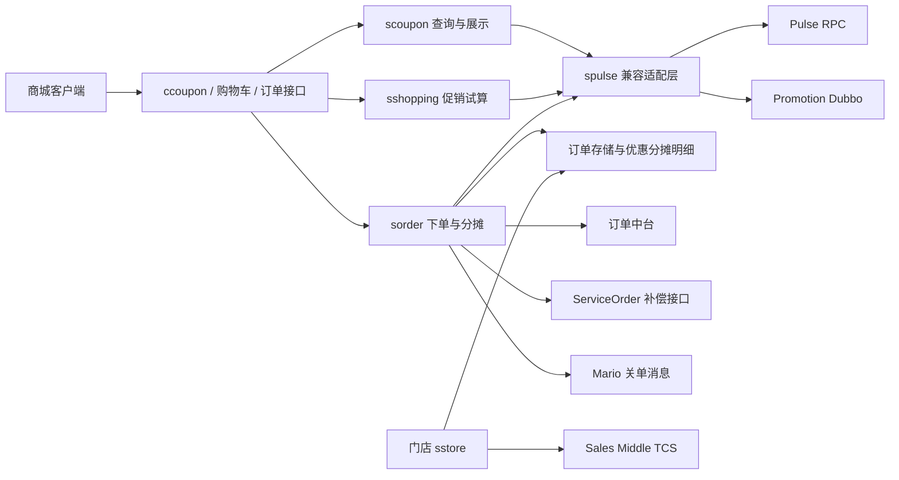
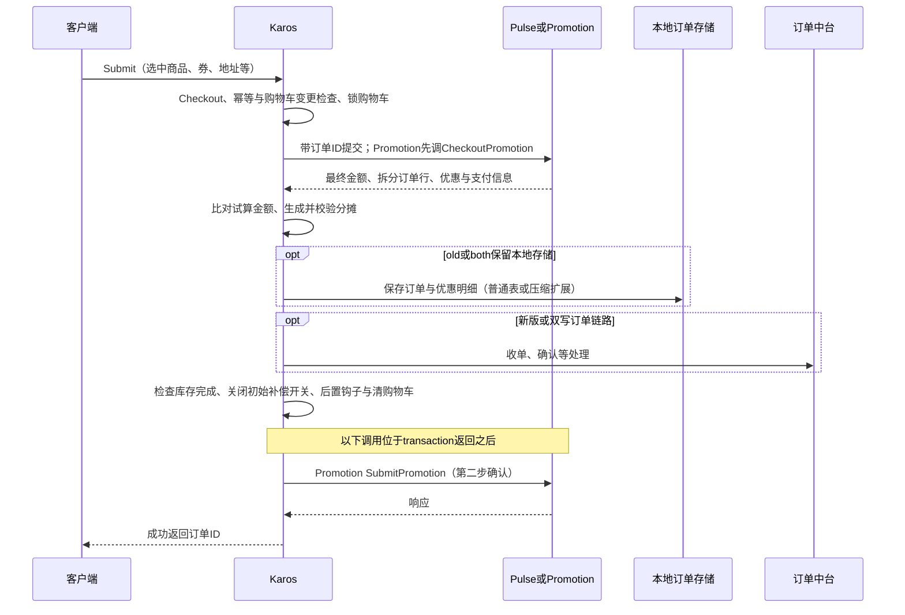
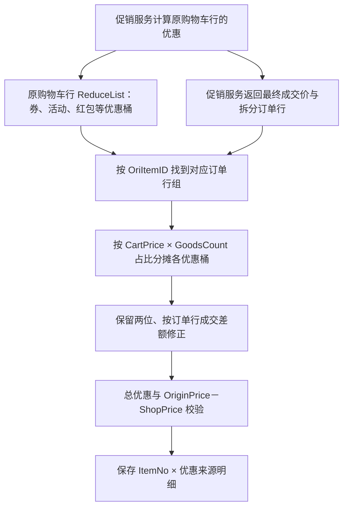

# 优惠券设计与订单核销、分摊分析

> 分析日期：2026-10-14。源码基线：`e9a4359`。本文描述当前 Karos 仓库中的实际调用与算法，不推定线上灰度配置，也不将远端服务接口注释等同于远端状态机实现。

## 1. 核心结论

本项目的优惠券模块是交易编排与适配层。券实例、使用条件、活动互斥、可叠加组合、最终优惠计算以及券资格占用主要交给 Pulse / Promotion；Karos 负责收集交易上下文、校验结果、创建订单、记录分摊和触发补偿。门店 `/store` 链路另由 Sales Middle TCS 结算中心处理。

需要区分三个概念：

| 概念 | 在本仓库中的实现 | 边界 |
| --- | --- | --- |
| 试算 / 验券 | 将选中购物车、券 ID / 优惠码、渠道、地址、配送等传给促销服务 | 返回可用性不代表已经核销 |
| 下单用券 | 主商城下单前调用远端 Submit；Promotion 路径再在订单保存后调用二阶段提交 | 调用发生在创建订单阶段；远端 `locked → used` 的精确时点不可从本仓库确认 |
| 优惠分摊 | 将远端已计算到原购物车行的优惠，继续分配到拆分后的订单商品行 | 本地分摊记录是交易明细，不是券状态表 |

因此，不能把“支付成功才核销”“取消一定同步退券”“部分退款按固定规则返券”当成这个仓库已经实现的事实。

## 2. 架构与职责



| 模块 | 主要职责 |
| --- | --- |
| `controllers/ccoupon` | 用户券、订单可用券、单品券、验券、分享、消费券等接口 |
| `service/scoupon` | 参数与展示处理、商品渠道过滤、调用促销服务、分享编排 |
| `service/spulse` | Pulse 请求模型，Pulse / Promotion 路由，响应兼容转换，Submit / Refund |
| `service/sshopping/pulse.go` | 将促销结果写回购物车，维护每行优惠桶、每券优惠金额和运费优惠 |
| `service/sorder` | 结算金额、下单资格占用、订单商品拆分、分摊校验、持久化、失败补偿 |
| `service/sstore` | 门店结算中心试算、PlaceOrder、接收分摊、RollbackOrder |

远端资格操作和本地数据库事务之间没有共同的数据库事务。整体依靠下单前占用、成功后确认、失败时回滚或补偿实现跨服务一致性；源码中的“二阶段提交”是应用接口流程，不足以证明具备数据库分布式事务的原子性。

## 3. 领域模型、类型与金额单位

### 3.1 名称相同但含义不同的类型

| 字段 / 常量所在位置 | 值 | 含义 |
| --- | --- | --- |
| 验券 / 下单请求 `coupon_type` | `1` / `2` | 明码券 / 无码券，即传优惠码还是券实例 ID |
| `ecoupon.CheckoutCoupon.CouponType`、券展示对象 | `1` / `2` | 商品券 / 运费券 |
| `epulse.COUPON_TYPE_*` | `1 / 2 / 3 / 4 / 99` | 现金券 / 折扣券 / 商品抵扣券 / 部分免邮券 / 运费券 |
| 门店 `estoreactivity.CouponType` | `TICKET=1`、`CODE=2` | 门店内部枚举；与请求类型的数字顺序不同 |
| `coupon_id` | 券实例 ID | 用户持有的具体一张券 |
| `coupon_type_id` / `TypeID` | 券类型或模板 ID | 对应券模板、领取活动等；不能代替券实例 ID |

主商城下单保留了旧参数名：无码券通过 `coupon_code="券ID1|券ID2"` 传入，再拆成 `CouponIDs []int64`；明码券则传字符串优惠码，适配为 `CouponCodes`。这一兼容协议支持多张无码券，但能否叠加、互斥和选优由远端服务决定。

`/coupon/validcoupon` 的 `coupon_id` 也有双重含义：请求类型为 `1` 时直接作为优惠码，为 `2` 时解析为数字券 ID。

### 3.2 关键模型

| 模型 | 关键字段 | 用途 |
| --- | --- | --- |
| `epulse.CouponInfo / CouponList` | ID、模板、状态、有效期、使用范围、可用渠道、分享标记、实际抵扣 | 用户券 / 可用券展示 |
| `ecoupon.CheckoutCoupon` | `Allow`、`ValidItem`、`Checked`、`RealReduce`、`CouponGroupNo`、`LimitUseRegion` | 结算候选券与已选券 |
| `epulse.ExInfo` | 券 ID / 码、旧版和 V2 券基础信息、不可用原因、地域限制 | 远端兼容信息与验券结果 |
| `eshopping.PulseInfo` | 活动 / 券 / 红包 / 运费优惠，`ReduceList`，`CouponDiscountMap` | 原购物车行的促销结果 |
| `epulse.PulseOrderItem` | `OriItemID`、`ItemNo`、标准价、购物车价、成交价、数量、套装信息 | 促销服务拆分后的订单行 |
| `entities.SalesPromotionStorage` | `ItemNo`、`ActType`、`ActID`、`ReduceMoney` 等 | 订单行优惠分摊 |

金额单位需要显式区分：

| 位置 | 单位与形式 |
| --- | --- |
| Pulse / Promotion 的多数价格、ReduceList 与 `CheckoutCoupon.RealReduce` | 整数分 |
| Karos 购物车金额、订单单价、`SalesPromotionStorage.ReduceMoney` | `float64` 元 |
| 发送订单中台的商品价与分摊 DTO | 元乘 100，转换为整数分 |
| 门店返回的商品价及 `RelatedGoods.ReduceAmount` | 直接使用浮点金额；分摊落地代码将单件减免乘数量 |

主商城转换订单行时，`ShopPrice = FinalPrice / 100 / SkuCount`。这里远端 `FinalPrice` 是整行金额，本地 `ShopPrice` 是单价；分摊记录的 `ReduceMoney` 则是整行优惠，不能再乘一次数量。

此外，主商城 `assignOrderItems` 写入订单 `GoodsID` 的来源是 `PulseOrderItem.Sku`。排查商品券匹配和分摊明细时，应按实际 SKU 口径核对，不能仅根据字段名认为它一定是商品主 ID。

### 3.3 券状态与展示状态

适配层定义 `unused`、`used`、`locked`、`expired`、`presented`、`received`、`unused_presented`、`all` 等状态字符串。用户券查询只接受其中的 `unused / used / unused_presented / expired / all`。

展示格式化会把远端 `locked / presented / received` 都转换成 `used`；`unused` 且已超过结束时间会显示 `expired`。分享状态另用 `GiftSend` 表达。因此，页面上“已使用”可能表示锁定或赠送相关状态，不能据此判定支付已完成或财务已经核销。

## 4. 查询、验券与结算试算

### 4.1 接口入口

下表以 [实际路由注册](../src/controllers/routers.go) 为准，均为 POST。控制器注释中的大小写与注册值部分不同，例如注释写 `validCoupon`，路由注册为 `validcoupon`。

| 路由 | 作用 |
| --- | --- |
| `/coupon/usercoupon` | 查询用户券，支持状态、目标券 ID 和渠道过滤 |
| `/coupon/ordercoupon` | 根据选中购物车和地址 / 门店查询订单候选券 |
| `/coupon/validcoupon` | 对当前购物车试算指定券，返回 allow / refuse、原因和优惠额 |
| `/coupon/productcoupon`、`/coupon/productcouponv2` | 商品相关的已持有可用券、可领取券活动；V2 区分商品销售来源 |
| `/coupon/goodscoupon`、`/coupon/aftercouponusedprice` | 商品券查询与券后价相关展示 |
| `/coupon/couponsend`、`couponget`、`couponquery`、`couponcancel`、`coupontoken` | 赠送、领取赠券、分享查询、取消赠送、Token 相关操作 |
| `/coupon/shoppingcouponlist`、`beijinglist`、`beijingsubscribe` | 消费券与北京消费券活动 / 订阅 |
| `/store/coupon/usercoupon`、`ordercoupon`、`validcoupon` | 门店独立券接口 |

这里的 `couponsend / couponget` 是分享赠券业务，不能当作通用券模板创建或营销活动发券接口。

### 4.2 候选券查询

`scoupon.GetUserCouponList` 通过 Pulse 获取用户券，再做客户端、门店相关渠道过滤及展示排序。排序主要是可用状态优先、面值排序，不是本地枚举券组合求最大优惠。

`scoupon.GetOrderCouponList` 读取购物车，去掉未选中行后调用 `spulse.CouponList`，带上城市、门店编码等条件。选中商品总额恰为 `0.01` 元时，本地将返回券全部标记为不可用。该候选券接口仍调用 Pulse；不能因为价格计算已经切换 Promotion，就认为所有券接口也已同步迁移。

单品券有两类数据：用户已经持有的可用券、当前商品对应的可领取券活动。旧路径从 Redis `pulse_getcoupon_event_new_v2` 读取活动元信息，再结合 Pulse 查询商品可用券类型。`GetCouponEventCache` 的“5 秒缓存”仅留在注释和已注释代码中，当前函数直接调用下层查询。

商品动态信息另有 `sproductinfo.getProductCouponByPromotion`，调用 `PromotionCouponService.GetProductCoupon`。这与 `/coupon/productcouponv2` 的控制器不是同一入口，不能以“V2”名称推断后端服务。

### 4.3 验券

`scoupon.ValidCoupon` 的主要步骤：

1. 校验用户、券表示类型、券实例 ID 或优惠码。
2. 读取基础购物车；没有选中商品则返回 `refuse`。
3. 调用 `sshopping.FormatByPulse` 的 checkout 流程，传入指定券和城市 / 门店。
4. 若 `CouponBaseInfoInvalid` 非空，返回远端不可用原因。
5. `FormatUseCouponV2` 按券 ID 汇总各购物车行的 `CouponDiscountMap`，返回实际抵扣金额等展示信息。

这是动态试算，不直接写券使用状态；最终下单还会重新计算与校验，不能复用一次验券结果跳过下单检查。

### 4.4 参与计算的商品与限制

购物车试算只提交选中且满足该流程过滤条件的商品；无感配网免费服务不参加促销计算。主商城 `formatPulseCart` 会把商品来源策略带给远端：

```text
任一传入商品 OrderForbidCoupon=true → 本次传入商品全部禁券
CannotUseCoupon = 整单禁券标记 OR 当前商品 ForbidCoupon
CannotUseCouponTypes = 当前来源配置限定的禁用券类型
```

同时传递活动、红包、礼品卡限制，以及 SKU、套装子件、数量、价格、用户会员、客户端、业务伙伴、门店 / 城市、配送方式和运费。Karos 给出这些交易约束，具体门槛、范围、组合与最优选择由远端处理。

`UseDefaultCoupon` 在结算试算中透传给 Promotion。它是请求远端自动选择的开关，不是 Karos 本地的选券算法。

### 4.5 促销结果与结算金额

原购物车行的远端 `ReduceList` 按 key 分类，并把整数分转换为元：

| 原始 key | 写回结果 |
| --- | --- |
| `act_<ID>` | 活动优惠累计 |
| `coupon_<ID>` | 商品券优惠累计，并记入 `CouponDiscountMap[ID]` |
| `redpacket_<ID>` | 红包优惠累计 |
| 运费详情 | `PostFree` 或 `ShipmentDiscountAmount`，以及运费券分摊 key |

普通结算金额可按下面的变量理解，实际代码还存在合约机、补贴等特殊分支：

```text
G = 选中商品 TotalPrice 之和（购物车价口径）
A = 活动优惠
C = 商品券优惠
S = 抵扣前运费
F = 运费券本次实际抵扣，逐行不超过可抵扣运费
R = 本次使用的红包抵扣
E = 礼品卡支付抵扣

AmountMoney  = G - A - C - F + S - R
NeedPayMoney = AmountMoney - E
展示 CouponDiscountMoney = C + F
```

实现先算商品券与运费券，再将运费券计入展示的 `CouponDiscountMoney`，以免运费优惠被重复扣除。礼品卡减少 `NeedPayMoney`，普通礼品卡在这个金额模型中与商品优惠不是同一类扣减。

## 5. 创建订单时如何“核销”

### 5.1 试算、预下单与实际下单

主商城保留两种后端：

| 流程 | 旧 Pulse | 新 Promotion |
| --- | --- | --- |
| 购物车计算 | Pulse Checkout | `CartCheckoutPromotion` |
| 结算页计算 | Pulse Checkout | `CheckoutPromotionV2` |
| 预下单计算 | Pulse Submit，`NoSaveDbSubmit=true` | `CheckoutPromotion`，`NoSaveDbSubmit=true` |
| 实际下单第一步 | Pulse Submit，带订单 ID | `CheckoutPromotion`，`NoSaveDbSubmit=false`、带订单 ID |
| 保存订单后的确认 | 旧 Pulse 路由语义需核对 | `SubmitPromotion(UserId, OrderId)` |
| 失败归还资格 | `RefundForCloseOrder` | `RollbackPromotion` |

`Checkout.pulseCheckout` 使用 `NoSave=true`，意图是只计算、不保存。`SubmitAndFormatPulseData` 的失败处理也明确排除 NoSave 请求。试算与真实占用不能混为一谈。

购物车、结算、提交分别由 `pulse_to_promotion.cart_open / checkout_open / submit_open` 控制，提交还受 UID 百分比、白名单控制。源码默认开启、提交默认全量，只能说明默认值；运行时配置决定实际路由。

### 5.2 主商城成功路径



实际执行由 `sorder.Submit → orderSubmit.transaction → pulseSubmit → SubmitAndFormatPulseData → spulse.Submit` 串起。关键约束如下：

1. 下单重新解析多券 ID，非法数字直接失败。
2. 远端返回最终成交金额与拆分商品行。本地通过 `OriItemID` 回到原购物车行；套装、数量、单品抵扣等可能产生多条订单行。
3. 比对实际提交的商品金额与 checkout 试算金额；不一致返回 `CodePromotionChanged`。红包金额也有独立比对。
4. 本地生成订单行和优惠分摊，执行商品优惠总额校验，进行库存、订单数据库和订单中台编排。
5. `transaction` 内部执行到 `needRefund=false` 后，初始的资格补偿退出；随后还有后置钩子、清购物车等操作。
6. `transaction` 成功返回后，才调用 `PulseSubmitTwoCommit`。

所以，源码可以确认的是“创建订单阶段调用资格占用和提交接口”，无法确认支付通知中才把券改为已用。远端是否区分锁定、确认、财务核销，以及它们各自如何过期释放，需看 Pulse / Promotion 实现。

### 5.3 二阶段提交的一致性窗口

新链路的第二步仅传 `UserId + OrderId`。调用发生在订单已经保存之后；部分后置操作、购物车清理也已先执行。

当前 `SubmitTwoCommitPromotion` 行为：

- Go `error != nil`：调用 `RollbackPromotion`，向上返回二阶段错误。
- 远端返回业务失败，但 Go `error == nil`：本层不检查响应 `ErrNo`，因此不会由这段代码阻断下单。
- 二阶段回滚失败：该 helper 记录日志；未在其中看到调用 `PulseRefundBackup` 或持久化重试任务。

由此存在“订单已保存，但确认报错后资格被回滚”的窗口；这条调用路径没有展示自动撤销已保存订单的逻辑。应通过远端订单状态查询、幂等确认、补偿消费等进一步验证闭环。

另一个兼容边界是：`sorder.Submit` 对 `PulseSubmitTwoCommit` 的调用没有检查本次第一步是否实际走 Promotion。不能仅看到旧 Pulse 分支，就断言它不会执行 Promotion 第二步。

## 6. 商品优惠如何分摊

### 6.1 两级处理与价格基准



**第一级**由远端决定一张券可作用于哪些商品、每个原购物车行优惠多少，以及拆分后各行的最终价格。**第二级**由 Karos 将该原购物车行上的优惠桶分到其派生订单行。

因此，Karos 当前算法不是把整单券面额按全订单商品金额重新分摊。分摊起点是远端已经给出的每个原购物车行 `ReduceList`。

本地记录三种单价：

```text
OriginPrice -- 原价类优惠 / 直降 / 赠品等 --> CartPrice
CartPrice   -- 活动 / 商品券 / 红包等    --> ShopPrice
```

实际分摊入口是 `assignPromotion → o.makePromotion()`。文件里仍保留旧的同名自由函数 `makePromotion(ctx, ...)`，但当前入口调用的是 receiver 方法，阅读算法时应以此为准。

### 6.2 比例分摊公式

`GetCartOrderMapping` 先按 `OriItemID` 建立订单行组，只包含选中且需要处理商品优惠或运费优惠的行。分母是这个组中**纳入处理的订单行**购物车金额之和：

```text
M_i = CartPrice_i × GoodsCount_i
M_group = Σ M_j
D_c = 原购物车行 ReduceList[c] 的整行优惠

初始分摊 D_i,c = Decimal2(M_i / M_group × D_c)
```

代码先把参与计算的单价和优惠转成整数分，计算比例，转回元后调用 `utils.Decimal`。该函数实际使用 `fmt.Sprintf("%.2f", value)` 再解析为浮点数；源码将其称为四舍五入，但它不是全流程整数金额算法。

例如，同一原购物车行拆成下面两条订单行，远端给该原行商品券优惠 40 元：

| 订单行 | CartPrice 单价 | 数量 | 权重金额 | 券分摊整行金额 | ShopPrice 单价 |
| --- | ---: | ---: | ---: | ---: | ---: |
| A | 200.00 | 1 | 200.00 | 20.00 | 180.00 |
| B | 100.00 | 2 | 200.00 | 20.00 | 90.00 |
| 合计 | — | 3 | 400.00 | 40.00 | 成交整行合计 360.00 |

这里 B 的分摊记录 `ReduceMoney=20.00`，已包含两件商品；单件优惠是 10 元。

### 6.3 来源 key 与记录类型

`parseReduceKey` 的规则如下：

| key | `ActType` | `ActID` |
| --- | --- | --- |
| `coupon_<数字，长度小于16>` | `coupon` | 解析后的券 ID |
| `coupon_<数字，长度大于等于16>` | `vcode` | 解析后的数字 ID |
| `act_<ID>` | `activity` | 活动 ID |
| `redpacket_<ID>` | `red_packet` | 红包 ID |
| `postfeecoupon_<ID>` | `postfeecoupon` | 运费券 ID |

本地用 ID 字符串长度区分无码券和有码券分摊类型，是历史兼容约定；并非从请求 `coupon_type` 直接得到。分摊 key 后缀仍要求能解析为 `int64`，不能直接放任意字母优惠码。

`parseReduceInfo` 对 `coupon` 类型另查询价保记录，如命中则填充 `CostGoodsID`；没有价保记录不影响正常分摊。

### 6.4 尾差修正不是逐券守恒

独立保留两位会产生尾差。代码随后逐订单行比较：

```text
目标普通优惠 = (CartPrice - ShopPrice) × GoodsCount
当前普通优惠 = 本行分摊记录之和（排除原价类优惠和运费券）
差额 = 目标普通优惠 - 当前普通优惠
```

修正规则：

| 情况 | 处理 |
| --- | --- |
| 分摊少于目标 | 找到本行第一条金额不小于 0 的现有记录，加上差额 |
| 没有上述记录 | 新增 `activity / 999996 / 活动分摊处理` 的正优惠 |
| 分摊多于目标 | 找到本行第一条金额足以抵扣差额的记录，减去差额 |
| 没有足够抵扣的记录 | 新增 `activity / 999997 / 活动分摊处理` 的负优惠 |

注释称“随机补”，实际 `getSalesProByItemNo` 返回第一条满足 `ItemNo + 金额下限` 的记录。生成过程遍历 Go map，记录顺序不固定；而这个选择函数本身也没有限制 `ActType`。

这意味着当前处理主要追求商品行总额与成交价一致，没有单独保证每个券 ID 的分摊合计仍等于其远端优惠金额。

一个可由算法推导的例子：原购物车行拆成三个等权行，券优惠 1 元、活动优惠 1 元。每行两种优惠初始都分为 `0.33 + 0.33 = 0.66`；远端成交价对应的目标优惠为 `0.67 / 0.67 / 0.66`。前两行各补 0.01 元。如果两行都选中券记录，最终券合计为 1.01 元，活动为 0.99 元，商品优惠总额仍为 2 元。此例说明代码的守恒维度，不代表已观测到线上事件。

### 6.5 运费券

运费优惠与商品优惠有独立口径：

- 结算阶段每行抵扣封顶：券可抵 10 元、实际运费 6 元时，本次结算抵扣为 6 元。
- `makePromotion` 不按商品金额比例分摊运费券，而是把对应 `ReduceList` 的金额一次挂在首个被处理的订单行上。
- `hasPostFreeCoupon` 是整单级标记，本地只接受一条这种运费券分摊。
- 注释说应挂到有运费的行，但实际 `ShipmentExpense==0` 的判断已被注释。不能认为落点一定是承担运费的行。
- `checkSalePromotion` 排除 `postfeecoupon`，不会把运费减免纳入商品成交差额校验。

结算抵扣封顶与分摊落库还需分别核对：分摊方法直接取 `ReduceList` 的金额，并未在这里重做运费封顶。

购物车格式化还存在两种 key 生成方式：一处把已选运费券的 `coupon_<ID>` 改成裸 `postfeecoupon`，另一处生成 `postfeecoupon_<ID>`。裸 key 不满足 `parseReduceKey` 的“下划线 + ID”条件，且单独运费优惠也不满足映射函数的长度判断；它可能被漏掉或解析为空类型 / ID 0。需要以远端真实返回结构确认该分支是否触发。

### 6.6 原价类优惠与套装辅助算法

`makePromotionForOriginDiscounts` 单独处理秒杀、赠品、加价购的 `OriginPrice → CartPrice` 优惠；后续还有直降、定金膨胀、保险 / 服务赠送等特殊修正。因此，订单上的“总优惠”不能简单等同于商品券金额。

`getChildReduceForPackage` 是另外一套套装子件辅助算法：先按价格权重把优惠分摊成整数分并截断，再按子件顺序各加 1 分补足余数。它出现在套装相关辅助路径中，不是上述普通商品券分摊的统一尾差算法。

### 6.7 最终校验

`checkSalePromotion` 对有商品价差的订单行验证：

```text
(OriginPrice - ShopPrice) × GoodsCount
    = Σ 本行非运费券 SalesPromotion.ReduceMoney
      + Σ 本行远端 PreferentialInfos.Amount
```

`PreferentialInfos` 用于合约机等特殊扣减。校验不通过将返回 `promotion.make error`，阻止正常下单。零价差行被跳过；本方法也没有按券 ID 校验整张券总额、没有验证运费券总额。

## 7. 优惠明细存在哪里

### 7.1 订单行与分摊记录

逻辑上每条分摊记录表示“某订单行被某优惠来源减了多少钱”。

| 字段 | 含义 |
| --- | --- |
| `user_id / order_id` | 用户与订单 |
| `item_no` | 当前订单中的商品行编号，关联拆分订单行 |
| `goods_id / goods_count` | SKU 口径商品与数量，主商城赋值来源见第 3 节 |
| `act_type / act_id / act_name` | 优惠来源类别、ID、名称；商品券和活动共用此模型 |
| `reduce_money` | 该优惠来源对这条订单行的整行优惠，单位元 |
| `origin_price / cart_price` | 标准 / 购物车单价；成交单价在订单行记录中 |
| `cost_goods_id` | 价保或关联活动等成本归属商品 |
| `stock_channel` | 库存 / 拆单渠道 |
| `data_from` | 当前主流程写 `KAROS` |
| `hash_code` | 使用随机数等生成的 Hash；不能直接充当可重复计算的幂等键 |

同一订单行可以有多张券、活动和红包记录；同一券也可以覆盖多个订单行。售后和财务核对既需要订单行成交价，也需要优惠来源明细。

### 7.2 三种持久化路径

| 订单路径 / 配置 | 优惠分摊存储 |
| --- | --- |
| `old / both`，关闭压缩扩展 | 本地事务调用 `dpromotion.SaveSalesPromotions` 插入 `xm_sales_promotion` |
| `old / both`，开启 `order_extend_compress_open` | 将分摊等数据按逻辑表名序列化，放入合并扩展存储，不走上述逐条明细插入分支 |
| `new / both`，订单中台 | 构建 `PromotionShare` 明细与 `PromotionDetail` 汇总；金额转为分发送 |

所以查不到 `xm_sales_promotion` 不能直接判断没有分摊，应先确认订单版本和压缩开关。

订单中台 `PromotionShare` 保留商品行、券 / 活动类别、来源 ID 与金额。`PromotionDetail` 当前仅以 `ActID` 聚合，没有把 `ActType` 放入 map key；若不同类型 ID 碰撞，可能被合并成一条汇总。

仓库另有 `TbOrderBenefit` 模型，描述已使用券、优惠金额和资格锁定状态等，也有价保读取优惠数据的代码；仅凭这个模型不能认定 Karos 在本地创建订单时负责写远端券状态表。

## 8. 下单失败如何归还券

`SubmitAndFormatPulseData` 负责真实 Submit 调用及后续格式化失败；外层 `orderSubmit.transaction` 负责远端成功后、订单编排失败的补偿。两处使用 `needRefund` 等条件控制重复补偿。

`handlePulseErr` 的核心策略是区分“明确应回滚”与“请求结果不确定”：

| 失败位置 / 类型 | 本地处理 | 保证范围 |
| --- | --- | --- |
| NoSave 试算 | 本函数不调用资格归还 | 依赖远端正确遵守不保存契约 |
| Submit 业务拒绝，`PulseError.OriErr=nil` | 不再调用归还 | 本地按“业务拒绝不需回滚”契约处理 |
| 普通 Pulse Submit 超时 / 断连等 | 不直接退，调用 `ServiceOrder.PulseRefundBackup` | 避免远端晚到成功与立即回滚相互竞争 |
| Promotion 第一阶段 RPC / 响应解析错误，标记 `Promotion Failed To Rollback` | 尝试直接 Refund / Rollback | 适配层用特定错误信息指定回滚策略 |
| 远端提交成功后，商品格式化、金额校验、库存、数据库等失败，且补偿开关仍开启 | 尝试直接归还资格 | 归还失败再送 `PulseRefundBackup` |
| 已到 `needRefund=false` 之后的后置处理失败 | 不由初始 defer 归还资格 | 已越过主要事务完成点 |
| Promotion 第二阶段 Go error | 单独调用 `RollbackPromotion`，返回二阶段错误 | helper 内只记录回滚失败，补偿闭环需另外确认 |

这里的 `spulse.Refund` 是“退还优惠资格”，不是向支付渠道退现金：旧服务调用 `RefundForCloseOrder`，新服务调用 `RollbackPromotion`。旧协议的 `ErrNo=0` 或 `307` 被当作可接受结果，本地注释将后者视为重复关单场景。

需要注意，归还后端按调用时的 `SubmitToPromotion(userID)` 灰度判断，并非读取该订单保存下来的原始优惠后端。跨灰度变化的订单应验证会否向错误后端回滚。

`PulseRefundBackup` 的任务落地、消费、重试频率、最终放弃策略和对账机制不在这段仓库实现中。不能将“接口接收成功”等同于“券已经返还成功”。

## 9. 取消订单与已支付退款

### 9.1 取消订单

主商城 `sorder.Cancel` 至少有以下路径：

| 路径 | 可确认行为 | 券返还边界 |
| --- | --- | --- |
| 新关单服务灰度 | 转发 `OrderCancelService.Cancel` 后返回 | 由外部服务编排 |
| 订单中台相关取消 | 调用中台取消能力 | 远端处理明细不在本仓库 |
| 旧本地关单 | 更新订单状态、执行钩子，再通过 `sendMarioCloseOrder` 发布 `order_close` | 注释约定消息触发券、卡、活动资格归还；实际消费不在本仓库 |

Mario 消息以订单 ID 为 `MessageIdx`，携带用户、订单流、来源、标签和订单类型。源码只展示发布消息与处理发布响应，没有展示券状态修改的消费者。订单已关闭与钱包已返券之间可能存在时间差，排查时应分别追踪。

### 9.2 已支付退款 / 部分退货

`sorder.RefundApply` 主要负责退款申请、条件检查与外部编排，例如普通退款发送 `/finance/self/refund`，部分业务转交履约服务，预售等还有支付服务退款调用。

本仓库可确认有订单行成交价和分摊基础数据，但不能从这里推出以下规则已经由 Karos 完成：

- 退部分商品后，重新判断满减门槛或追回整单优惠。
- 多件同 SKU 部分退货时如何分配最后一分钱。
- 仅退某商品是否返券，还是整单退完才返。
- 返券是否补发新券、延长有效期或保留原券 ID。
- 现金、礼品卡、红包和券抵扣之间的实际退款顺序。

`edefine.DiscountDesc` 的页面说明为“在有效期内退回、原有效期不变”，但这只是展示文案，不能替代返券实现证据。实际退款金额与返券规则应继续查财务、售后、订单中台和优惠中台服务；也不能直接用 `ShopPrice × 退货数量` 作为所有场景的最终退款公式。

## 10. 门店链路的区别

门店有独立购物车、券校验和下单处理器，不能套用主商城的 `o.makePromotion` 算法。

| 项目 | 主商城 | 门店 `/store` |
| --- | --- | --- |
| 价格 / 资格后端 | Pulse 或 Promotion | Sales Middle TCS |
| 券参数 | 多券 ID 或优惠码兼容协议 | 试算构造单个券 ID / 码和结算中心枚举 |
| 创建订单 | `sorder.Submit` | `sorder.AbstractSubmit` + ActivityHandler |
| 实际优惠提交 | Pulse Submit / Promotion 两步接口 | `sstoreactivity.ActivitySubmit → PlaceOrder` |
| 商品行分摊 | 原购物车行优惠按订单行权重再分配 | 直接接收结算中心 `Promotion.Coupon.RelatedGoods` |
| 券分摊金额 | 本地比例与尾差修正 | `ReduceAmount × item.GoodsCount` |
| 资格归还 | Refund / Rollback + 主链路补偿入口 | ActivityHandler.Rollback / TCS `RollbackOrder` |

门店本地记录券分摊前会用 `ItemNo` 找订单行，再验证商品 ID 和数量一致；不一致返回 `promotion.make error`。券记录写 `ActType=coupon`，从远端 `CouponId` 解析 `ActID`，带上 `CostGoodsId`。

门店参与优惠分摊的商品有独立限制：保险、赠品、加价购、指定送装服务行、虚拟商品不能参与。若选中商品参加的活动标记 `CouponAllow=NO`，门店订单候选券查询直接返回空列表。

门店取消订单先调用 TCS `RollbackOrder`，返回失败时阻止继续关单，再进行本地订单关闭。这与主商城旧链路发布 Mario 消息的时序不同，也存在远端资格回滚成功、本地关单失败的跨服务窗口。

`AbstractSubmit` 在 `activitySubmit` 成功后才安装后续事务失败的回滚 defer；PlaceOrder 本身失败 / 超时后的远端资格处理需由结算中心契约补充说明。不能认为门店继承了主商城的 `PulseRefundBackup` 或 Promotion 二阶段提交逻辑。

## 11. 分享、消费券与地域限制

分享赠券会先查询券、检查是否过期 / 可赠送。距离结束不足 30 分钟的券不允许赠送；随后构造 Token 并调用 Pulse HTTP 的 `/pulse/coupon/gift/send`。领取、日志查询、取消赠送分别调用 `/gift/get`、`/gift/log`、`/gift/cancel`。状态记录和券归属变化主要在远端，Karos 做校验、Token 和结果编排。

北京消费券存在礼品卡形态与优惠券形态的历史兼容。主商城 `UseShoppingCoupon` 分支校验北京省市 ID 和详细地址，并限制消费券数量；部分消费券通过 `EcardIds` 和 `UseEcardInfo` 处理，不能全部按 `coupon` 分摊类型解释。

普通地域限制券的 `checkAddressLimitCoupon` 对非自提订单校验地区与详细地址，自提则交由远端门店编码校验。该函数当前对返回的每个限制地区 ID 都逐一检查，并要求它们出现在地址省 / 市 / 区 / 镇层级中；若远端列表表达的是多个可选区域而不是层级路径，需要确认这套“全部满足”语义是否正确。

## 12. 需要验证的设计风险

下表将“已确认的本地代码行为”与“还需补齐的保证”分开。它们是设计审阅结论，不表示已经确认线上出现故障。

| 重点 | 已确认行为 | 建议验证或补齐 |
| --- | --- | --- |
| 二阶段业务失败漏检 | wrapper 返回业务错误码但 nil error；调用层仅检查 Go error | 明确业务错误码契约，并校验确认响应 |
| 保存后确认失败 | 订单保存、部分后置操作后才确认；请求出错会回滚资格 | 核对订单与资格状态的对账、幂等确认、自动修复和可恢复查询 |
| 旧新链路混用 | 第二步确认未按第一步后端判断；归还按当前 UID 灰度路由 | 保存并使用订单原始后端 / 协议版本，验证灰度切换场景 |
| 尾差改变券归属金额 | 按商品行补第一条满足条件的记录，未按券总额校验 | 增加 `(ActType, ActID)` 总额对账，明确稳定的尾差归属 |
| 运费券识别与金额口径 | 裸 key 和带 ID key 混用；分摊直接取原始金额；落点未检查运费 | 统一结构与 key，核对封顶后金额、唯一券约束和落点 |
| 订单中台汇总碰撞 | 只按 `ActID` 聚合 | 确认跨类型 ID 全局唯一，否则按类型与 ID 联合聚合 |
| 分摊错误可能被覆盖 | `assignPromotion` 接收 `makePromotion` 错误后，立即以 `checkSalePromotion` 结果覆盖 err | 先返回构造错误，避免校验通过时丢失原错误 |
| 多券展示兼容 | `FormatUseCouponV2` 遍历 V2 券信息，但名称 / TypeCode / ShowTitle / PostFree 读旧对象 | 验证多张不同类型券与优惠码，逐券使用对应元信息 |
| 有码验券查找 | 控制器传券码时数字 ID 为 0；服务仍按数字 ID 查 CouponMap | 确认远端是否以 0 返回，或建立券码到实例信息的映射 |
| 取消 / 售后闭环 | 主商城关单消息与财务退款消费者不在本仓库 | 追踪退券成功状态、过期政策、部分退款门槛与资金口径 |

金额精度也应纳入审阅：现有代码在整数分、浮点元和两位格式化之间多次转换。重构时应明确整行 / 单价口径、稳定排序和尾差策略，并在保留现有业务契约的前提下统一金额计算表示。

## 13. 验证范围与源码索引

本次以源码静态跟踪为主，核对了实际路由、调用顺序、字段单位、分摊公式与存储分支；文中的数值例子用于解释算法。未运行会访问 Pulse、订单数据库或结算中心的集成测试，也未据此宣称远端行为已验证。

现有 `sorder/promotion_test.go` 构造了拆分订单行与券 / 活动金额样例，但主要打印结果，缺少分摊守恒断言；`spulse/coupon_test.go` 等测试直接调用外部服务。后续有条件补齐时，优先验证多券叠加、套装拆分与数量、尾差、运费封顶、灰度变化、第一步超时、第二步业务失败 / 请求失败、取消消息与部分退款闭环。

| 源码入口 | 起始行 / 函数 | 对应内容 |
| --- | --- | --- |
| [controllers/routers.go](../src/controllers/routers.go) | 192、512 | 主商城 / 门店实际券路由 |
| [scoupon/coupon.go](../src/service/scoupon/coupon.go) | 26 `GetUserCouponList`；172 `GetOrderCouponList` | 券查询、过滤与 0.01 元限制 |
| [scoupon/validCoupon.go](../src/service/scoupon/validCoupon.go) | 26 `ValidCoupon`；188 `FormatUseCouponV2` | 验券、每券优惠汇总与展示 |
| [ecoupon/checkoutCoupon.go](../src/entities/ecoupon/checkoutCoupon.go) | `CheckoutCoupon` | 候选券与选券模型 |
| [epulse/coupon.go](../src/entities/epulse/coupon.go) | 券常量与 `CouponInfo / CouponList` | 类型、状态与展示模型 |
| [eshopping/pulseinfo.go](../src/entities/eshopping/pulseinfo.go) | `PulseInfo` | 原购物车行优惠桶 |
| [spulse/base.go](../src/service/spulse/base.go) | 117 `formatPulseCart`；343 `isCouponUsed` | 参与规则与展示状态 |
| [spulse/coupon.go](../src/service/spulse/coupon.go) | 39 `CouponList`；455 `GetCouponEventCache`；526 `FormatCouponList` | Pulse 候选券、活动查询、展示 |
| [scoupon/productCoupon.go](../src/service/scoupon/productCoupon.go) | 27 `GetProductCoupon` | 商品可用券与可领取活动 |
| [sproductinfo/dynamic.go](../src/service/sproduct/sproductinfo/dynamic.go) | 845 `getProductCouponByPromotion` | 商品动态信息的 Promotion 券入口 |
| [PromotionDubboService/gray.go](../src/resources/dubbogo/PromotionDubboService/gray.go) | 10、15、20 | 计算和提交灰度开关 |
| [spulse/order.go](../src/service/spulse/order.go) | 21 `GetCartList`；211 `Refund`；303 `SubmitPromotion`；314 `SubmitTwoCommitPromotion` | 试算、提交、归还与第二步确认 |
| [spulse/checkoutPulse2Promotion.go](../src/service/spulse/checkoutPulse2Promotion.go) | 573 请求转换；633 响应转换 | NoSave 与错误码兼容 |
| [PromotionDubboService/submitPromotion.go](../src/resources/dubbogo/PromotionDubboService/submitPromotion.go) | 21 `SubmitPromotion` | 第二步确认的业务错误码与 Go error |
| [sshopping/pulse.go](../src/service/sshopping/pulse.go) | 77 `FormatByPulse`；297 优惠桶转换；1128 运费信息 | 商品优惠、每券金额与运费 key |
| [sorder/checkout.go](../src/service/sorder/checkout.go) | 394 `formatByPulse`；1234 `pulseCheckout`；1992 `checkAddressLimitCoupon` | 结算金额、预下单、地域限制 |
| [sorder/pulse.go](../src/service/sorder/pulse.go) | 50 `SubmitAndFormatPulseData`；404 `handlePulseErr`；450 `PulseSubmitTwoCommit` | 资格占用、价格转换、补偿 |
| [sorder/submit.go](../src/service/sorder/submit.go) | 225；338；876；1415；1765；1909 | 确认时序、补偿边界、压缩存储、中台 DTO |
| [sorder/database.go](../src/service/sorder/database.go) | 330 `assignOrderItems`；1353 `assignPromotion`；1371 `checkSalePromotion`；1413 `GetCartOrderMapping` | 订单行生成、校验与分摊分组 |
| [sorder/promotion.go](../src/service/sorder/promotion.go) | 43 receiver `makePromotion`；606；615；677；697 | 比例分摊、尾差、套装辅助、来源解析 |
| [entities/promotion.go](../src/entities/promotion.go)、[dpromotion/promotion.go](../src/dao/dpromotion/promotion.go) | `SalesPromotionStorage`、`SaveSalesPromotions` | 分摊数据与普通表存储 |
| [sorder/cancel.go](../src/service/sorder/cancel.go)、[dorder/mario.go](../src/dao/dorder/mario.go) | `Cancel`；`SendMarioCloseOrder` | 取消与资格归还消息 |
| [sorder/refundApply.go](../src/service/sorder/refundApply.go)、[edefine/refund.go](../src/entities/edefine/refund.go) | 276 `refundApplyByAPI`；63 返优惠文案 | 财务退款边界与页面说明 |
| [sorder/abstractSubmit.go](../src/service/sorder/abstractSubmit.go) | 182 `transaction` | 门店提交与回滚生命周期 |
| [sstoreactivity/submit.go](../src/service/sstore/sstoreactivity/submit.go) | 35 `ActivitySubmit` | 门店提交结算中心 |
| [sstoreorder/orderdatahandler.go](../src/service/sstore/sstoreorder/orderdatahandler.go) | 507 `AssignPromotion` | 门店消费远端分摊结果 |
| [sstoreorder/cancel.go](../src/service/sstore/sstoreorder/cancel.go)、[sstoresalesmiddle/rollback.go](../src/service/sstore/sstoresalesmiddle/rollback.go) | 64；21 `Rollback` | 门店取消前回滚资格 |
| [scoupon/couponShare.go](../src/service/scoupon/couponShare.go) | 39 `GiftSend`；84 `GiftGet`；137 `GiftCancel` | 分享 / 赠券编排 |
