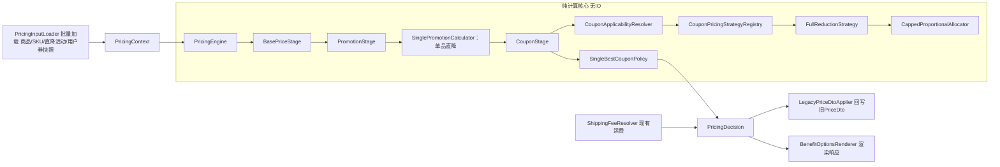
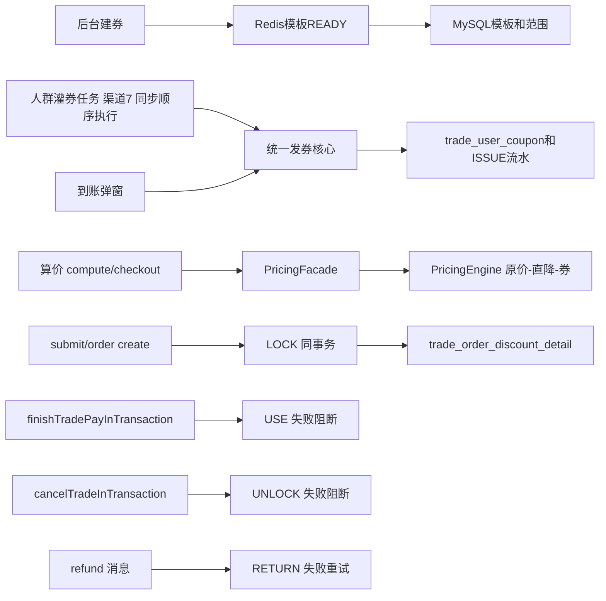

# 优惠券 MVP 写代码计划

## 已确认的口径
- 不做 `trade_coupon_stock` 和 `trade_coupon_expire_notify`：建券只写模板表和范围表；`totalStock` 非空时返回 `COUPON_STOCK_LIMIT_NOT_SUPPORTED`；不加 `stock_counted` 字段，也不做 `used_count` 统计任务。
- 用户券表 MVP 只建 1 张物理表 `trade_user_coupon`。代码里保留 `UserCouponTableRouter` 抽象（固定返回 0 号表），`couponId = (seq << 3) | shardNo`，低 3 位照样预留。预留低位不等于已经能无损扩分表：以后扩分表时，需要单独出存量数据迁移和旧 ID 路由兼容方案，本期不做。
- 删除库存表和单分表这两项简化，需要同步更新 `coupon-tables-ddl.sql` 和技术设计文档。前提是本期没有依赖实时发放数、核销数的后台功能；以后要统计，基于流水表建设。
- 核销（USE）和解锁（UNLOCK）放进现有事务里做条件更新，影响行数不符合预期就抛异常、回滚并告警（阻断）。
- 返券（RETURN）由独立消费组消费 `trade_order_change:refund`，在退款提交后判断该券关联的子单是否全部退款成功；失败返回 `RECONSUME_LATER` 重试，并告警。
- 编码节奏：先写框架抽象（阶段 0），你 review 后再逐阶段写实现，每阶段结束停下来给你看。

## 代码落点（沿用购物车模块的分层）
- Controller：`trade-order-api/.../business/controller/couponv1/`，C 端用 `CouponV1Controller`（`/coupon/v1/*`），后台用 `CouponV1InternalController`（`/internal/coupon/v1/*`）。
- 对外 DTO：`trade-order-client/.../dto/couponv1/`。
- 内部 Client：参考 `ProductInnerController`，拆分 `CouponV1InternalReadClient`（任务详情）和 `CouponV1InternalWriteClient`（建券、作废、同步灌券）；Controller 实现接口，方法和 DTO 字段注释注明 HTTP 路径、Path/Body 参数及返回字段，类注释提供新人券、人群灌券两套完整调用示例。
- 业务代码：`trade-order-service/.../business/couponv1/`，下分 `entity`、`repository/mapper`、`repository`、`service`、`pricing`、`support`、`enums`。
- 旧的 `business/coupon`、`trade_coupons` 和 `/coupon/*` 一律不动，也不调用。

## 代码质量约定（全模块适用）
- 一个类只做一件事。Service 只负责编排流程，不放算法；算法放在不依赖 IO 的独立组件或工具类里。
- 分支收敛：按券类型、选择模式、不可用原因的分支，只出现在策略或注册表里，业务代码不写 `if (discountType == 2)` 这类判断。
- 模型不可变：引擎内部的值对象用 `@Value`/`@Builder`（或 final 字段加构造器），不用可变 DTO 在层之间传递。新代码与旧 DTO（`PriceDto`、`DiscountDto`、`OrderProductResponse`）之间只在适配层转换。
- 命名用业务语言：`couponBase`、`deductible`、`allocation`、`quote`、`decision`，不用 `tmp`/`data`/`info`。
- 方法尽量不超过 40 行，嵌套不超过 3 层，提早返回。
- 注释只写约束和原因（例如“商品行和子单允许 0 元、整笔交易支付至少 0.01 元”“到账弹窗和算价模板缓存 miss 不回源，算价读取用户券资产后 MGET 模板 Redis”），不复述代码。日志统一带 `tradeId`/`couponId`/`userId`；关键链路用 Spring `StopWatch` 记录耗时。
- 不写内联全限定类名，统一 import；`StringUtils` 用 Spring 的。
- Spring Bean 依赖统一用字段注入 `@Autowired`，不用构造器注入，也不用 `@RequiredArgsConstructor`。需要事务自调用时，沿用仓库现有的 `@Autowired @Lazy self` 写法。
- 读取依赖先批量加载，避免在循环内重复查询 RPC、Redis、DB；人群灌券按确认的同步 for 循环逐用户写入独立事务，不引入多线程。

## 价格引擎设计（`business/couponv1/pricing`）

新链路的商品价格完全由本引擎计算，按层执行：原价 → 单品直降（channel=9）→ 优惠券。运费不进引擎，仍复用现有 `ShippingFeeResolver`。

整体分三层：核心引擎只做计算、没有 IO；IO 只放在加载器里；和旧 DTO 打交道的代码只放在适配层。

**接入范围**
- 不做新旧链路路由：所有算价入口都走新引擎，不区分 app（包括造物相机）、不加开关、不看请求字段。
- 覆盖范围：`/price/compute`、`/order/create`（含预下单 `/product/detail`）、`/trade/checkout`、`/trade/submit`、`/cart/list`，以及商品详情、商城列表、社区搜索的价格字段（`discountPrice`、`promotionChannel`、`promotionChannelInfo`）。阶段 4 的第一步是盘点所有调用 `PriceService`、`PriceStrategy`、`PricingService`、`MarketingExtService.batchProductListDiscount` 的地方（包括内部接口、第三方订单、定制等），列成清单交给你确认后再逐个切换。
- 原价沿用现有取价逻辑，引擎只替换优惠计算。
- 众筹商品保持现有逻辑：继续走 `PriceStrategy` 的 `crowdfundingPrice` 分支，不进新优惠引擎，不计算单品直降或优惠券。具体做法：
  - `PricingFacade` 在入口按商品类型分流，众筹商品直接保留现有结果；混合交易只对普通商品行计算新优惠。
  - 商品详情、列表、搜索不给众筹商品返回新券标签；众筹商品的历史展示字段和原价格逻辑不改。
  - 券的可用性规则加一条 `ProductTypeRule`：众筹行不进入新优惠计算；全店券仍可配置，但不会改变众筹行价格。
  - 建券不增加众筹商品类型限制，避免改动既有商品范围校验。
  - 购物车提交已有的众筹商品校验保持不变。
- `couponSelection` 按技术设计保留（`AUTO`/`SPECIFIED`/`NONE`），只表达选券意图。不传时按 `AUTO` 处理；只传了非空 `couponIds` 却没传 `couponSelection`，按设计返回参数错误。
- 下游和子线程不读请求上下文（`AuthContext`），需要的用户、租户信息在请求入口取一次，作为参数往下传。
- 新链路不调用 `MarketingService.getDiscountV2`、`getBoxDiscount`，也不调用通用历史优惠编排。新人价、想要折扣、端盒折扣等非 channel=9 的优惠在新链路里不生效。
- 历史优惠逻辑不做兼容：新引擎只计算单品直降和新券，不读取任何历史营销结果。运费仍复用 `ShippingFeeResolver`（模板、地址、拼箱、行级分摊），但不传入营销折扣，所以 `WANTIT_AUTHOR` 免邮也不再生效。

**模型（`pricing/model`，不可变，金额内部统一用 long 分）**
- `Cents`：分与 `BigDecimal` 的互转，以及求和、比较。只在边界做转换，引擎内部不出现 `BigDecimal`。
- `PricingLine`：`lineId`（即 skuId）、`cartItemId`、`productId`、`quantity`、`saleMode`、`originalUnitCents`。
- `PricingLedger`：逐层记账的账本，记录每行、每件在每一层后的剩余金额，以及各层的优惠明细 `DiscountEntry`（层、来源 ID、件级金额）。各层只读上一层的剩余金额并追加明细，不改前面层的结果，所以账本可以还原整个计算过程。
- `PromotionRule`：某个促销活动在某个 SKU 上的规则（`promotionType`、`activityId`、优惠方式、优惠值）。MVP 只有 `SINGLE_PROMOTION`（channel=9）。
- `PromotionOffer`：单品直降在某一行上的报价（件级优惠金额）。MVP 只有这一种促销，不建促销组合模型。
- `CouponCandidate`：用户券表提供资产状态和金额有效期，模板 Redis 提供范围与 `stackable/stack_layer/funder`；模板 miss 时标记为不可用。MVP 一笔交易最多选择一张券。
- `PricingContext`：行列表、促销规则、候选券、选择意图（`CouponSelection` 加 `couponIds`）、整单运费（只用于比较最终应付）。
- `CouponQuote`：`couponId`、`combinationMode`、`discountCents`、`List<LineAllocation>`；`LineAllocation` 内含 `List<UnitAllocation>`。
- `CouponEvaluation`：一张券的评估结果，要么可用（带 `CouponQuote`），要么不可用（带 `UnavailableReason`）。
- `PricingDecision`：最终账本、选中的报价（可为空）、全部评估结果、`selectedBenefitType`。

**核心组件（`pricing/engine`，不依赖 IO，以后补单测时可用 Mockito `@InjectMocks` 组装）**
- 引擎、各层、可用性解析、策略、选择器都注册为 `@Component`，彼此之间用 `@Autowired` 注入。层通过 `@Autowired List<PricingStage>` 收集并按 `order()` 排序；优惠券策略注册表通过 `@Autowired List<CouponPricingStrategy>` 收集。
- `Cents` 和 `CappedProportionalAllocator` 是无状态的纯函数，写成 `final` 工具类加静态方法，不注册为 Bean。
- `PricingEngine`：唯一入口 `PricingDecision price(PricingContext ctx)`。按顺序执行各层，自身不含算法细节。
- `PricingStage` 接口：`int order()` 和 `void apply(PricingContext ctx, PricingLedger ledger)`，本期仅组织原价、单品直降、优惠券三个阶段。
- `BasePriceStage`：用原价初始化账本。
- `PromotionStage`：仅读取当前有效的 channel=9 单品直降，按商品行和子单可实付 0 元，整笔交易发起支付至少 0.01 元计算并写入账本 `PROMOTION` 层；本期不设计促销互斥组、跨促销叠加或第二种促销的组合框架。
- `CouponStage`：逐张候选券生成评估结果（只读账本，不写入），交给 `SingleBestCouponPolicy` 选出最多一张券，再把分摊写进账本，明细记为券层。
- `CouponApplicabilityResolver`：决定适用行和每行的基准金额。范围匹配、有效期、模板可用性、与单品直降的兼容性按顺序检查，第一条失败就返回原因。
- `CouponPromotionCompatibilityRule`：按模板 `stackable` 判断：`stackable=1` 以促销后金额为基准；`stackable=0` 且券适用商品行存在单品直降时返回 `PROMOTION_CONFLICT`，否则以原价为基准。本期只实现单品直降冲突判断。
- `CouponPricingStrategy` 和 `CouponPricingStrategyRegistry`：策略接口只算“这张券在这些基准金额下优惠多少分”；注册表按 `DiscountType` 查找，未注册的类型返回 `COUPON_TYPE_NOT_SUPPORTED`。MVP 只有 `FullReductionStrategy`（门槛判断，再取面额和可抵扣空间的较小值）。立减、折扣以后只需新增实现并注册。
- `CappedProportionalAllocator`：通用的带上限按比例分摊。输入总额、权重、上限和稳定排序键，先按比例向下取整，达到上限的项退出，剩余部分继续按权重分配，最后的一分钱尾差按排序键补齐，保证合计守恒。行级和件级共用这一个分摊器，上限等于对应商品基准金额，允许分摊后商品行或子单实付为 0 元。
- `SingleBestCouponPolicy`：输入可用券评估结果和选择意图，MVP 最多选 1 张。
  - AUTO 的排序规则写成一个常量 `Comparator` 链：最终应付升序、实际优惠降序、有效期结束升序、couponId 升序；最终应付相同时优先只用促销。
  - SPECIFIED 时指定券不可用，返回带原因的决策，由上层抛 `COUPON_NOT_USABLE`。NONE 时不选券。

**边界组件**
- `PricingInputLoader`：唯一做 IO 的地方，按批量方式加载商品和 SKU 原价；`SinglePromotionReadPort` 读当前有效的 channel=9 活动和 SKU 范围（复用 `ActivityQueryService` / `PromotionActivitySkuRepository` 的批量查询）；一次 SQL 读取用户券状态和规则金额；MGET 读取模板 Redis 规则、范围和叠加配置。
- `LegacyPriceDtoApplier`：把账本转换成旧 `PriceDto`。`discountList` 由引擎结果重建：直降一条 `DiscountDto`（channel=9），券一条 `DiscountDto`（`discountTag=COUPON_V1`，不填 `trueUseCoupon`），再调用 `buildPriceDto`，并把 `shippingFee` 合入。只有这个类接触旧的价格 DTO。
- `BenefitOptionsRenderer`、`PromotionLabelRenderer`、`CouponTextRenderer`：负责响应渲染，与计算解耦。
- `PricingFacade`：Spring Bean，按“加载 → 计算运费 → 引擎计算 → 回写 → 渲染”编排，并用 StopWatch 记录耗时。`/price/compute`、`/order/create`、checkout、submit、购物车列表、商品标签共用这一个入口；标签场景每个商品按 1 件独立计算。

**MVP实现边界**
- 促销层只实现单品直降；会员价、大促立减折扣、跨店促销和促销组合扩展不纳入本次计划。
- 优惠券算价保留 `CouponPricingStrategy` 注册表，MVP 只注册 `FullReductionStrategy`；立减、折扣策略后置。
- `couponIds` 保持数组协议以兼容未来扩展，但本期校验最多一个元素；不实现多券组合策略。

## 链路总览

## 阶段 0：框架抽象（只写骨架，方法体留 TODO，交给你 review）
- DDL：新增 `../../trade-order-service/src/main/resources/sql/trade_coupon_v1.sql`，包含 7 张表：模板、范围、用户券（带 `display_name`/`scope_type`/`crowd_type` 及 idx_user_crowd）、流水、发券任务、发券明细、订单分摊。上线前执行 `20261020_coupon_user_snapshot_migration.sql` 并人工确认未回填快照为 0 后，再开启新人终身限领，避免历史新人券漏判。
- 实体、Mapper、Repository：MyBatis-Plus，写法对齐 `CartEntity`/`CartRepository`。
- 枚举：`CouponIssueChannel`（1～5 默认全部用户、6 人群惊喜券仅新人、7 人群灌券） 、`DiscountType`、`ValidType`、`CrowdType`、`AudienceType`、`UserCouponStatus`、`CouponAction`、`CouponSelection`、`UnavailableReason`。
- 错误码：`CouponErrorCode`。另外新增一个携带 `data` 的异常，用来在 `COUPON_NOT_USABLE` 时返回 `benefitOptions`，需要在 `GlobalExceptionHandler2` 里接住。
- 核心接口：
  - 模板：`CouponTemplateService`、`CouponTemplateCache`（Redis 模板和人群索引）
  - 发券：`CouponIssueService`（统一发券核心）、`CouponIssueTaskService`、`ArrivalPopupService`
  - 用户券：`UserCouponQueryService`（列表、历史）、`UserCouponStateService`（lock/unlock/use/return）
  - 算价：按“价格引擎设计”一节建好模型、原价/单品直降/券三个层、满减策略注册表、单券择优、分摊器、`PricingInputLoader`、`SinglePromotionReadPort`、`LegacyPriceDtoApplier`、`PricingFacade` 的骨架
  - 促销和订单：`SinglePromotionReadPort`（只读 channel=9）、`CouponOrderAllocationService`
  - 基础设施：`CouponIdGenerator`（基于 `GlobalIdGeneratorUtil.generatorId` 左移 3 位）、`UserCouponTableRouter`、`CouponRequestNoBuilder`（`I:/L:/U:/S:/R:` 前缀加 sha256 截断，不超过 64 字节）、`CouponAlarmSupport`（封装 `AlarmManager`）
- 协议 DTO：请求加 `couponSelection` 和 `couponIds`；响应加 `couponIds`、`BenefitOptions`、`CouponOption`、`PromotionLabel`；`AggPriceInfo` 增加券项扩展字段。 `PromotionLabel` 和 `AggPriceInfo` 的券项统一增加可空 `String cannotJumpText`，与券卡片共用跳转协议；促销标签该字段为 `null`。
- 券卡片 DTO：`CouponHistoryItem` 复用 `CouponListItem` 的同名字段和快照映射，统一通过 `validEndTime` 返回结束时间，补齐类型、金额与有效期字段；不向列表/历史新增 `discountRate`，折扣文案沿用 `discountText`。`CouponOption.selected` 从 `selectedCouponIds` 映射。列表、历史、到账弹窗和候选卡片共用 `isVoidTime`：仅 UNUSED、处于有效期且剩余不超过 24 小时（含边界）为 true，其余为 false。`cannotJumpText` 由 `CouponJumpResolver` 统一生成。指定范围去重后只有一个商品时才查上架/未删除状态：正常跳 `/product/query?productId=...`；下架/不存在返回“商品已下架或不存在，暂时无法跳转”及 `jumpUrl=null`。多商品/全店直接跳 `/coupon/v1/list`，不查商品/SKU/库存。依赖异常降级通用入口，不回滚发券、不改变券状态。订单实际优惠该字段固定 null。
- 存量快照迁移：`20261020_coupon_user_snapshot_migration.sql` 可重复执行，补三字段和索引，按 tenant+template 仅回填空值；无法关联的历史券人工核对，不默认 crowd_type=0。迁移完成后启用新人终身判断。

## 阶段 1：后台建券和作废
- `POST /internal/coupon/v1/templates`：
  - 参数校验：只允许满减；领取窗口不超过 180 天；三种 `validType`；渠道 1～5 省略 `audienceType` 时默认 ALL_USER，拒绝新人和注册天数；渠道 6 只接受 NEW_USER 且注册天数为正；渠道 7 不配置人群；`scopeType=1`（指定商品）时 `scopeItemIds` 去重后必须是 1 到 100 个，并批量校验上架状态；`scopeType=2`（全店）时不传范围明细、不写范围表；`totalStock` 必须为 null；`issueChannel=7` 禁传 audienceType（含空串）及 registerWithinDays，crowd_type=0 占位，其他校验不变。
  - 写入顺序：先 Redis（模板键按 `cacheExpireAt` 设置 TTL，人群索引 `SADD` 后由 Lua 比较过期时间，仅在需要延长时执行 `PEXPIREAT`），渠道 1～5 写 all 索引、渠道 6 写 new 索引、渠道 7 只保留完整模板键；再 MySQL 本地事务写模板和范围。MySQL 失败时删除 Redis 键，删除失败就告警。
- `POST /internal/coupon/v1/templates/{id}/void`：更新状态后 `DEL` 模板键并 `SREM` 人群索引。
- 到账弹窗运行时读模板只读 Redis，miss 时返回 `COUPON_TEMPLATE_UNAVAILABLE`，不回源 MySQL；算价、可用性和标签读取 `trade_user_coupon` 的资产/金额字段，并 MGET 模板 Redis 的范围、作废状态和叠加规则，缓存 miss 标记券不可用，不回源 MySQL。

## 阶段 2：发券
- 统一核心 `CouponIssueService`：幂等批量回读，正常批量事务原子写用户券+ISSUE；遇重复键整个批次回滚，逐命令 REQUIRES_NEW 重试。回读到原券为 REPLAYED，新增为 CREATED，真实失败为 FAILED 并继续余项；不能在 rollback-only 事务内继续，也不能把失败当成功。
- 资产写规则及 display_name/scope_type/crowd_type 最小快照；crowd_type 仅服务端新人历史，不对 C 端返回；商品范围和叠加规则不复制到用户券。
- 运营任务只接受渠道 7，名单去空/去重最多 100 人，不配置人群、不查注册时间；仍校验 READY、领取窗口、有效期、每人限领及请求幂等，source_type=2，备注“人群灌券任务:{taskId}”。渠道 6 仅由到账弹窗自动领取，不能创建发券任务。
- 任务写库后在当前请求内按名单顺序 for 循环执行，不使用线程池或异步执行器；先批量读用户已有券，每用户独立事务写入。重复键跳过/幂等成功，真实失败只更新当前明细，继续其他人。运营后台提供任务创建、分页列表、详情和“重试全部失败用户”接口；详情一次性返回最多 100 个用户 ID 及逐用户结果。重试只重置失败明细，成功用户不重复发券，并复用原 requestNo 保证幂等。整体异常时告警并可能保留 PROCESSING，不代表有后台线程继续执行。
- 到账弹窗仅 `POST /coupon/v1/arrival-popup`，无确认、游标或批次缓存；统一发券核心将新券标记为待弹窗，运营券和自动券由接口统一读取并消费：
  - SMEMBERS all/new + MGET 批量模板，显式校验渠道与人群组合：1～5 必须全部用户，6 必须新人，7 即使脏索引残留也跳过；弹窗模板 miss 不回源。
  - 批量查候选已有券，符合条件的普通券全部尝试发放。
  - 新人终身历史按 tenant_id/user_id/crowd_type=1 LIMIT1 直接查库，不限模板、状态或有效期。锁前/锁内各查一次；候选按最大 templateId 选择最新分配的模板，不按面额/领取截止择优。全局发号器正常运行时按发号顺序递增，不等同于并发事务提交顺序；Redis 快照不新增 createTime，MySQL 审计时间保留。新人自动请求号不含模板ID，Redis锁失效仍由数据库唯一键兜底。
  - 注册时间通过 UserRegisterTimeReader 批量查询本地 biz_user.create_time，仅未领过且有新人模板时读取；不虚构用户中心 RPC。
  - 待弹窗券新人优先，其余按领取时间升序，消费本次全部待弹窗券并最多返回 3 张；couponCount是本次待弹窗总数，remainingCount仅提示去列表查看。重复发券产生的REPLAYED不产生新待弹窗券；响应丢失不重放弹窗，资产从列表查询。
- 人群灌券模板 C 端不能发现/领取；已发到用户的券正常参与列表、历史、报价、锁定和核销。

## 阶段 3：C 端券资产
- `/coupon/v1/list` 从用户券快照读有效未使用券，valid_end_time ASC、discount_value DESC、coupon_id ASC 后分页。
- `/coupon/v1/history` 一次查该用户全部券，内存推导 EXPIRED、状态筛选，再 valid_end_time DESC、coupon_id DESC 分页；validEndTime取用户券有效期结束，不按核销/商品下架时间改排序。单用户数量超阈值告警，不截断。
- 名称、门槛/优惠/范围文案来自用户券，不读模板表/Redis。crowd_type用于新人历史判断，不展示。
- CouponJumpResolver 在分页后只对有效期内 UNUSED/LOCKED 指定商品券批量读持久化范围；去重后恰好单商品才批量查已上架且未删除状态，普通/盲盒同规则。上架跳详情；下架/不存在返回 cannotJumpText=“商品已下架或不存在，暂时无法跳转”、jumpUrl=null。
- 多商品/全店、USED/EXPIRED、订单实际优惠明细不查商品，返回通用列表入口/null文案。依赖失败/范围缺失也降级通用入口，不虚报下架。商品上下架不改变券状态；持久化范围不随模板TTL清理。到账弹窗复用，补充失败不回滚发券。

## 阶段 4：算价
- 先实现纯计算核心，再替换现有算价入口：`Cents`、`CappedProportionalAllocator`、`PricingLedger`、`BasePriceStage`、`PromotionStage`、`SinglePromotionCalculator`、`CouponStage`、`CouponApplicabilityResolver`、`CouponPromotionCompatibilityRule`、`FullReductionStrategy`、`SingleBestCouponPolicy`、`PricingEngine`。
- 规则：
  - 适用行合计达到门槛后，优惠只扣一次。
  - 先分到行再分到件，商品行和子单可实付 0 元，整笔交易发起支付至少 0.01 元，尾差按 skuId 稳定顺序分配。
  - `stackable=0` 且适用行有直降时，返回 `PROMOTION_CONFLICT`。
  - AUTO 和 SPECIFIED 的行为按“价格引擎设计”一节执行。
- 接入点：新链路由 `PricingFacade` 统一计算商品价格，运费仍走 `ShippingFeeResolver`，`LegacyPriceDtoApplier` 回写旧 `PriceDto`。券不参与免邮判断，也不改运费。
  - 直接购买：`PriceStrategy.getPrice` / `PriceService`。
  - 购物车：`BatchSkuPriceTradeAdapter.quote` 返回之后。
- `/price/compute` 和 `/trade/checkout` 返回 `couponIds` 与 `benefitOptions`，`aggPriceInfoList` 渲染券项。
- `CouponOption.cannotJumpText` 复用单商品跳转规则，读取 `trade_coupon_scope`，不额外读取模板 Redis；算价链路单独 MGET 模板 Redis；多商品/全店不查商品。门槛/促销冲突等仍由 reasonCode 表达，不能生成下架文案。
- `PreTradeSnapshot` 扩展：`resolvedCouponId`、选择模式、价格和运费指纹、地址，以及行级、件级分摊。

## 阶段 5：下单锁券和订单分摊
- 购物车提交：在 `TradeSubmitService.submitInTransaction` 里核对快照，在同一事务内 LOCK（条件 `status=1` 且在有效期内，`order_id=tradeId`）、创建主单和子单、写分摊明细，任一失败整体回滚。
- 直接购买：在 `OrderService.createOrder` 事务里实时重算后 LOCK；用 `tenantId+userId+token` 做建单去重，重复的成功请求返回原 `orderId/tradeId`。
- 盲盒：改写 `validProductBasic` 里多件盲盒的限购守卫；`BlindBoxPerUnitSplitStrategy` 按普通商品的比例与稳定尾差规则分摊各层优惠，不偏置首件；券使用独立 `unitAmounts`，子单可实付 0 元；扩展 `assertConservation`，校验券优惠守恒。
- 子单 `Order.discountInfo` 同步记录券分摊（老接口都读这里）：
  - 写入路径：沿用 `OrderService.buildDiscount`（`OrderService.java` 约 933–994 行），购物车提交经 `TradeDiscountFiller` 进入，直接购买直接调用。券的 `DiscountDto` 已在算价阶段追加到行级 `discountList`，所以会随 `DiscountSnapshot.from` 落进 `discountInfo.discountList`。
  - 写入的值必须是该子单实际承担的分摊额。盲盒拆成单件子单后，每个子单的券 `DiscountDto.discountAmount` 改为本件的券分摊额，不能沿用整行金额。
  - `DiscountSnapshot` 只追加字段：`sourceType=COUPON_V1`、`userCouponId`（String）、`templateId`（String）、`couponName`、`unitAmounts`（件级分摊数组）。`toDiscountDto` 同步还原这些字段。
  - 新券 ID 不写入外层历史字段 `couponId`/`couponCode`，也不写入快照里的旧 `couponId`。这些字段属于旧 `trade_coupons`，`freeze`/`unFreeze` 链路和下游消费方会按旧券解释。
  - 子单 `discountAmount`/`payAmount` 已包含券优惠，与 `discountInfo` 金额一致；和 `trade_order_discount_detail` 的一致性由写入后的校验保证，不一致就回滚。
  - 兼容检查：`TradeRefundSupport`（约 319–342 行）的盲盒退款拦截按 `discountList` 渠道判断，确认券项不会被当成拦截渠道；ES `OrderIndex` 和 `ShippingTraceEventListener` 透传 `discountInfo` JSON，新增字段只追加不改结构。
- 订单详情：从子单 `discountInfo.discountList` 渲染券项（沿用 `OrderService.fillAggPriceInfoList` 加 `PromotionRenderService.buildAggPriceInfoList`，补上券项的 `sourceType`/`couponId`/文案字段），不按当前模板重新计算。 订单实际优惠明细的 `cannotJumpText=null`，使用通用 `/coupon/v1/list` 入口，不为跳转文案加载当前商品或模板。

## 阶段 6：核销、解锁、返券
- USE：在 `TradeFinishPayService.finishTradePayInTransaction` 里条件更新 `status=2→3` 并写流水。幂等命中视为成功；其余失败抛异常、回滚事务并告警。
- UNLOCK：在 `TradeCancelService.cancelTradeInTransaction` 里条件更新 `status=2→1` 并写流水。直接购买走旧接口 `OrderService.cancelOrder` 时，只要订单挂了主单，也要接入；失败同样阻断并告警。
- RETURN：在 `trade-order-job` 新建独立消费组 `GID_coupon_return_group`，订阅 `trade_order_change:refund`。
  - 按子单查出 tradeId 和 couponId，再拿到关联子单集合 S。
  - 以成功退款事实（`trade_refund` 状态为 COMPLETED，且金额全额）判断 S 是否全退；全退则在 tradeId 锁内条件更新 `status=3→1` 并写流水，同时按事实重新覆盖 `refunded_amount`。
  - 失败返回 `RECONSUME_LATER` 并告警。退款消息早于核销到达时，同样进入重试。

## 阶段 7：商品与购物车展示
- 商品详情、商城列表、社区搜索、购物车列表新增 `promotionLabelList`。
- 用户券资产、模板 Redis 规则和促销数据按当前页批量读取，然后逐商品独立计算，不合并金额；同一商品最多一条最优券标签，单品直降排在优先位置。券标签的 `cannotJumpText` 与券卡片共用可售结果，非空时前端提示并停止跳转，促销标签固定为 `null`。未登录时不返回券标签。
- 购物车列表按勾选商品做 AUTO 预估，把优惠回填到行价，`priceSummary` 不新增字段。
- 商详/商城/搜索/推荐/定制及模型入口各 SKU 按数量 1 独立 AUTO 报价，直接回填实付单价和总优惠；不跨规格凑门槛，不按标签重算金额。依赖批量加载，用户价只回填请求副本。
- 商详 `productDetail` 继续保留老字段，并回填当前 SKU 首标签文案；有促销时首标签沿用原促销渲染话术，纯券时回填券标签。`productDetails` 重建为直降、全部已达门槛券、仅未达门槛券规则，trim 并保序去重；展示多券不代表同时使用多张。报价后选择默认 SKU 和顶层单券标签。

## 阶段 8：收尾
- 本轮补定向回归测试：1～5 全部用户/6 仅新人/7 仅任务的校验及索引、渠道6禁止任务、任务同步顺序执行、新人最大模板ID择优及展示置顶、历史与无确认弹窗、全量发放但最多展示3张、重复键回滚后逐项继续及真实失败、单商品跳转与多商品/全店无商品IO。执行相关服务测试和API编译；不将未执行的数据库迁移标记为已发布。
- 告警：统一通过 `CouponAlarmSupport` 调用现有 `AlarmManager` 发送，告警内容带 `tradeId`/`couponId`/`templateId`/`taskId`。覆盖的场景：
  - 模板写入：Redis 成功但 MySQL 失败，且回删 Redis 也失败（产生孤儿模板缓存）。
  - 到账弹窗运行时读模板时 Redis miss。
  - 发券任务执行异常（捕获后告警，保留 PROCESSING，由人工处理）。进程直接退出可能来不及发告警，上线需检查未完成任务。
  - 锁券、核销、解锁、返券失败。
  - 单个用户券数超过阈值。
- 本期不做任何恢复和巡检 Job（发券任务恢复、孤儿模板清理、卡住锁券修复、对账），全部靠告警后人工处理。CSV 导入、失败用户分页查询/导出、限量库存、立减和折扣策略也不做；失败用户重试通过任务详情和统一重试接口完成。

## 需要你在 review 时留意的点
- 旧优惠的冻结、核销、解冻代码（`priceService.freeze`/`use`/`unFreeze`）不删也不改，新单不会再进入这些链路。
- 没有开关意味着出问题时不能通过配置回退到老算价，只能回滚发版。
- 核销阻断意味着：券状态异常时，已收款的完付会回滚，靠支付回调重试和人工处理告警兜底。
- 算价复用 `discountList` 承载券优惠，这样主单、子单金额和拆单守恒都不用另起一套；`trade_order_discount_detail` 作为退款和审计的事实表。
- 券分摊写两处：子单 `Order.discountInfo`（老接口、订单详情、下游消费方读这里）和 `trade_order_discount_detail`（返券和审计读这里），两者在同一事务里由同一份分摊结果生成。
- 设计里价格响应的 `PriceDto.couponId` 会返回新券 ID，但它会经 `OrderProductResponse.couponId` 流进 `discountInfo` 外层的旧 `couponId`。计划在建单时显式隔离：外层旧字段只放旧券，新券信息只写在 `discountList` 的券项里，不新增外层摘要字段。

## 本轮修订验收（2026-10-21）
- 渠道1～5省略人群默认全部用户，拒绝新人和注册窗口；渠道6只接受新人和注册窗口；渠道7缺失/null人群成功，传人群/空串/注册天数失败。
- 渠道1～5进入all索引，渠道6进入new索引，渠道7不进入任何人群索引，弹窗对脏索引也过滤。
- 任务只接受渠道7，同步顺序执行，不校验人群，保留时间、限领、幂等；单用户失败继续其他人，到账券C端可见可用。
- 老模板/已使用/已过期新人券仍阻止再领；稳定新人请求号不含模板；多个新人模板按最大templateId选一张并在展示截断前置顶。
- 弹窗无确认和游标；只计CREATED，全部符合条件尽可能发放，展示最多3，重放不展示。
- 单商品下架提示；多商品/全店不查商品；依赖失败不虚报、不回滚资产。
- 用户券快照迁移完成并校验空值后上线；不改变已有列表/历史排序及状态机。
