# 优惠券技术设计 V3

> 文档状态：设计与实现同步修订（2026-10-21）
>
> 适用范围：造好物优惠券 V3，面向运营后台、用户端商品详情/购物车/提单页/订单页。
>
> 代码基线：当前 `order-java` 项目。本轮同步落地到账弹窗、用户券快照、发券幂等和人群灌券修订；其他章节保留既有设计边界。

> 排期评估说明：第八章按本轮确认的 MVP 范围重新估算；正文标为“后续/后置”的能力是本次排期建议，不代表产品已确认删除。当前基线包含盲盒按件拆单、商城列表/社区搜索券摘要、购物车列表展示和 C 端历史券查询。

> 2026-10-18 业务口径确认：一个交易单最多使用一张券；一个商品有多张可用券时按最终应付最低、实际优惠最高、有效期最早、couponId 最小择优；MVP 仅满减按该券的全部适用商品合计计算，再分摊到订单行和件；立减、折扣仅保留策略扩展位；商品行和子单允许实付 0 元，整笔交易发起支付时至少 0.01 元；普通商品多件不拆单，盲盒多件按件拆单；该券关联的优惠子订单全部成功退款后返券，其他子订单无需退款；保留系统自动发新人券。

## 一、需求背景

### 1.1 需求简介

目前运营后台已有新人价、单品直降等活动价能力，缺少优惠券的创建、自动领券、灌券、使用和核销闭环。本期建设一套独立的优惠券能力，优先支持新人优惠券和人群灌券，并通过版本化接口为后续券型扩展保留空间。

整体链路如下：

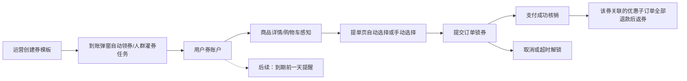

本期边界：

1. 优惠券服务提供领券能力，但本期用户端不主动点击领取；渠道 1～5 的全部用户券、渠道 6 的新人券在自动领券弹窗触达时执行领券，渠道 7 由运营发券任务按名单灌券，均直接生成用户券。盲盒商品同样走该领券与用券链路。
2. 单笔交易最多使用一张优惠券。
3. 商品侧已有优惠只接入单品直降（`PromotionChannel.SINGLE_PROMOTION_ACTIVITY = 9`）；新人价、端盒折扣和其他历史优惠不属于本期优惠券计算输入。历史接口和历史数据保持现状，不改代码、不由新优惠券链路调用。
4. 优惠券与单品直降是否叠加由券模板已有的 `stackable` 控制，不新增字段：`stackable=1` 时先单品直降、再计算优惠券；`stackable=0` 时只要券适用商品行存在单品直降，该券即不可用，返回 `PROMOTION_CONFLICT`，不移除促销、不静默换券。券适用范围外的商品促销不影响该券。实现时通过独立的单品直降读取端口取得 `channel=9` 结果，入口即拒绝其他渠道，不调用通用历史优惠编排再过滤结果。优惠券规则通过可扩展算价策略抽象；MVP 只启用满减（`discount_type=2`），立减和折扣保留协议枚举与扩展位，但创建/发布时返回“当前版本不支持”。
5. 对外已有价格字段保持兼容：`payPrice`、`discount`、`productPayPrice`、`unitPayPrice`、`couponId`、`couponCode`、`promotionText`、`aggPriceInfoList` 等字段不改名、不改变原有含义。

这里的“忽略其他历史优惠”只约束新接入路径：新适配器不调用旧优惠服务、旧优惠券接口、通用历史优惠策略，也不读取或叠加它们的结果。未接入 MVP 的原有接口继续按当前代码返回，避免影响旧调用方；当新券开关关闭时，价格字段和历史计算结果完全按现状返回。

### 1.2 产品需求映射

| 产品能力 | MVP 技术方案 |
|---|---|
| 优惠券创建 | 后台创建模板、配置不限量发放和指定商品范围；模板创建后不可编辑关键金额规则 |
| 促销叠加 | 复用模板 `stackable`：默认 `true`，单品直降后再用券；配置为 `false` 时，券适用行存在单品直降则券不可用，服务端返回冲突原因；无冲突时参与单券择优 |
| 人群灌券 | MVP 输入去重后的用户 ID，最多 100 人；创建任务后在当前请求内顺序执行；后台支持任务分页列表、详情一次性返回全部用户结果和重试全部失败用户；CSV 导入、失败导出后置 |
| 新用户券 | 对符合注册时间窗口的新用户，在到账弹窗触达时自动发券；同一用户最多成功领取一张新人券 |
| 商品详情/购物车 | 商品详情、商城列表、社区搜索和购物车列表的展示标签使用新增 `promotionLabelList`，价格优惠明细继续使用 `aggPriceInfoList`，优惠券列表/领券仍使用 Coupon V1 的券卡片接口 |
| C 端优惠券列表与历史 | `/coupon/v1/list` 按有效期结束时间升序、同到期时间优惠价值降序；`/coupon/v1/history` 按用户券有效期结束时间降序，最近失效的在前；均按状态机筛选并分页，只读，不触发状态变更 |
| 券范围内暂无可售商品 | 券卡片新增 `cannotJumpText`；单商品范围且商品下架或不存在时返回面向用户的提示，前端判断文案非空后提示，不改变券状态或列表归属 |
| 提单页 | 按全部适用商品合计试算，自动比较促销候选和每张券候选的最终应付金额；支持切换其他可用券或选择不使用 |
| 下单 | 提交订单创建交易时锁券，并重新校验券、价格、商品状态 |
| 支付/取消 | 支付成功核销；取消或超时解锁，保留原有效期 |
| 退款 | 该券关联的优惠子订单全部成功退款后返券，未使用该券的子订单无需退款；仅退部分关联子订单时不返券 |
| 临期提醒 | 后续能力：到期前一天 10:00 扫描次日到期券，同一用户合并发送短信和站内信；不计入 MVP 排期 |

### 1.3 V3 UI 与页面交互映射

V3 设计稿中的页面交互按以下方式落到服务端。页面展示由客户端控制，服务端只返回可计算、可展示的券数据和既有价格字段。

| V3 页面 | 页面行为 | 服务端接口和约束 |
|---|---|---|
| 运营后台-创建优惠券 | 先选择优惠方式，再选择发放量、每人限领和商品范围；渠道 6 配置新人窗口，渠道 7 不配置人群 | `POST /internal/coupon/v1/templates`；渠道 1～5 默认全部用户，渠道 6 仅新人，渠道 7 由发券任务名单决定；字段映射到既有 DDL |
| 自动领券弹窗 | 页面在指定时机触发，展示本次新到账券 | `POST /coupon/v1/arrival-popup`；服务端执行系统领券，一次返回本次新领取结果；弹窗频控由客户端处理 |
| 商品详情 | 展示商品优惠和券候选提示，不在详情页锁券 | 改造现有 `GET /product/query`（对外为 `GET /aigc/trade/product/query`），新增 `promotionLabelList`；各 SKU 数量 1 独立 AUTO 报价，沿用现有价格字段回填最终实付和总优惠，`productDetail` 保留促销层话术 |
| 商城列表/社区搜索 | 本期支持全部优惠摘要和跳转，不锁券 | 改造现有 `/product/list`、`/product/search`，按批量商品集合读取优惠数据后逐商品计算，组装商品 `promotionLabelList`；`aggPriceInfoList` 仍保留为历史/价格明细字段，禁止逐商品远程调用券服务 |
| 购物车 | 勾选商品后按整笔交易试算一张券 | `POST /trade/checkout`；券选择放请求根节点，适用商品统一计算 |
| 提单页 | 单品直降与优惠券分栏；切换券或“不使用”后重新计算 | `/price/compute` 或 `/trade/checkout` 传 `couponSelection`；一笔交易最多一张券 |
| 订单详情 | 展示实际子订单承担的优惠金额 | 读取 `trade_order_discount_detail`，按真实 `order_id` 和 `line_id` 展示，不重新计算券规则 |

后台只有选择渠道 6 人群惊喜券时才配置新人选项；渠道 1～5 页面不展示人群选择，默认全部用户；渠道 7 为人群灌券，不配置人群，存储仍复用现有字段：

| 后台选项 | `audienceType` | 存储映射 | 领取入口 |
|---|---|---|---|
| 全部用户 | `ALL_USER` | `crowd_type=0` | 渠道 1～5 自动领券弹窗 |
| 新人 | `NEW_USER` | `crowd_type=1`，`register_within_days` 必填 | 渠道 6 自动领券弹窗，领取时校验注册时间 |
| 人群灌券 | 不传 `audienceType` | `issue_channel=7`，`crowd_type=0` 兼容占位 | 运营发券任务按名单同步发放 |

`audienceType` 不新增数据库列；服务端创建模板时将其转换为 `crowd_type`。渠道 1～5 不展示人群选择，省略 `audienceType` 时按 `ALL_USER` 写入 `crowd_type=0`；渠道 6 只接受 `NEW_USER`，并写入 `crowd_type=1`；渠道 7 不配置人群，`audienceType` 必须缺失或为 `null`，`registerWithinDays` 必须为 `null`，任务名单即最终发放对象。渠道 1～5 进入全部用户索引，渠道 6 进入新人索引，渠道 7 不进入任何 C 端模板索引。渠道 7 模板不能被 C 端发现或领取，已到账资产正常可见、可用。新逻辑中的系统自动领券沿用 `source_type=1`，人群灌券任务使用 `source_type=2`，历史主动领券链路仍与新表和新路由隔离。

### 1.4 优惠券与促销叠加规则

本期“促销”只指单品直降（`PromotionChannel.SINGLE_PROMOTION_ACTIVITY = 9`）。优惠券模板的 `stackable` 是唯一的叠加开关，不代表一笔交易可以使用多张券。一个商品有多张候选券时，`AUTO` 按“最终应付金额最低 → 实际优惠金额最高 → 有效期结束时间最早 → `couponId` 最小”排序，只返回并使用一张券。

| `stackable` | 规则 | 计算规则 | 订单明细 |
|---|---|---|---|
| `1` | 可叠加 | 先计算单品直降，再以直降后金额判断券门槛并计算券优惠；券优惠在全部适用商品间按行/件分摊 | 同一行可有 `PROMOTION` 和券层两条明细 |
| `0` | 不可叠加 | 仅检查券适用商品行；任一适用行存在 `channel=9` 单品直降时，该券返回 `PROMOTION_CONFLICT`，不改促销、不生成互斥候选；适用范围外行的促销不影响该券 | 券不可用，不锁券 |

`SPECIFIED` 明确选券时，若券与适用行促销冲突，返回 `COUPON_NOT_STACKABLE/PROMOTION_CONFLICT`，不能静默改用促销或另一张券；门槛、最低实付或商品状态不满足时返回对应错误。无冲突的券才进入单券择优。无论是否叠加，整笔交易最多锁定、核销一张券；拆分子订单不会增加券数量。

### 1.5 参考资料和代码基线

- 产品需求：[造好物优惠券MVP.pdf](/Users/rogerswang/Downloads/造好物优惠券MVP.pdf)
- 原技术设计：[优惠券-技术设计.pdf](/Users/rogerswang/Downloads/优惠券-技术设计.pdf)
- 最新技术设计与 UI：[优惠券-技术设计-V3.pdf](/Users/rogerswang/Downloads/优惠券-技术设计-V3.pdf)
- E-R：[coupon-er.md](/Users/rogerswang/my/work/jjewelry/order-java/docs/coupon-er.md)、[coupon-er.puml](/Users/rogerswang/my/work/jjewelry/order-java/docs/coupon-er.puml)
- DDL：[coupon-tables-ddl.sql](/Users/rogerswang/my/work/jjewelry/order-java/docs/coupon-tables-ddl.sql)
- 现有价格接口：[PriceController.java](/Users/rogerswang/my/work/jjewelry/order-java/trade-order-api/src/main/java/cn/mathmagic/jjewelry/business/controller/price/PriceController.java)
- 现有交易接口：[TradeController.java](/Users/rogerswang/my/work/jjewelry/order-java/trade-order-api/src/main/java/cn/mathmagic/jjewelry/business/controller/trade/TradeController.java)
- 直接购买接口：[OrderController.java](/Users/rogerswang/my/work/jjewelry/order-java/trade-order-api/src/main/java/cn/mathmagic/jjewelry/business/controller/order/OrderController.java)
- 现有价格返回：`PriceDto`、`PriceComputeResponse`、`OrderProductResponse`
- 现有下单请求：`OrderCreateRequest`、`OrderCreateResponse`

## 二、概要设计

### 1. 优惠券系统架构

MVP 不新拆服务，优惠券领域逻辑部署在现有 order 服务中，后台和用户端通过 API Gateway 访问。新优惠券模块使用独立表和独立缓存命名空间，与历史 `trade_coupons`、`/coupon/claim` 链路隔离。券适配器只依赖单品直降结果（`PromotionChannel.SINGLE_PROMOTION_ACTIVITY=9`），不调用历史 `CouponService`、旧 `/coupon/*` 接口或其他历史优惠策略。

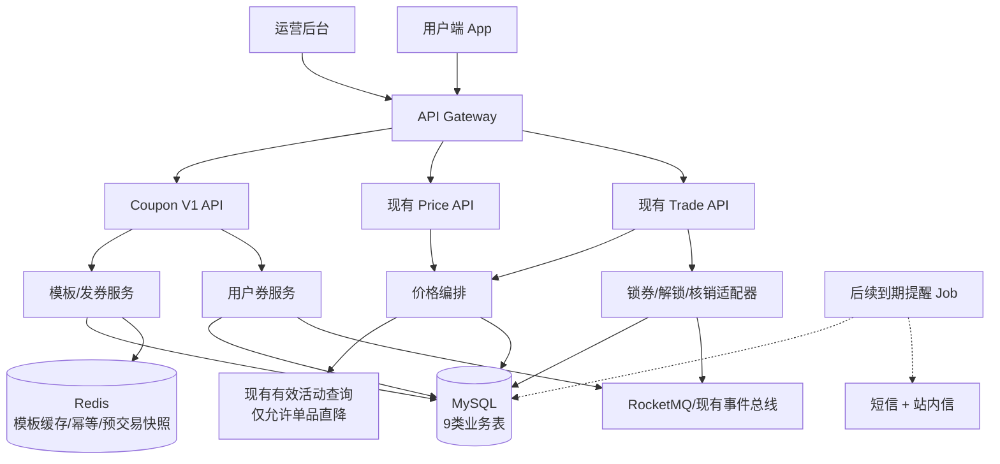

职责边界：

- `CouponTemplateService`：模板参数校验、作废、模板缓存。
- `CouponIssueService`：任务创建、名单去重、发放执行、失败重试。
- `UserCouponService`：可用券查询、自动择优、锁定、解锁、核销、返券。
- `CouponPricingAdapter`：复用现有单品直降和运费结果，仅在商品金额部分计算券优惠，输出现有价格字段。
- `CouponOrderAllocationService`：按订单行和件生成 `trade_order_discount_detail`。
- `CouponExpireNotifyJob`：后续能力，负责每日扫描并合并用户临期券、发送两种通知；不属于 MVP 上线链路。

### 2. 系统交互

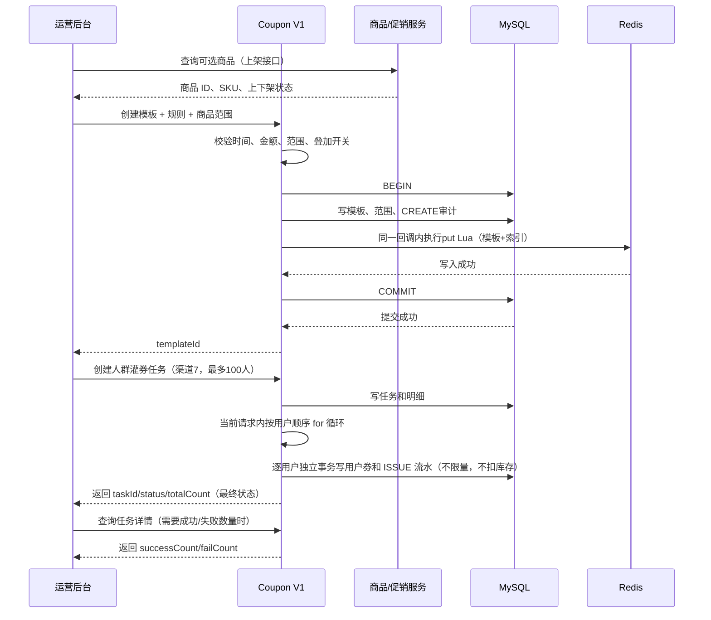

Redis 与 MySQL 不组成同一个事务，也不引入 XA、Seata 或其他分布式事务协调器。创建券在同一 MySQL 事务回调内先保存模板、范围和审计，再执行单次 Redis Lua 写入 READY 模板及对应人群索引，成功后提交 MySQL；失败记录告警，不增加缓存反向清理或补偿；本期不限量，不建库存表。到账弹窗的候选模板继续从 Redis 读取，缓存未命中跳过并记录告警，不回源。内部运营接口全部读 MySQL；用户券到账后，算价、可用券判断、商品标签和订单链路从用户券表读取资产状态/金额有效期，并 MGET 模板 Redis 读取范围、叠加层级和成本承担方；模板缓存 miss 不回源 MySQL，候选标记为不可用。Redis 与 MySQL 可能短暂不一致，按告警、人工/运维重建和发布重试处理，不宣称跨资源强一致。内部运营人员可调用 `POST /internal/coupon/v1/cache/rebuild`，按指定租户或全部租户分页读取 MySQL，重建模板详情、商品范围和双 ZSET；临时索引构建完成后原子替换正式索引，失败时保留旧索引并告警。

### 3. 状态机

#### 3.1 券模板状态机

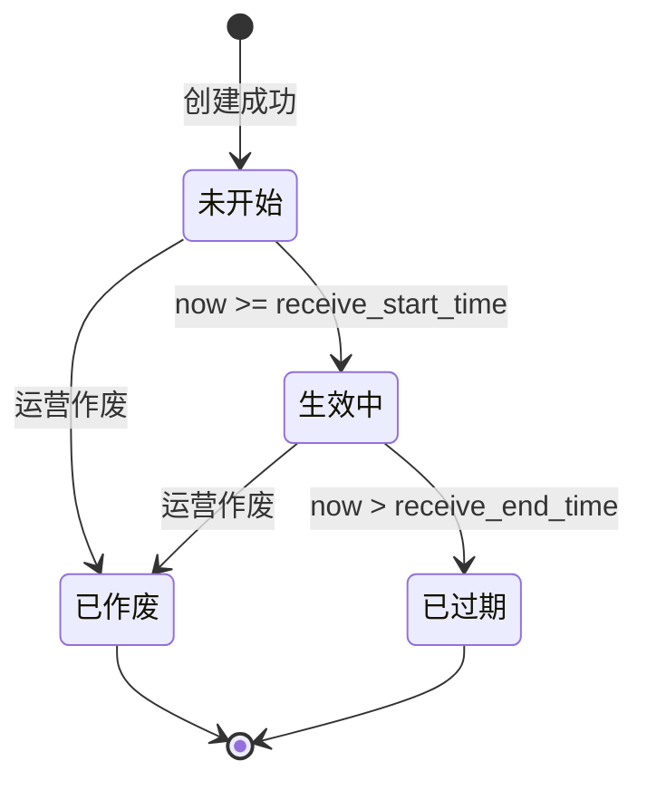

数据库仅存 `status=1 正常`、`status=2 已作废`。未开始、生效中、已过期由当前时间和领取时间推导；已过期不能作废，作废不可恢复。模板作废不影响已发出的用户券。

#### 3.2 用户券状态机

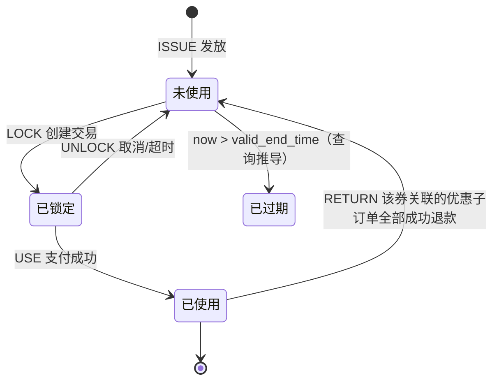

用户券表只持久化 `1 未使用`、`2 已锁定`、`3 已使用`。过期由 `status=1 && now > valid_end_time` 推导，不跑任务修改状态。锁定后才过期的券允许继续支付，避免支付阶段因时间跨界失败。返券保留原有效期，即使返还时已过期也恢复 `status=1`，查询展示为过期。

状态动作约束：`ISSUE` 只允许无用户券记录时创建 `UNUSED`，重复请求命中幂等流水后直接返回原券；`LOCK` 只允许券本人把 `UNUSED` 改为 `LOCKED`，并绑定唯一 `tradeId`；`UNLOCK` 只允许同一交易把 `LOCKED` 改回 `UNUSED`；`USE` 只允许同一交易把 `LOCKED` 改为 `USED`，一张券只能成功一次；`RETURN` 只允许该券关联的所有优惠子订单完成退款后把 `USED` 改回 `UNUSED`，重复退款事件命中幂等流水。所有非法状态迁移阻断当前事务并告警，不写半成功流水。`EXPIRED` 始终是查询展示状态，不落库、不参与状态迁移。

用户券状态动作与接口展示完整映射如下：

| 动作/场景 | 持久化前状态 | 持久化后状态 | 展示状态 | 约束 |
|---|---|---|---|---|
| `ISSUE` 发券成功 | 无记录 | `UNUSED(1)` | `UNUSED` /“未使用” | 用户券与 ISSUE 流水同一事务；重复 requestNo 只返回原券 |
| `LOCK` 提交交易 | `UNUSED(1)` | `LOCKED(2)` | `LOCKED` /“使用中” | 条件包含用户、有效期、订单归属；同一交易最多一张券 |
| `UNLOCK` 取消/超时 | `LOCKED(2)` | `UNUSED(1)` | 未过期为 `UNUSED`，过期为 `EXPIRED` | 清空交易绑定；原有效期不延长 |
| `USE` 支付成功 | `LOCKED(2)` | `USED(3)` | `USED` /“已使用” | 同一 `(tenantId, tradeId, couponId)` 只写一条 USE；重复支付回调幂等 |
| `RETURN` 关联优惠子单全部退款成功 | `USED(3)` | `UNUSED(1)` | 未过期为 `UNUSED`，已过期为 `EXPIRED` | 只判断使用该券的子订单集合；重复退款回调不能清除新交易绑定 |
| 查询时自然过期 | `UNUSED(1)` 且 `now > valid_end_time` | 仍为 `UNUSED(1)` | `EXPIRED` /“已过期” | 不落库、不写过期流水；截止时刻相等仍为 `UNUSED` |
| 模板作废/范围商品下架 | 任意 | 不变 | 不变 | 不改变用户券状态；仅影响可用性或 `cannotJumpText` |

`statusText` 是与 `status` 同步返回的展示文案：`UNUSED=未使用`、`LOCKED=使用中`、`USED=已使用`、`EXPIRED=已过期`。状态判断优先保留 `LOCKED/USED`，再对 `UNUSED` 按有效期推导 `EXPIRED`；`valid_end_time` 等于查询时刻不算过期。

## 三、详细设计

### 1. 创建优惠券

#### 1.1 参数校验

后台先调用商品查询接口，指定商品最多 100 个；普通商品只能传已上架商品，`pre` 场景由后台权限决定是否允许查询其他状态商品。创建接口校验：

- `receive_start_time < receive_end_time`，领取窗口不超过 180 天。
- `valid_type=1` 时有效期为领取时刻至 `receive_end_time`；`valid_type=2` 必须传 `relative_valid_days`；`valid_type=3` 必须传完整固定时间。
- MVP 只允许 `discount_type=2`（满减），必须传 `threshold_amount` 和 `discount_value`，金额按分校验且 `discount_value > 0`。`discount_type=1`（立减）和 `discount_type=3`（折扣）保留接口枚举与策略扩展位，但创建/发布直接返回 `COUPON_TYPE_NOT_SUPPORTED`。
- MVP `max_per_user` 固定为 1，表示同一用户针对同一模板最多领取一张；新人券另有“同一用户最多一张新人券”的全局规则。
- 渠道 1～5 不展示人群配置，`audienceType` 省略时默认 `ALL_USER`，写入 `crowd_type=0`；不允许传 `NEW_USER` 或 `register_within_days`。
- 渠道 6 本期仅接受 `audienceType=NEW_USER`，必须传正数 `register_within_days`，写入 `crowd_type=1`；由到账弹窗自动领取，不创建发券任务。
- `issueChannel=7` 禁止传 `audienceType`（空串也拒绝）和 `registerWithinDays`，`crowd_type=0` 为兼容占位，任务名单决定发放对象，其他有效期、限领、范围、满减和不限量校验保持不变。
- `scope_type=1` 必须有 1 至 100 个商品范围；`scope_type=2` 不写范围行。`stackable` 必须为布尔值；`stackable=0` 表示与同一适用商品行的 `channel=9` 单品直降互斥，`stackable=1` 才允许按“直降后再用券”计算。
- 后台可以展示“限量/不限量”配置控件，但 MVP 不支持总库存：`totalStock` 必须为 `null`，非空直接返回 `COUPON_STOCK_LIMIT_NOT_SUPPORTED`；MVP 不建库存表，不写库存扣减或发放数统计逻辑。每人限领固定为 1，由 `trade_user_coupon(user_id, template_id)` 唯一键保证并发安全。

#### 1.2 写入和缓存

1. 校验规则和商品范围，生成 `templateId`。`name` 为运营名称；`description` 必填、最多 6 字，是 C 端券名称，发券时保存到用户券 `display_name` 快照。
2. 进入同一个 `TransactionTemplate` MySQL 事务回调，先保存模板、可选商品范围及 `BizSystem.COUPON / CREATE` 操作日志，再执行一次写入 Lua，写入完整 `READY` 模板 JSON 和对应人群索引。
3. Java 校验 snapshot、tenantId、templateId 及到期时间，组装渠道、人群和键名，并计算模板绝对到期毫秒数。Lua 写入模板详情、商品范围和对应 ZSET；ZSET member 是模板 ID，score 是 `cacheExpireAt`，不依赖 ZSET key TTL。渠道 1～5 只写 all 索引、渠道 6 只写 new 索引，渠道 7 只写模板键。键使用相同租户 hash tag，兼容 Redis Cluster 多键脚本。
4. `cacheExpireAt = max(receiveEndTime, 最晚可能发出用户券的validEndTime) + 24小时`。相对天数按上海日历天计算，缓冲不延长业务有效期。数据库/审计或 Redis 失败均抛异常回滚本地 MySQL 事务；Lua 成功后才结束回调提交 MySQL，提交成功才返回创建成功。
5. 不增加数据库回滚后的缓存删除/恢复、补偿、自动重试或分布式事务。MySQL 提交失败或 Redis 超时但实际执行成功时，创建可能留存缓存，作废可能只移除人群索引，记录模板 ID、租户、异常并告警。两段 Lua 只分别保证 Redis 写入、索引移除的原子执行，不保证跨存储提交原子性。
6. 模板关键规则创建后不可修改。作废在行锁及本地事务内更新作废状态和 `CANCEL` 日志，再执行一次索引移除 Lua，ZREM 对应 all/new ZSET 成员，不删除模板规则 JSON，成功后提交 MySQL。重复作废同样在事务内移除索引，保留首次作废时间且不重复审计。移除失败回滚数据库。已发用户券仍可读取保留的规则快照参与算价；基础设施异常记录租户、模板 ID 和堆栈，发送“模板作废失败”告警并转换为 `COUPON_SYSTEM_BUSY`，业务异常原样透传。

```text
模板键：coupon:v1:template-v2:{tenantId}:template:<templateId>
全部用户索引：coupon:v1:template-v2:{tenantId}:audience:v2:all（ZSET，score=cacheExpireAt）
新人索引：coupon:v1:template-v2:{tenantId}:audience:v2:new（ZSET，score=cacheExpireAt）
```

`{tenantId}` 的花括号是实际 Redis hash tag。写入和作废分别使用 `CouponTemplateCache.PUT_SCRIPT / EVICT_SCRIPT` 中的 Java 字符串，通过 `DefaultRedisScript` 执行，不再加载独立 Lua 文件。Lua 仅保留 Redis 操作和必要分支，不检查参数数量、正则、数字范围、键名或 TYPE，也不增加 Redis 预查询。写入先操作索引再写模板；作废执行 ZREM，索引类型错误直接报错且不改模板；Lua 错误不会撤销已执行命令。

当前正式候选索引只有普通券和新人券两个 ZSET。缓存重建先按租户分页读取数据库模板，构建临时 ZSET，成功后原子替换正式索引；失败时保留旧正式索引，支持通过内部重建接口重试。

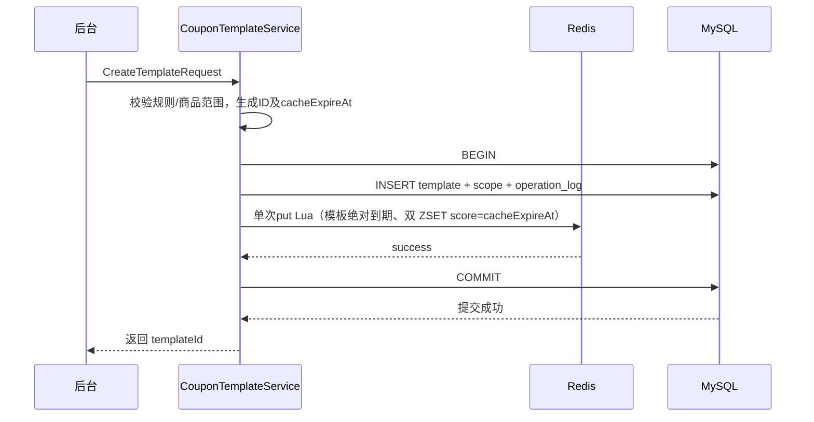

到账弹窗只依据 Redis 中的 `READY` 快照，不回源 MySQL；内部运营接口读 MySQL。已到账券算价从用户券表读取资产/金额，批量 MGET 模板 Redis 读取范围、作废、叠加和资方，模板 miss 标记 `COUPON_TEMPLATE_UNAVAILABLE`，不回源 MySQL，不影响资产列表和历史记录。

### 2. 人群灌券发券

运营输入用户 ID，去空、去重后最多 100 人。任务仅接受 `issueChannel=7`（人群灌券）；渠道 7 以名单决定发放对象，不查询注册时间、不执行人群资格判断，仍校验模板 READY、领取窗口、使用有效期和请求幂等；同模板限领由统一发券服务和用户模板唯一键保证。库存不限量，不扣库存。CSV、失败导出和复杂重试后置。渠道 6 是新人惊喜券，只能由到账弹窗自动领取，不创建任务。

任务及明细本地事务落库后，在当前请求内按去重后的用户顺序同步执行。先批量读取用户已有券，循环内不再读取模板或注册时间；每个用户独立写资产和 ISSUE 流水。请求号由 `tenantId + taskId + userId + templateId` 稳定生成；发券来源为 `source_type=2`，备注为 `人群灌券任务:{taskId}`。重复键回读原券视为该用户幂等成功，继续其他用户；真实失败只更新当前明细，不把失败当成功，也不阻断其他用户。

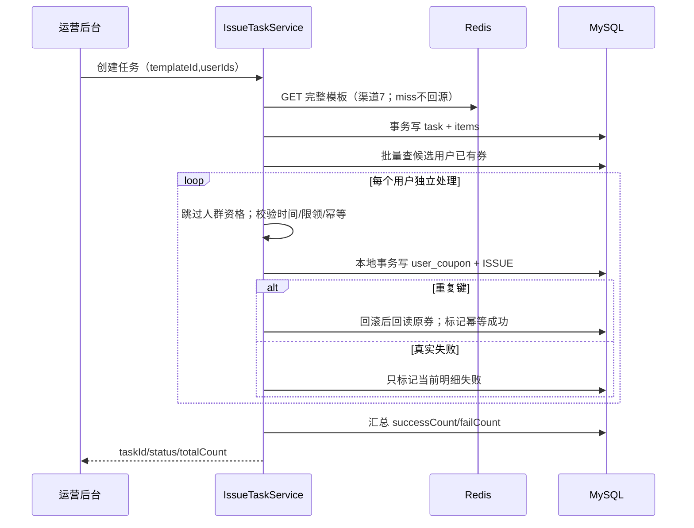

### 3. 自动领券弹窗

客户端在指定页面触发 `POST /coupon/v1/arrival-popup`，弹窗频控由客户端负责。服务端只执行系统领券并返回本次实际新增的券，不提供确认展示接口、游标或弹窗批次缓存；响应丢失后用户从优惠券列表查看已到账资产，不保证重放弹窗。

1. Redis `ZRANGEBYSCORE` 读取有效期内的全部用户/新人索引，合并模板 ID 后一次 `MGET`；查询前清理不大于当前时间的成员。内存过滤 READY、领取窗口和使用有效期，并显式校验模板的渠道与人群组合：渠道 1～5 必须为全部用户，渠道 6 必须为新人；索引构建时分别加入 all/new ZSET，渠道 7 即使脏索引残留也不发。模板 miss 只对仍在有效 ZSET 中的 ID 告警，不回源模板表。
2. 一次查询该用户在候选模板下的已有券，校验自动领取请求号和模板限领，普通人群券尽可能全部发放。
3. 新人历史直接读库：按 `tenant_id + user_id + crowd_type=1 LIMIT 1` 查询，覆盖所有模板和所有状态，已使用/已过期券同样算已领。存在记录就不再读取注册时间或发新人券。仅尚未领过时通过 `UserRegisterTimeReader` 批量读取本地 `biz_user.create_time`，筛选注册窗口，按最大 `templateId` 选择最新分配的一张；不按面额或领取截止时间择优。全局发号器正常工作时按发号顺序递增，Redis 快照无需额外冗余 `createTime`，MySQL 原有审计时间保留。
4. 复用 `RedissonDistributedLocker.tryLock(lockKey, 0, 5, SECONDS)` 获取租户加用户维度短锁，成功后再次执行新人历史查询。竞争失败跳过新人券；中断恢复线程标记并停止本次新人发放；基础设施异常继续传播。自动新人请求号只由租户、AUTO 业务键、用户生成，不含模板 ID；即使候选模板改变、锁过期或并发重试，唯一键仍限制自动新人领取最多一次。在 finally 调用 `unlockQuietly`，释放失败不遮蔽已成功发券结果。不使用包装业务异常的 Supplier 锁重载。
5. 发券核心返回 `CREATED/REPLAYED/FAILED`；仅 `CREATED` 计入弹窗。符合条件的券全部尝试发放，不因最多展示 3 张而只发 3 张。`couponCount` 是本次实际新发总数，`coupons` 最多 3 张，`remainingCount=couponCount-coupons.size()` 仅提示去列表查看，不代表可翻页数据。没有新券时返回 `show=false`、0、`[]`、0。重放券不计数、不再次展示。
6. 新人券候选最多实际发放一张，按 `templateId` 最大选择创建时间最晚的模板；本次新发结果排序时新人券置顶，再截取最多 3 张展示。客户端无需知道模板创建时间。
7. 只对展示的券批量补充 `cannotJumpText`；补充失败不回滚发券，使用通用列表跳转。

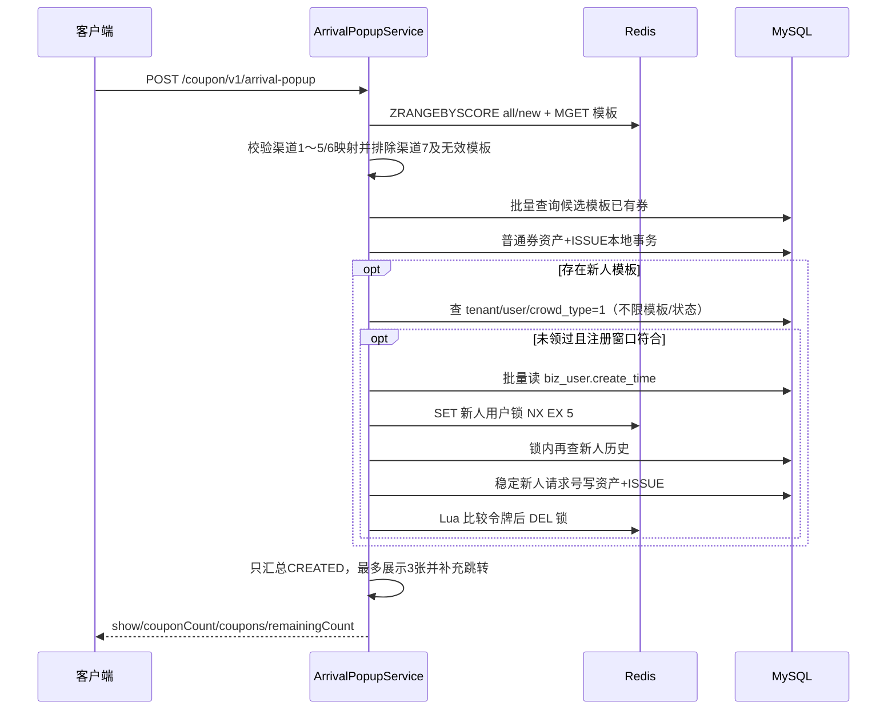

### 4. 领券流程

系统自动领取和运营任务复用 `CouponIssueService`，不调用历史 `/coupon/claim`。MVP 实际使用一张无后缀 `trade_user_coupon`，保留分表路由抽象和 ID 低位；后续分表需单独迁移，不能把预留能力当作已部署分表。Redis 不参加发券 MySQL 事务，不使用 Redis 幂等标记代替数据库唯一键。

**Redis 命令：**

```redis
ZREMRANGEBYSCORE coupon:v1:template-v2:{tenantId}:audience:v2:all -inf now
ZRANGEBYSCORE coupon:v1:template-v2:{tenantId}:audience:v2:all (now +inf
ZREMRANGEBYSCORE coupon:v1:template-v2:{tenantId}:audience:v2:new -inf now
ZRANGEBYSCORE coupon:v1:template-v2:{tenantId}:audience:v2:new (now +inf
MGET coupon:v1:template-v2:{tenantId}:template:<templateId1> coupon:v1:template-v2:{tenantId}:template:<templateId2>
-- 任务只 GET 对应模板；渠道7不加入上述人群索引
GET coupon:v1:template-v2:{tenantId}:template:<templateId>
```

新人短锁通过 `RedissonDistributedLocker.tryLock(lockKey, 0, 5, SECONDS)` 和 `unlockQuietly(lockKey)` 管理，不在优惠券服务内拼接 SETNX 或解锁脚本。

算价不执行模板 Redis 回源，但会把 Redis 作为运行时模板规则来源。数据库读取用户券资产状态、金额规则和有效期；一次 MGET 模板 Redis 读取商品范围、模板是否仍为 `READY`、`stackable`、`stack_layer` 和 `funder`，缺失即标记候选不可用，不回源 MySQL。模板/范围表只用于建券、内部发券任务、列表跳转补充、迁移和审计：

```sql
-- 候选模板批量资格查询；保留已使用/过期记录用于限领
SELECT * FROM trade_user_coupon
WHERE tenant_id = ? AND user_id = ? AND template_id IN (?, ?, ...);

-- 新人终身历史：不依赖当前模板集合，不按状态/有效期过滤；锁前和锁内各查一次
SELECT id FROM trade_user_coupon
WHERE tenant_id = ? AND user_id = ? AND crowd_type = 1 LIMIT 1;
-- 使用索引 idx_user_crowd(tenant_id,user_id,crowd_type)

-- 核心幂等批量回读，重复键后回读使用相同条件
SELECT * FROM trade_user_coupon
WHERE tenant_id = ? AND user_id = ? AND request_no IN (?, ?, ...);
```

到账弹窗从 Redis 模板取 `name/scope_type/crowd_type`，名称、范围类型和人群写入用户券最小快照；规则金额和有效期继续写入用户券，商品范围、`stackable/stack_layer/funder` 不复制。`crowd_type` 仅用于服务端新人历史，不向 C 端展示。模板渠道 7 的该值为 0 占位，不表示需要校验全部用户资格。已到账券后续算价再从模板 Redis 读取完整规则。

```sql
BEGIN;
INSERT INTO trade_user_coupon
  (coupon_id,user_id,template_id,source_type,display_name,scope_type,crowd_type,
   status,receive_time,valid_start_time,valid_end_time,discount_type,discount_value,
   threshold_amount,discount_rate,max_discount_amount,request_no,version,tenant_id)
VALUES (?, ?, ?, ?, ?, ?, ?, 1, ?, ?, ?, 2, ?, ?, NULL, NULL, ?, 0, ?);
INSERT INTO trade_user_coupon_log
  (coupon_id,user_id,template_id,action,before_status,after_status,request_no,mq_sent,operator,remark)
VALUES (?, ?, ?, 'ISSUE', NULL, 1, ?, 0, ?, ?);
COMMIT;
```

正常路径按同用户批量写资产和流水，二者原子提交。若批次遇到重复键，先整体回滚，再逐命令用独立 `REQUIRES_NEW` 事务重试，不能在 rollback-only 事务中继续插入。重复项回读原券返回 `REPLAYED` 并继续；新成功返回 `CREATED`；降级重试真实失败返回 `FAILED` 并继续余项。任务将前两者计为成功，弹窗仅展示 `CREATED`。非重复键的批次异常直接抛出并整体回滚，不伪造部分成功。

普通自动领取请求号包含租户、AUTO、用户和模板；新人自动领取请求号不含模板；任务号包含租户、任务、用户和模板。所有请求号含稳定摘要且不超过 64 字节，最终由 `(user_id,request_no)` 唯一键兜底。

### 5. 价格计算

#### 计算顺序

价格计算先由现有单品直降策略确定 `channel=9` 的活动结果，再由优惠券算价策略生成叠加或单券候选。策略按 `discount_type` 注册，保证代码可读且后续可扩展：

```java
interface CouponPricingStrategy {
    CouponQuote quote(CouponRule rule, List<PricingLine> eligibleLines, PricingContext context);
}

final class FullReductionCouponPricingStrategy implements CouponPricingStrategy {
    // 1. 计算适用商品合计；2. 判断门槛；3. 计算一次性优惠额；
    // 4. 按行/件分摊并校验商品行、子单实付不为负；整笔支付在支付入口校验至少 0.01 元。
}

// 后续扩展：DirectReductionCouponPricingStrategy、DiscountCouponPricingStrategy
```

策略注册表只在 `discount_type=2` 注册并启用 `FullReductionCouponPricingStrategy`；收到 `1/3` 时返回 `COUPON_TYPE_NOT_SUPPORTED`，不会在满减策略中塞入立减/折扣分支。每个策略只负责商品金额，运费由现有 `ShippingFeeResolver` 独立计算。

1. 查询商品、SKU、库存和地址相关信息。
2. 由单品直降适配器同时提供商品行原始金额 `originalProductPayPrice` 和单品直降后金额 `promotionProductPayPrice`；若该行没有单品直降，两者相同。
3. 沿用现有 `ShippingFeeResolver` 计算选中商品集合的行级和整单运费；运费计算完成后再生成优惠券候选，优惠券不改变运费。
4. 查询用户可用券，读取 `trade_user_coupon` 的资产状态、金额规则和有效期，再批量 MGET 对应模板 Redis，取得商品范围、作废状态、叠加开关、叠加层级和出资方；模板缓存 miss 不回源 MySQL，该券标记为 `COUPON_TEMPLATE_UNAVAILABLE`，由 AUTO 跳过、SPECIFIED 返回明确不可用原因。
5. 在一笔交易中最多选择一张券。未指定券时按候选报价的最终应付金额升序选择；最终应付相同按实际优惠金额降序、`valid_end_time` 升序、`couponId` 升序，确保结果稳定。
6. `stackable=1` 时，满减策略以单品直降后、不含运费的全部适用商品合计判断门槛，优惠面额只扣一次，再按行/件分摊；`stackable=0` 时只要券适用商品行存在 `channel=9` 单品直降，该券直接标记 `PROMOTION_CONFLICT`，不生成候选。
7. 全程以整数分计算，商品行和子单允许实付 0 元，整笔交易发起支付时至少 0.01 元；普通商品数量大于 1 保持一个订单行/子订单，盲盒数量大于 1 才按件拆成多个子订单。券只锁定和核销一次。
8. 返回既有价格字段和新的券数组字段。促销展示优先级统一为：同一展示槽位只有一个标签时优先历史单品促销；无促销时才展示券 `discountText`。`aggPriceInfoList` 是当前报价上下文下实际计入价格的全部优惠明细，可以同时包含单品直降、优惠券及后续扩展优惠项，不放未选中或未达门槛的券。商品详情、商城列表、社区搜索和购物车列表的展示标签由 `promotionLabelList` 承载，价格字段直接采用同一次报价的商品实付和总优惠，不根据标签重算；提单候选券由 `benefitOptions` 承载。

#### 运费计算（沿用现有逻辑）

优惠券只作用于商品金额，不新增运费券，也不改现有运费模版、免邮和拼箱规则。新券算价必须复用 `ShippingFeeResolver.allocateOrderShipping` 与 `ShippingFeeService.getShippingFee`，传入券计算前已有的营销结果用于兼容现有免邮判断，不能把优惠券 `DiscountDto` 当作运费免邮依据；并将同一份运费结果用于不使用券报价和叠加券报价；促销冲突券不生成报价。

1. **先解析模版单价。** 按商品的 `freightTemplateId` 调用现有运费服务：未配置或找不到模版时沿用 4 元兜底；未登录、没有可用地址或地址不匹配时沿用模版默认运费/包邮配置；登录用户地址匹配区域时使用区域运费；模版标记包邮时为 0 元。地址优先使用请求 `addressId`，否则沿用当前用户默认地址或已有地址选择逻辑。
2. **识别现有免邮活动。** 仅按现有营销结果识别 `WANTIT_AUTHOR` 的免邮资格（含作者配额分支和 `expectFree` 判断），命中后该行运费为 0 且不进入后续拼箱分摊。优惠券本身不触发、取消或覆盖该免邮判断；本期单品直降 `channel=9` 只改变商品价格，不改变运费资格。
3. **选中行按模版拼箱。** 数量 `null` 或小于 1 时按 1 件。显式 0 元运费行直接记 0 元，不进入拼箱；运费缺失不能按 0 元兜底，该行返回“运费计算失败”。其余选中行按 `freightTemplateId` 分组，每组运费为 `ceil(组内计费件数 / 6) × 模版单价`。
4. **保持现有行级分摊。** 现有实现先汇总所有模版组运费，再按所有可计费选中行的数量占比平摊到 SKU 行，金额保留两位小数并采用 `HALF_UP`；最后一行承接累计尾差，确保行级运费合计等于整单运费。购物车中未勾选行不进入选中行拼箱，而按本行数量独立 `ceil(quantity / 6) × 模版单价` 计算，仅用于该行展示，不计入 checkout 汇总。直接购买的单 SKU 价格接口沿用单行计算，运费就是该 SKU 按数量独立计箱；购物车 checkout/submit 才按所有勾选行合并计费。
5. **运费与优惠券解耦。** 券门槛金额 `B`、券优惠额和行/件分摊均不包含运费；候选应付统一使用 `candidatePayableAmount = candidateProductPayableAmount + shippingFee`。由于候选的商品集合、地址、数量和现有促销免邮结果相同，`AUTO` 比较的不使用券报价和叠加券报价复用同一整单及行级运费，不因切换券重复计箱或重复调用运费服务。
6. **返回运费与保存结算快照。** 每行 `PriceDto.shippingFee` 返回现有分摊后的行运费，整单 `shippingFee` 为成功且选中行的行运费之和；`shippingFeeDto` 保留现有费用来源和地址信息，`shippingSummary` 继续读取现有配置文案。购物车 checkout 的 `preTradeId` 快照额外保存 `addressId`、各行 `freightTemplateId`、行级运费、整单运费及运费规则指纹；submit 时重新按同一逻辑计算，地址、商品集合、数量或运费结果变化则返回 `PRICE_CHANGED`。直接购买预览不新增运费或券报价凭证，建单时按实时地址和商品重新计算运费。

现有金额关系保持不变：`totalPrice = productTotalPrice + shippingFee`；`productPayPrice` 先在商品金额中扣除单品直降和优惠券并校验非负，再加全额运费得到 `payPrice`/`totalPayPrice`。优惠券仅抵扣商品金额，不抵扣运费；商品金额可为 0，运费继续按原规则收取。支付入口对含运费的整笔交易应付金额校验至少 0.01 元，不将每个子单抬价到 0.01 元。

`DiscountDto.trueUseCoupon` 属于历史 Coupon 实体，新 MVP 不构造该实体，也不调用旧 `freeze`/`claim` 链路。算价内部使用独立的 `CouponQuote` 模型，至少保存 `combinationMode=STACKED|COUPON_ONLY|PROMOTION_ONLY`、每个来源行的 `promotionApplied` 和券基准金额，最后由适配器把券 ID、优惠金额和展示文案映射到既有价格/聚合字段。`STACKED` 表示单品直降与券同时生效，`COUPON_ONLY` 表示券适用行没有单品直降、仅券生效，`PROMOTION_ONLY` 表示未使用券或券因促销冲突不可用。单品直降的 `channel=9` 记录保持原结构；可叠加时券明细追加在其后，`COUPON_ONLY` 只写券层明细，冲突券不生成券报价且保留促销层。接口层 `promotionCombination` 与内部 `combinationMode` 使用同一组枚举值；不再使用 `EXCLUSIVE` 这一别名，避免客户端和订单快照出现两套含义。

#### 优惠金额算法

按已确认口径，满减策略作用于全部适用商品；立减和折扣仅为后续策略扩展，单交易只选一张券。最低实付明确为**商品行和子单可为 0、整笔交易支付至少 0.01 元**。源码 `PriceStrategy.buildPriceDto` 的历史金额兜底不能改变新账本结果；新券适配器只校验商品实付不为负，支付入口对整笔交易执行 0.01 元下限。

设商品行原始金额为 `original_i`，单品直降后行金额为 `promotion_i`，数量为 `q_i`，券适用行集合为 `L`，运费不计入券门槛和优惠金额：

- `stackable=1` 的券报价：`couponBase_i = promotion_i`，`B = sum(couponBase_i, i∈L)`；`stackable=0` 的券只有在券适用行均无单品直降时才生成报价，此时 `couponBase_i = original_i`（仅对 `L`），非适用行继续使用 `promotion_i`；存在冲突时不生成报价。单品直降候选始终使用 `promotion_i`。
- 校验当前候选报价每件不低于 0 元；若促销或券输入造成负实付，返回价格异常，不用负优惠或抬高券后价格掩盖。券候选实际可抵扣空间 `deductible = sum(couponBase_i)`。
- 立减（后续策略，不属于 MVP）：`couponDiscount = min(discount_value, deductible)`，面额对适用集合使用一次。
- 满减（MVP）：当 `B >= threshold_amount` 时，`couponDiscount = min(discount_value, deductible)`，否则不可用。
- 折扣（后续策略，不属于 MVP）：`couponDiscount = min(floorCent(B × (1 - discount_rate)), deductible)`，有封顶时再取 `min(max_discount_amount, couponDiscount)`；`floorCent` 表示优惠额向下取到分，折扣在集合合计后取整一次。
- 行分摊：按 `couponBase_i / B` 比例向下取分，每行不得超过 `couponBase_i`；达到上限的行退出后，将剩余额度按未达上限行的金额权重继续分配。最终不足比例分配的一分尾差按稳定 `skuId` 顺序分配到仍有空间的行，直到合计恰好等于 `couponDiscount`。商品行和子单允许实付 0 元，不能产生负实付。
- 件分摊：使用当前候选报价的每件基准金额作为权重，按上述带上限规则将行优惠分配到每件，每件上限为该件基准金额；以稳定件序号处理尾差，写入 `unit_amount_json`。行、件基准金额由单品直降适配器同源产生，不能用展示字段 `unitPayPrice × quantity` 反推，避免四舍五入丢分。
- 无适用行或实际优惠为 0 时，该券不可用且不锁券；存在促销冲突的 `stackable=0` 券不进入 AUTO 候选且不锁券；无冲突候选按最终应付金额、实际优惠、失效时间、`couponId` 稳定排序。

不适用券的商品行分摊金额为 0，不写券明细。每个优惠来源各写一条 `trade_order_discount_detail`，同一实际订单行最多有 `PROMOTION` 和 `SHOP_COUPON/PLATFORM_COUPON` 两条。参与该券计算/门槛的行因分摊取整或最低实付约束得到 0 元券优惠时，仍保留带 `coupon_id` 的 0 元关联明细，避免丢失门槛参与关系；该行纳入返券所需退款集合，前端无需显示 0 元优惠项。没有参与该层的行不写空明细。单笔交易所有券明细的 `coupon_id` 必须相同。

#### 价格计算时序

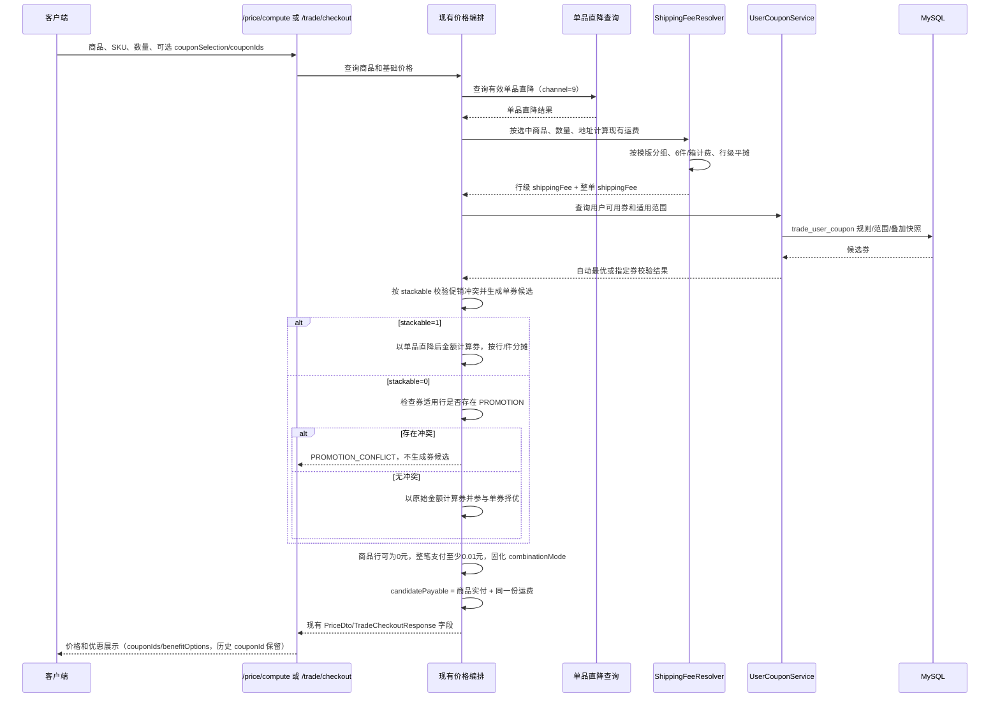

#### 5.1 商城商品列表（MVP）

商城列表继续调用现有 `GET /product/list`，本期新增商品级 `promotionLabelList` 展示标签数组；历史商品标签字段保持促销含义，不锁券；既有 `discountPrice`、`discount` 分别回填统一报价的商品实付单价、总优惠额。`aggPriceInfoList` 如已有则继续返回，仍表示价格优惠明细，不作为本接口的展示标签来源。商品未达到券门槛时仍可展示“满100减20”等券标签，但不改变列表价格；达到门槛后采用 AUTO 引擎选择结果回填最终优惠价，最终成交金额以 `/price/compute`、`/trade/checkout` 的实时报价为准。促销冲突、商品范围不适用、券已使用或已过期的券不进入 `promotionLabelList`。服务端先批量读取当前页商品、促销和用户券数据，再按**每个商品独立的报价上下文**组装标签；批量读取只用于性能优化，不能把当前页商品金额合并后判断满减门槛，也不能在商品循环内逐条调用券服务。列表默认按每个商品 1 件计算；标签按 `priority` 降序返回，单品直降优先于券；同一商品最多返回一条最优券标签，按最终应付金额最低、实际优惠金额最高、有效期最早、`couponId` 最小择优。

#### 5.2 社区搜索（MVP）

社区搜索继续调用现有 `POST /product/search`，沿用商城列表的批量读取、逐商品独立计算策略，在商品 `promotionLabelList` 中返回当前商品的展示标签；`aggPriceInfoList` 如已有则继续保留为价格优惠明细，不作为本接口标签来源。未达门槛的适用券仍可返回券标签和门槛文案，但不改写搜索列表价格。历史商品标签字段仍按原逻辑只保留一个主标签，优惠券不覆盖、不拼接到该字段。搜索结果不锁券、不写订单分摊；用户进入详情或提单后重新计算。搜索采用现有 `searchAfter` 游标，券摘要查询必须按当前页商品批量执行，但当前页、不同分页页和搜索结果集合都禁止合并金额计算。

#### 5.3 购物车列表优惠展示

购物车继续调用现有 `GET /cart/list`，本期新增 `data.items[].promotionLabelList`，并保留 `data.priceSummary` 的原有字段结构。适用范围和有效期匹配的券，即使当前行或当前勾选集合尚未达到门槛，也可以作为券标签返回，券文案和门槛正常展示；该展示标签不改变行价或整单价。`data.items[].aggPriceInfoList` 如已有则继续表示该行交易预估的价格优惠明细，不作为标签来源；`data.priceSummary` 不新增优惠明细或标签字段。促销冲突、范围不适用、已过期或已使用的券不进入标签数组，具体不可用原因由 `benefitOptions` 返回。接口按当前勾选商品集合执行 `AUTO` 预估：勾选的 A、B 可以合并判断满减门槛，达到门槛后计算出的全部优惠仍按行/件分摊并回填到各勾选行的 `productPayPrice`、`unitPayPrice` 和价格明细；未勾选行不参与该次交易预估，也不回填交易级优惠，但仍可展示自身适用券标签。购物车只预估、不锁券，checkout/submit 重新报价并锁定最终使用的一张券。

#### 5.4 商品详情

商品详情对外使用 `GET /aigc/trade/product/query`，网关转发到内部 `GET /product/query`。历史价格字段和 `aggPriceInfoList` 继续保留；商品级展示标签使用 `promotionLabelList`。各 SKU 按数量 1、AUTO 独立报价，先整批读取商品、直降和用户券依赖，再在内存中调用同一个价格引擎，不能跨规格凑门槛。`discountPrice` 取商品实付单价，`discount` 取总优惠额；无优惠时沿用标价回退。报价后按最终实付、SKU ID 排序，默认 SKU 与顶层单券标签使用同一份结果。商详不锁券。

`productDetail` 保留促销层原有话术，不计入券优惠、不清空。`productDetails` 根据当前 SKU 报价重建：直降文案 → 全部可用券的 `discountText`（报价顺序）→ 仅因 `THRESHOLD_NOT_MET` 不可用的券规则（有效期、券 ID 升序）；其他不可用券不展示。去空白、trim、保序去重，老字段与数组相同也保留数组项。展示多券不表示叠用，价格只采用 AUTO 选中的一张券。券适用但未达门槛时展示规则、价格不抵扣；没有促销时创建类型为“优惠券”的话术对象。

商城/搜索、推荐、定制专区和模型购买入口复用上述报价回填，不使用 `filterDiscountProduct` 隐藏真实优惠。请求入口显式传递租户和用户，个性化结果只写请求副本，Redis/Caffeine 共享缓存保留基础标价及内容。

#### 5.5 购物车

购物车继续输出现有 `promotionText`、`discount`、`productPayPrice`、`aggPriceInfoList` 等字段，并新增行级 `promotionLabelList` 展示标签数组。购物车列表按当前勾选商品集合做 `AUTO` 预估：行本身不单独与其他未勾选行合并，但适用券可以先作为标签出现在行级数组中；当勾选商品形成的交易集合达到门槛后，整单优惠金额仍分摊回每个适用勾选行，价格明细继续写入行级 `aggPriceInfoList`。未勾选行不参与交易级计算，但仍可展示自身适用券标签。购物车列表不锁券；checkout/submit 重新报价并锁券。

#### 5.6 提单页

直接购买使用 `/price/compute`，购物车购买使用 `/trade/checkout`。页面首次进入传 `couponSelection=AUTO`，用户选择其他券传 `couponSelection=SPECIFIED` 和 `couponIds:[couponId]`；价格响应保留现有 `PriceDto.couponId` 兼容字段；新请求选择不使用传 `couponSelection=NONE,couponIds=[]`。每次切换都重新计算金额；同一次提单停留期间保留用户选择，重新进入页面重新自动择优。

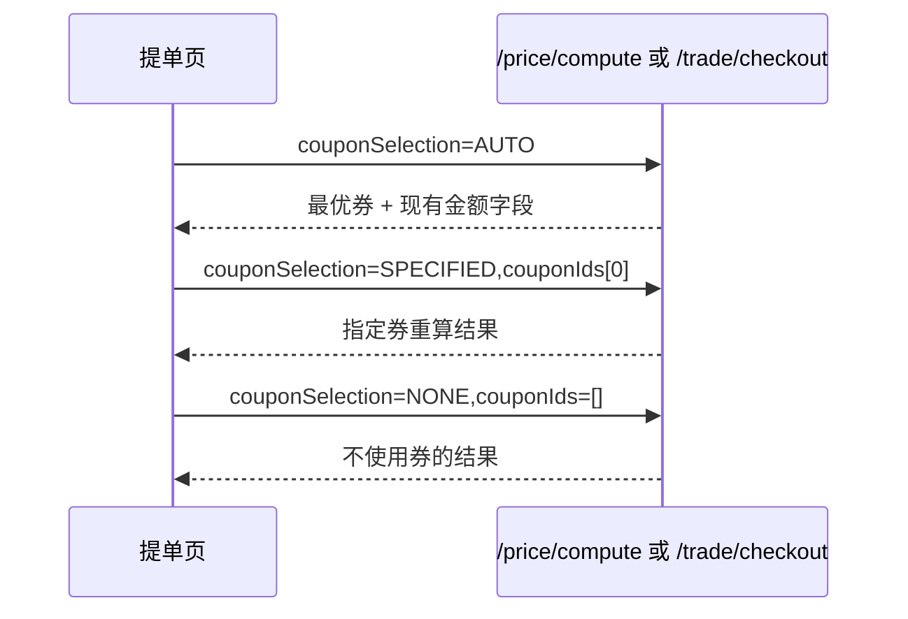

### 6. 下单核销券流程

#### 规则

- 单笔交易最多 1 张券，MVP 不做多券叠加。
- 一个交易单 `tradeId` 可关联多个子订单 `orderId`。不同子订单满足不同券条件时，也只能在交易级选一张；一张券可以分摊到多个适用子订单，拆单不增加可用券数量。
- 模板 `stackable=1` 时，券与单品直降叠加，按“单品直降 → 优惠券”执行；`stackable=0` 时，只要券适用商品行存在单品直降，该券不可用、不生成券候选，交易保留单品直降；若券适用行没有单品直降，券可按适用行原价计算，非适用商品行仍保留单品直降。优惠券与其他历史优惠不参与叠加判断，因为本期新路径不读取它们。
- `AUTO` 比较“促销候选”和每张券候选的最终应付金额，选择最终应付最低的一个；相同金额优先促销候选，不锁券。`SPECIFIED` 明确选券时，如果该券不可用或与促销互斥导致校验失败，返回 `COUPON_NOT_STACKABLE`/`COUPON_THRESHOLD_NOT_MET`，不得静默改用其他券。
- 购物车 checkout 的 `preTradeId` 报价快照保存 `combinationMode`、每行采用的 `promotionId`、券基准金额和最终分摊；submit 重算并核对该快照，不能静默改变预览选择。直接购买预览不额外保存券报价快照，建单时按服务端实时数据重算。两条路径均将最终确认的组合和分摊落库，锁券、子单明细和退款使用同一份已落单结果；冲突券不生成券分摊。
- 提交订单必须重新查询商品价格、活动状态、库存和用户券状态。
- 用户显式选择的券失效、价格变化或商品下架时，返回可识别错误码，前端刷新提单页；服务端不静默替换券。

#### 6.1 直接购买

直接购买沿用现有两步接口：`POST /price/compute`（预览）和 `POST /order/create`（建单）。`/price/compute` 当前没有 `preTradeId`，本期不新增独立的券报价凭证或预览价格快照；创建订单时按 `couponSelection/couponIds` 和服务端实时数据重新报价。现有 `OrderCreateRequest.token` 继续用于原预订单校验，不新增券报价含义；`discountPrice` 仍是兼容字段，服务端不得直接信任客户端金额。此方案不锁定预览价格，也无法比较未保存的预览价格指纹，成交金额以建单重算为准。客户端确认时将预览选中的 `couponIds` 以 `SPECIFIED` 提交，无券则传 `NONE`，以固定选券意图；如果仍提交 `AUTO`，服务端按最新数据择优，结果可能与预览不同。指定券失效时返回明确错误，不静默替换。

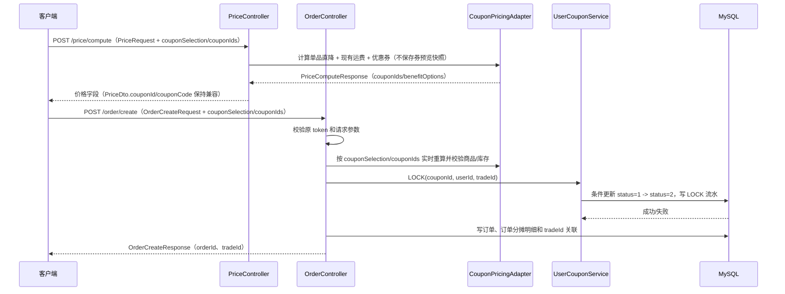

锁券条件包含 `user_id`、`coupon_id`、`status=1`、当前时间在有效期内和订单归属。`trade_user_coupon.order_id` 沿用 DDL 列保存 `tradeId`，`trade_user_coupon_log.order_id` 同样保存 `tradeId`，而 `trade_order_discount_detail.main_order_id` 保存 `tradeId`、`order_id` 保存真实子订单 ID。LOCK/USE/UNLOCK/RETURN 的幂等业务键为 `(tenantId, action, tradeId, couponId)`，按前文摘要格式压缩为不超过 64 字节的 `request_no`；同一券返还后在新交易使用，必须得到新的业务键。相同 `tradeId` 的重复锁券通过条件更新与流水幂等处理，不能按拆出的子订单重复锁券。现有 token 仅有预订单校验用途，不能假定它已绑定 `tradeId` 或保证建单重试返回原交易；本期新券建单需补充以 `tenantId + userId + token` 为键的请求去重与成功交易关联，重复成功请求返回原 `orderId/tradeId`，不能重新分配交易号再锁券。该关联服务于建单幂等，不保存预览价格或充当券报价凭证。订单写入和锁券在同一数据库事务内；若未来跨库，再引入订单侧事务加锁券补偿，当前同库实现不需要另起分布式事务。

#### 6.2 购物车下单

购物车提单分为 `POST /trade/checkout`（预览）和 `POST /trade/submit`（提交）。checkout 接收勾选的 `items[]`，生成并持久化 `preTradeId` 快照。submit 必须携带该 `preTradeId`，按本次请求的 `couponSelection/couponIds` 和实时商品、单品直降、地址/运费、库存及用户券重新报价：`AUTO` 或省略券字段时实时择优，`SPECIFIED` 校验指定券，`NONE` 不用券。随后比较实际券 ID 与 checkout 快照，不要求两次意图字符串相同；券 ID 和价格一致才允许建单并锁券，实际用券变化需要重新 checkout。两条路径共用内部算价、运费、分摊和锁券服务，行上保留 `cartItemId`；服务端按所有勾选商品形成一笔交易，券优惠只在适用商品之间分摊。

`PreTradeSnapshot` 保存 `userId/items/totalPayPrice`、`couponSelection/resolvedCouponId`、地址、运费和价格指纹。新快照中 `resolvedCouponId=null` 表示明确无券，仍须与本次实际券 ID 比较：`A→B`、`A→null`、`null→A` 即使总价相同也拒绝。仅 `couponSelection=null` 的旧快照跳过券 ID 比较，继续执行原有总应付及已有价格指纹校验。AUTO 不再转成快照券的 SPECIFIED；重新选出的券与快照不同则报错，不静默换券成交。

交易与拆单接入以当前源码为准：

| 现有接入点 | 当前行为 | MVP 接入设计 |
|---|---|---|
| `TradeSubmitService.submitInTransaction` | 重新报价，先保存 `MainOrder`，再调用 `OrderService.createSubOrdersUnderTrade` | 在同一事务内锁一张券、写主单/子单/券分摊；任一环节失败全部回滚 |
| `TradeResolver.assertDistinctSkuIds` | checkout/submit 禁止同一请求出现重复 `skuId` | 沿用校验，报价用 `skuId` 作为稳定行键并保留 `cartItemId`，不能按请求数组下标比对快照 |
| `OrderService.createSubOrdersUnderTrade` | 普通商品行保留数量；盲盒 `saleMode=BLIND` 且数量大于 1 时按件展开，一个输入行可能生成多个 `orderId` | MVP 同时覆盖普通商品和盲盒：普通商品多件保持一个子单；盲盒先按件预展开，再把件级券分摊映射到实际子单；禁止假定 `orderIdList[i]` 对应原始 `items[i]` |
| `BlindBoxPerUnitSplitStrategy` | 盲盒多件按件拆成数量为 1 的子单 | 各优惠层按普通商品件级比例和尾差规则分摊，不优先某一件、不集中首件；券 `unitAmounts` 按件落到子单，商品实付可为 0，金额及券优惠合计严格守恒 |
| `TradeSubOrderSplitter.assertConservation` | 校验拆单前后商品原价、优惠、实付和运费守恒 | 普通商品数量不拆单；盲盒按件展开后校验件数、券优惠、商品实付和运费守恒 |

新内部模型 `CouponQuote` 保留一张 `resolvedCouponId`，其 `allocations[]` 记录 `sourceLineId`（当前请求内的 `skuId`）、`cartItemId`、数量、单品直降金额、券分摊金额和件级数组。MVP 的子订单适配器输出 `TradeSubOrderCreateLine` 及独立映射上下文 `(sourceLineId, unitIndex, allocation)`。普通商品数量保持原行；盲盒行由 `BlindBoxPerUnitSplitStrategy` 按件展开，读取券 `unitAmounts` 并逐件落快照，单品直降等优惠按剩余商品金额比例分摊，不集中首件。不会修改历史优惠算法，也不从 `DiscountDto.trueUseCoupon` 取券状态。

盲盒按件设计纳入 MVP：先按整笔交易计算单品直降，再按券适用件基准金额分摊券优惠，最后按 `saleMode=BLIND` 预展开为数量 1 的子单。所有优惠层均按普通商品件级比例和稳定尾差规则分摊，不按盲盒首件优先分配，也不能给每个拆出的子单重复套用券面额/门槛。拆单适配器必须显式返回来源行、件序号与真实子单映射，并校验 `createSubOrdersUnderTrade` 返回的 ID 与建单行映射。

`trade_order_discount_detail.line_id` 写真实 `OrderItem.orderItemId`（业务行 ID，由建单上下文回填），`order_id` 写实际子单 ID，`unit_amount_json` 只包含该子单承接的件；普通行保留多件数组，盲盒一件子单只有一个元素。拆单后的每条券明细使用同一 `coupon_id`，锁定、核销、返券仍各按交易和券执行一次。需要满足：`sum(子单商品实付)=主单商品实付`、`sum(子单券优惠)=报价券总优惠`、`每件商品实付>=0`；运费继续按项目现有规则分摊，不参与券门槛或抵扣。整笔交易的支付金额仍必须在支付入口达到 0.01 元。

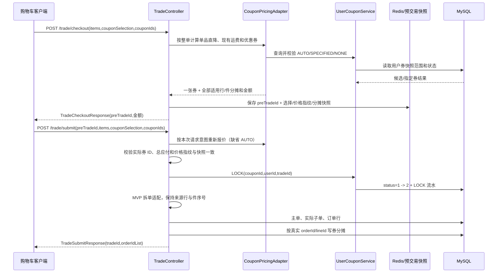

#### 6.3 支付成功核销

`TradeFinishPayService.finishTradePayInTransaction` 在事务中将主单从 `WAIT_PAY` 改为 `PAID`，再处理子单完付。新消费者若收到子单 `orderId` 事件，应回查主单和优惠分摊取得 `tradeId`、`couponId`，确认交易支付成功后，按 `(tenantId, USE, tradeId, couponId)` 幂等校验用户券 `status=2 AND order_id=tradeId`，更新为 `status=3` 并写入 `used_time` 和 `USE` 流水。多个子订单的支付事件只核销同一张券一次；不能按券明细行数累加 `trade_coupon_stock.used_count`。

MVP 不统计库存发放/核销数。后续增加统计消费时，必须持久化已处理流水游标或独立幂等记账，不能只依赖 `mq_sent` 后重复加减。支付核销失败时回滚并告警，由人工排查重试，不自动补发不存在的券事件。

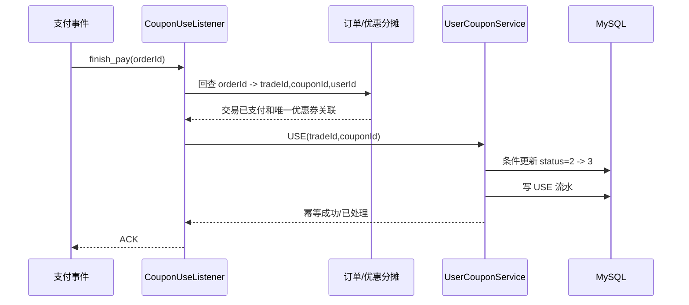

#### 6.4 取消和超时解锁

取消接口沿用 `/trade/cancel`；订单超时任务也调用同一解锁服务。接入 `TradeCancelService` 的交易级关单流程，先确认主单及支付状态允许关闭，再对 `status=2 AND order_id=tradeId` 的券执行一次 `UNLOCK`，恢复未使用并保留原 `valid_end_time`，清空当前 `order_id` 绑定，关联历史保存在流水及分摊表。多个子单关闭回调不能重复解锁；已支付订单只允许走退款返券路径。券状态绑定使用 `tradeId`，库存操作仍遵守 `TradeResolver.resolveStockBizId` 的现有规则（购物车用交易号，立购用子单号），两者不能混用。

### 7. 子订单详情

订单详情只展示每个子订单实际承接的优惠分摊金额。例如交易使用满 100 减 10 元券，商品 A、B 分别分摊 8 元和 2 元，则 A 子订单展示券优惠 8 元、B 子订单展示 2 元；不再重复展示整张券的“满 N 减 M”规则。页面读取已落库的订单优惠明细，不按当前模板重新计算。

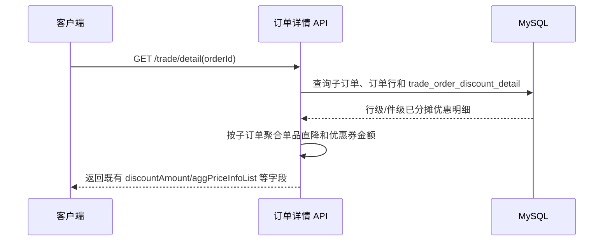

### 8. 退款返还券流程

退款返券按**该券关联的优惠子订单集合**判断，不要求交易主单进入全退状态。退款成功后，以 `(main_order_id=tradeId, coupon_id=couponId)` 查询券分摊，去重得到关联的 `orderId` 集合 `S`：

1. `S` 中所有子订单的商品都已成功全额退款时，按 `(tenantId, RETURN, tradeId, couponId)` 返还该券；交易中不在 `S` 的子订单无需退款，主单仍为 `PARTIALLY_REFUNDED` 也可返券。
2. 仅 `S` 的部分子订单退款，或某个关联子订单只退部分件/部分商品实付时，不返券；不重新计算券门槛、不追回优惠。若本次退的是未用券子订单，不改变券状态。
3. 成功返券将用户券由已使用改回未使用，清空当前 `order_id`、`used_time`，保留原有效期和原发放身份；已过期则查询展示为过期。历史订单关联通过流水和分摊表保留。
4. 退款回调先根据退款业务记录确认成功，再在交易锁内从已成功退款事实重算对应明细的累计 `refunded_amount` 并覆盖写入；不能对重复事件直接 `+=`。该字段表示已退商品对应的券优惠分摊额，不是实际退给用户的现金金额，也不能单靠 `refunded_amount=amount` 判断退款完成（0 元分摊也可能尚未退款）。
5. 实际现金退款使用已落库商品实付及现有运费规则；返券不额外退还券面额。已有 `TradeRefundSupport.resolveRefundAmount` 会按整笔交易退款进度决定何时退运费，优惠子订单全退后的返券不等待其他子单运费结算。

成功退款判定不能直接复用 `TradeRefundSupport.isLastRemainingSubRefund`：该方法为了运费结算会将“进行中的售后”视为已占用退款名额，不代表退款资金已成功退回；单纯 `Order.status=CLOSED` 也不能区分未支付取消和成功退款。券消费者必须核对实际成功退款金额/件数及对应售后完成记录。现有盲盒含单品直降时的用户退款拦截继续有效，本节只处理已成功执行的退款，盲盒按件拆出的子单仍沿用现有售后入口；券返还只处理已成功退款事实，不因拆单增加核销次数。

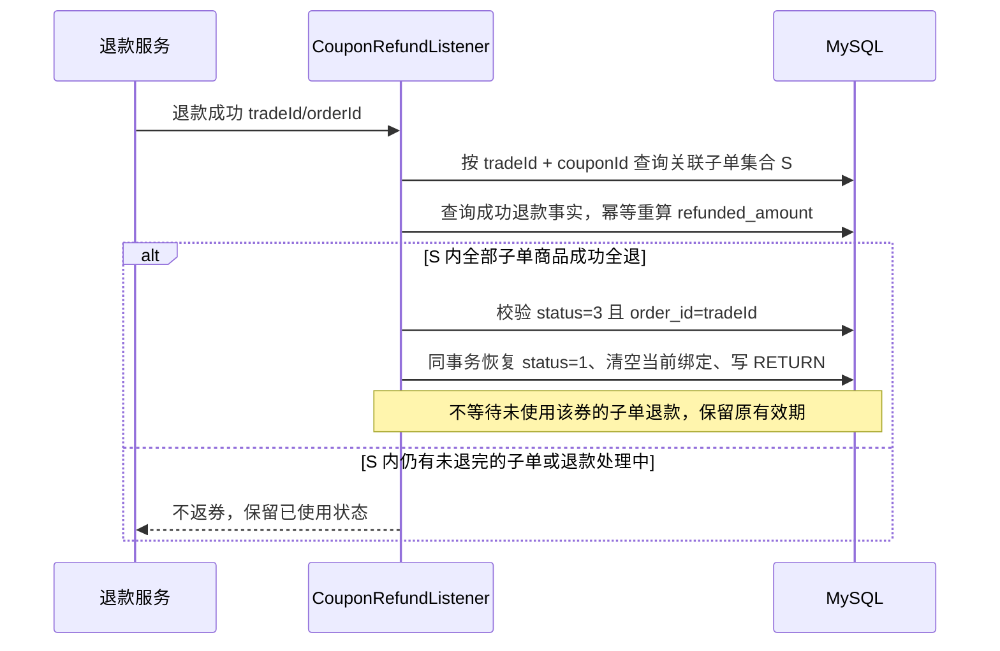

退款处理按交易加锁，并与用户券条件更新共同防重；返券状态变更和 RETURN 流水在同一事务。若退款消息早于支付核销到达，先补查成功支付事实并补齐 `USE`，或进入重试，不允许把仍锁定的券直接返还。若该券返还后已用于另一笔交易，旧交易的重复退款事件只命中原 RETURN 流水，不得清空新交易绑定。`used_count` 只按该 RETURN 流水减少一次，不能按退款子单数减少；`issued_count` 不回退，不因返券生成新券或重发新人券。

### 9. 券到期提醒（后续能力，不属于 MVP）

后续版本每天北京时间 10:00 由分片任务扫描各用户券表，查找明天 00:00 至 23:59 到期、状态为未使用且当前仍有效的券，按 `user_id` 合并为一条通知，同时发送 1 条短信和 1 条站内信，内容包含券名称和“去查看”跳转到优惠券列表页。本功能不进入 MVP 排期、DDL 迁移和上线验收。

DDL 当前 `channel=1` 是 App 推送，不能复用该值。保留原枚举并增加 `channel=4` 表示“短信 + 站内信”，同时为提醒记录增加 `sms_status`、`inbox_status` 和对应失败原因（见附录实施修正）；只有两个渠道都成功才将总状态置为 `1`，单渠道成功后重试不得重复发送已成功渠道。`uk_user_date` 继续保证同一用户同一天只有一条聚合记录。

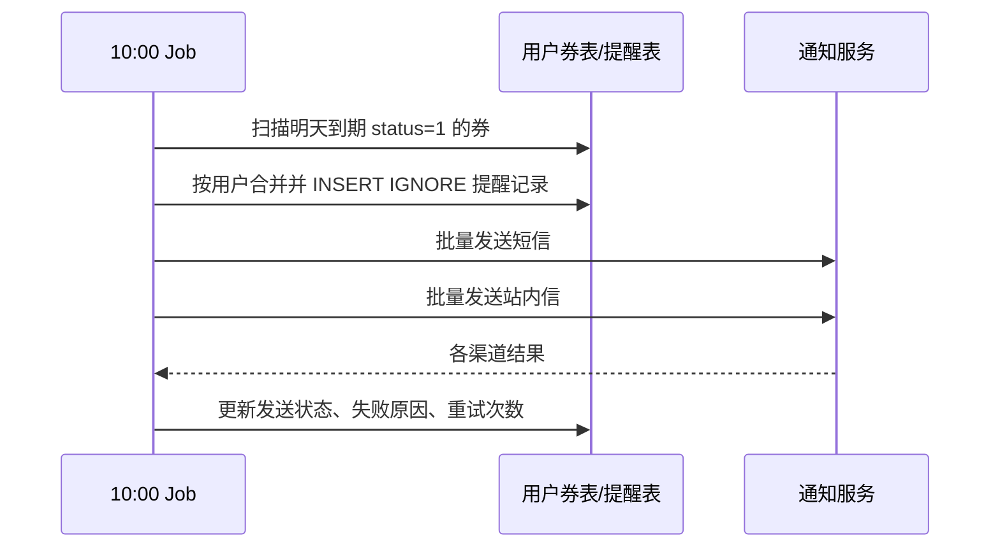

#### 9.1 到期提醒补偿（后续）

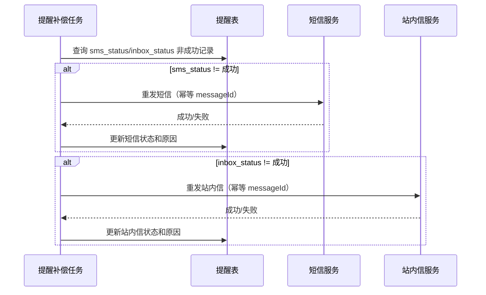

### 10. 优惠券列表

`GET /coupon/v1/list?page=1&pageSize=20` 返回有效期内未使用券，`page` 从 1 开始、`pageSize=1～50`。固定按 `valid_end_time ASC, discount_value DESC, coupon_id ASC` 全量排序后分页；MVP 优惠价值取满减面额，不使用当前交易实际优惠。名称、规则文案、范围文案、状态都来自用户券快照，不读模板表；仅为当前页跳转字段按需读取范围摘要缓存。商品下架不改变券状态、排序或分页总数。

`CouponJumpResolver` 统一补充唯一字段 `cannotJumpText` 和 `jumpUrl`，用于正常券列表、到账弹窗、报价候选及展示标签；历史券列表保留这两个响应字段，但固定返回 `null`：

| 场景 | 依赖读取 | jumpUrl | cannotJumpText |
|---|---|---|---|
| 指定范围去重后恰好 1 个商品，已上架且未删除 | 批量查询该商品基础状态，普通品和盲盒同规则 | `/product/query?productId=P1001` | `null` |
| 指定范围恰好 1 个商品，已下架、已删除或查询确认不存在 | 同上，不查 SKU/库存 | `null` | `商品已下架或不存在，暂时无法跳转` |
| 指定多个商品或全店 | 不查商品状态，跳列表不受单商品状态影响 | `/coupon/v1/list` | `null` |
| 范围缺失、依赖异常或无法确认 | 记录日志，使用通用入口，不伪造下架原因 | `/coupon/v1/list` | `null` |
| 已核销/已过期/未生效券；订单已生效优惠明细 | 不查询当前商品状态 | `/coupon/v1/list` | `null` |
| 历史券列表（LOCKED/USED/EXPIRED） | 只读用户券快照，不读取范围、模板或商品状态 | `null` | `null` |

只对本页有效期内的 `UNUSED/LOCKED` 指定商品券，按模板集合一次读取范围摘要缓存（本地 Caffeine 未命中时批量读取 Redis）；在内存去重配置的商品 ID，**只有恰好一个商品时**才加入批量商品查询。不是“多个商品中只剩一个上架”就跳详情。全店和多商品不做全范围可售扫描、不查 SKU/库存。商品范围数据仍持久化保留，不随模板 Redis TTL 删除；缓存缺失时正常列表降级为通用入口。

模板详情、商品范围和范围摘要的 Redis 到期时间均为 `cacheExpireAt = max(receiveEndTime, 最晚可能发出用户券的 validEndTime) + 24小时`，正常情况下不会早于已发用户券有效期结束。缓存缺失或依赖异常时跳转解析降级，不阻断正常券列表；该缓冲不延长券业务有效期。

报价从模板 Redis 读取范围和叠加规则；正常列表跳转读取范围摘要缓存并按需查询商品状态，不读取模板 Redis。历史列表不做跳转解析，也不读取范围、模板或商品状态。范围缺失时正常列表不生成下架文案。不同券的跳转结果按 `couponId` 关联，已使用/已过期券不继承同模板有效券的当前状态。`scope_type` 只生成“指定商品可用/全店商品可用”通用 `scopeText`，不返回范围数值或人群字段。文案非空时前端直接提示并停止跳转，不能用门槛不足、促销冲突、无库存或本次范围不匹配替代该文案。字段不落库，补充失败不阻断资产返回、不回滚发券。

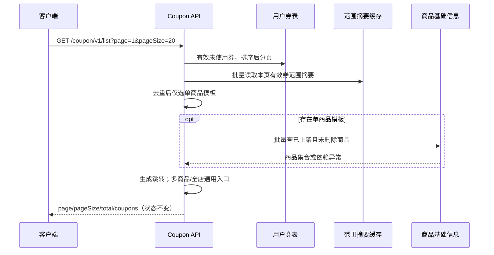

### 11. 历史优惠券列表（MVP）

`GET /coupon/v1/history` 是本期 C 端正式能力，返回用户券的状态历史视图，仅支持 `ALL`、`LOCKED`、`USED`、`EXPIRED`；空值/空白等同 ALL，UNUSED 和非法值返回参数错误，使用 `page/pageSize` 分页。先按 `LOCKED → USED → EXPIRED` 分组，每组按 `valid_end_time DESC, couponId 数值 DESC` 稳定排序，空到期时间组内最后。过期券的 `validEndTime` 取用户券 `valid_end_time`，不取商品下架时间、模板过期时间、查询时间或记录修改时间。各状态筛选结果均使用同一排序键，筛选 `ALL` 时也不按领取、锁定或核销时间重排；排序不改变状态机含义。返回券 ID、用户券名称快照、规则文案、状态及 `statusText`、有效期结束时间和 `jumpUrl/thresholdText/discountText/scopeText/cannotJumpText`。查询只读，不触发解锁、返券或重新算价；历史响应保留 `jumpUrl` 和 `cannotJumpText` 字段，但两者始终为 `null`，不提供使用跳转。

状态映射沿用用户券状态机：`status=1 && now <= valid_end_time` 为 `UNUSED`；`status=1 && now > valid_end_time` 为 `EXPIRED`；`status=2` 为 `LOCKED`；`status=3` 为 `USED`。模板作废和指定商品全部下架都不改变已发用户券状态，也不把用户券额外移入历史；历史列表不读取商品状态，商品上下架不会改变历史响应。已锁定券在订单最终状态确定前显示为“使用中”，订单取消并完成解锁后回到可用列表。

历史列表按用户路由到单个用户券分片，一次读取该用户全部用户券的状态、有效期、规则字段、`display_name` 和 `scope_type`，在内存中推导 `EXPIRED`、按 `status` 筛选，按 `LOCKED → USED → EXPIRED` 分组，再按组内 `valid_end_time DESC, couponId 数值 DESC` 排序，最后按 `page/pageSize` 截取结果；资产与状态查询不读取 Redis、不联查模板表，也不查询持久化商品范围或商品服务。历史卡片的 `jumpUrl` 和 `cannotJumpText` 固定为 `null`，`scope_type` 仅用于生成通用范围文案 `scopeText`。商品全部下架不会改变用户券状态，不把商品下架作为 `EXPIRED`、`USED` 或其他用户券状态；历史列表只按用户券状态机和有效期返回记录。模板缓存过期或 miss 不影响已经发出的历史券展示。实现对单用户券数量设置告警阈值；当前一次加载并内存筛选分页，不截断或静默丢数据。

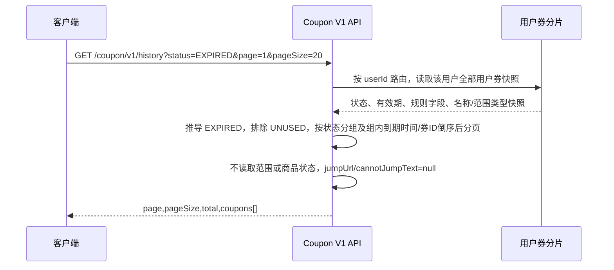

## 四、存储与中间件

### 4.1 数据库

现有 [coupon-tables-ddl.sql](/Users/rogerswang/my/work/jjewelry/order-java/docs/coupon-tables-ddl.sql) 保留 9 类表的完整参考设计；MVP 实际创建其中 7 类，库存统计和临期提醒后置：

| 表 | 用途 | 一致性要求 |
|---|---|---|
| `trade_coupon_template` | 模板规则、状态、有效期 | MySQL 持久化事实；到账弹窗模板候选读 Redis，内部接口读 MySQL |
| `trade_coupon_stock` | 后续发放数、核销数统计 | 仅参考设计预留；MVP 不建表、不统计、不扣减 |
| `trade_coupon_scope` | 指定商品范围 | 与模板创建同事务 |
| `trade_user_coupon` | 用户券状态、金额/有效期规则快照，以及 `display_name/scope_type/crowd_type` 最小快照字段；MVP 为一张无后缀物理表，预留分表能力 | 列表/历史的资产与状态只读该表；算价和商品范围/叠加规则另批量读取模板 Redis；逻辑表名统一使用 `trade_user_coupon`，分表能力保留 |
| `trade_user_coupon_log` | ISSUE/LOCK/UNLOCK/USE/RETURN 流水 | `request_no` 唯一幂等 |
| `trade_coupon_issue_task` | 人群灌券发券任务 | 记录创建人和租户 |
| `trade_coupon_issue_task_item` | 每个用户的发券结果 | `(task_id,user_id)` 唯一 |
| `trade_coupon_expire_notify` | 后续用户/日期提醒聚合 | `(user_id,notify_date)` 唯一；不属于 MVP 数据库迁移 |
| `trade_order_discount_detail` | 订单行和件的优惠分摊 | 下单时写入，退款直接读取 |

叠加规则复用模板已有 `stackable`、`stack_layer`。用户券保存 `display_name/scope_type/crowd_type` 发券快照，规则金额和有效期沿用已有列；`crowd_type` 用于直接查询新人终身领取历史，不返回 C 端。门槛文案和优惠文案由 `threshold_amount`、`discount_type`、`discount_value` 等规则字段查询时生成，正常列表继续补充通用 `jumpUrl=/coupon/v1/list` 或单商品跳转结果；历史接口保留 `jumpUrl/cannotJumpText` 字段但固定返回 `null`，不返回商品范围摘要或指定目标字段。列表和历史的资产/文案均不依赖 Redis 或模板表；正常列表仅在当前页按需读取范围摘要并查询单商品状态，历史不读取范围或商品服务。实时商品范围匹配、叠加判断和算价读取模板 Redis；用户券表仅提供用户券状态、规则金额有效期以及展示/人群快照。订单报价快照需持久化实际 `combinationMode`、每行采用的 `promotion_id` 和券基准金额。若 `trade_order_discount_detail` 已有 `layer_code/layer_order/promotion_id`，叠加报价写 `PROMOTION` 与券层两条记录；`COUPON_ONLY` 报价只写券层；促销冲突时不生成券报价，订单保留 `PROMOTION` 层。若订单创建后仍需独立审计冲突原因，保存 `combination_mode`/`promotion_conflict_code` 或等价订单扩展快照，不能只依赖 Redis 预览快照。

E-R 关系以 [coupon-er.md](/Users/rogerswang/my/work/jjewelry/order-java/docs/coupon-er.md) 和 [coupon-er.puml](/Users/rogerswang/my/work/jjewelry/order-java/docs/coupon-er.puml) 为准。MVP 使用单张 `trade_user_coupon`，路由固定 0；后续按 `hash(user_id) % table_count` 分表需独立迁移方案。库存统计表是参考设计预留，当前 MVP 实现不建库存表、不统计发放/核销数。8 个分片时由 ID 生成器预留低 3 位：`coupon_id = (globalSeq << 3) | shardNo`，反查使用 `coupon_id & 0b111`。模板/用户券 ID 的 `globalSeq` 来自 `GlobalIdGeneratorUtil.generatorId()`；最大 ID 可用于“最新分配模板”的确定性排序，但不等同于并发事务的提交时间顺序。生成器必须在左移后仍保持 Java `Long` 有效范围；扩分片不能直接复用旧 ID 的低位解释，需要保留旧分片路由兼容策略。本次状态与盲盒修订不调整 `templateId/couponId` 的对外类型，也不执行全量字符串化；各接口继续沿用当前 DTO 契约，已有价格/商品 DTO 中的 `Long couponId` 保持原数值字段契约。服务端内部仍使用 `Long` 做状态、分摊和幂等校验。

#### 4.1.1 E-R 与 DDL 落地

E-R 图中的模板、库存、范围、用户券分片、流水、发券任务、提醒和订单分摊关系与 DDL 设计一一对应；外键关系由应用层按 `template_id`、`coupon_id`、`task_id` 和订单号维护，用户券分表不跨分片建立数据库外键。`coupon-tables-ddl.sql` 保留完整设计；MVP 迁移只创建模板、范围、用户券、流水、发券任务/明细和订单分摊共 7 类核心表。库存统计表、提醒表及相关统计/提醒字段后置，MVP 不增加 `stock_counted`。

原 DDL/ER 中“整单退款返券”的文字按本次确认解释为“该券关联的优惠子订单全部成功退款后返券”，不是交易所有子单全退。结构无需因此新增表：分摊表已有 `main_order_id + coupon_id + order_id` 可表达关联。一个交易最多一张券由交易报价快照、提交事务及所有券分摊 `coupon_id` 一致性校验保证；用户券返还后可再次使用，因此不能给历史分摊表的 `coupon_id` 单独加唯一约束。

### 4.2 事务、幂等和并发

- 建券：同一 MySQL 事务回调先写模板、范围、审计，再执行 Redis put Lua，成功后提交；不增加缓存补偿或跨资源事务。
- 作废：行锁事务内先更新状态、写 CANCEL 审计，再执行 evict Lua，最后提交；重复作废保留首次时间且不重复审计。索引移除失败回滚数据库；移除成功但提交失败可能缺失索引成员，不恢复或补偿。
- 发券：用户券和 ISSUE 流水在同一 MySQL 本地事务；MVP 不执行库存条件更新。
- 锁券：交易主单、子单、券分摊、用户券条件更新和 LOCK 流水同一事务；订单侧保存唯一券及行/件快照和 `combinationMode`，拆单不重复锁券。
- 状态变更：每个动作使用带动作命名空间的唯一 `request_no`，重复消息返回已处理结果；流水唯一键必须能区分不同租户和动作，原始业务参数写入关联订单/任务及日志。
- 并发领券：所有发券入口按用户券分片和幂等号控制并发，批量查询限领后插入用户券和 ISSUE 流水；新人额外使用用户级 Redis 短锁。MVP 不建库存表、不锁库存行、不统计发放/核销数；数据库唯一键仍作为最后幂等兜底。
- 分摊金额：数据库保存行级和件级结果，后续不根据当前模板重新计算。
- 后续 `used_count` 统计：恢复该功能时再增加持久化统计标记或等价唯一记账记录，按 `USE` 加 1、`RETURN` 减 1，保证每条流水只记账一次；`mq_sent` 不能代替消费游标。MVP 不实现。

### 4.3 Redis

| Key | 内容 | TTL |
|---|---|---|
| `coupon:v1:template-v2:{tenantId}:template:<templateId>` | 模板完整规则 | 最长业务结束时间加 24 小时缓冲；miss 不回源 |
| `coupon:v1:template-v2:{tenantId}:audience:v2:all` / `coupon:v1:template-v2:{tenantId}:audience:v2:new` | 全部用户/新人模板 ID ZSET，score 为 `cacheExpireAt` | member 按 score 自然失效；查询前清理 `-inf` 到 `now`；模板作废时 ZREM |
| `coupon:v1:available:{tenantId}:{userId}:{requestHash}` | 可用券短缓存 | 10 秒以内，价格变化时删除 |
| `trade:pre:{tenantId}:{preTradeId}` | 现有预交易快照，增加选择信息 | 沿用现有 24 小时 |
| `coupon:v1:idempotent:{tenantId}:{requestNo}` | 短期请求结果 | 1 天 |

模板缓存以 epoch milliseconds 设置绝对过期，不依赖 JVM/数据库默认时区。先算“可能发出的最后一张用户券”的有效期结束，再与 receiveEndTime 取较晚值并加 24 小时缓冲，不按创建时间或单个用户的领取时间计算：`valid_type=1`（领取时起效至领取结束）取 `receive_end_time`；`valid_type=2`（领取后 N 天）取领取结束时刻按上海日历加 relative_valid_days 天；`valid_type=3`（固定有效期）取模板 `valid_end_time`。模板作废只移除人群索引成员，保留规则 JSON 直到原绝对到期时间，确保已发券算价；双 ZSET 成员按同一绝对时间自然失效，查询时清理过期成员。这样在领取窗口结束后，仍能覆盖最后时刻发出的相对有效期用户券查询和规则快照。模板缓存过期后不回源 MySQL；需要恢复时由运维按 MySQL 配置重新发布/重建缓存。用户券自身的有效期仍以发券时保存的 valid_start_time/valid_end_time 为准。

内部只读接口 `GET /aigc/trade/internal/coupon/v1/cache/templates` 以数据库模板为主数据查询 Redis 状态；传 `tenantId` 查询指定租户，不传时按租户分组。每个租户独立分页返回模板详情、商品范围、范围摘要以及两个 ZSET 的成员 score、TTL 和解析错误，不扫描 Redis key，也不读取已废弃的旧 SET。

不使用 Redis 作为库存最终事实，也不在 Redis 和 MySQL 之间声称存在同一事务。到账弹窗和算价模板缓存故障时不回源 MySQL，直接返回暂不可用并告警；恢复依赖运维重建。不新增券报价缓存；仅购物车 checkout 的短期 `preTradeId` 快照设置 TTL。

### 4.4 消息和定时任务

- 支付成功、订单取消/超时、退款成功沿用现有订单/支付事件总线；优惠券消费者按动作幂等。
- 状态流水 `mq_sent=0` 由 AFTER_COMMIT 发送和补偿任务重发；`mq_sent` 只表示发送是否成功，重发不能因为流水 `request_no` 已存在而跳过，消费者仍按动作幂等。发送失败时保留原流水，不创建重复状态流水。
- 人群灌券任务在创建请求内顺序执行，MVP 单任务去重后最多 100 人。
- 临期提醒每日 10:00 分片执行、失败补跑属于后续能力，MVP 不启动该 Job。

### 4.5 容量估算

MVP 人群灌券单次 100 人，主要压力来自用户券查询和提单算价。按 100 万用户、每人 20 张券、8 个用户券分片估算，用户券约 2000 万行；列表和价格查询都带 `user_id`，命中单分片索引。单笔交易最多一张券，普通商品每个实际订单行最多写单品直降层和券层两条明细；盲盒数量大于 1 时按件展开，最坏情况下子单数与盲盒件数相同。当前 submit 最多 100 个输入行、每行最多 99 件，报价快照和 `unit_amount_json` 需覆盖最多 9,900 件级分摊值，需按现有 submit 数量上限和盲盒件级分摊数组做容量压测。

### 4.6 性能与容量评估

以下是压测前的设计目标，最终阈值以现有线上基线和压测结果为准：可用券查询与价格计算 P95 不超过 300 ms、P99 不超过 800 ms；锁券/解锁/核销数据库事务 P95 不超过 150 ms。临期提醒恢复后再按用户券分片游标分页，每批 500 条，单分片失败可独立重试。商品列表和社区搜索不在商品循环内逐张调用券服务，恢复后先由既有列表/搜索（含 ES）返回商品，再批量读取用户券和模板范围；MVP 不新增 ES 索引和写入链路。

容量按上述 2,000 万用户券、每人 20 张、8 个分片估算。券资产列表和历史列表使用 `page/pageSize` 分页；价格/checkout 的 `benefitOptions` 完整返回当前交易的候选，不静默截断。服务端应监控异常大账户，超出保护阈值时返回明确错误或限流提示，不能返回伪完整候选。`trade_user_coupon_log` 按每张券平均 4 次状态变更约 8,000 万行，需按 `coupon_id`、`request_no` 和 `create_time` 保留归档/清理策略。提醒表在后续功能上线后再确定保留窗口。MVP 不做限量库存扣减，DDL 的 `bucket_no` 分桶仅作为后续扩展预留。

## 五、内外部依赖

| 依赖 | 用途 | 失败策略 |
|---|---|---|
| 商品服务 | 后台查询商品、校验上下架、读取商品范围 | 创建失败；提交时失败则要求刷新 |
| 用户中心/用户表 | 获取用户存在性和注册时间 | 新用户自动发券延迟重试；提交订单不依赖注册时间 |
| 现有价格/促销模块 | 计算单品直降后的基准价 | 保持现有活动结果；失败返回价格服务错误 |
| 订单交易模块 | checkout、submit、cancel、订单状态 | 订单创建失败触发解锁补偿 |
| 支付事件 | 支付成功核销 | MQ 重试和流水补偿 |
| 退款事件 | 该券关联的优惠子订单全部成功退款后返券 | 按成功退款事实判断，不等待未用券子订单，幂等处理 |
| Redis | 模板缓存、人群索引、预交易快照、短期幂等 | 到账弹窗模板 miss 不回源；预交易快照按现有过期策略处理，算价不依赖模板缓存 |
| MySQL | 券规则和状态最终事实 | 主库写入，读副本只用于非关键列表 |
| 短信/站内信 | 后续到期提醒 | 恢复提醒功能时按渠道重试，失败可补跑；不属于 MVP 依赖 |

子线程不读取 `AuthContext`。后台创建人、租户和操作人显式写入任务记录；同步请求继续沿用当前控制层从 `BaseApiDto` 获取用户身份的方式。

## 六、接口设计

### 6.1 协议约定与兼容范围

本文覆盖 App 用户端、运营后台和现有价格/交易前端接口。接口路径为网关业务路径；交易服务部署时还需结合应用 context-path `/aigc/trade` 和网关路由配置。`TradeController` 本身没有类级 `/trade` 映射，最终外部 URL 以网关配置为准。

前端成功响应统一使用项目响应信封。以下 `traceId` 为请求链路标识，`msg` 为结果说明，`code=200` 表示成功，`data` 为接口业务数据；无业务载荷的成功响应中 `data` 为 `null`。

```json
{
  "traceId": "245b7caa2fb349f79800ff7c888215d5",
  "msg": "success",
  "code": 200,
  "data": {}
}
```

参数表中的“新增”指优惠券功能需要扩展的前端协议字段，不表示当前 Java DTO 已实现；“沿用”指现有字段，保持名称、类型和既有语义。“必填”按本接口业务场景判断。金额在新 Coupon V1 API 中使用两位小数字符串；现有价格/订单 DTO 的金额类型不变，按现有 JSON 数字格式返回。本文不把既有 `templateId/couponId` 协议统一迁移为字符串：价格/订单等现有 DTO 的 `Long couponId` 继续保持数值契约，其他字段沿用其当前 DTO 类型；只有已经定义为字符串的 Coupon V1 专用请求/响应字段继续按十进制字符串传输，服务端内部仍解析为 `Long`。

请求参数表统一包含字段路径、类型、必填性、默认值、校验规则、说明和变更状态；响应参数表使用“必填/空值”列表达返回是否可能为空，并在说明中给出取值约束。`Array<T>`、`Map<K,V>` 表示嵌套对象集合，具体子字段继续在表中展开。

价格、购物车、订单、商城列表和社区搜索中的 `aggPriceInfoList` 是**全部优惠明细集合**，沿用现有字段 `name/value/channel/discountTag/promotionText/imageUrl`，不等同于优惠券列表、展示标签或 `couponSummary`。其中既有单品直降等优惠继续按原字段返回；券项在不改变旧字段含义的前提下增加：`sourceType=COUPON`、`couponId`、`couponName`、`thresholdText`、`discountText`、`scopeText`、`jumpUrl`、`cannotJumpText`；后续优惠类型继续追加对应的 `sourceType` 和扩展字段。`cannotJumpText` 是可空的直接展示文案，前端非空时提示用户并停止跳转；正常可跳转时返回 `null`。实际产生优惠时 `value` 仍使用现有负号金额展示，例如 `-15.00`；价格、checkout、订单详情和购物车价格明细使用该金额字段。商城列表、社区搜索和购物车列表的标签展示改用 `promotionLabelList`，不从 `aggPriceInfoList` 读取标签。券 ID 在该聚合展示对象中使用十进制字符串，`PriceDto.couponId` 仍保持既有 `Long`。运费不属于优惠集合，继续单独放在 `shippingFee`。

`AggPriceInfo` 中的优惠券项按以下协议返回；`thresholdText` 为 `thresholdAmount=0` 时显示“无门槛”，否则为“满{金额}元可用”；满减券 `discountText` 示例为“满70减15元”；立减和折扣文案规则仅作为后续策略预留，MVP 只返回满减文案。`jumpUrl` 返回客户端可直接打开的站内相对路径或已登记的深链；当商品入口不能打开时返回 `null`，并在 `cannotJumpText` 返回直接面向用户的原因文案。前端只判断 `cannotJumpText` 是否非空，有值就提示并停止跳转；正常可跳转时返回 `null`。单品直降等非券项不强制增加券字段，继续使用既有 `channel`、`promotionText` 和 `discountTag` 表达。

同一个 `aggPriceInfoList` 在不同接口中按上下文解释，它始终表示该上下文下的全部优惠明细集合，不增加额外的“已生效”状态字段。价格、checkout、订单详情和购物车价格明细中的该字段用于表达实际报价或已落单优惠；商城列表、社区搜索和购物车列表的展示标签统一改用 `promotionLabelList`。范围不适用、促销冲突、已使用或已过期的券不进入 `promotionLabelList`；具体不可用原因由 `benefitOptions.unavailableCoupons[]` 的状态和原因码表达。列表和搜索按每个商品独立判断，不能把当前页、搜索结果或跨分页商品合并计算；适用但未达门槛的券仍可返回券标签，但不计入列表价格。购物车按当前勾选商品集合做 `AUTO` 预估，适用券可以先展示在行级 `promotionLabelList` 中；勾选商品共同达到满减门槛后，全部实际优惠项按适用行/件计算并回填到各勾选行的到手价和价格明细；未勾选行不参与该次交易级计算，但仍可展示自身适用券标签。该预估不锁券，最终以 checkout/submit 为准。商城/搜索每个商品最多返回一条默认最优券标签；达到门槛和未达门槛均按既有匹配与择优规则返回，标签排序由 `priority` 控制。

历史字段一律保留，包括商品详情/列表/社区搜索中的 `price`、`discountPrice`、`promotionChannel`、`promotionChannelInfo.productTag`、`promotionText`、`promotionChannelInfo`，以及购物车和价格接口中的 `payPrice`、`discount`、`productPayPrice`、`unitPayPrice`、`couponId`、`couponCode`。当一个页面只有一个优惠标签槽位时，服务端/客户端按同一规则读取 `promotionLabelList` 的第一项：促销标签沿用该场景原有渲染话术，只有没有促销时才显示券标签；不修改 `productTag`，也不把券规则写入历史促销话术。商品详情的 `skuDtoList[].promotionChannelInfo.productDetails` 由当前 SKU 报价独立重建，依次展示直降、全部已达门槛券和仅未达门槛券规则；过滤空白、trim、保序去重。商详 `productDetail` 字段继续作为老字段使用，并回填首标签文案（有促销时首标签就是原促销话术；纯券时为券标签）；无促销有券时创建类型为“优惠券”的对象，券不覆盖促销渠道。实际价格取独立 AUTO 报价，不按文案计算。`aggPriceInfoList` 继续承载全部价格优惠明细，扩展字段只对券项增加，不删除旧字段。

| 字段路径 | 类型 | 必填/空值 | 默认值/约束 | 说明 | 变更 |
|---|---|---|---|---|---|
| `AggPriceInfo.name` | String | 有值 | — | 优惠名称，沿用现有字段 | 沿用 |
| `AggPriceInfo.value` | String | 实际券优惠项有值；其他历史项保持原协议 | 券项为负号金额、两位小数，例如 `-15.00` | 当前上下文实际计入价格的优惠金额；未达门槛、未选中或不可用券不生成券明细项，展示标签放 `promotionLabelList` | 沿用/语义补充 |
| `AggPriceInfo.channel` | Integer | 有值 | 券层为 `0` | 原渠道字段 | 沿用 |
| `AggPriceInfo.discountTag` | String | 可空 | 券层为 `null` | 原优惠标签 | 沿用 |
| `AggPriceInfo.promotionText/imageUrl` | String | 可空 | 按现有返回规则 | 原展示文案和商品图 | 沿用 |
| `AggPriceInfo.sourceType` | String | 券项有值 | `COUPON` | 标记此项为优惠券 | 新增 |
| `AggPriceInfo.couponId` | String | 券项有值 | 十进制字符串 | 防止聚合 DTO 的 Long 精度损失；不改变 `PriceDto.couponId` | 新增 |
| `AggPriceInfo.couponName` | String | 券项有值 | — | 券模板名称 | 新增 |
| `AggPriceInfo.thresholdText` | String | 券项有值 | — | 门槛文案，折扣类也需明确门槛 | 新增 |
| `AggPriceInfo.discountText` | String | 券项有值 | — | MVP 满减文案，例如“满70减15元”；立减/折扣为后续策略 | 新增 |
| `AggPriceInfo.scopeText` | String | 券项有值 | `指定商品可用` 或 `全店商品可用` | 商品范围通用文案，由用户券快照 `scope_type` 生成 | 新增 |
| `AggPriceInfo.jumpUrl` | String | 券项可空 | 站内相对路径/登记深链；`cannotJumpText` 非空时为 `null` | 点击后进入适用商品或优惠券列表 | 新增 |
| `AggPriceInfo.cannotJumpText` | String | 券项可空 | 正常为 `null`；入口不可跳转时返回直接提示文案 | 前端非空即提示并停止跳转；与 `jumpUrl=null` 配套 | 新增 |

商品详情、商城列表、社区搜索和购物车列表使用独立的 `PromotionLabel` 数组，不复用 `AggPriceInfo`：

| 字段路径 | 类型 | 必填/空值 | 默认值/约束 | 说明 | 变更 |
|---|---|---|---|---|---|
| `promotionLabelList[]` | Array<PromotionLabel> | 有值 | 无标签返回 `[]` | 商品详情、商城列表、社区搜索和购物车列表的展示标签集合，按 `priority` 降序返回 | 新增 |
| `promotionLabelList[].type` | String | 有值 | `PROMOTION`、`COUPON` | 标签来源类型；后续类型预留枚举扩展 | 新增 |
| `promotionLabelList[].text` | String | 有值 | — | 客户端直接展示的主文案 | 新增 |
| `promotionLabelList[].priority` | Integer | 有值 | 单品直降 `100`，优惠券 `50` | 数值越大越优先；单标签展示位取第一项 | 新增 |
| `promotionLabelList[].couponId` | String | 券标签有值，促销标签为空 | 十进制字符串 | 券标签关联的用户券 ID；促销标签为 `null` | 新增 |
| `promotionLabelList[].couponName` | String | 可空 | 用户券名称快照 | 商详 SKU 优惠话术复用；促销标签为 `null` | 新增 |
| `promotionLabelList[].thresholdText` | String | 券标签有值，促销标签为空 | — | 券门槛文案；未达门槛也返回 | 新增 |
| `promotionLabelList[].discountText` | String | 券标签有值，促销标签为空 | — | 券优惠文案，例如“满100减20元” | 新增 |
| `promotionLabelList[].scopeText` | String | 券标签有值，促销标签为空 | `指定商品可用` 或 `全店商品可用` | 商品范围通用文案；促销标签为 `null` | 新增 |
| `promotionLabelList[].jumpUrl` | String | 券标签可空，促销标签为空 | 站内相对路径或已登记深链；`cannotJumpText` 非空时为 `null` | 去使用跳转地址 | 新增 |
| `promotionLabelList[].cannotJumpText` | String | 券标签可空，促销标签为 `null` | 正常为 `null`；不能跳转时返回直接提示文案 | 前端非空即提示并停止跳转；有值时 `jumpUrl` 必须为 `null` | 新增 |

`promotionLabelList` 返回当前上下文全部可展示的标签类型；券标签的 `scopeText` 只表达通用范围，不列具体商品名称；同一商品或购物车行最多返回一条按既有规则择优的券标签。标签只表示展示，不代表锁券、核销或最终成交金额。旧客户端可忽略该新增数组；商品详情及三个列表场景的新客户端必须优先读取该数组。

交易券数组统一结构：

| 字段路径 | 类型 | 必填/空值 | 默认值/约束 | 说明 | 变更 |
|---|---|---|---|---|---|
| `couponIds[]` | Array<String> | 条件必填 | `[]` | 请求或响应中的券 ID 数组；MVP 最大长度 1，未来可扩展多券 | 新增 |
| `benefitOptions` | BenefitOptions | 有值 | `null`（旧客户端/券能力关闭时可不返回） | 统一承载促销候选、可用券、不可用券和当前优惠选择 | 新增 |
| `benefitOptions.maxSelectableCount` | Integer | 有值 | `1` | 一笔交易最多选择一张券；为未来多券预留 | 新增 |
| `benefitOptions.selectedBenefitType` | String | 有值 | `NONE` | `PROMOTION`、`COUPON`、`NONE` | 新增 |
| `benefitOptions.selectedCouponIds[]` | Array<String> | 有值 | `[]` | 当前实际选择的券；MVP 最多一个元素 | 新增 |
| `benefitOptions.promotionList[]` | Array<PromotionOption> | 有值 | `[]` | 当前交易中的促销候选及商品行归属 | 新增 |
| `benefitOptions.availableCoupons[]` | Array<AvailableCoupon> | 有值 | `[]` | 当前交易可用的完整券候选 | 新增 |
| `benefitOptions.unavailableCoupons[]` | Array<UnavailableCoupon> | 有值 | `[]` | 当前不可用券、完整券卡片和主原因 | 新增 |

`benefitOptions` 的嵌套字段如下。以下 `CouponOption` 同时用于 `availableCoupons[]` 和 `unavailableCoupons[]`；两组均返回完整券卡片，不依赖另一个接口补齐。字段表适用于 `/price/compute`、`/trade/checkout` 的成功响应以及指定券不可用的错误响应。

| 字段路径（相对各数组元素） | 类型 | 必填/空值 | 默认值/校验规则 | 说明 | 变更 |
|---|---|---|---|---|---|
| `promotionList[].promotionId` | String | 有值 | 活动 ID | 现有单品直降活动标识 | 新增 |
| `promotionList[].name` | String | 有值 | 非空 | 促销展示名称 | 新增 |
| `promotionList[].channel` | Integer | 有值 | 本期为 `9` | 单品直降渠道 | 新增 |
| `promotionList[].discountAmount` | String | 有值 | 非负、两位小数 | 当前交易该促销优惠额，不含券优惠 | 新增 |
| `promotionList[].applicableLineIds[]` | Array<String> | 有值 | 请求行 `skuId`；无行返回 `[]` | 促销对应的商品行；与报价分摊来源一致 | 新增 |
| `CouponOption.couponId/templateId` | String | 有值 | 十进制字符串 | 用户券 ID / 模板 ID；用于切换券时回传 `couponIds[]` | 新增 |
| `CouponOption.displayName` | String | 有值 | 非空 | 发券时保存的券名称快照 | 新增 |
| `CouponOption.discountType` | Integer | 有值 | MVP 为 `2` | 满减；其他券型仅预留扩展 | 新增 |
| `CouponOption.thresholdAmount/discountValue` | String | 有值 | 非负、两位小数 | 满减门槛和面额 | 新增 |
| `CouponOption.validStartTime/validEndTime` | String(datetime) | 有值 | `yyyy-MM-dd HH:mm:ss` | 用户券实际有效期；择优使用 `validEndTime` | 新增 |
| `CouponOption.selected` | Boolean | 有值 | 默认 `false` | 当前实际选中券为 `true`，与 `selectedCouponIds` 一致；可用和不可用券项均返回 | 新增 |
| `CouponOption.isVoidTime` | Boolean | 有值 | 默认 `false` | 用户券未使用、处于有效期内且距到期不超过 24 小时时为 `true`，含两端边界；不受本次报价门槛或范围影响 | 新增 |
| `CouponOption.status` | String | 有值 | `UNUSED/LOCKED/USED/EXPIRED` | 沿用用户券状态机；能否用于本次报价还需看所在候选数组和原因码 | 新增 |
| `CouponOption.statusText` | String | 有值 | 与 `status` 一一对应 | `未使用/使用中/已使用/已过期`；不是本次报价不可用原因 | 新增 |
| `CouponOption.thresholdText/discountText` | String | 有值 | 非空 | 门槛与优惠文案，例如“满70元可用”/“满70减15元” | 新增 |
| `CouponOption.scopeText` | String | 有值 | `指定商品可用`/`全店商品可用` | 由用户券 `scope_type` 快照生成的通用范围文案，不返回商品范围明细 | 新增 |
| `CouponOption.cannotJumpText` | String | 可空 | 默认 `null`；仅单商品范围且商品下架/不存在时返回“商品已下架或不存在，暂时无法跳转” | 有值时直接提示并停止跳转，`jumpUrl=null`；多商品/全店不查商品状态 | 新增 |
| `CouponOption.jumpUrl` | String | 可空 | 单商品上架时为商品详情；多商品/全店为 `/coupon/v1/list`；文案非空时为 `null` | 客户端券卡片去使用入口 | 新增 |
| `CouponOption.stackable` | Boolean | 有值；模板缓存缺失时为空 | 模板 Redis 中的 `stackable` | 是否可叠加适用商品行的单品直降 | 新增 |
| `CouponOption.actualDiscount` | String | 可用券有值，不可用券为 `null` | 可用时大于 0、两位小数 | 当前上下文该券实际可减金额 | 新增 |
| `CouponOption.candidatePayableAmount` | String | 可用券有值，不可用券为 `null` | 非负、两位小数 | 该券候选的商品应付加同一份现有运费 | 新增 |
| `CouponOption.promotionCombination` | String | 可用券有值，不可用券为 `null` | `STACKED/COUPON_ONLY` | 该候选适用行的组合模式，不代表交易其他行没有促销 | 新增 |
| `unavailableCoupons[].reasonCode` | String | 有值 | 稳定原因码 | 例如 `THRESHOLD_NOT_MET`、`PROMOTION_CONFLICT`、`COUPON_TEMPLATE_UNAVAILABLE` | 新增 |
| `unavailableCoupons[].reasonText` | String | 有值 | 非空 | 客户端直接展示的不可用原因 | 新增 |

存在选中券时 `selectedBenefitType=COUPON`，该券项 `selected=true`，其余券项为 `false`；可叠加的促销仍正常生效。没有选中券但有促销时为 `PROMOTION`，两者都没有时为 `NONE`。是否叠加由候选的 `promotionCombination` 及已生效的 `aggPriceInfoList` 表达。`AUTO` 比较含相同运费的最终应付金额；相同时优先保留促销方案，再按实际券优惠、有效期、券 ID 稳定择优。`SPECIFIED` 不可用时返回错误及完整 `benefitOptions`，所有券项 `selected=false`，不静默换券；`NONE` 仅停用券，仍保留促销。

`cannotJumpText` 统一复用第三章第 10 节单商品跳转规则：正常券列表、弹窗、benefitOptions、标签仅指定范围恰好一个商品时批量查询上架/未删除状态；多商品/全店直接跳列表。历史券列表不执行跳转解析，字段固定为 `null`。模板 miss、门槛不足和当前范围不匹配不生成该文案，依赖失败通用入口降级；订单已生效优惠明细固定为 null，不加载当前商品。

`couponIds[]` 是本期所有新请求的唯一券选择字段；`AUTO`、`NONE` 的请求数组必须为空或省略，`SPECIFIED` 恰好传一个元素，数组长度大于 1 返回 `MULTI_COUPON_NOT_SUPPORTED`。仅传非空 `couponIds` 而不传 `couponSelection` 属于参数错误，不能当作旧客户端请求静默忽略；两者都未传时沿用旧逻辑。价格响应中的历史 `PriceDto.couponId` 继续保留，新客户端读取 `couponIds[]`。价格和 checkout 响应不再返回独立的券列表字段；当前选择通过 `couponIds[]`、`benefitOptions.selectedCouponIds[]` 与券项 `selected` 一致表达，客户端可直接读取券项选中态。候选详情通过 `benefitOptions.availableCoupons[]/unavailableCoupons[]` 表达。订单创建和交易提交响应不新增券字段；订单详情的实际优惠统一放在 `discountSummary.aggPriceInfoList[]`。

下方 JSON 示例展示有代表性的实际字段；可空字段在具体响应中可能为 `null` 或按现有序列化配置省略，完整字段以对应接口的返回参数表为准。

所有算价和下单请求都使用数组表达券选择，便于后续扩展一笔交易多券：`couponSelection=AUTO` 由服务端从当前用户可用券中择优，`SPECIFIED` 使用 `couponIds`，`NONE` 使用空数组。MVP 只接受 `couponIds.length <= 1`；`SPECIFIED` 必须恰好一个元素，`AUTO` 最多返回一个元素，服务端不允许按商品行分别传券。新请求不再接收单值 `couponId`；价格响应中的历史 `PriceDto.couponId` 保持 Long 类型，和 `couponIds[]` 表达同一当前选择。优惠券仅抵商品金额，不抵运费；运费由现有地址、运费模板、拼箱及行级分摊逻辑计算。模板 `stackable=true` 时单品直降后再算券；`false` 时只要券适用行存在单品直降就返回 `PROMOTION_CONFLICT`，不移除促销、不生成互斥候选。

旧客户端不传新增券字段时，价格和下单仍走原逻辑；券开关关闭时不改变现有价格字段、历史促销结果和返回结构。历史 `/coupon/*` 路由与行为保持原样，新优惠券链路不调用它们。

### 6.2 现有价格与交易接口

#### 6.2.1 价格预计算

接口名称：价格预计算（直接购买）

URL：`POST /price/compute`

请求参数 JSON：

```json
{
  "productId": "P1001",
  "skuId": "SKU1001",
  "quantity": 2,
  "addressId": "ADDR01",
  "promotionId": "PROMO01",
  "couponSelection": "SPECIFIED",
  "couponIds": ["72057594037927937"]
}
```

| 字段路径 | 类型 | 必填 | 默认值 | 校验/说明 | 变更 |
|---|---|---:|---|---|---|
| `couponSelection` | String | 否 | 缺省走旧逻辑 | 仅允许 `AUTO`、`SPECIFIED`、`NONE`；旧客户端不传时不启用新券 | 新增 |
| `couponIds` | Array<String> | 条件必填 | `[]` | `SPECIFIED` 恰好 1 个；MVP 最大长度 1；每个 ID 为十进制字符串且属于当前用户 | 新增 |

返回数据 JSON：

```json
{
  "traceId": "245b7caa2fb349f79800ff7c888215d5",
  "msg": "success",
  "code": 200,
  "data": {
    "payPrice": 85.0,
    "discount": 25.0,
    "shippingFee": 0.0,
    "totalPrice": 110.0,
    "productTotalPrice": 110.0,
    "productPayPrice": 85.0,
    "unitPayPrice": 42.5,
    "couponId": 72057594037927937,
    "couponIds": [
      "72057594037927937"
    ],
    "benefitOptions": {
      "maxSelectableCount": 1,
      "selectedBenefitType": "COUPON",
      "selectedCouponIds": [
        "72057594037927937"
      ],
      "promotionList": [
        {
          "promotionId": "PROMO01",
          "name": "单品直降5元",
          "channel": 9,
          "discountAmount": "10.00",
          "applicableLineIds": [
            "SKU1001"
          ]
        }
      ],
      "availableCoupons": [
        {
          "couponId": "72057594037927937",
          "templateId": "72057594037927936",
          "displayName": "新人券",
          "discountType": 2,
          "thresholdAmount": "70.00",
          "discountValue": "15.00",
          "validStartTime": "2026-10-16 12:00:00",
          "validEndTime": "2026-10-23 12:00:00",
          "status": "UNUSED", "statusText": "未使用",
          "isVoidTime": false,
          "selected": true,
          "cannotJumpText": null,
          "actualDiscount": "15.00",
          "candidatePayableAmount": "85.00",
          "thresholdText": "满70元可用",
          "discountText": "满70减15元",
          "scopeText": "指定商品可用",
          "jumpUrl": "/coupon/v1/list",
          "stackable": true,
          "promotionCombination": "STACKED"
        }
      ],
      "unavailableCoupons": [
        {
          "couponId": "72057594037927938",
          "templateId": "72057594037927944",
          "displayName": "满减券",
          "discountType": 2,
          "thresholdAmount": "200.00",
          "discountValue": "20.00",
          "validStartTime": "2026-10-16 12:00:00",
          "validEndTime": "2026-10-23 12:00:00",
          "status": "UNUSED", "statusText": "未使用",
          "isVoidTime": false,
          "selected": false,
          "cannotJumpText": null,
          "actualDiscount": null,
          "candidatePayableAmount": null,
          "thresholdText": "满200元可用",
          "discountText": "满200减20元",
          "scopeText": "指定商品可用",
          "jumpUrl": "/coupon/v1/list",
          "stackable": true,
          "promotionCombination": null,
          "reasonCode": "THRESHOLD_NOT_MET",
          "reasonText": "未达到使用门槛"
        }
      ]
    },
    "couponCode": null,
    "discountList": [],
    "promotionChannelInfo": {
      "promotionChannel": 9,
      "productTag": "单品直降",
      "productDetail": "每件直降5元"
    },
    "aggPriceInfoList": [
      {
        "name": "单品直降5元",
        "value": "-10.00",
        "channel": 9,
        "discountTag": null,
        "promotionText": "每件直降5元，共优惠10元",
        "imageUrl": null
      },
      {
        "name": "新人券",
        "value": "-15.00",
        "channel": 0,
        "discountTag": null,
        "promotionText": "券后满减15元",
        "imageUrl": null,
        "sourceType": "COUPON",
        "couponId": "72057594037927937",
        "couponName": "新人券",
        "thresholdText": "满70元可用",
        "discountText": "满70减15元",
        "scopeText": "指定商品可用",
        "jumpUrl": "/coupon/v1/list",
        "cannotJumpText": null
      }
    ]
  }
}
```

| 字段路径 | 类型 | 必填/空值 | 说明 | 变更 |
|---|---|---|---|---|
| `data.couponId` | Long | 可空 | 实际适用券 ID；继续保持现有 `Long` 类型 | 行为扩展 |
| `data.couponIds[]` | Array<String> | 有值，可为空 | 当前实际选券数组；MVP 最多一个元素，价格响应中的历史 `couponId` 保留 | 新增 |
| `data.benefitOptions` | BenefitOptions | 有值或旧客户端省略 | 统一返回促销候选、可用券和不可用券；价格响应不再返回独立的券列表字段 | 新增 |
| `data.aggPriceInfoList[]` | Array<AggPriceInfo> | 有值 | 当前报价上下文的全部优惠明细集合；券项增加 `sourceType/couponId/couponName/thresholdText/discountText/scopeText/jumpUrl/cannotJumpText` | 扩展 |


说明：本例两件商品原价合计 110 元，单品直降每件 5 元，促销后合计 100 元；叠加满70减15券后商品实付 85 元，运费为 0 元。满200减20券未达门槛，仅出现在 `benefitOptions.unavailableCoupons` 中。`PriceDto.couponId` 响应保持 `Long`；请求端 `couponIds[]` 使用字符串 ID，避免 JSON Long 精度丢失，新请求不接收单值 `couponId`。新券报价仍按现有运费逻辑计算：先取得该商品/地址的当前运费，再计算商品侧券优惠；券优惠不改变 `shippingFee`。`couponIds` 不替代 `OrderCreateRequest.token`。

#### 6.2.2 直接购买创建订单

接口名称：创建订单（直接购买）

URL：`POST /order/create`

请求参数 JSON：

```json
{
  "addressId": "ADDR01",
  "quantity": 2,
  "skuId": "SKU1001",
  "productId": "P1001",
  "discountPrice": 50.00,
  "token": "preorder_token_01",
  "remark": "尽快发货",
  "scene": "APP",
  "promotionId": "PROMO01",
  "couponSelection": "SPECIFIED",
  "couponIds": ["72057594037927937"]
}
```

| 字段路径 | 类型 | 必填 | 默认值 | 校验/说明 | 变更 |
|---|---|---:|---|---|---|
| `couponSelection` | String | 否 | 缺省走旧逻辑 | `AUTO/SPECIFIED/NONE`；确认购买时建议将预览结果固定为 `SPECIFIED` 或 `NONE`，仍传 `AUTO` 则实时择优 | 新增 |
| `couponIds` | Array<String> | 条件必填 | `[]` | `SPECIFIED` 恰好 1 个；MVP 最大长度 1 | 新增 |

返回数据 JSON：

```json
{
  "traceId": "245b7caa2fb349f79800ff7c888215d5",
  "msg": "success",
  "code": 200,
  "data": {
    "orderId": "O202610170001",
    "tradeId": "T202610170001"
  }
}
```

| 字段路径 | 类型 | 必填/空值 | 说明 | 变更 |
|---|---|---|---|---|
| `data.orderId/tradeId` | String | 成功时有值 | 原订单和交易返回字段保持不变；优惠结果通过订单详情的 `discountSummary.aggPriceInfoList[]` 查询 | 沿用，无字段新增 |

提交时服务端校验原 `token`，按请求选择和服务端实时商品、库存、地址运费、单品直降及用户券重算，再锁券；不校验不存在的券预览价格指纹，不直接信任客户端 `discountPrice`，也不承诺固定预览金额。客户端确认时用 `SPECIFIED` 及预览选中的 `couponIds` 固定券选择，无券则用 `NONE`；继续传 `AUTO` 表示允许实时重新择优。旧客户端不传新增券选择字段时完全沿用旧流程。成功响应仅有原 `orderId/tradeId`，无需新增券字段。

#### 6.2.3 交易结算预览

接口名称：交易结算预览（购物车/多商品）

URL：`POST /trade/checkout`

请求参数 JSON：

```json
{
  "addressId": "ADDR01",
  "items": [
    {"cartItemId": "CART001", "productId": "P1001", "skuId": "SKU1001", "quantity": 1},
    {"cartItemId": "CART002", "productId": "P1002", "skuId": "SKU1002", "quantity": 2}
  ],
  "couponSelection": "SPECIFIED",
  "couponIds": ["72057594037927937"]
}
```

| 字段路径 | 类型 | 必填 | 默认值 | 校验/说明 | 变更 |
|---|---|---:|---|---|---|
| `couponSelection` | String | 否 | 缺省走旧逻辑 | `AUTO/SPECIFIED/NONE`；整笔交易只能选择一张券 | 新增 |
| `couponIds` | Array<String> | 条件必填 | `[]` | 仅 `SPECIFIED` 传 1 个；所有商品行共用该券 | 新增 |

返回数据 JSON：

```json
{
  "traceId": "245b7caa2fb349f79800ff7c888215d5",
  "msg": "success",
  "code": 200,
  "data": {
    "preTradeId": "PT202610170001",
    "couponIds": [
      "72057594037927937"
    ],
    "benefitOptions": {
      "maxSelectableCount": 1,
      "selectedBenefitType": "COUPON",
      "selectedCouponIds": [
        "72057594037927937"
      ],
      "promotionList": [],
      "availableCoupons": [
        {
          "couponId": "72057594037927937",
          "templateId": "72057594037927936",
          "displayName": "新人券",
          "discountType": 2,
          "thresholdAmount": "70.00",
          "discountValue": "15.00",
          "validStartTime": "2026-10-16 12:00:00",
          "validEndTime": "2026-10-23 12:00:00",
          "status": "UNUSED", "statusText": "未使用",
          "isVoidTime": false,
          "selected": true,
          "cannotJumpText": null,
          "actualDiscount": "15.00",
          "candidatePayableAmount": "143.00",
          "thresholdText": "满70元可用",
          "discountText": "满70减15元",
          "scopeText": "指定商品可用",
          "jumpUrl": "/coupon/v1/list",
          "stackable": true,
          "promotionCombination": "COUPON_ONLY"
        }
      ],
      "unavailableCoupons": []
    },
    "items": [
      {
        "cartItemId": "CART001",
        "productId": "P1001",
        "skuId": "SKU1001",
        "quantity": 1,
        "price": 70.0,
        "unitPayPrice": 55.0,
        "productPayPrice": 55.0,
        "channel": 0,
        "aggPriceInfoList": [
          {
            "name": "新人券",
            "value": "-15.00",
            "channel": 0,
            "discountTag": null,
            "promotionText": "券后满减15元",
            "imageUrl": null,
            "sourceType": "COUPON",
            "couponId": "72057594037927937",
            "couponName": "新人券",
            "thresholdText": "满70元可用",
            "discountText": "满70减15元",
            "scopeText": "指定商品可用",
            "jumpUrl": "/coupon/v1/list",
            "cannotJumpText": null
          }
        ]
      },
      {
        "cartItemId": "CART002",
        "productId": "P1002",
        "skuId": "SKU1002",
        "quantity": 2,
        "price": 40.0,
        "unitPayPrice": 40.0,
        "productPayPrice": 80.0,
        "channel": 0
      }
    ],
    "discountSummary": {
      "itemTotal": 1,
      "discountTotal": 15.0,
      "aggPriceInfoList": [
        {
          "name": "新人券",
          "value": "-15.00",
          "channel": 0,
          "discountTag": null,
          "promotionText": "券后满减15元",
          "imageUrl": null,
          "sourceType": "COUPON",
          "couponId": "72057594037927937",
          "couponName": "新人券",
          "thresholdText": "满70元可用",
          "discountText": "满70减15元",
          "scopeText": "指定商品可用",
          "jumpUrl": "/coupon/v1/list",
          "cannotJumpText": null
        }
      ]
    },
    "shippingSummary": {
      "fee": 8.0,
      "intro": "运费按当前模板计算",
      "bullets": []
    },
    "priceSummary": {
      "productTotalPrice": 150.0,
      "discount": 15.0,
      "productPayPrice": 135.0,
      "shippingFee": 8.0,
      "totalPayPrice": 143.0,
      "aggPriceInfoList": [
        {
          "name": "新人券",
          "value": "-15.00",
          "channel": 0,
          "discountTag": null,
          "promotionText": "券后满减15元",
          "imageUrl": null,
          "sourceType": "COUPON",
          "couponId": "72057594037927937",
          "couponName": "新人券",
          "thresholdText": "满70元可用",
          "discountText": "满70减15元",
          "scopeText": "指定商品可用",
          "jumpUrl": "/coupon/v1/list",
          "cannotJumpText": null
        }
      ]
    }
  }
}
```

| 字段路径 | 类型 | 必填/空值 | 说明 | 变更 |
|---|---|---|---|---|
| `data.discountSummary.aggPriceInfoList[]` | Array<AggPriceInfo> | 有值 | 当前交易汇总的全部优惠明细；券项补充 `sourceType/couponId/couponName/thresholdText/discountText/scopeText/jumpUrl/cannotJumpText` | 修改 |
| `data.items[].aggPriceInfoList[]` | Array<AggPriceInfo> | 可空 | 当前行实际承担的全部优惠明细；券项字段按 6.1 共用结构返回 | 修改 |
| `data.priceSummary.productPayPrice/shippingFee/totalPayPrice` | BigDecimal | 有值 | 商品优惠只改 `productPayPrice`，运费沿用现有逻辑，`totalPayPrice=productPayPrice+shippingFee` | 语义明确 |
| `data.priceSummary.aggPriceInfoList[]` | Array<AggPriceInfo> | 有值 | 整笔交易全部优惠汇总，券项按 6.1 共用结构返回 | 新增 |
| `data.couponIds[]` | Array<String> | 有值，可为空 | 整笔预估实际选券数组；MVP 最多一个元素，价格响应中的历史 `couponId` 保留 | 新增 |
| `data.benefitOptions` | BenefitOptions | 有值或旧客户端省略 | 交易级优惠候选和当前选择；checkout 根节点只通过 `benefitOptions` 返回候选 | 新增 |

`benefitOptions` 是 checkout 根节点唯一的优惠候选容器：促销、可用券和不可用券均从这里读取；`items[].aggPriceInfoList`、`discountSummary.aggPriceInfoList` 和 checkout 的 `priceSummary.aggPriceInfoList` 只表示已经生效的优惠明细。

金额关系保持 `productPayPrice = productTotalPrice - discount`、`totalPayPrice = productPayPrice + shippingFee`。整笔选中商品按现有运费模板分组及拼箱规则计算运费，继而按既有规则向订单行分摊；优惠券只调整商品侧金额。商品行和子单允许实付 0 元，整笔交易发起支付时至少 0.01 元。`preTradeId` 快照保存选券、价格指纹、促销候选、运费及订单行分摊。

#### 6.2.4 提交交易订单

接口名称：提交交易订单

URL：`POST /trade/submit`

请求参数 JSON：

```json
{
  "addressId": "ADDR01",
  "items": [
    {"cartItemId": "CART001", "productId": "P1001", "skuId": "SKU1001", "quantity": 1},
    {"cartItemId": "CART002", "productId": "P1002", "skuId": "SKU1002", "quantity": 2}
  ],
  "preTradeId": "PT202610170001",
  "remark": "请尽快发货",
  "couponSelection": "SPECIFIED",
  "couponIds": ["72057594037927937"]
}
```

| 字段路径 | 类型 | 必填 | 默认值 | 校验/说明 | 变更 |
|---|---|---:|---|---|---|
| `couponSelection` | String | 否 | `AUTO` | `AUTO/SPECIFIED/NONE`；按本次意图实时算价，意图可以与 checkout 不同，实际券 ID 必须一致 | 新增 |
| `couponIds` | Array<String> | 条件必填 | 省略 | `SPECIFIED` 恰好指定一张券；`AUTO/NONE` 允许空数组、null 或省略；仅传非空数组而不传意图仍属参数错误 | 新增 |

返回数据 JSON：

```json
{
  "traceId": "245b7caa2fb349f79800ff7c888215d5",
  "msg": "success",
  "code": 200,
  "data": {
    "tradeId": "T202610170001",
    "orderIdList": ["O202610170001", "O202610170002"]
  }
}
```

| 字段路径 | 类型 | 必填/空值 | 说明 | 变更 |
|---|---|---|---|---|
| `data.tradeId/orderIdList[]` | String/Array<String> | 成功时有值 | 原交易和子订单返回结构保持不变；优惠结果通过订单详情的 `discountSummary.aggPriceInfoList[]` 查询 | 沿用，行为扩展 |

服务端按本次请求意图实时算价，先校验指定券可用性，再比较实际券 ID、总应付和价格指纹，通过后才创建交易和子订单并在同一事务锁券，不得按子订单重复锁券。券 ID 或价格指纹变化返回 `PRICE_CHANGED`，提示“订单状态改变，请重新确认订单”；指定券不可用保留原优惠券错误码和候选数据，总应付变化沿用原金额校验错误码，提示统一为上述文案。省略券字段按 AUTO 重选，不继承 checkout 意图；旧快照仅在 `couponSelection=null` 时跳过券 ID 比较，仍校验金额及已有价格指纹。

#### 6.2.5 取消交易

接口名称：取消待支付交易

URL：`POST /trade/cancel`

请求参数 JSON：

```json
{"tradeId": "T202610170001", "reason": "用户取消"}
```

| 字段路径 | 类型 | 必填 | 默认值 | 校验/说明 | 变更 |
|---|---|---:|---|---|---|
| — | — | — | — | 请求和响应字段不新增；券解锁作为取消副作用按 `tradeId` 幂等执行 | 无字段变更 |

返回数据 JSON：

```json
{
  "traceId": "245b7caa2fb349f79800ff7c888215d5",
  "msg": "success",
  "code": 200,
  "data": {"status": 60, "statusDesc": "已取消"}
}
```

| 字段路径 | 类型 | 必填/空值 | 说明 | 变更 |
|---|---|---|---|---|
| `data.status/statusDesc` | Integer/String | 有值/可空 | 原交易状态字段保持不变 | 沿用，无字段新增 |

券解锁作为取消副作用执行，保留原有效期；重复取消/解锁必须幂等。请求和响应 DTO 不新增字段；券解锁作为取消副作用按 `tradeId` 幂等执行。

#### 6.2.6 交易/订单详情

接口名称：交易详情

URL：`GET /trade/detail?orderId=O202610170001&tradeId=T202610170001`

请求参数：无请求体。

| 参数 | 位置 | 类型 | 必填 | 默认值 | 校验/说明 | 变更 |
|---|---|---|---:|---|---|---|
| `orderId` | Query | String | 是 | — | 原子单查询参数保持不变 | 沿用 |
| `tradeId` | Query | String | 否 | `null` | 有值时按交易聚合子订单 | 沿用 |

返回数据 JSON：

```json
{
  "traceId": "245b7caa2fb349f79800ff7c888215d5",
  "msg": "success",
  "code": 200,
  "data": {
    "orderId": "O202610170001",
    "tradeId": "T202610170001",
    "orderIndex": 1,
    "orderCount": 2,
    "productId": "P1001",
    "skuId": "SKU1001",
    "productName": "示例商品",
    "quantity": 1,
    "price": 70.00,
    "unitPayPrice": 55.00,
    "totalAmount": 70.00,
    "discountAmount": 15.00,
    "payAmount": 55.00,
    "shippingFee": 0.00,
    "productTotalPrice": 70.00,
    "discountSummary": {"itemTotal": 1, "discountTotal": 15.00, "aggPriceInfoList": [{"name": "新人券", "value": "-15.00", "channel": 0, "discountTag": null, "promotionText": "券后满减15元", "imageUrl": null, "sourceType": "COUPON", "couponId": "72057594037927937", "couponName": "新人券", "thresholdText": "满70元可用", "discountText": "满70减15元", "scopeText": "指定商品可用", "jumpUrl": "/coupon/v1/list", "cannotJumpText": null}]},
    "shippingSummary": {"fee": 0.00, "intro": "包邮", "bullets": []},
    "priceSummary": {"productTotalPrice": 70.00, "discount": 15.00, "productPayPrice": 55.00, "shippingFee": 0.00, "totalPayPrice": 55.00}
  }
}
```

| 字段路径 | 类型 | 必填/空值 | 说明 | 变更 |
|---|---|---|---|---|
| `data.discountSummary.aggPriceInfoList[]` | Array<AggPriceInfo> | 可空 | 已落库的交易全部优惠展示；券项含完整券字段 | 修改 |
| 其他 `data.*` | — | — | 订单详情原字段保持既有协议，不因券功能改名或改类型 | 沿用 |

交易详情不得根据当前券模板重算金额。券金额以订单实际分摊明细为准；同一张券可在多个适用子订单行出现分摊明细；普通商品多件仍在一个子单的 `unit_amount_json` 中保存多件，盲盒多件对应多个数量为 1 的子单，但全交易只生成一次 `USE` 核销流水。

#### 6.2.7 购物车列表

接口名称：购物车列表（优惠展示改造）

URL：`GET /cart/list`

请求参数：无请求体；用户、租户和 App 身份沿用现有登录态和请求头。

现有字段全部保持原协议，以下只列本期新增/修改字段。购物车列表不锁券；适用范围和有效期匹配的券可以先以 `promotionLabelList` 返回，即使当前勾选商品集合未达门槛也不改变价格。当前勾选商品集合达到门槛后，优惠按适用行/件分摊并回填到每个勾选行的到手价和 `aggPriceInfoList`；未勾选行不参与该次预估，但仍可展示自身适用券标签。真正选券和锁券在 checkout/submit 完成。

返回数据 JSON（仅展示新增/修改字段，其他既有商品、库存和价格字段省略）：

```json
{
  "traceId": "245b7caa2fb349f79800ff7c888215d5",
  "msg": "success",
  "code": 200,
  "data": {
    "items": [{
      "cartItemId": "CART001",
      "productId": "P1001",
      "selected": true,
      "productPayPrice": 48.00,
      "unitPayPrice": 48.00,
      "aggPriceInfoList": [{"name": "福利券", "value": "-12.00", "channel": 0, "discountTag": null, "sourceType": "COUPON", "couponId": "72057594037927937", "couponName": "福利券", "thresholdText": "满100元可用", "discountText": "满100减20元", "scopeText": "指定商品可用", "jumpUrl": "/coupon/v1/list", "cannotJumpText": null}],
      "promotionLabelList": [{"type": "COUPON", "text": "满100减20", "priority": 50, "couponId": "72057594037927937", "thresholdText": "满100元可用", "discountText": "满100减20元", "scopeText": "指定商品可用", "jumpUrl": "/coupon/v1/list", "cannotJumpText": null}]
    }, {
      "cartItemId": "CART002",
      "productId": "P1002",
      "selected": true,
      "productPayPrice": 32.00,
      "unitPayPrice": 32.00,
      "aggPriceInfoList": [{"name": "福利券", "value": "-8.00", "channel": 0, "discountTag": null, "sourceType": "COUPON", "couponId": "72057594037927937", "couponName": "福利券", "thresholdText": "满100元可用", "discountText": "满100减20元", "scopeText": "指定商品可用", "jumpUrl": "/coupon/v1/list", "cannotJumpText": null}],
      "promotionLabelList": [{"type": "COUPON", "text": "满100减20", "priority": 50, "couponId": "72057594037927937", "thresholdText": "满100元可用", "discountText": "满100减20元", "scopeText": "指定商品可用", "jumpUrl": "/coupon/v1/list", "cannotJumpText": null}]
    }],
    "priceSummary": {"productTotalPrice": 100.00, "discount": 20.00, "productPayPrice": 80.00, "shippingFee": 4.00, "totalPayPrice": 84.00}
  }
}
```

| 字段路径 | 类型 | 必填/空值 | 默认值 | 校验/说明 | 变更 |
|---|---|---|---|---|---|
| `data.items[].productPayPrice/unitPayPrice` | BigDecimal | 有值 | — | 勾选集合达到门槛时包含该行分摊的交易级优惠；未达门槛或未勾选时沿用自身价格，不包含展示券金额 | 修改 |
| `data.items[].aggPriceInfoList[]` | Array<CartAggPriceInfo> | 可空 | `[]` | 当前行的价格优惠明细；达到门槛后回填行分摊金额；展示标签改由 `promotionLabelList` 返回；未勾选行不参与交易级分摊 | 修改 |
| `data.items[].aggPriceInfoList[].sourceType/couponId/couponName` | String | 券项有值 | `null` | `sourceType=COUPON`，ID 为十进制字符串 | 新增 |
| `data.items[].aggPriceInfoList[].value` | String | 实际券优惠项有值 | 负号金额、两位小数 | 勾选集合达到门槛并实际选券时返回本行分摊优惠额，例如 `-12.00`；未达门槛或未选中券不生成券明细，只展示 `promotionLabelList` | 修改 |
| `data.items[].aggPriceInfoList[].thresholdText/discountText/scopeText/jumpUrl/cannotJumpText` | String | 券文案有值；jumpUrl/cannotJumpText 可空 | 按 6.1 公共结构 | 门槛、优惠、通用范围文案、跳转地址和不能跳转原因；`cannotJumpText` 非空时 `jumpUrl=null` | 新增 |
| `data.items[].promotionLabelList[]` | Array<PromotionLabel> | 有值 | `[]` | 当前购物车行全部可展示标签，按 `priority` 降序；不代表锁券或最终成交 | 新增 |
| `data.items[].promotionLabelList[].type/text/priority` | String/String/Integer | 有值 | `PROMOTION`/`COUPON`；促销 100、券 50 | 标签类型、展示文案和排序优先级 | 新增 |
| `data.items[].promotionLabelList[].couponId/thresholdText/discountText/scopeText/jumpUrl/cannotJumpText` | String | 券文案有值；jumpUrl/cannotJumpText 可空，促销项为空 | 券 ID 十进制字符串 | 券标签关联信息、通用范围文案和跳转失败文案；促销项返回 `null` | 新增 |

#### 6.2.8 商品详情

接口名称：商品详情（优惠展示改造）

对外 URL：`GET /aigc/trade/product/query?productId=P1001&includeCouponInfo=true`

内部映射：`GET /product/query`

请求参数：GET 无请求体。原 Query 参数 `productId`（必填）和 `promotionId`（可选）沿用现有协议，以下仅列新增参数。

| 字段路径 | 位置 | 类型 | 必填 | 默认值 | 校验/说明 | 变更 |
|---|---|---|---:|---|---|---|
| `includeCouponInfo` | Query | Boolean | 否 | `true` | 登录用户返回可展示券标签；未登录按 `false` 处理 | 新增 |

返回数据 JSON（原详情字段继续返回，以下为与优惠相关的完整示例）：

```json
{
  "traceId": "245b7caa2fb349f79800ff7c888215d5",
  "msg": "success",
  "code": 200,
  "data": {
    "productId": "P1001",
    "skuId": "SKU1001",
    "productName": "示例商品",
    "price": 80.00,
    "discountPrice": 70.00,
    "promotionChannel": 9,
    "promotionText": "单品直降10元",
    "promotionChannelInfo": {"productTag": "单品直降"},
    "promotionLabelList": [
      {"type": "PROMOTION", "text": "单品直降10元", "priority": 100, "couponId": null, "thresholdText": null, "discountText": null, "scopeText": null, "jumpUrl": null, "cannotJumpText": null},
      {"type": "COUPON", "text": "满70减15", "priority": 50, "couponId": "72057594037927937", "thresholdText": "满70元可用", "discountText": "满70减15元", "scopeText": "指定商品可用", "jumpUrl": "/coupon/v1/list", "cannotJumpText": null}
    ],
    "aggPriceInfoList": [
      {"name": "单品直降10元", "value": "-10.00", "channel": 9, "discountTag": null, "promotionText": "单品直降10元", "imageUrl": null}
    ]
  }
}
```

| 字段路径 | 类型 | 必填/空值 | 默认值/约束 | 说明 | 变更 |
|---|---|---|---|---|---|
| `data.price/discountPrice/promotionText/promotionChannelInfo` | BigDecimal/String/Object | 按原协议 | 保持原值和语义 | 顶层字段继续返回，SKU 最终优惠价采用独立 AUTO 报价；券标签不覆盖促销话术 | 沿用 |
| `data.skuDtoList[].promotionChannelInfo.productDetails[]` | Array<String> | 有适用券时有值 | 按直降、全部可用券、仅未达门槛券重建，每张券一条规则（`discountText`），trim 并保序去重；`productDetail` 保留原逻辑 | 例如“满100减20元”，未达门槛也展示优惠规则，不写入尚未产生的实际抵扣额；无促销时 `productDetailType` 为“优惠券”；单品直降为“直降价” | 修改 |
| `data.promotionLabelList[]` | Array<PromotionLabel> | 有值 | 无标签返回 `[]` | 商品详情展示标签，按 `priority` 降序；适用但未达门槛的券仍可展示 | 新增 |
| `data.promotionLabelList[].type/text/priority` | String/String/Integer | 有值 | `PROMOTION`/`COUPON` | 促销优先级 100，券优先级 50 | 新增 |
| `data.promotionLabelList[].couponId` | String | 券项有值，促销项为空 | 十进制字符串 | 券标签关联的用户券 ID | 新增 |
| `data.promotionLabelList[].couponName` | String | 可空 | 用户券名称快照 | SKU 话术复用，促销项为空 | 新增 |
| `data.promotionLabelList[].thresholdText/discountText/scopeText/jumpUrl/cannotJumpText` | String | 券文案有值；jumpUrl/cannotJumpText 可空，促销项为空 | 券项返回文案、跳转地址和不能跳转原因 | 券门槛、优惠、范围、跳转和提示信息；促销项均为 `null` | 新增 |
| `data.aggPriceInfoList[]` | Array<AggPriceInfo> | 按原协议，可空 | `[]` | 全部价格优惠明细；详情页继续使用该字段，不作为标签来源 | 沿用/扩展 |

详情页只做展示，不锁券、不核销；用户进入提单页后由 `/price/compute` 或 `/trade/checkout` 重新报价。促销和券同时存在时，`promotionLabelList` 按优先级排序，单标签展示位取单品直降；优惠券实际金额只在价格预计算或结算响应的 `aggPriceInfoList` 中体现。

#### 6.2.9 商城商品列表

接口名称：商城商品列表（优惠摘要改造）

URL：`GET /product/list?productionStatus=1&page=1&pageSize=20&includeCouponInfo=true`

兼容单标签策略：历史商品标签字段（如 `promotionChannelInfo.productTag`）继续只返回原有主标签，保持原优先级、排序和文案语义；优惠券不覆盖、不拼接到历史标签字段。新增 `promotionLabelList` 作为当前商品的展示标签数组，按 `priority` 降序返回促销和最多一条最优券标签；未满足门槛的券也可进入该数组，但不改变列表价格。`aggPriceInfoList` 如已有则继续表示全部价格优惠明细，不作为列表标签来源。客户端有第二展示区域时可展示数组中的多个标签，只有一个标签槽位时取第一项；最终报价以价格/结算接口为准。

请求参数（仅新增/修改字段；原 `productionStatus`、`pageParams`、`searchValue` 保持原协议）：

| 参数 | 位置 | 类型 | 必填 | 默认值 | 校验/说明 | 变更 |
|---|---|---|---:|---|---|---|
| `includeCouponInfo` | Query | Boolean | 否 | `true` | 登录用户返回券候选明细；未登录按 `false` 处理 | 新增 |

返回数据 JSON（`data.dataList[]` 下的原 `ProductDetailResp` 字段保持不变，新增 `promotionLabelList`；`PageReturnData` 使用 `page/pageSize/totalCount/dataList`）：

```json
{"traceId":"245b7caa2fb349f79800ff7c888215d5","msg":"success","code":200,"data":{"page":1,"pageSize":20,"totalCount":1,"dataList":[{"productId":"P1001","productName":"示例商品","price":80.00,"discountPrice":70.00,"promotionChannel":9,"promotionChannelInfo":{"productTag":"单品直降"},"promotionLabelList":[{"type":"PROMOTION","text":"单品直降10元","priority":100,"couponId":null,"thresholdText":null,"discountText":null,"scopeText": null,"jumpUrl":null, "cannotJumpText": null},{"type":"COUPON","text":"满70减15","priority":50,"couponId":"72057594037927937","thresholdText":"满70元可用","discountText":"满70减15元","scopeText": "指定商品可用","jumpUrl":"/product/query?productId=P1001", "cannotJumpText": null}],"aggPriceInfoList":[{"name":"单品直降10元","value":"-10.00","channel":9,"discountTag":null,"promotionText":"单品直降10元","imageUrl":null}]}]}}
```

| 字段路径 | 类型 | 必填/空值 | 默认值/约束 | 说明 | 变更 |
|---|---|---|---|---|---|
| `data.dataList[].promotionLabelList[]` | Array<PromotionLabel> | 有值 | 无标签返回 `[]`；按 `priority` 降序，促销优先于券 | 商品展示标签数组，不锁券；列表优惠价取同次 AUTO 报价 | 新增 |
| `data.dataList[].promotionLabelList[].type/text/priority` | String/String/Integer | 有值 | `PROMOTION`/`COUPON`；促销 100、券 50 | 标签来源、展示文案和排序优先级 | 新增 |
| `data.dataList[].promotionLabelList[].couponId/thresholdText/discountText/scopeText/jumpUrl/cannotJumpText` | String | 券文案有值；jumpUrl/cannotJumpText 可空，促销项为空 | 券 ID 十进制字符串；未达门槛仍返回文案 | 券标签关联信息、通用范围文案和不能跳转原因；促销项为 `null` | 新增 |
| `data.dataList[].aggPriceInfoList[]` | Array<AggPriceInfo> | 按历史协议 | 保留已有价格优惠明细字段 | 不作为列表标签来源 | 沿用 |
| `data.page/pageSize/totalCount` | Integer | 有值 | 保持原协议 | `PageReturnData` 现有分页字段 | 沿用 |

服务端按当前页商品批量查询券摘要，禁止商品循环逐条调用券服务；列表价格仍以详情/算价接口为准。

#### 6.2.10 社区搜索

接口名称：社区商品搜索（优惠摘要改造）

URL：`POST /product/search`

兼容单标签策略同商城列表：历史商品标签字段保持单标签和原展示优先级，优惠券不覆盖、不拼接历史标签；当前商品的展示标签放入 `promotionLabelList`，按 `priority` 降序返回促销和最多一条最优券标签，未满足门槛的券也可返回但不改写搜索列表价格。`aggPriceInfoList` 如已有则继续表示价格优惠明细，不作为搜索标签来源。搜索结果只做券展示摘要，不把摘要当作最终成交价或锁券结果。

请求参数 JSON（原字段保持不变，仅新增字段）：

```json
{"searchValue":"手链","size":10,"tabType":"ALL","includeCouponInfo":true,"searchAfter":null}
```

| 字段路径 | 类型 | 必填 | 默认值 | 校验/说明 | 变更 |
|---|---|---:|---|---|---|
| `includeCouponInfo` | Boolean | 否 | `true` | 登录用户返回候选券优惠明细；未登录按 `false` 处理 | 新增 |

返回数据 JSON（原 `SearchResult` 字段保持不变）：

```json
{"traceId":"245b7caa2fb349f79800ff7c888215d5","msg":"success","code":200,"data":{"dataList":[{"productId":"P1001","productName":"示例商品","price":80.00,"discountPrice":70.00,"promotionChannel":9,"promotionChannelInfo":{"productTag":"单品直降"},"promotionLabelList":[{"type":"PROMOTION","text":"单品直降10元","priority":100,"couponId":null,"thresholdText":null,"discountText":null,"scopeText": null,"jumpUrl":null, "cannotJumpText": null},{"type":"COUPON","text":"满70减15","priority":50,"couponId":"72057594037927937","thresholdText":"满70元可用","discountText":"满70减15元","scopeText": "指定商品可用","jumpUrl":"/product/query?productId=P1001", "cannotJumpText": null}],"aggPriceInfoList":[{"name":"单品直降10元","value":"-10.00","channel":9,"discountTag":null,"promotionText":"单品直降10元","imageUrl":null}]}],"searchAfter":{"score":0.91,"lastScore":0.91,"lastProductId":"P1001","featuredSortOrder":null,"featuredPickTime":null,"tabType":"ALL"},"hasMore":false}}
```

| 字段路径 | 类型 | 必填/空值 | 默认值/约束 | 说明 | 变更 |
|---|---|---|---|---|---|
| `data.dataList[].promotionLabelList[]` | Array<PromotionLabel> | 有值 | 无标签返回 `[]`；按 `priority` 降序，促销优先于券 | 搜索商品展示标签数组，不锁券；列表优惠价取同次 AUTO 报价 | 新增 |
| `data.dataList[].promotionLabelList[].type/text/priority` | String/String/Integer | 有值 | `PROMOTION`/`COUPON`；促销 100、券 50 | 标签来源、展示文案和排序优先级 | 新增 |
| `data.dataList[].promotionLabelList[].couponId/thresholdText/discountText/scopeText/jumpUrl/cannotJumpText` | String | 券文案有值；jumpUrl/cannotJumpText 可空，促销项为空 | 券 ID 十进制字符串；未达门槛仍返回文案 | 券标签关联信息、通用范围文案和不能跳转原因；促销项为 `null` | 新增 |
| `data.dataList[].aggPriceInfoList[]` | Array<AggPriceInfo> | 按历史协议 | 保留已有价格优惠明细字段 | 不作为搜索标签来源 | 沿用 |
| `data.searchAfter.score/lastScore/lastProductId/featuredSortOrder/featuredPickTime/tabType` | Float/Float/String/Integer/String(datetime)/String | 可空 | 保持原协议 | 沿用 `SearchAfterDto`；ALL 使用 `score/lastScore/lastProductId`，FEATURED 使用 `featuredSortOrder/featuredPickTime/lastProductId` | 沿用 |
| `data.hasMore` | Boolean | 有值 | 保持原协议 | 是否还有下一页 | 沿用 |

搜索服务按当前页批量查询券优惠候选并组装 `promotionLabelList`，沿用 `searchAfter`，不在商品循环内远程调用券服务。

### 6.3 App 用户端优惠券接口

列表、到账弹窗、新人券查询与历史券共用同名、同类型的券卡片字段。历史券金额、折扣率和有效期同样来自用户券快照，结束时间统一命名为 `validEndTime`。`discountType` 区分立减（1）、满减（2）和折扣（3）；金额券返回 `discountValue`，折扣券返回 `discountRate`。两者均最多保留两位小数并去除尾零，折扣文案使用 `discountText`。

所有券卡片均返回布尔字段 `isVoidTime`：仅存储状态为 `UNUSED`、`validStartTime <= now <= validEndTime` 且 `validEndTime - now <= 24小时` 时为 `true`，时间缺失则为 `false`。`LOCKED/USED/EXPIRED` 均为 `false`，因此历史页全部为 `false`；该标记不触发提醒任务，也不改变状态、有效期、排序或报价。非历史券示例按距到期超过 24 小时展示。

#### 6.3.1 查询我的优惠券

接口名称：我的优惠券列表

URL：`GET /coupon/v1/list?page=1&pageSize=20`

排序规则：服务端固定按 `validEndTime ASC → discountValue DESC → couponId 数值 ASC` 排序后分页。越快过期越靠前；到期时间相同，满减面额越高越靠前；前端按返回顺序展示。

请求参数：无请求体；用户身份从登录态取得。

| 参数 | 位置 | 类型 | 必填 | 默认值 | 校验/说明 | 变更 |
| --- | --- | --- | ---: | --- | --- | --- |
| `page` | Query | Integer | 否 | `1` | 1～100000，页码从 1 开始 | 新增 |
| `pageSize` | Query | Integer | 否 | `20` | 1～50 | 新增 |

返回数据 JSON：

```json
{
  "traceId": "245b7caa2fb349f79800ff7c888215d5",
  "msg": "success",
  "code": 200,
  "data": {
    "coupons": [
      {
        "couponId": "72057594037927940",
        "templateId": "72057594037927953",
        "displayName": "满50减5",
        "discountType": 2,
        "thresholdAmount": "50.00",
        "discountValue": "5.00",
        "validStartTime": "2026-10-16 12:00:00",
        "validEndTime": "2026-10-22 12:00:00",
        "status": "UNUSED", "statusText": "未使用",
        "isVoidTime": false,
        "cannotJumpText": null,
        "thresholdText": "满50元可用",
        "discountText": "满50减5元",
        "scopeText": "指定商品可用",
        "jumpUrl": "/coupon/v1/list"
      },
      {
        "couponId": "72057594037927937",
        "templateId": "72057594037927936",
        "displayName": "新人券",
        "discountType": 2,
        "thresholdAmount": "70.00",
        "discountValue": "15.00",
        "validStartTime": "2026-10-16 12:00:00",
        "validEndTime": "2026-10-23 12:00:00",
        "status": "UNUSED", "statusText": "未使用",
        "isVoidTime": false,
        "cannotJumpText": null,
        "thresholdText": "满70元可用",
        "discountText": "满70减15元",
        "scopeText": "指定商品可用",
        "jumpUrl": "/coupon/v1/list"
      },
      {
        "couponId": "72057594037927939",
        "templateId": "72057594037927952",
        "displayName": "商品优惠券",
        "discountType": 2,
        "thresholdAmount": "100.00",
        "discountValue": "10.00",
        "validStartTime": "2026-10-16 12:00:00",
        "validEndTime": "2026-10-23 12:00:00",
        "status": "UNUSED", "statusText": "未使用",
        "isVoidTime": false,
        "cannotJumpText": "商品已下架或不存在，暂时无法跳转",
        "thresholdText": "满100元可用",
        "discountText": "满100减10元",
        "scopeText": "指定商品可用",
        "jumpUrl": null
      }
    ],
    "page": 1,
    "pageSize": 20,
    "total": 3
  }
}
```

| 字段路径 | 类型 | 必填/空值 | 说明 | 变更 |
| --- | --- | --- | --- | --- |
| `data.coupons[]` | Array<CouponListItem> | 有值 | 当前用户券列表；有效期结束时间升序，同到期时间满减面额降序，再按券 ID 数值升序 | 新增 |
| `data.coupons[].couponId/templateId` | String | 有值 | 用户券和模板 ID，十进制字符串 | 新增 |
| `data.coupons[].displayName` | String | 有值 | 券名称 | 新增 |
| `data.coupons[].discountType` | Integer | 有值 | 券优惠类型 | 新增 |
| `data.coupons[].thresholdAmount/discountValue` | String | 可空 | 门槛和优惠值，金额字符串 | 新增 |
| `data.coupons[].validStartTime/validEndTime` | String(datetime) | 有值 | 券有效期 | 新增 |
| `data.coupons[].isVoidTime` | Boolean | 有值 | 未使用、处于有效期且剩余不超过 24 小时时为 `true`，含边界；其余为 `false` | 新增 |
| `data.coupons[].status` | String | 有值 | `UNUSED`、`LOCKED`、`USED`、`EXPIRED` 等展示状态 | 新增 |
| `data.coupons[].statusText` | String | 有值 | 与 `status` 对应的中文文案：`未使用`、`使用中`、`已使用`、`已过期` | 新增 |
| `data.coupons[].cannotJumpText` | String | 可空，默认 `null` | 仅本页有效期内 UNUSED/LOCKED 的单商品券查询商品状态；下架/不存在返回“商品已下架或不存在，暂时无法跳转”并 `jumpUrl=null`；多商品/全店、已使用/过期或依赖失败为 `null` | 新增 |
| `data.coupons[].thresholdText/discountText/scopeText` | String | 有值 | 门槛文案、优惠文案和通用范围文案 | 新增 |
| `data.coupons[].jumpUrl` | String | 可空 | 单商品上架时为商品详情；多商品/全店为 `/coupon/v1/list`；文案非空时为 `null` | 新增 |
| `data.page/pageSize/total` | Integer | 有值 | 当前页、分页大小和总数 | 新增 |

示例按“10 月 22 日到期的 5 元券 → 10 月 23 日同一时刻到期的 15 元券 → 10 元券”排列，体现到期时间优先、同到期时间优惠价值优先。第三张券只配置一个商品且已下架或不存在，因此返回 `cannotJumpText="商品已下架或不存在，暂时无法跳转"`、`jumpUrl=null`，仍为 `UNUSED`，仍计入 `total`。列表响应不返回人群类型或范围明细字段；`scopeText` 仍由 `scope_type` 快照生成。资产与文案不联查模板表；仅为当前页跳转字段批量读取范围摘要缓存，再批量读取商品可售状态，详见第三章第 10 节。仅未达门槛不能生成无商品提示文案。

#### 6.3.2 自动领券弹窗

接口名称：查询弹窗并执行系统自动领券

URL：`POST /coupon/v1/arrival-popup`

请求参数 JSON：

```json
{}
```

用户身份从登录态取得；客户端负责弹窗频控，服务端不保存每日弹窗频控。

| 参数 | 位置 | 类型 | 必填 | 默认值 | 校验/说明 | 变更 |
| --- | --- | --- | ---: | --- | --- | --- |
| — | Body | Object | 否 | `{}` | 无业务参数；用户身份由登录态获取 | 不适用 |

返回数据 JSON：

```json
{
  "traceId": "245b7caa2fb349f79800ff7c888215d5",
  "msg": "success",
  "code": 200,
  "data": {
    "show": true,
    "couponCount": 1,
    "coupons": [
      {
        "couponId": "72057594037927937",
        "templateId": "72057594037927936",
        "displayName": "新人券",
        "discountType": 2,
        "thresholdAmount": "70.00",
        "discountValue": "15.00",
        "validStartTime": "2026-10-16 12:00:00",
        "validEndTime": "2026-10-23 12:00:00",
        "status": "UNUSED", "statusText": "未使用",
        "isVoidTime": false,
        "cannotJumpText": null,
        "thresholdText": "满70元可用",
        "discountText": "满70减15元",
        "scopeText": "指定商品可用",
        "jumpUrl": "/coupon/v1/list"
      }
    ],
    "remainingCount": 0
  }
}
```

| 字段路径 | 类型 | 必填/空值 | 说明 | 变更 |
| --- | --- | --- | --- | --- |
| `data.show` | Boolean | 有值 | 本次是否有新到账券需要展示 | 新增 |
| `data.couponCount` | Integer | 有值 | 本次实际新发券总数（仅 CREATED），可大于 3 | 新增 |
| `data.coupons[]` | Array<CouponListItem> | 有值，可为空数组 | 本次 CREATED 的券；新人券置顶，其余按 templateId 数值降序，再截取最多 3 张，结构沿用券列表项 | 新增 |
| `data.coupons[].statusText` | String | 有值 | 沿用券列表项；本次新到账券通常为“未使用”，和 `status` 同源生成 | 新增 |
| `data.coupons[].cannotJumpText` | String | 可空，默认 `null` | 仅本页有效期内 LOCKED 的单商品券查询商品状态；下架/不存在返回“商品已下架或不存在，暂时无法跳转”并 `jumpUrl=null`；多商品/全店、已使用/过期或依赖失败为 `null` | 新增 |
| `data.coupons[].jumpUrl` | String | 可空 | 单商品上架时为商品详情；多商品/全店为 `/coupon/v1/list`；文案非空时为 `null` | 新增 |
| `data.remainingCount` | Integer | 有值 | 本次新发总数减展示数，仅提示去列表查看，不提供分页或重放 | 新增 |

接口按人群规则自动发放符合条件的全部用户券和新人券：渠道 1～5 为全部用户，渠道 6 为新人；人群灌券渠道 7 不进入弹窗，由运营任务发放。客户端无需确认展示，服务端不记录弹窗频控。重复请求不得重复生成用户券，仅返回本次实际 CREATED 的券；REPLAYED 不展示。无需确认、无游标/批次缓存，响应丢失从列表查看；不因展示上限少发券。

#### 6.3.3 查询优惠券历史（MVP）

接口名称：历史优惠券列表

URL：`GET /coupon/v1/history?status=EXPIRED&page=1&pageSize=20`

本接口属于 MVP C 端能力；`/coupon/v1/list` 用于当前可用券展示，本接口用于按状态查询用户券资产历史。历史页先按 `LOCKED → USED → EXPIRED` 分组，组内按 `valid_end_time DESC → couponId 数值 DESC` 排序后分页；`EXPIRED` 券的 `validEndTime` 为用户券 `valid_end_time`。前端按返回顺序展示。接口只读，不锁券、不解锁、不返券，也不重新计算价格；只读取用户券快照，不读取 Redis、模板、商品范围或商品状态，保留的跳转字段固定为 `null`。以下响应示例的查询时间为 `2026-10-24 12:00:00`。

请求参数：无请求体。

| 参数 | 位置 | 类型 | 必填 | 默认值 | 校验/说明 | 变更 |
| --- | --- | --- | ---: | --- | --- | --- |
| `status` | Query | String | 否 | `ALL` | 仅 LOCKED、USED、EXPIRED、ALL；空白同 ALL；UNUSED/非法值返回参数错误 | 新增 |
| `page` | Query | Integer | 否 | `1` | 1～100000，页码从 1 开始 | 新增 |
| `pageSize` | Query | Integer | 否 | `20` | 1～50 | 新增 |

返回数据 JSON：

```json
{
  "traceId": "245b7caa2fb349f79800ff7c888215d5",
  "msg": "success",
  "code": 200,
  "data": {
    "coupons": [
      {
        "couponId": "72057594037927937",
        "templateId": "72057594037927936",
        "displayName": "新人券",
        "status": "EXPIRED", "statusText": "已过期",
        "isVoidTime": false,
        "cannotJumpText": null,
        "discountType": 2,
        "thresholdAmount": "70.00",
        "discountValue": "15.00",
        "validStartTime": "2026-10-16 12:00:00",
        "validEndTime": "2026-10-23 12:00:00",
        "thresholdText": "满70元可用",
        "discountText": "满70减15元",
        "scopeText": "指定商品可用",
        "jumpUrl": null
      },
      {
        "couponId": "72057594037927939",
        "templateId": "72057594037927952",
        "displayName": "商品优惠券",
        "status": "EXPIRED", "statusText": "已过期",
        "isVoidTime": false,
        "cannotJumpText": null,
        "discountType": 2,
        "thresholdAmount": "100.00",
        "discountValue": "10.00",
        "validStartTime": "2026-10-16 12:00:00",
        "validEndTime": "2026-10-22 12:00:00",
        "thresholdText": "满100元可用",
        "discountText": "满100减10元",
        "scopeText": "指定商品可用",
        "jumpUrl": null
      }
    ],
    "page": 1,
    "pageSize": 20,
    "total": 2
  }
}
```

| 字段路径 | 类型 | 必填/空值 | 说明 | 变更 |
| --- | --- | --- | --- | --- |
| `data.coupons[]` | Array<CouponHistoryItem> | 有值，可为空数组 | 历史券列表；LOCKED→USED→EXPIRED 分组，组内有效期结束时间、券 ID 数值降序 | 新增 |
| `data.coupons[].couponId/templateId` | String | 有值 | 用户券、模板 ID | 新增 |
| `data.coupons[].displayName/status` | String | 有值 | 名称、最终状态 | 新增 |
| `data.coupons[].discountType` | Integer | 有值 | 券优惠类型，与列表同名同义 | 新增 |
| `data.coupons[].thresholdAmount/discountValue` | String | 可空 | 门槛和优惠值，金额字符串；与列表使用相同快照映射 | 新增 |
| `data.coupons[].validStartTime` | String(datetime) | 有值 | 用户券有效期开始，与列表同名同义 | 新增 |
| `data.coupons[].isVoidTime` | Boolean | 有值 | 历史仅返回 LOCKED/USED/EXPIRED，因此固定为 `false` | 新增 |
| `data.coupons[].statusText` | String | 有值 | `LOCKED=使用中`、`USED=已使用`、`EXPIRED=已过期` | 新增 |
| `data.coupons[].cannotJumpText` | String | 可空，固定 `null` | 历史列表只读用户券快照，不读取范围或商品状态 | 新增 |
| `data.coupons[].validEndTime` | String(datetime) | 可空 | 用户券 valid_end_time，用于组内排序；不使用商品下架、核销或记录修改时间 | 新增 |
| `data.coupons[].thresholdText/discountText/scopeText` | String | 有值 | 门槛文案、优惠文案和通用范围文案 | 新增 |
| `data.coupons[].jumpUrl` | String | 可空，固定 `null` | 历史列表不提供使用跳转，保留字段兼容客户端 | 新增 |
| `data.page/pageSize/total` | Integer | 有值 | 当前页、分页大小和总数 | 新增 |

### 6.4 运营后台优惠券接口

内部接口按读写职责拆分 Client，Controller 实现两个 Client 接口，便于运营后台或其他内部服务按依赖方向注入：`CouponV1InternalReadClient` 提供模板 search、发券任务 search、任务摘要分页列表和详情查询；`CouponV1InternalWriteClient` 提供模板创建、模板作废、渠道 7 人群灌券任务创建和失败用户重试。任务管理本期不提供编辑、删除或取消接口。Client 方法注释必须写明字段名、HTTP 方法、Path/Query/Body 参数和返回字段；Controller 类注释保留新人券自动领券弹窗、人群灌券任务两套完整调用示例。服务端 Controller 的 Spring 映射前缀为 `/internal/coupon/v1`，经现有网关暴露为 `/aigc/trade/internal/coupon/v1`。

#### 6.4.1 内部全字段搜索

模板和发券任务分别提供数据库分页的全字段 search，不代替现有任务摘要列表/详情，也不读取 Redis。两个接口均按当前租户隔离，查询 DTO 不接受 tenantId；page 默认 1、pageSize 默认 20、最大 100，全部条件在 SQL 中过滤，`PageResult.data` 返回 `dataList` 和 `total`。默认只按对应表自增主键 `id DESC`，不按业务 ID 或创建时间追加排序。

| 接口 | Query 精确/模糊条件 | 时间范围条件 | 持久化状态 |
| --- | --- | --- | --- |
| `GET /internal/coupon/v1/templates/search` | `id/templateId` 精确；`name/description` 模糊；`issueChannel/status/validType/discountType/crowdType/scopeType/stackLayer/stackable/funder/closed/appId/createBy/updateBy` 精确 | `receiveStartTimeFrom/To`、`receiveEndTimeFrom/To`、`validStartTimeFrom/To`、`validEndTimeFrom/To`、`createTimeFrom/To` | `NORMAL=1`、`VOID=2` |
| `GET /internal/coupon/v1/issue-tasks/search` | `id/taskId/templateId` 精确；`name/sourceFile` 模糊；`status/totalCount/successCount/failCount/createBy` 精确 | `startTimeFrom/To`、`finishTimeFrom/To`、`createTimeFrom/To`、`modifiedTimeFrom/To` | `PENDING=0`、`PROCESSING=1`、`FINISHED=2`、`CANCELLED=3` |

ID 使用十进制字符串，业务时间按 `Asia/Shanghai` 格式化，`createTime/modifiedTime` 保留 `BaseEntity` 审计字符串。模板响应逐列映射 `trade_coupon_template` 全部字段：`id/templateId/name/description/issueChannel/receiveStartTime/receiveEndTime/validType/relativeValidDays/validStartTime/validEndTime/discountType/discountValue/thresholdAmount/discountRate/maxDiscountAmount/maxPerUser/crowdType/registerWithinDays/scopeType/stackLayer/stackable/funder/status/voidTime/voidBy/voidReason/closed/tenantId/appId/createBy/updateBy/createTime/modifiedTime`。任务响应逐列映射 `trade_coupon_issue_task` 全部 15 列：`id/taskId/templateId/name/sourceFile/totalCount/successCount/failCount/status/startTime/finishTime/tenantId/createBy/createTime/modifiedTime`。不直接序列化 Entity。

Query 参数全部可选，规则如下；时间范围两端均包含，单独传 From 或 To 也可查询。

| 参数类型 | 类型与校验 |
| --- | --- |
| `page/pageSize` | Integer；page ≥ 1，pageSize 为 1～100，默认 1/20 |
| `id/templateId/taskId` | String；非空时必须是正十进制数字字符串，不能超出 Java Long 正数范围 |
| 状态及枚举条件 | Integer；必须为对应业务枚举码，模板状态使用 1/2，任务状态使用 0/1/2/3，不接受派生展示状态 |
| `stackable/closed` | Integer；只能为 0/1；closed 不传时不过滤删除标记 |
| `totalCount/successCount/failCount` | Integer；必须 ≥ 0 |
| `name/description/sourceFile/appId/createBy/updateBy` | String；空白值不增加条件；按上表执行模糊或精确匹配 |
| `*TimeFrom/*TimeTo` | String；`yyyy-MM-dd HH:mm:ss`，按 Asia/Shanghai 解释；拒绝非法日期及 From 晚于 To |

模板 search 请求示例（路径含网关前缀；实际发送时对空格等字符作 URL 编码）：

```http
GET /aigc/trade/internal/coupon/v1/templates/search?page=1&pageSize=20&issueChannel=7&status=1&description=福利&receiveEndTimeFrom=2026-10-22 00:00:00
```

完整字段响应示例：

```json
{
  "code": 200,
  "msg": "success",
  "data": {
    "dataList": [{
      "id": "18",
      "templateId": "72057594037927936",
      "name": "双十一核心用户满100减20",
      "description": "福利券",
      "issueChannel": 7,
      "receiveStartTime": "2026-10-20 00:00:00",
      "receiveEndTime": "2026-11-11 23:59:59",
      "validType": 2,
      "relativeValidDays": 7,
      "validStartTime": null,
      "validEndTime": null,
      "discountType": 2,
      "discountValue": "20.00",
      "thresholdAmount": "100.00",
      "discountRate": null,
      "maxDiscountAmount": null,
      "maxPerUser": 1,
      "crowdType": 0,
      "registerWithinDays": null,
      "scopeType": 2,
      "stackLayer": 2,
      "stackable": 1,
      "funder": 1,
      "status": 1,
      "voidTime": null,
      "voidBy": null,
      "voidReason": null,
      "closed": 0,
      "tenantId": "ZHW",
      "appId": "ZHW",
      "createBy": "OP001",
      "updateBy": "OP001",
      "createTime": "2026-10-20 10:00:00",
      "modifiedTime": "2026-10-20 10:00:00"
    }],
    "total": 1
  }
}
```

任务 search 请求及完整字段响应示例：

```http
GET /aigc/trade/internal/coupon/v1/issue-tasks/search?page=1&pageSize=20&status=2&templateId=72057594037927936
```

```json
{
  "code": 200,
  "msg": "success",
  "data": {
    "dataList": [{
      "id": "12",
      "taskId": "82057594037927936",
      "templateId": "72057594037927936",
      "name": "核心用户灌券",
      "sourceFile": null,
      "totalCount": 2,
      "successCount": 1,
      "failCount": 1,
      "status": 2,
      "startTime": "2026-10-22 10:00:00",
      "finishTime": "2026-10-22 10:00:01",
      "tenantId": "ZHW",
      "createBy": "OP001",
      "createTime": "2026-10-22 10:00:00",
      "modifiedTime": "2026-10-22 10:00:01"
    }],
    "total": 1
  }
}
```

两份建表 DDL 均为 search 默认列表增加 `(tenant_id, id)` 索引，使租户等值过滤和 `id DESC` 顺序共用索引。验收时现有 dev 表仍使用旧索引，EXPLAIN 显示 `Using filesort`；本次没有修改 dev schema。

#### 6.4.2 创建优惠券模板

接口名称：创建优惠券模板

URL：`POST /internal/coupon/v1/templates`

请求参数 JSON：

```json
{
  "name": "新人满70减15",
  "description": "新人券",
  "issueChannel": 6,
  "audienceType": "NEW_USER",
  "registerWithinDays": 30,
  "receiveStartTime": "2026-10-17 00:00:00",
  "receiveEndTime": "2026-10-31 23:59:59",
  "validType": 2,
  "relativeValidDays": 7,
  "discountType": 2,
  "thresholdAmount": "70.00",
  "discountValue": "15.00",
  "totalStock": null,
  "maxPerUser": 1,
  "scopeType": 1,
  "scopeItemIds": ["P1001", "P1002"],
  "stackable": true,
  "stackLayer": 2,
  "funder": 1
}
```

| 字段路径 | 类型 | 必填 | 默认值 | 校验/说明 | 变更 |
| --- | --- | ---: | --- | --- | --- |
| `name` | String | 是 | — | 运营模板名称，最多 64 字 | 新增 |
| `description` | String | 是 | — | C 端券名称，非空白、最多 6 字；MVC 与 Service 都校验，超长拒绝 | 新增 |
| `issueChannel` | Integer | 是 | — | 1～5 默认全部用户，6 仅新人，7 人群灌券（仅任务） | 新增 |
| `audienceType` | String | 条件必填 | `null` | 渠道 1～5 可省略且默认 ALL_USER；渠道 6 必须 NEW_USER；渠道 7 禁止传值（包括空串），不展示人群选项 | 新增 |
| `registerWithinDays` | Integer | 条件必填 | `null` | 仅渠道 6 必填且大于 0；渠道 1～5、7 必须缺失或 null | 新增 |
| `receiveStartTime/receiveEndTime` | String(datetime) | 是 | — | 开始早于结束，领取窗口不超过 180 天 | 新增 |
| `validType` | Integer | 是 | — | 1 领取窗口有效、2 领取后 N 天、3 固定有效期 | 新增 |
| `relativeValidDays` | Integer | 条件必填 | `null` | `validType=2` 时必填且大于 0 | 新增 |
| `validStartTime/validEndTime` | String(datetime) | 条件必填 | `null` | `validType=3` 时必填，开始早于结束 | 新增 |
| `discountType` | Integer | 是 | — | 1 立减、2 满减、3 折扣；MVP 仅支持 2，其他值返回不支持 | 新增 |
| `discountValue` | String | 满减时必填 | `null` | MVP 满减金额，十进制两位小数，按分校验 | 新增 |
| `thresholdAmount` | String | 条件必填 | `null` | 满减门槛金额；满减券必填 | 新增 |
| `discountRate` | String | 后续 | `null` | 折扣策略预留，MVP 不支持 | 新增 |
| `maxDiscountAmount` | String | 后续 | `null` | 折扣策略预留，MVP 不支持 | 新增 |
| `totalStock` | Integer | 否 | `null` | MVP 必须为 `null` 表示不限量；非空返回 `COUPON_STOCK_LIMIT_NOT_SUPPORTED` | 新增 |
| `maxPerUser` | Integer | 是 | DDL 默认值 | MVP 固定为 1 | 新增 |
| `scopeType` | Integer | 是 | — | 1 指定商品，2 全部商品 | 新增 |
| `scopeItemIds` | Array<String> | 条件必填 | `[]` | `scopeType=1` 去重后 1 至 100 个商品 ID；全量范围为空 | 新增 |
| `stackable` | Boolean | 否 | `true` | 与 DDL 默认一致；false 表示与适用商品行单品直降互斥 | 新增 |
| `stackLayer` | Integer | 否 | `2` | 执行层顺序元数据，不覆盖 `stackable=false` 互斥规则 | 新增 |
| `funder` | Integer | 是 | — | 资金承担方枚举，按 DDL 约定校验 | 新增 |

人群券映射：渠道 1～5 默认 `ALL_USER` 对应 `crowd_type=0`；渠道 6 仅 `NEW_USER` 对应 `crowd_type=1` 并使用 `registerWithinDays`；渠道 7 不配置 `audienceType`，`crowd_type=0` 仅作兼容占位，用户名单在发券任务明细中保存。渠道 1～5 和渠道 6 由自动领券弹窗触发系统领券；渠道 7 通过发券任务发放。


人群灌券创建示例（不传 `audienceType/registerWithinDays`）：

```json
{"name":"双十一核心用户满100减20","description":"福利券","issueChannel":7,"receiveStartTime":"2026-10-20 00:00:00","receiveEndTime":"2026-11-11 23:59:59","validType":2,"relativeValidDays":7,"discountType":2,"thresholdAmount":"100.00","discountValue":"20.00","totalStock":null,"maxPerUser":1,"scopeType":2,"scopeItemIds":[],"stackable":true,"funder":1}
```

渠道 7 持久化 `crowd_type=0` 兼容占位，只写完整 Redis 模板键，不入全部用户/新人人群索引；名单决定发放对象，到账资产仍正常展示和使用。

返回数据 JSON：

```json
{
  "traceId": "245b7caa2fb349f79800ff7c888215d5",
  "msg": "success",
  "code": 200,
  "data": {"templateId": "72057594037927936", "status": "NOT_STARTED", "cacheExpireTime": "2026-11-08 23:59:59"}
}
```

| 字段路径 | 类型 | 必填/空值 | 说明 | 变更 |
| --- | --- | --- | --- | --- |
| `data.templateId` | String | 有值 | 模板 ID，十进制字符串 | 新增 |
| `data.status` | String | 有值 | `NOT_STARTED`、`ACTIVE`、`EXPIRED` 等派生状态 | 新增 |
| `data.cacheExpireTime` | String(datetime) | 有值 | 实际模板缓存过期时间，最长业务结束时间加 24 小时缓冲 | 新增 |

创建在同一 MySQL 事务回调先保存模板、范围、CREATE 审计，再执行一次 put Lua，提交成功后返回。Redis 失败回滚本地数据库；提交失败或超时不进行缓存反向删除、自动重试或补偿，记录异常并告警，跨存储一致性边界见 1.2。内部运营接口读 MySQL，C 端模板缓存 miss 不回源。

#### 6.4.3 作废优惠券模板

接口名称：作废优惠券模板

URL：`POST /internal/coupon/v1/templates/{templateId}/void`

请求参数 JSON：

```json
{"reason": "活动配置错误"}
```

| 字段路径 | 位置 | 类型 | 必填 | 默认值 | 校验/说明 | 变更 |
| --- | --- | --- | ---: | --- | --- | --- |
| `templateId` | Path | String | 是 | — | 模板 ID，十进制字符串 | 新增 |
| `reason` | Body | String | 是 | — | 最长 255 字符；只允许作废未开始或生效中的模板 | 新增 |

返回数据 JSON：

```json
{
  "traceId": "245b7caa2fb349f79800ff7c888215d5",
  "msg": "success",
  "code": 200,
  "data": {"templateId": "72057594037927936", "status": "VOID", "voidTime": "2026-10-17 12:00:00"}
}
```

| 字段路径 | 类型 | 必填/空值 | 说明 | 变更 |
| --- | --- | --- | --- | --- |
| `data.templateId` | String | 有值 | 被作废模板 ID | 新增 |
| `data.status` | String | 有值 | 固定为 `VOID` | 新增 |
| `data.voidTime` | String(datetime) | 有值 | 作废时间 | 新增 |

#### 6.4.4 创建人群灌券任务

接口名称：创建发券任务（MVP 仅支持用户 ID 列表）

URL：`POST /internal/coupon/v1/issue-tasks`

请求参数 JSON：

```json
{
  "templateId": "72057594037927936",
  "name": "客服补偿-20261017",
  "userIds": ["U10001", "U10002"]
}
```

| 字段路径 | 类型 | 必填 | 默认值 | 校验/说明 | 变更 |
| --- | --- | ---: | --- | --- | --- |
| `templateId` | String | 是 | — | 发券模板 ID；必须为 `issue_channel=7` 人群灌券模板，十进制字符串 | 新增 |
| `name` | String | 是 | — | 任务名称 | 新增 |
| `userIds` | Array<String> | 是 | — | 去空、格式校验、去重后 1 至 100 个用户 ID | 新增 |

MVP 在创建请求内按去重名单顺序 for 循环同步执行，任务和明细可追踪、可幂等。响应返回 taskId/status/totalCount，成功/失败数量通过任务详情查询。正常执行完成返回终态；进程中断或整体执行异常时可能保留 PROCESSING，告警后人工处理，不代表后台还有异步线程继续发放。名单最多 100 人，不引入线程池、CSV 导入或异步执行器。

返回数据 JSON：

```json
{
  "traceId": "245b7caa2fb349f79800ff7c888215d5",
  "msg": "success",
  "code": 200,
  "data": {"taskId": "72057594037927940", "status": "PARTIAL_FAILED", "totalCount": 2}
}
```

| 字段路径 | 类型 | 必填/空值 | 说明 | 变更 |
| --- | --- | --- | --- | --- |
| `data.taskId` | String | 有值 | 发券任务 ID，十进制字符串 | 新增 |
| `data.status` | String | 有值 | `PROCESSING`、`SUCCESS`、`PARTIAL_FAILED`、`FAILED` | 新增 |
| `data.totalCount` | Integer | 有值 | 去重后任务用户数 | 新增 |

#### 6.4.5 分页查询发券任务

接口名称：发券任务列表

URL：`GET /internal/coupon/v1/issue-tasks?page=1&pageSize=20&status=PARTIAL_FAILED`

请求参数：无请求体；Query 参数如下。

| 参数 | 位置 | 类型 | 必填 | 默认值 | 校验/说明 | 变更 |
| --- | --- | --- | ---: | --- | --- | --- |
| `page` | Query | Integer | 否 | `1` | 大于等于 1 | 新增 |
| `pageSize` | Query | Integer | 否 | `20` | 1～100 | 新增 |
| `taskId` | Query | String | 否 | `null` | 十进制正整数，精确匹配 | 新增 |
| `templateId` | Query | String | 否 | `null` | 十进制正整数，精确匹配 | 新增 |
| `name` | Query | String | 否 | `null` | 最长 64 字符，按任务名称模糊查询 | 新增 |
| `status` | Query | String | 否 | `null` | `PENDING`、`PROCESSING`、`SUCCESS`、`PARTIAL_FAILED`、`FAILED`、`CANCELLED` | 新增 |

返回数据 JSON：

```json
{
  "traceId": "245b7caa2fb349f79800ff7c888215d5",
  "msg": "success",
  "code": 200,
  "data": {
    "records": [{
      "taskId": "72057594037927940",
      "templateId": "72057594037927936",
      "templateName": "核心用户灌券",
      "name": "客服补偿-20261017",
      "status": "PARTIAL_FAILED",
      "totalCount": 2,
      "successCount": 1,
      "failCount": 1,
      "createBy": "operator-1",
      "createTime": "2026-10-17 12:00:00",
      "startTime": "2026-10-17 12:00:00",
      "finishTime": "2026-10-17 12:00:02"
    }],
    "total": 1,
    "page": 1,
    "pageSize": 20
  }
}
```

| 字段路径 | 类型 | 必填/空值 | 说明 | 变更 |
| --- | --- | --- | --- | --- |
| `data.records[]` | Array<IssueTaskListItem> | 有值，可为空数组 | 当前页任务摘要，按 `createTime DESC、taskId DESC` | 新增 |
| `data.records[].taskId/templateId` | String | 有值 | 任务和模板 ID，十进制字符串 | 新增 |
| `data.records[].templateName/name` | String | 有值 | 模板名称和任务名称 | 新增 |
| `data.records[].status` | String | 有值 | 任务展示状态；终态由成功/失败数派生 | 新增 |
| `data.records[].totalCount/successCount/failCount` | Integer | 有值 | 去重名单总数、成功数、失败数 | 新增 |
| `data.records[].createBy/createTime/startTime/finishTime` | String | `finishTime` 可空 | 操作人及执行时间 | 新增 |
| `data.total/page/pageSize` | Integer | 有值 | 总记录数、当前页和分页大小 | 新增 |

列表查询按租户隔离；模板名称批量读取 MySQL 模板表，不在循环内逐条查询 Redis。

#### 6.4.6 查询发券任务详情

接口名称：发券任务详情

URL：`GET /internal/coupon/v1/issue-tasks/{taskId}`

请求参数：无请求体；Path 中 `taskId` 为十进制字符串。

| 参数 | 位置 | 类型 | 必填 | 默认值 | 校验/说明 | 变更 |
| --- | --- | --- | ---: | --- | --- | --- |
| `taskId` | Path | String | 是 | — | 正十进制任务 ID，按当前租户查询 | 新增 |

返回数据 JSON：

```json
{
  "traceId": "245b7caa2fb349f79800ff7c888215d5",
  "msg": "success",
  "code": 200,
  "data": {
    "taskId": "72057594037927940",
    "templateId": "72057594037927936",
    "templateName": "核心用户灌券",
    "name": "客服补偿-20261017",
    "status": "PARTIAL_FAILED",
    "totalCount": 2,
    "successCount": 1,
    "failCount": 1,
    "createBy": "operator-1",
    "createTime": "2026-10-17 12:00:00",
    "startTime": "2026-10-17 12:00:00",
    "finishTime": "2026-10-17 12:00:02",
    "failedReasonSummary": {"COUPON_ISSUE_LIMIT": 1},
    "items": [
      {"userId": "U10001", "status": "SUCCESS", "couponId": "72057594037927941", "failReasonCode": null, "failReason": null, "retryCount": 0},
      {"userId": "U10002", "status": "FAILED", "couponId": null, "failReasonCode": "COUPON_ISSUE_LIMIT", "failReason": "已达优惠券领取上限", "retryCount": 0}
    ]
  }
}
```

| 字段路径 | 类型 | 必填/空值 | 说明 | 变更 |
| --- | --- | --- | --- | --- |
| `data.taskId/templateId` | String | 有值 | 任务和模板 ID | 新增 |
| `data.templateName/name` | String | 有值 | 模板名称和任务名称 | 新增 |
| `data.status` | String | 有值 | `PENDING`、`PROCESSING`、`SUCCESS`、`PARTIAL_FAILED`、`FAILED`、`CANCELLED` | 新增 |
| `data.totalCount/successCount/failCount` | Integer | 有值 | 任务统计 | 新增 |
| `data.createBy/createTime/startTime/finishTime` | String | `finishTime` 可空 | 创建人及执行时间 | 新增 |
| `data.failedReasonSummary` | Object<String,Integer> | 有值 | 失败原因码到数量的映射，只统计失败明细，无失败时为空对象 | 新增 |
| `data.items[]` | Array<IssueTaskItem> | 有值，最多 100 条 | 一次性返回名单中全部用户及发券结果，不分页 | 新增 |
| `data.items[].userId` | String | 有值 | 任务输入的用户 ID | 新增 |
| `data.items[].status` | String | 有值 | `PENDING`、`SUCCESS`、`FAILED` | 新增 |
| `data.items[].couponId` | String | 成功时有值 | 实际生成或幂等重放的券 ID | 新增 |
| `data.items[].failReasonCode` | String | 失败时有值 | 稳定原因码，未知码保留；成功/待发均 null | 新增 |
| `data.items[].failReason` | String | 失败时有值 | 中文原因；未知码返回“未知发券失败原因”；成功/待发均 null | 语义调整 |
| `data.items[].retryCount` | Integer | 有值 | 已重试次数 | 新增 |

详情接口一次性返回用户 ID，是运营平台展示名单和逐用户结果的唯一数据源；任务上限 100 人，因此本期不增加明细分页。

#### 6.4.7 重试发券任务失败用户

接口名称：重试发券任务

URL：`POST /internal/coupon/v1/issue-tasks/{taskId}/retry`

请求参数：无请求体；Path 中 `taskId` 为十进制字符串。

| 参数 | 位置 | 类型 | 必填 | 默认值 | 校验/说明 | 变更 |
| --- | --- | --- | ---: | --- | --- | --- |
| `taskId` | Path | String | 是 | — | 只能重试已完成且存在失败明细的任务 | 新增 |

处理规则：

1. 通过 `UPDATE ... WHERE status=FINISHED AND fail_count>0` 抢占任务，避免并发重试。
2. 仅把失败明细重置为 `PENDING`，清空失败原因和券 ID，并将 `retry_count` 加一；已经成功的用户不再发券。
3. 复用原任务和原用户的 `requestNo`，按原名单顺序同步 for 循环发放；重复请求命中已存在的用户券时视为幂等成功。
4. 重试完成后返回与详情接口相同的完整任务结果；已成功且无失败的任务重复调用直接返回详情，不重复发券。

返回数据 JSON：

```json
{
  "traceId": "245b7caa2fb349f79800ff7c888215d5",
  "msg": "success",
  "code": 200,
  "data": {
    "taskId": "72057594037927940",
    "status": "SUCCESS",
    "totalCount": 2,
    "successCount": 2,
    "failCount": 0,
    "items": [
      {"userId": "U10001", "status": "SUCCESS", "couponId": "72057594037927941", "failReasonCode": null, "failReason": null, "retryCount": 0},
      {"userId": "U10002", "status": "SUCCESS", "couponId": "72057594037927942", "failReasonCode": null, "failReason": null, "retryCount": 1}
    ]
  }
}
```

响应字段与 `6.4.6 查询发券任务详情` 相同，省略的基础字段仍按详情接口返回。

#### 6.4.8 查询发券失败用户（后续）

接口名称：发券失败用户明细（后续，不属于 MVP）

URL：`GET /internal/coupon/v1/issue-tasks/{taskId}/failed-users?cursor=CURSOR001&pageSize=50`

请求参数：无请求体。

| 参数 | 位置 | 类型 | 必填 | 默认值 | 校验/说明 | 变更 |
| --- | --- | --- | ---: | --- | --- | --- |
| `taskId` | Path | String | 是 | — | 发券任务 ID，十进制字符串 | 新增 |
| `cursor` | Query | String | 否 | 首页 | 不透明游标 | 新增 |
| `pageSize` | Query | Integer | 否 | 50 | 1 至 100 | 新增 |

返回数据 JSON：

```json
{
  "traceId": "245b7caa2fb349f79800ff7c888215d5",
  "msg": "success",
  "code": 200,
  "data": {
    "items": [{"userId": "U10002", "failReasonCode": "COUPON_ISSUE_LIMIT", "failReason": "已达优惠券领取上限", "retryCount": 0}],
    "nextCursor": null
  }
}
```

| 字段路径 | 类型 | 必填/空值 | 说明 | 变更 |
| --- | --- | --- | --- | --- |
| `data.items[]` | Array<FailedIssueUser> | 有值，可为空数组 | 当前页失败用户 | 新增 |
| `data.items[].userId` | String | 有值 | 用户 ID | 新增 |
| `data.items[].failReasonCode/failReason` | String | 有值 | 稳定原因码与中文原因；沿用详情映射 | 新增 |
| `data.items[].retryCount` | Integer | 有值 | 已重试次数 | 新增 |
| `data.nextCursor` | String | 可空 | 下一页游标 | 新增 |

CSV 导出仍需单独定义权限、审计及导出协议，不由本接口隐式触发；失败用户重试属于 MVP 的独立接口 `POST /internal/coupon/v1/issue-tasks/{taskId}/retry`，由运营平台显式调用，不由本查询接口隐式触发。

### 6.5 历史优惠券接口（保持原协议）

以下端点属于历史 `CouponController`，不是新 Coupon V1。它们的 URL、请求/响应 DTO 和代码行为保持不变；新优惠券逻辑、价格计算和订单流程均不调用这些路由。

#### 6.5.1 生成历史优惠券

接口名称：生成优惠券（历史）

URL：`POST /coupon/internal/batch`

请求参数 JSON：

```json
{
  "count": 10,
  "shopProductIdList": ["P1001"],
  "customizedProductIdList": [],
  "expireTime": "2026-10-31 23:59:59",
  "prefix": "OLD",
  "userTagName": "客服补偿",
  "type": 1,
  "discountValue": "10"
}
```

| 字段路径 | 类型 | 必填 | 默认值 | 说明 |
|---|---|---:|---|---|
| `count` | Integer | 按历史逻辑 | `0` | 生成数量；不改变历史校验行为 |
| `shopProductIdList` | Array<String> | 否 | `null` | 商城商品 ID 列表 |
| `customizedProductIdList` | Array<String> | 否 | `null` | 定制商品 ID 列表 |
| `expireTime` | String(datetime) | 否 | `null` | 过期时间 |
| `prefix` | String | 否 | `null` | 券码前缀 |
| `userTagName` | String | 否 | `null` | 用户标签名称 |
| `type` | Integer | 否 | `null` | 历史优惠类型 |
| `discountValue` | String | 否 | `null` | 历史优惠值 |

返回数据 JSON：

```json
{"traceId":"245b7caa2fb349f79800ff7c888215d5","msg":"success","code":200,"data":["OLD-A1B2C3","OLD-D4E5F6"]}
```

| 字段路径 | 类型 | 必填/空值 | 说明 |
|---|---|---|---|
| `data[]` | Array<String> | 可为空 | 已生成历史券码集合；顺序不作为契约 |

#### 6.5.2 领取历史优惠券

接口名称：领取历史优惠券

URL：`POST /coupon/claim`

请求参数 JSON：

```json
{"couponCode": "OLD-A1B2C3"}
```

| 字段路径 | 类型 | 必填 | 默认值 | 说明 |
|---|---|---:|---|---|
| `couponCode` | String | 按历史逻辑 | — | 历史券码；沿用既有服务端校验 |

返回数据 JSON：

```json
{"traceId":"245b7caa2fb349f79800ff7c888215d5","msg":"success","code":200,"data":null}
```

| 字段路径 | 类型 | 必填/空值 | 说明 |
|---|---|---|---|
| `data` | null | 成功时为空 | 无业务响应体；历史领取副作用不变 |

#### 6.5.3 查询历史优惠券状态

接口名称：查询历史优惠券状态

URL：`GET /coupon/query?couponCode=OLD-A1B2C3`

请求参数：无请求体。

| 参数 | 位置 | 类型 | 必填 | 默认值 | 说明 |
|---|---|---|---:|---|---|
| `couponCode` | Query | String | 是 | — | 历史券码 |

返回数据 JSON：

```json
{
  "traceId": "245b7caa2fb349f79800ff7c888215d5",
  "msg": "success",
  "code": 200,
  "data": {
    "couponCode": "OLD-A1B2C3",
    "isClaimed": 1,
    "status": 8,
    "expireTime": "2026-10-31 23:59:59",
    "productId": "P1001",
    "modelId": null,
    "config": {},
    "productType": 1
  }
}
```

| 字段路径 | 类型 | 必填/空值 | 说明 |
|---|---|---|---|
| `data.couponCode` | String | 有值 | 历史券码 |
| `data.isClaimed` | Integer | 有值 | 1 已领取、0 未领取 |
| `data.status` | Integer | 有值 | 历史状态码 |
| `data.expireTime` | String(datetime) | 可空 | 券过期时间 |
| `data.productId/modelId` | String | 可空 | 关联商品和模型 |
| `data.config` | Object | 可空 | 历史优惠配置对象 |
| `data.productType` | Integer | 可空 | 商品类型 |

指定券不可用时，`/price/compute` 和 `/trade/checkout` 返回业务错误 `COUPON_NOT_USABLE`；错误响应的 `data.benefitOptions` 仍携带完整可用券、不可用券及原因，不生成新的报价快照，也不锁券。示例：

```json
{
  "traceId": "245b7caa2fb349f79800ff7c888215d5",
  "msg": "指定优惠券不可用",
  "code": "COUPON_NOT_USABLE",
  "data": {
    "benefitOptions": {
      "maxSelectableCount": 1,
      "selectedBenefitType": "NONE",
      "selectedCouponIds": [],
      "promotionList": [],
      "availableCoupons": [],
      "unavailableCoupons": [
        {
          "couponId": "72057594037927938",
          "templateId": "72057594037927944",
          "displayName": "满减券",
          "discountType": 2,
          "thresholdAmount": "200.00",
          "discountValue": "20.00",
          "validStartTime": "2026-10-16 12:00:00",
          "validEndTime": "2026-10-23 12:00:00",
          "status": "UNUSED", "statusText": "未使用",
          "isVoidTime": false,
          "selected": false,
          "cannotJumpText": null,
          "thresholdText": "满200元可用",
          "discountText": "满200减20元",
          "scopeText": "指定商品可用",
          "jumpUrl": "/coupon/v1/list",
          "stackable": true,
          "actualDiscount": null,
          "candidatePayableAmount": null,
          "promotionCombination": null,
          "reasonCode": "THRESHOLD_NOT_MET",
          "reasonText": "未达到使用门槛"
        }
      ]
    }
  }
}
```

### 6.6 错误码

错误响应仍沿用统一信封；`code` 和 `msg` 为项目错误码及消息。一般业务错误的 `data` 为 `null`；`/price/compute` 和 `/trade/checkout` 的 `COUPON_NOT_USABLE` 例外返回 `data.benefitOptions`，供客户端直接刷新优惠弹窗。以下是优惠券业务错误名，映射到项目统一错误枚举时保持稳定。

| 错误码 | 场景 | 客户端动作 |
|---|---|---|
| `COUPON_NOT_FOUND` | 券不存在或不属于当前用户 | 刷新可用券 |
| `COUPON_NOT_USABLE` | 显式选择的券当前不可用；响应 `data.benefitOptions` 携带可用/不可用券及原因 | 保留当前商品和地址，重新选择优惠券或选择不使用 |
| `COUPON_EXPIRED` | 提单期间券过期 | 刷新价格并提示券已失效 |
| `COUPON_NOT_APPLICABLE` | 商品范围不适用或最低实付下无有效抵扣 | 刷新价格 |
| `COUPON_NOT_STACKABLE` | 显式选券时券适用商品行存在单品直降，或不满足不可叠加规则 | 提示重新选择；不静默替换成其他券 |
| `PROMOTION_CONFLICT` | `stackable=0` 券适用行存在 `channel=9` 促销 | 该券置为不可用；AUTO 跳过，SPECIFIED 返回错误 |
| `COUPON_THRESHOLD_NOT_MET` | 未达到满减门槛 | 刷新可用券/价格 |
| `COUPON_LOCK_FAILED` | 券已被其他交易锁定 | 重新选择 |
| `PRICE_CHANGED` | 商品、单品直降、运费或价格指纹变化 | 重新结算 |
| `ORDER_STATE_CHANGED` | 商品、库存或订单状态变化 | 刷新提单页 |
| `COUPON_STOCK_LIMIT_NOT_SUPPORTED` | 创建模板传入非空 `totalStock`；MVP 不支持限量券 | 后台改为不限量后重试 |
| `COUPON_TEMPLATE_UNAVAILABLE` | 到账弹窗模板 Redis miss，或算价 MGET 模板 Redis miss/模板状态不可用；均不回源 MySQL | 稍后重试或由运维重建缓存 |
| `COUPON_STOCK_EMPTY` | 后续限量库存耗尽；MVP 不会返回 | 后续版本处理 |
| `COUPON_ISSUE_LIMIT` | 超过每人限领 | 展示任务失败原因 |

## 七、高可用与容灾设计

### 7.1 可用性

- API 无状态部署，按现有网关和服务实例扩容。
- 模板缓存是运行时必需缓存；创建券在同一 MySQL 事务回调内先写数据库和审计、再执行 Redis Lua，Redis 失败回滚本地事务；运行时缓存未命中不回源 MySQL，接口返回模板暂不可用并告警。
- MySQL 主库负责模板、范围、任务和用户券状态写入；新人历史及发券幂等查询必须读主库，避免复制延迟造成误判。
- 用户券按用户分片，列表、限领、锁券均路由单分片。
- 发券任务异常时告警并由人工处理；自动恢复、巡检和到期提醒任务属于后续能力。

### 7.2 一致性保护

- 所有状态变化写流水；当前 DDL 的流水表没有 `tenant_id`，租户通过用户券/模板/任务回查关联，若部署需要按租户直接隔离流水，应在迁移中补充该列和索引。流水携带 `request_no`、订单号和操作人。
- MQ 消费至少一次，业务按幂等号处理。
- 订单创建失败、支付回调重复、退款回调重复均有补偿路径。
- MVP 不维护库存统计，也不增加统计修正任务；后续恢复统计时以流水为依据，不能因此修改用户券状态。

### 7.3 容灾和降级

| 故障 | 处理 |
|---|---|
| Redis 故障 | 创建接口失败；运行时模板读取返回暂不可用并告警，不回源 MySQL；恢复后由运维重建缓存 |
| MQ 延迟 | 订单状态和券状态以数据库为准，流水补偿持续重试 |
| 短信服务故障 | 后续提醒能力不属于 MVP；不影响券主链路 |
| 用户中心故障 | 新人资格判断和自动发券延迟；已存在用户的券列表和下单不依赖该接口 |
| 商品服务故障 | 创建券和提交订单失败并提示重试，禁止使用过期价格 |
| MySQL 主库故障 | 通过现有主备切换；切换期间暂停券状态写入，避免双主发券 |

### 7.4 监控和告警

监控模板创建失败率、Redis miss/孤儿键、发券成功/失败数、锁券失败、解锁延迟、支付核销延迟、返券失败、流水未发送 MQ 数和价格接口 P95/P99；MVP 不监控库存扣减失败。到期提醒发送失败监控在后续提醒功能恢复时增加。按 `templateId`、`tenantId`、`request_no` 关联日志，用户 ID 脱敏。

## 八、排期

### 8.1 工时口径与估算前提

本节只估算后端，统一使用**人/天**，一天按 8 小时计算，最小单位为 0.5 人/天；同一模块内的接口、Mapper、日志、开发自测和常规修正合并估算。前端/App、QA、DBA 和发布值守不计入后端基线，另由各负责人排期。

本次按电商行业模块拆分，并在“任务模块”列标识 B 端运营、C 端消费者或平台共性：商品、库存、促销、优惠券（创建/发券/用券/返券）、算价、支付、订单（正向/逆向）、公共治理。MVP 约束已经计入：不限量库存、满减策略、单交易单券、普通商品多件不拆单、盲盒按件拆单、商城列表/社区搜索批量优惠展示、MySQL 事务内先数据库/审计再 Redis Lua、到账弹窗模板缓存 miss 不回源。

为避免重复计工，能力只归属一个实现模块：M01 负责商品详情/列表/搜索/购物车的接口适配和展示字段；M03 只负责单品直降及券促销冲突判断；M04 负责券资产和状态流转；M05 负责统一报价、自动择优、优惠分摊和运费；M07 只负责订单编排、拆单及已落库优惠展示。其他模块只通过接口调用，不重复实现同一能力。

后端 MVP 基线为 **57 人/天**，风险预留 **5.5 人/天**，建议后端总预算 **62.5 人/天**。本次基线已包含用户券 `display_name/scope_type/crowd_type` 快照建表与写入、C 端历史优惠券分页查询、状态映射和文案，以及正常列表当前页的跳转补充、价格/checkout 链路批量读取用户券并 MGET 模板 Redis；正常列表仅读取范围摘要缓存，不读取模板详情，历史接口不读取 Redis、范围或商品服务。已合并商品展示接入、促销展示优先级、列表/购物车批量摘要和自动择优的重复估算。库存域只做“不限量配置和兼容校验”，不实现限量扣减、库存行锁和库存不足分支；立减/折扣只做策略接口预留，不进入本期价格实现。

### 8.2 MVP 后端模块与任务明细

同一大模块的单元格使用 `rowspan` 合并；任务明细保持模块级，不细化到代码类。工时为后端投入总量，均按 0.5 人/天取整。

<table>
  <thead>
    <tr><th>大模块</th><th>任务模块</th><th>任务明细/完成标准</th><th>工时（人/天）</th><th>前置依赖</th></tr>
  </thead>
  <tbody>
    <tr><td rowspan="2"><strong>M01 商品域</strong></td><td>B端/平台</td><td>商品范围校验：创建券时批量校验商品/SKU 上架状态、去重和最多 100 个范围项。</td><td>1.5</td><td>商品查询现有接口</td></tr>
    <tr><td>C端/平台</td><td>商品详情、商城列表、社区搜索、购物车优惠展示接入：一次完成券摘要批量读取、逐商品独立候选计算、勾选购物车的交易级优惠分摊回填、促销优先展示、`promotionLabelList` 组装、历史 `aggPriceInfoList` 和字段兼容；不新增独立 `couponSummary`，不在商品循环内重复调用券服务。</td><td>2.5</td><td>商品域、M03、M04、M05</td></tr>
    <tr><td colspan="3"><strong>模块小计</strong></td><td><strong>4</strong></td><td></td></tr>
    <tr><td rowspan="2"><strong>M02 库存域</strong></td><td>B端/平台</td><td>券发放量配置兼容：后台显示限量/不限量选项，MVP 只允许 `total_stock=null`，非空返回不支持错误。</td><td>1</td><td>DDL/状态模型</td></tr>
    <tr><td>C端/平台</td><td>不限量发券兼容校验：核对自动领取、任务发券及核销链路均不依赖库存表、不锁库存、不统计发放/核销数，补充配置校验和回归检查。</td><td>1</td><td>DDL/状态模型</td></tr>
    <tr><td colspan="3"><strong>模块小计</strong></td><td><strong>2</strong></td><td></td></tr>
    <tr><td rowspan="2"><strong>M03 促销域</strong></td><td>C端</td><td>接入现有单品直降 `channel=9`，输出原价、促销后商品金额和促销明细，其他历史优惠不进入新券算价。</td><td>2</td><td>现有促销策略</td></tr>
    <tr><td>C端</td><td>`stackable` 叠加/互斥：可叠加时先单品直降再算券；不可叠加时仅检查券适用行，存在单品直降返回 `PROMOTION_CONFLICT`。展示优先级由 M01 统一接入，本模块不重复改造详情、列表、搜索和购物车接口。</td><td>1</td><td>现有促销策略、商品域</td></tr>
    <tr><td colspan="3"><strong>模块小计</strong></td><td><strong>3</strong></td><td></td></tr>
    <tr><td rowspan="6"><strong>M04 优惠券域</strong><br/>创建/发券/用券/返券</td><td>B端-创建</td><td>创建和作废模板：渠道1～5默认全部用户、渠道6仅新人、渠道7人群灌券条件映射、all/new索引写入规则、满减参数、商品范围、`stackable`、不限量校验；同一 MySQL 事务回调先写模板/范围/审计，再执行 Redis put Lua，成功后提交，失败不回源。</td><td>3.5</td><td>M01、M02</td></tr>
    <tr><td>B端/C端-发券</td><td>全部用户、新人弹窗和人群灌券：Redis `ZRANGEBYSCORE+MGET` 双 ZSET 索引、批量资格查询、统一发券、规则字段和 `display_name/scope_type/crowd_type` 快照、幂等流水；新人按用户券 crowd_type 直接查终身历史，按最大 templateId 选择最晚创建模板并置顶；无确认/游标，发全部但最多展示3张；重复键回滚后逐项新事务重试，不做库存扣减；灌券任务当前请求内 for 循环执行。</td><td>4</td><td>本地注册时间、DDL</td>
    <tr><td>B端-任务管理</td><td>发券任务创建、分页列表、详情和失败重试：列表按租户、状态和创建时间索引查询；详情一次性返回最多 100 个用户 ID、券 ID、失败原因和重试次数；重试只重置失败明细，使用原 requestNo 顺序执行，成功用户不重复发券；不提供编辑、删除、取消和 CSV 导入。</td><td>2.5</td><td>发券核心、DDL</td></tr>
    <tr><td>C端-用券</td><td>用户券资产查询：发券时落用户券金额/有效期规则，以及 `display_name/scope_type/crowd_type` 最小快照；`/list` 与 `/history` 从用户券分片完成分页、状态机映射和门槛/满减文案；正常列表按当前页补充范围摘要及商品可售状态，支持单商品详情跳转或通用列表入口，商品下架不改变券状态；历史列表不读取范围、Redis 或商品服务，`jumpUrl/cannotJumpText` 固定为 `null`。可用券实时范围校验、模板 Redis MGET 和自动择优由 M05 统一计算。</td><td>3.5</td><td>发券资产、M03</td></tr>
    <tr><td>C端-用券</td><td>锁券、解锁、核销：按 `tradeId+couponId` 锁定，一笔交易一券；支付重复回调只写一条 `USE`，取消/超时 `UNLOCK`。</td><td>3.5</td><td>M05、订单状态机</td></tr>
    <tr><td>C端/逆向</td><td>返券：以实际使用该券的关联子订单集合为准，全部成功退款后 `RETURN`；未使用该券的其他子订单不参与判断，重复退款事件幂等。</td><td>3.5</td><td>退款事实、订单分摊</td></tr>
    <tr><td colspan="3"><strong>模块小计</strong></td><td><strong>20.5</strong></td><td></td></tr>
    <tr><td rowspan="4"><strong>M05 算价域</strong></td><td>C端-策略</td><td>建立 `CouponPricingStrategy`、策略注册表和 `CouponQuote`；MVP 实现 `FullReductionCouponPricingStrategy`，统一完成促销候选与券候选的自动择优；立减/折扣只留扩展实现位。</td><td>4</td><td>M03、M04</td></tr>
    <tr><td>C端-金额</td><td>满减门槛、整单优惠一次计算、按行/件分摊、商品行和子单允许实付 0 元，整笔交易支付至少 0.01 元；普通行数量不拆单，盲盒件级分摊可供拆单使用。</td><td>3</td><td>策略接口、订单行模型</td></tr>
    <tr><td>C端-运费</td><td>复用现有地址、免邮、运费模板、拼箱和行级分摊；券只改商品金额，`totalPayPrice=productPayPrice+shippingFee`。</td><td>2</td><td>现有 ShippingFeeResolver</td></tr>
    <tr><td>C端-报价</td><td>改造 `/price/compute` 和 checkout 的统一报价链路，返回 `benefitOptions`；仅 checkout 保存价格/运费指纹、选券数组和分摊快照，直接购买建单实时重算。商品详情、列表、搜索和购物车的接口适配由 M01 统一承接。</td><td>1.5</td><td>M03、M04</td></tr>
    <tr><td colspan="3"><strong>模块小计</strong></td><td><strong>10.5</strong></td><td></td></tr>
    <tr><td rowspan="2"><strong>M06 支付域</strong></td><td>C端-支付</td><td>支付成功事件校验交易级唯一券，写 `USE` 流水并更新用户券状态；重复事件、乱序和 MQ 重试不重复核销。</td><td>2.5</td><td>M04、M07</td></tr>
    <tr><td>C端-关单</td><td>支付前取消和超时调用 `UNLOCK`，保留有效期；已支付交易不走解锁，进入退款返券。</td><td>1.5</td><td>M04、订单状态机</td></tr>
    <tr><td colspan="3"><strong>模块小计</strong></td><td><strong>4</strong></td><td></td></tr>
    <tr><td rowspan="4"><strong>M07 订单域</strong><br/>正向+逆向</td><td>C端-正向</td><td>checkout/submit/order-create 兼容：重新报价、校验旧字段和数组字段、原 token 请求去重与交易关联、编排锁券和订单创建顺序，保留旧客户端行为；锁券实现由 M04 提供，本行只计订单侧编排。</td><td>3</td><td>M04、M05、现有订单状态机</td></tr>
    <tr><td>C端-拆单</td><td>普通商品多件保持一个子订单；盲盒数量大于 1 按件拆子订单；将 `main_order_id/order_id/line_id` 与券分摊快照准确映射。</td><td>2.5</td><td>现有拆单策略、M05</td></tr>
    <tr><td>C端-订单展示</td><td>订单详情按实际分摊明细展示 `aggPriceInfoList` 和历史价格字段，不重新计算券规则。</td><td>1.5</td><td>M05、订单明细表</td></tr>
    <tr><td>逆向-退款</td><td>消费券关联子订单退款事实、部分退款不返券、全关联集合退款后返券；维护 `refunded_amount` 和返券幂等；返券状态变更由 M04 提供，本行只计退款事实接入。</td><td>3</td><td>现有退款事件、M04</td></tr>
    <tr><td colspan="3"><strong>模块小计</strong></td><td><strong>10</strong></td><td></td></tr>
    <tr><td rowspan="4"><strong>M08 公共治理</strong></td><td>平台-批量与缓存</td><td>模板 TTL、人群索引、Redis miss 不回源、孤儿键告警、运维重建入口和批量查询限流。</td><td>1.5</td><td>M04</td></tr>
    <tr><td>平台-对账</td><td>模板/用户券/流水/订单分摊巡检，`USE/RETURN` 统计幂等，卡住锁券和消息补偿。</td><td>1.5</td><td>M04～M07</td></tr>
    <tr><td>平台-B/C 联调与故障</td><td>覆盖 Redis 成功/MySQL 失败、缓存丢失不回源、重复支付/退款、热点自动领券、盲盒拆单和列表批量性能。</td><td>1.5</td><td>M01～M07</td></tr>
    <tr><td>平台-发布</td><td>灰度开关、监控告警、DDL 发布顺序、旧客户端回滚和在途订单处理手册。</td><td>1</td><td>M01～M07</td></tr>
    <tr><td colspan="3"><strong>模块小计</strong></td><td><strong>5.5</strong></td><td></td></tr>
    <tr><td colspan="3"><strong>MVP 后端基线合计；8 个电商大模块</strong></td><td><strong>59.5</strong></td><td></td></tr>
  </tbody>
</table>

### 8.3 MVP 依赖、并行安排与完成标准

先冻结商品、库存和优惠券数据契约，再并行开发 B 端创建/发券和 C 端券资产；促销域完成后接入满减策略与运费；算价域完成统一报价后，M01 只做商品详情、列表、搜索和购物车的接口适配，不再重复实现优惠计算；支付和订单正向链路稳定后接入逆向返券。两名后端可按“券域/算价”和“订单/支付/退款”分工，商品、库存和治理任务穿插完成。

| 里程碑 | 建议窗口（2 名后端） | 必须完成 | 验收标准 |
|---|---|---|---|
| S1 契约与底座 | 第 1 周 | 商品范围、DDL、Redis 键、人群映射、数组协议和开关 | MySQL 事务内先数据库和审计、再 Redis Lua；缓存 miss 不回源；旧字段保留 |
| S2 发券与券资产 | 第 2～3 周 | 全部用户/新人/人群灌券发券、可用券列表、历史券分页查询、自动领券弹窗 | 新人跨模板最多一张；历史查询按用户券快照在内存映射/筛选且支持 `page/pageSize`；不限量不做库存门槛；自动领券和可用券链路批量 Redis/SQL，无逐券远程调用 |
| S3 算价与正向交易 | 第 3～5 周 | 单品直降、满减策略、运费、checkout/submit/order-create、锁券 | 单交易单券；商品/子单可为 0、整笔支付至少 0.01；普通多件不拆单、盲盒按件拆单；促销优先展示 |
| S4 支付与逆向上线 | 第 5～6 周 | 支付核销、取消解锁、关联子单退款返券、对账和灰度 | 一券一次 USE；关联子单全退才 RETURN；重复事件幂等；旧客户端不受影响 |

### 8.4 可从 MVP 砍掉或后置的能力

以下能力不影响“创建—发券—算价—下单—支付—退款返券”主闭环，优先后置；商城列表、社区搜索、购物车和商品详情的优惠摘要不能砍，因为本期已明确需要支持。

| 能力 | 处理 | 预计节省后端工时 |
|---|---|---:|
| 临期短信/站内信提醒 | 后置，不迁提醒表、不接通知渠道 | 1.5～2 |
| 人群灌券名单导入、失败导出、复杂重试 | 后置；MVP 只收最多 100 个 `userIds` | 1.5～2 |
| 限量券库存扣减 | 本期明确不做；后台保留配置控件但提交非空失败 | 2～3 |
| 立减/折扣策略实现 | 本期只做策略接口和错误码，后续按策略新增 | 2～3 |
| 复杂运营报表、动态分片和多级缓存 | 后置；只保留基础对账、告警和运维重建 | 2～3 |

不建议砍掉新人全局一张、系统自动领券、C 端历史券查询、单品直降互斥、运费复用、单交易单券、支付核销、盲盒拆单或关联子单返券；这些规则直接决定 MVP 交易闭环、用户资产可追溯性和资金准确性。按全部后置项同时砍除，理论上可减少约 9～13 人/天，但需重新评审接口、验收和发布范围，不能直接从 57 人/天承诺扣减。

### 8.5 风险预留与预算

风险预留 5.5 人/天，不并入模块基线：价格/订单兼容差异 1.5，支付与退款事件竞争 1.5，Redis miss/运维重建和性能调优 1，固定分片与 DDL 迁移 0.5，盲盒件级分摊和退款金额守恒 0.5，客户端数组协议兼容修正 0.5。建议后端总预算 **57 + 5.5 = 62.5 人/天**。

### 8.6 MVP 设计到任务覆盖检查

| 设计能力/交付要求 | 后端模块 | 覆盖说明 |
|---|---|---|
| 商品详情、商城列表、社区搜索、购物车优惠展示 | M01 | 列表/搜索逐商品独立计算；购物车按勾选集合计算并把优惠分摊回行价；详情/列表/搜索/购物车组装 `promotionLabelList`，价格明细继续兼容 `aggPriceInfoList` 和历史字段；只有一个标签槽位时促销优先，不在 M03/M05 重复计工 |
| 不限量发放量配置 | M02、M04 | `total_stock=NULL`，不实现库存门槛、扣减和库存不足分支 |
| 创建模板、人群券、MySQL 事务内先数据库/审计再 Redis Lua、不回源 | M04、M08 | 同一 MySQL 事务回调内先数据库/审计再单次 Lua 写模板绝对到期及永久人群索引；Java 计算绝对毫秒到期时间；运行时 miss 返回暂不可用 |
| 全部用户/新人/人群灌券发券 | M04 | Redis 异构索引、批量 SQL、统一 ISSUE；发券时落用户券规则字段，以及 `display_name/scope_type/crowd_type` 快照；新人每用户最多一张 |
| 用户券列表/历史与模板缓存解耦 | M04 | 券资产/文案只读用户券快照；模板过期、作废或缓存 miss 不影响已发券展示；正常列表按当前页补充范围摘要和商品状态，历史列表不做跳转解析且字段固定为空，商品下架不改变券状态 |
| 单品直降冲突、满减算价、策略扩展、运费复用 | M03、M05 | M03 只产出促销结果和冲突码，M05 负责满减策略、自动择优、分摊和现有运费复用 |
| 数组化券协议、旧字段兼容 | M05、M07 | 新请求只使用 `couponSelection/couponIds[]`，MVP 最多一个；仅价格响应保留已有 `PriceDto.couponId`，建单/提交响应不新增券字段；历史价格和话术字段保留 |
| 前端协议精简与完整展示 | M01、M04、M05、M07 | 候选从价格/checkout 的 `benefitOptions` 一次获取；商品详情和列表用 `promotionLabelList`，订单详情用 `discountSummary.aggPriceInfoList[]`；券卡片、标签、实际券明细均有 `scopeText`，购物车 `priceSummary` 保持原结构 |
| 锁券、支付核销、取消解锁 | M04、M06、M07 | 交易级一券；一次 USE；重复事件幂等 |
| 普通不拆单、盲盒按件拆单、订单分摊 | M07 | 真实子订单和行明细映射；券只核销一次 |
| 关联子订单全退返券 | M04、M07 | 只判断使用该券的关联子订单集合 |
| C 端历史优惠券列表 | M04 | `/coupon/v1/history` 使用 `page/pageSize`，一次读取用户券快照后内存筛选/分页，完成状态机映射和文案；保留 `jumpUrl/cannotJumpText` 字段但固定为 `null`，不依赖 Redis、商品范围或商品服务 |
| 临期提醒、CSV、限量库存、立减/折扣实现、复杂报表 | — | 后置/可砍，不作为 MVP 验收项 |
## 九、上线计划

1. 先执行 MVP DDL，创建模板、范围、用户券、流水、发券任务/明细和订单分摊表；本期不创建库存表和提醒表，不执行库存扣减或统计；确认索引和主从延迟。
2. 发布仅包含后台建券和查询的代码，开关关闭用户端算价接入，验证模板缓存和发券对账。
3. 灰度开启可用券、历史券查询和到账弹窗，观察用户券查询 RT、状态映射、重复发券和客户端弹窗频控。
4. 灰度开启 `/price/compute` 和 `/trade/checkout` 的 `AUTO` 计算；以单品直降商品为样本核对分摊金额。
5. 开启 submit 锁券、支付核销、取消解锁和退款返券；每日核对状态流水与订单优惠分摊。
6. 全量发布后保留旧 `/coupon/*` 接口，旧调用方不迁移、不改行为；新逻辑通过独立 Coupon V1 服务入口访问。

回滚策略：停止新发券和新订单接入（通过开关及客户端能力 gate），已发用户券仍可按原有效期使用；关闭后仍保留旧已发券交易的支付核销、取消解锁、退款返券消费者，不能删除用户券数据。未支付订单只在确认订单已关单后逐笔解锁，不能无条件批量解锁；对未发送流水执行 AFTER_COMMIT/补偿重发，确认无处理中任务后再回滚应用版本。

## 十、评审记录

| 日期 | 角色 | 结论 |
|---|---|---|
| 2026-10-16 | 用户确认 | 一个交易单最多一张券；MVP 先实现满减按全部适用商品合计后分摊，立减/折扣保留扩展策略；商品行和子单允许实付 0 元，整笔交易支付至少 0.01 元 |
| 2026-10-16 | 用户确认 | 该券关联的优惠子订单全部成功退款后返券，未使用该券的其他子订单无需退款；保留系统自动发新人券 |
| 2026-10-18 | 用户确认 | C 端查询优惠券历史纳入 MVP，接口使用 `/coupon/v1/history`，按优惠券状态机支持 `status` 筛选和 `page/pageSize` 分页 |
| 2026-10-19 | 缓存、用户券快照与排期重构 | 模板/人群候选仍由 Redis 承载，模板 miss 不回源；`/coupon/v1/list` 和 `/coupon/v1/history` 只读用户券金额/有效期字段和 `display_name/scope_type/crowd_type` 最小快照，商品下架不改变券状态；价格链路批量 MGET 模板 Redis 读取范围与叠加规则，缓存 miss 标记券不可用；排期将最小快照迁移纳入 M04，取消列表/历史重复读取 Redis 的工时，后端基线仍为 57 人/天、风险预留 5.5 人/天 |
| 2026-10-19 | 前端协议与冗余字段调整 | 请求统一使用 `couponSelection/couponIds[]`，只保留价格响应已有单值券字段；不新增直接购买券报价凭证，建单实时重算；创建/提交响应保持原结构；订单实际优惠复用 `discountSummary.aggPriceInfoList[]`，购物车 `priceSummary` 不扩展；补充商品详情标签和全部新券展示结构的 `scopeText`，候选券统一由价格/checkout 的 `benefitOptions` 返回 |
| 2026-10-20 | 券列表与历史排序确认 | 列表按有效期结束时间升序，同到期时间满减面额降序，再按券 ID 数值升序；历史按用户券有效期结束时间降序，最近失效的在前，同时间沿用券 ID 数值降序；先排序再分页 |
| 2026-10-21 | 渠道与发券执行口径确认 | 渠道 1～5 默认全部用户，渠道 6 仅新人并按最大 templateId 选择最晚创建模板，渠道 7 仅人群灌券；灌券任务在当前请求内顺序 for 循环，弹窗新人券置顶；删除本期促销扩展设计 |
| 2026-10-22 | Code Review 1 实施及口径覆盖 | 历史仅含 LOCKED/USED/EXPIRED，按该顺序分组后到期时间、券 ID 倒序；description 必填且最多 6 字，作为 C 端券名；创建在同一 MySQL 事务回调先数据库/审计再单次 Lua，无缓存反向清理；模板及任务 search 默认 id DESC；新业务仅改建表 DDL，不新增迁移脚本 |
| 2026-10-22 | Lua 简化及作废事务调整 | 两段脚本内联 CouponTemplateCache，Java 校验参数，写入模板及双 ZSET（score 为 cacheExpireAt）；作废事务内先状态/审计、再移除 ZSET 成员、最后提交，保留模板规则 JSON 供已发券算价，业务异常透传，系统异常告警并转换 COUPON_SYSTEM_BUSY；提交失败不补偿索引 |
| 待补 | 后端 | 确认用户券分片、状态流水、订单优惠分摊和幂等方案 |
| 待补 | 数据 | 确认 9 类表、索引、主从和分片扩展策略 |
| 待补 | 客户端 | 确认价格字段兼容、benefitOptions 候选结构和错误码刷新行为 |
| 待补 | QA | 确认并发发券、单交易单券、普通商品多件不拆单、盲盒按件拆单金额守恒、重复支付回调、优惠子单全退与部分退款、旧客户端兼容和缓存故障用例 |

## 附录

### 字段和状态枚举

| 枚举 | 值 |
|---|---|
| `issue_channel` | `1全网公开`、`2直播`、`3客服`、`4领券中心`、`5自有（默认全部用户）`、`6人群惊喜券（仅新人自动领取）`、`7人群灌券（仅发券任务）` |
| `expire_notify.channel` | `1 App推送（原有保留）`、`2 短信（后续预留）`、`3 站内信（后续预留）`、`4 短信+站内信（后续预留）` |
| `discount_type` | `1立减（后续）`、`2满减（MVP）`、`3折扣（后续）` |
| `valid_type` | `1领取时起效至领取结束`、`2领取后 N 天`、`3自定义固定时间` |
| `crowd_type` | `0全部用户`、`1新用户` |
| 用户券状态 | 存储值：`1未使用`、`2已锁定`、`3已使用`；接口展示值：`UNUSED`、`LOCKED`、`USED`、`EXPIRED`；过期由 `status=1` 且超过 `valid_end_time` 推导 |
| 用户券状态文案 | `statusText`：`UNUSED=未使用`、`LOCKED=使用中`、`USED=已使用`、`EXPIRED=已过期`；列表、历史、到账弹窗和 benefitOptions 共用，历史不返回 UNUSED |
| 流水动作 | `ISSUE`、`LOCK`、`UNLOCK`、`USE`、`RETURN` |
| 单品直降渠道 | `SINGLE_PROMOTION_ACTIVITY=9` |

### 金额示例

商品 A 单品直降后 60 元，商品 B 单品直降后 40 元，商品 C 不在券范围；券为满 100 减 20。适用金额合计 100 元，A 分摊 12 元，B 分摊 8 元，C 分摊 0 元。订单行和每件分摊结果写入 `trade_order_discount_detail`，退款不重新计算。

运费示例：A、B 均为同一运费模版、各购买 1 件、模版单价 4 元，选中商品总数为 2 件，现有规则按 `ceil(2/6) × 4 = 4` 元计一箱，再按数量占比平摊为 A 2 元、B 2 元。若 A/B 商品侧最终实付为 90 元，整单 `shippingFee=4`、`productPayPrice=90`、`payPrice=94`；券门槛和 20 元券优惠仍只按商品金额计算。`stackable=0` 发生促销冲突时不生成券候选，只保留促销候选并复用这 4 元运费；切换到其他无冲突券时也复用同一运费结果，不能因为切换券再次计箱。

叠加示例：商品 A 原价 80 元、单品直降后 70 元，商品 B 原价 40 元且无促销；一张 `stackable=1` 的满 100 减 20 券以 70+40=110 元计算，券优惠 20 元，最终应付 90 元，单品直降 10 元与券优惠 20 元同时展示。若同一张券为 `stackable=0`，因为 A 是券适用行且存在单品直降，券返回 `PROMOTION_CONFLICT`，不移除 A 的促销、不生成券候选，`AUTO` 保留促销候选，`SPECIFIED` 返回冲突错误。若券只适用无促销的 B，则券可按 B 的原价判断门槛，A 的单品直降继续保留。

MVP 只实现满减策略：以本节首例 A=60、B=40 为基准，满 100 减 20 合计扣 20 元，分摊为 12/8 元；若采用上一叠加示例的 A=70、B=40，则按 70:40 分摊并处理分级尾差，不能沿用 12/8 元。立减和折扣只保留策略接口，后续启用时沿用同一整单分摊框架。

单交易单券与退款验收示例：

| 场景 | 预期结果 |
|---|---|
| A=60、B=40；券甲为满50减10，券乙为满30减15 | AUTO 选券乙，商品实付合计 85；不能同时用甲乙得到 75 |
| A 原价 80、单品直降后 70；B 原价 40；`stackable=1` 满 100 减 20 | 以 70+40=110 计算，促销 10 元与券 20 元叠加，最终应付 90 元 |
| 同上，`stackable=0` 满 100 减 20 | A 是券适用行且存在单品直降，券返回 `PROMOTION_CONFLICT`，不移除促销、不锁券；若券只适用无促销的 B，则可按 B 的原价判断门槛 |
| 一个商品同时有券甲、券乙 | AUTO 按最终应付最低、实际优惠最高、有效期最早、couponId 最小选择一张；不能同时使用甲乙 |
| `stackable=0` 券适用行无促销、范围外行有促销 | 范围外促销不影响该券；券仅按适用行原价计算 |
| 一张券给 A、B 合计减 20，C 不适用 | A、B 共同使用同一张券；只退 A 不返券，A、B 均成功全退后返券，C 可以保留 |
| 上例 A 已退款，B 的退款仍处理中 | 不返券，直到 B 的退款确认成功 |
| 选中券只给 A 优惠，B 不适用；A 退款完成 | 返券，不等待 B 退款或主单进入全退状态 |
| 普通商品行数量 3、每件基准 10 元，使用满 30 减 6 元券 | 券按整行商品金额计算并分摊 6 元；一个普通子订单保持 `quantity=3`，行实付 24 元；不得拆成三个普通子订单 |
| 盲盒行数量 3、每件原价 10 元，无单品直降，使用满 30 减 6 元券 | 先按整行合计分摊为每件 2 元，预展开为 3 个数量为 1 的盲盒子订单；每个商品实付 8 元，券只锁定和核销一次 |
| 盲盒行数量 3、单品直降每件 1 元，`stackable=1` 再使用满 24 减 6 元券 | 以 9+9+9=27 元计算券，按件各分摊 2 元；三个盲盒子订单商品实付均为 7 元，单品直降和券层分别记录 |
| 盲盒三个券关联子单 | 依据成功退款事实判断三个关联子单全部成功退款后返券；普通商品未使用券的其他子单无需退款 |
| 多个子单重复发送支付成功事件 | 用户券只写一条 USE 流水，`used_count` 只增加一次 |
| 券在交易 T1 退款返还后又用于 T2，T1 重复退款回调到达 | 只返回 T1 已处理结果，不清空 T2 绑定，不再次返券 |
| 购物车勾选 A=60、B=40，使用满100减20 | 先按 A+B=100 满足门槛，再按行分摊 A=12、B=8；A 行到手价 48、B 行到手价 32，`priceSummary` 展示整单优惠 20；购物车列表只预估，checkout/submit 重新报价并锁券 |
| 购物车 A=60、B=40 但只勾选 A | 只按 A=60 计算，B 不参与门槛，A 不满足满100门槛；B 行不显示本次交易级券优惠 |
| 商城列表或社区搜索同时出现 A=60、B=40，满100减20 | A、B 各自独立计算，均不满足门槛；当前页、搜索结果和跨分页商品不能合并 |
| 商品列表中的单个商品 A=60，用户有满100减20券 | `promotionLabelList` 展示“满100减20”券标签及门槛文案，不改写列表价格；优惠券列表仍可展示该券 |
| 商品列表中的单个商品 A=100，用户有满100减20券 | `promotionLabelList` 返回该券标签；列表价格不因标签改写，最终以详情/checkout 重算结果为准 |

前端协议调整验收：

| 场景 | 预期结果 |
|---|---|
| 直接购买和交易提交传券 | 请求仅传 `couponSelection/couponIds[]`；最多一张，指定不可用券报错且不替换；价格响应保留已有 `PriceDto.couponId` |
| 直接购买预览后建单 | 无额外券报价凭证；原 `token` 用途保持不变，服务端实时重算，不宣称锁定预览价格；以 `SPECIFIED` 固定券选择，仍传 `AUTO` 则允许重新择优 |
| 购物车提交实时选券 | AUTO 或省略券字段实时重选；两次意图可以不同，实际券 ID 必须一致，`A→B`、`A→null`、`null→A` 即使同价也拒绝；AUTO/NONE 允许空数组 |
| 购物车旧快照兼容 | `couponSelection=null` 的旧快照跳过券 ID 比较，仍校验金额及已有价格指纹；新快照中无券也必须参与比较 |
| 创建订单、提交交易成功 | 响应分别只保留原 `orderId/tradeId` 和 `tradeId/orderIdList`，不新增券字段；优惠从订单详情读取 |
| 价格/checkout 同时有促销、可用券和不可用券 | `benefitOptions` 一次返回完整候选和原因；选中 ID 与 `couponIds[]` 一致，`aggPriceInfoList` 仅含实际计价项 |
| 指定不可用券 | 返回 `COUPON_NOT_USABLE` 及完整 `data.benefitOptions`，不生成 checkout 快照、不锁券；客户端可重新选择 |
| 商品详情、商城列表、社区搜索及购物车列表 | 标签使用 `promotionLabelList`，旧价格、话术和单标签字段仍存在；购物车 `priceSummary` 不增加字段 |
| 券卡片、券标签和实际券优惠明细 | 均返回 `scopeText`；通用范围文案由用户券 `scope_type` 生成，不增加 Redis 或模板表查询；商品可用性另在本页批量读取范围/商品状态 |
| 券商品入口不可跳转 | `cannotJumpText` 返回直接提示文案，例如“商品已下架或不存在，暂时无法跳转”；前端非空即提示并停止跳转，且 `jumpUrl=null`；正常可跳转时返回 `null`，不改变券状态 |
| 单商品范围的商品下架或不存在 | 券卡片 `cannotJumpText="商品已下架或不存在，暂时无法跳转"`，`jumpUrl=null`；前端直接提示并停止跳转，仍保留原状态和分页归属，不推导为 `EXPIRED` |
| 单商品已上架但未达满减门槛；多商品/全店券 | `cannotJumpText=null`，提单仍按门槛返回不可用原因；不能把门槛不满足误判为无商品 |
| 商品恢复上架或恢复可售 | 下次查询返回 `cannotJumpText=null` 和正常 `jumpUrl`，前端不再展示无商品提示；不触发返券、重发或券状态变更 |
| 模板 Redis TTL 到期、商品依赖超时或范围缺失 | 模板 TTL 不影响用户券资产状态和规则金额，但会影响实时算价；缓存 miss 不回源并返回模板不可用；无法确认商品可用性时 `cannotJumpText=null`，仅单商品且确认下架/不存在才返回提示文案，前端非空即展示，不吞掉资产记录 |
| 优惠券列表到期时间优先 | 5 元券明天到期、15 元券后天到期：5 元券在前；不能按面额把更晚到期的券排前 |
| 优惠券列表同到期时间按价值排序 | 两张券到期时间完全相同，满70减15排在满100减10前；到期时间和面额均相同时按券 ID 数值升序 |
| 历史页最近失效在前 | 10 月 23 日失效的券排在 10 月 22 日失效的券前；取用户券有效期结束时间，不按领取、核销、商品下架或修改时间重排 |
| 券列表与历史稳定分页 | 对全部匹配记录按各自固定排序规则排序后再分页，前端不重排；无商品提示不改变排序，算价 AUTO 仍按既有最低应付规则选券 |
| 历史分页与批量性能 | 按状态分组及组内到期时间、券 ID 倒序后分页，再仅对本页有效期内 `LOCKED` 单商品券按 `template_id` 批量读取商品范围并补充商品状态；同模板、同商品去重，禁止逐券 IO；多商品/全店券不查商品，`USED/EXPIRED` 返回 `null` 文案 |
| 订单详情 | 不新增根节点券字段，使用已有 `data.discountSummary.aggPriceInfoList[]` 展示实际子单分摊优惠 |
| 旧客户端、历史接口或新券开关关闭 | 不传新券选择字段时沿用旧逻辑；历史 `/coupon/*` 路由和原字段保持既有协议 |

### DDL 实施修正项

1. 创建保持同一 MySQL 事务回调内先模板、范围、审计，再 Redis READY put Lua，最后提交；写入和删除各为单次 Lua，不增加数据库回滚后的缓存清理、自动重试、补偿或分布式事务。
2. 到期提醒属于后续能力。恢复时保留原有 `trade_coupon_expire_notify.channel` 的 `1=App推送`，再为短信/站内信设计独立渠道状态和失败原因；提醒表、渠道值及字段均不进入 MVP 建表。不得在 MVP 中把提醒渠道误标为已上线。
3. MVP 只建无后缀物理表 `trade_user_coupon`，保留分表路由抽象和 ID 低位；未来物理分片需独立迁移。本期不限量，不建库存表、不扣库存。
4. `trade_coupon_issue_task` 的同步执行记录必须保存 `tenant_id` 和 `create_by`，发券流水操作人直接取任务记录，不读取 `AuthContext`。
5. 原 DDL/ER “整单退款返券、部分退款不返券”的注释应同步为“该券关联的优惠子订单全部成功退款后返券；仅关联集合部分退款时不返券、不追回优惠”。其他未用券子单无需退款；该口径不改变表结构，本次只在设计文档标明修正，未直接修改源 DDL/ER。

#### MVP 建表与用户券快照

新建库使用 `../../trade-order-service/src/main/resources/sql/trade_coupon_v1.sql`。当前 MVP 不建库存/临期提醒表、不做统计任务。用户券实际表为 `trade_user_coupon`，保留将来 `trade_user_coupon_{00..N}` 分表能力；本次不新增分片。算价不依赖用户券范围/叠加/成本快照，改为批量 MGET 模板 Redis。

优惠券 V1 是新业务，无历史数据，本次直接维护建表语句，不增加迁移或回填脚本。两份 DDL 保持以下定义：

```sql
-- 以下为 trade_user_coupon 建表语句中的快照列与索引摘录。
display_name VARCHAR(64) DEFAULT NULL COMMENT '发券时的模板description快照（C端券名称）',
scope_type TINYINT DEFAULT NULL COMMENT '发券时的商品范围类型快照',
crowd_type TINYINT DEFAULT NULL COMMENT '发券时的人群快照，仅用于新人历史判断',
KEY idx_user_crowd (tenant_id,user_id,crowd_type)
```

发券时写入三项最小快照；`display_name` 取必填且最多 6 字的模板 `description`，`crowd_type` 不返回 C 端，模板原字段仍保留。模板运营 `name` 不作为 C 端名称来源。

业务时间列使用 BIGINT epoch 毫秒；继承 `BaseEntity` 的 create_time/modified_time 保留 DATETIME 和审计字符串处理。算价模板缓存 miss 直接返回模板不可用，不回源 MySQL。`cannotJumpText` 不落库，范围关系持久化保留。渠道 7 复用已有 issue_channel，仅扩展注释/枚举，不新增模板字段。本次未执行任何数据库 schema 变更。

### 代码接入边界

本轮修订已同步 Java 实现、建表 DDL 与协议：到账弹窗、快照、新人历史、发券幂等和渠道7。其他实现阶段只在明确的价格、交易和优惠券适配点接入新模块；历史 `CouponService`、`trade_coupons` 和 `/coupon/*` 保持不动，新逻辑默认不调用历史优惠链路。

| 接入点 | 现有代码事实 | MVP 约束 |
|---|---|---|
| 单品直降读取 | `PromotionChannel.SINGLE_PROMOTION_ACTIVITY` 的值为 `9`，现有策略类为 `SinglePromotionActivityStrategy` | 新增适配器只读取该渠道的商品/SKU促销结果；不把其他渠道传入券计算 |
| 直接购买 | `PriceController.detail` 接收 `PriceRequest`，返回 `PriceComputeResponse` | 在券开关开启时补充选择字段并重算；字段沿用 `PriceDto`/`PriceComputeResponse` |
| 购物车提单 | `TradeController.checkout` 接收 `TradeCheckoutRequest`，通过 `TradePricingFreightPort` 批量算价 | 选择字段放请求根节点；checkout 与 submit 使用同一券快照 |
| 提交订单 | `TradeController.submit` 接收 `TradeSubmitRequest`，由 `TradeSubmitService` 重新报价并创建主单/子单 | 重新校验唯一券后，在同一事务锁券、创建订单并写分摊；失败整体回滚 |
| 盲盒拆单 | `BlindBoxPerUnitSplitStrategy` 已按 `saleMode=BLIND` 多件展开，但当前 `validProductBasic` 仍有多件限购守卫 | MVP 需在交易 checkout/submit 路径移除或改写该守卫：普通商品数量不拆，盲盒数量按件展开；券层使用独立 `unitAmounts` 件级快照；所有优惠按普通商品规则分摊，允许零元子单 |
| 退款返券 | `TradeRefundSupport` 负责交易退款进度和运费规则，部分辅助判断包含进行中的售后 | 券返还独立检查该券关联子单的成功退款事实；不以主单全退或售后受理作为返券条件 |
| 历史优惠 | `CouponController` 暴露 `/coupon/internal/batch`、`/coupon/claim`、`/coupon/query` | 保持原实现和行为，新模块不调用 |

本轮以实际定向回归测试、dev MySQL/Redis 集成验收和模块构建结果作为验证；建表 DDL 未应用到 dev 数据库。

### 2026-10-21 渠道、弹窗与同步灌券修订验收

| 场景 | 期望 |
|---|---|
| 新人历史来自已过期/已使用券、旧模板或缓存已过期模板 | tenant/user/crowd_type=1 直接查库，仍禁止再领新人券；不按当前模板过滤 |
| 并发/切换新人模板 | 锁内复查 + 不含模板ID的稳定请求号，最多新增一张 |
| 多张新人模板可领 | 选择最大 templateId，较小模板即使面额更高也不替换最新模板；不在 Redis 快照增加 createTime |
| 新人券与多张普通券同时到账 | 新人券先置顶再截取3张，保证新人券在弹窗内；符合条件的普通券仍全部发放 |
| 一次新增 5 张 | 全部到账，couponCount=5、coupons最多3、remainingCount=2；无确认/游标和批次回放 |
| 重复键及真实失败 | 批次先回滚，逐项新事务；原券REPLAYED不重复弹窗，后续可发继续；真实失败FAILED |
| 渠道7创建 | 缺失/null audience可成功；传空串/人群/注册天数失败；仍校验满减、窗口、范围、限领及不限量 |
| 渠道1～5/6/7模板候选 | 渠道1～5默认全部用户并进入all索引；渠道6仅新人并进入new索引；渠道7仅保留模板key不入all/new索引；脏索引仍由弹窗过滤 |
| 渠道6创建和任务隔离 | 非新人配置或缺少注册窗口创建失败；渠道6不能创建运营发券任务 |
| 渠道7任务 | 按去重名单在当前请求内同步for循环发放、source_type=2，不查注册人群；单个用户重复/失败不影响其他人 |
| 人群灌券到账资产 | 列表、历史、报价、锁券/核销按普通用户券处理；C端无未到账模板领取入口 |
| 单商品跳转 | 上架跳详情；下架/不存在提示并jumpUrl=null；多商品/全店不查商品直接跳列表；依赖失败降级 |
| 历史状态和排序 | 下架不改状态；list到期升序、面额降序、ID升序；history仅含LOCKED/USED/EXPIRED，按该顺序分组，组内到期降序、ID降序 |
