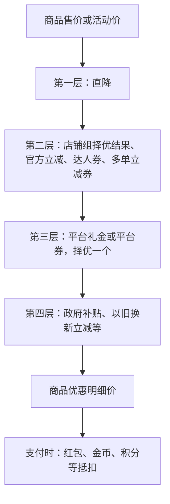

# 抖音优惠规则分析

> 分析日期：2026-10-21。
> 依据：[营销活动叠加规则](marketing-rule.md)及同目录配图。本文分析的是所提供资料表达的规则，未核验抖音当前线上规则版本；特殊招商规则、活动规则以具体活动说明为准。
> 范围：优惠分类、互斥与叠加、计算基数、券使用限制和多件优惠。跨店促销仅解释与前面优惠的关系，不展开跨店结算设计。

## 最终理解（供 Review）

本节只归纳 [marketing-rule.md](marketing-rule.md) 正文与其嵌入截图中，和该文件列出的促销类型有关的规则。以下按“明确规则”和“尚不能确定”区分，请重点审阅加粗的理解是否符合业务预期。

### 我对整体算价顺序的理解

```text
商家原价
  → 单品促销：同商品 / SKU / 时段，候选中生效最优惠的一个
  → 店铺促销：商品优惠券、店铺优惠券、多件优惠，候选中生效最优惠的一个
  → 多单立减：生效一个
  → 大促立减折扣：生效一个
  → 跨店促销：候选中生效最优惠的一个（本项目当前不考虑）
  → 商品优惠后的金额
```

我将上面理解为**按顺序处理的五个阶段**：某阶段选出的优惠作用于前面阶段的结果，之后阶段再基于更新后的金额计算；同一阶段标注“最优惠的一个”或“生效一个”时，只允许该阶段的一个候选生效。依据是概览图的串联减价顺序和正文对各阶段的互斥描述。

### 分组理解

| 阶段 | 本文件提到的优惠 | 我对互斥 / 叠加的理解 |
| --- | --- | --- |
| 单品促销 | 单品直降、会员专享价 | 同一商品、同一 SKU、同一时间段只生效最优惠的一个；若招商或活动规则另有规定，以特殊规则为准。不同 SKU 可各自计算。 |
| 店铺促销 | 商品优惠券、店铺优惠券、多件优惠 | 同一订单按适用条件筛选候选后，三类优惠相互择优，只生效最优惠的一个。商品券只作用指定商品，店铺券面向全店，多件优惠只作用指定商品。 |
| 多单立减 | 多单立减 | 是概览图中独立于“多件优惠”的阶段，只生效一个；图示顺序表示它可与前面的店铺促销依次生效。 |
| 大促立减折扣 | 大促立减折扣 | 只生效一个；正文明确可与单品促销、店铺促销、跨店促销叠加。概览图将其放在多单立减之后、跨店促销之前。 |
| 跨店促销 | 跨店促销活动 | 同类活动择优一个，可与单品、店铺、大促立减折扣叠加；原文标注“不考虑”，因此本次规则理解不展开其细节。 |

### 对优惠计算细节的理解

- **门槛按前序优惠后的金额校验**：FAQ 截图说明后一层优惠门槛按前一层优惠扣减后的金额判断；因此商品原价达到门槛，不代表前序折扣后仍满足门槛。
- **先判适用资格，再比较优惠力度**：例如会员专享价需满足会员资格；优惠券与多件优惠需先符合商品范围及门槛，之后才进入本阶段的择优。
- **店铺促销的“最优”是本阶段实际优惠效果最好的一个**：不应只按券面金额排序。具体在多商品订单里如何定义可比较范围，需要按实际适用商品和门槛计算。
- **阶梯多件优惠不是多档优惠金额直接相加**：原文只确认满件打折 / 减钱及支持配置阶梯，没有说明多档同时满足时的命中方式，也没有说明是否可重复享受同一档。
- **最终优惠以提交订单时为准**：截图提示活动限量、变更、到期和购买件数等因素可能改变优惠，商品详情的优惠展示属于预估。

### 目前不能从该文件确定的内容

1. 单品促销或店铺促销中，“最优惠”的精确比较算法、平手时如何选择，以及是否会为后续阶段的优惠门槛回退前面的选择。
2. 店铺促销规则在多商品订单中的互斥粒度：是否整单仅选一个活动，或能按互不重叠的商品范围分别选择。正文写“一笔订单”生效店铺促销最优惠的一个，但没有展开拆分场景。
3. 各阶段的金额基数、百分比优惠公式、舍入、优惠封顶和最低实付规则；FAQ 中的买家侧券示例不能直接推定每张商家促销卡片的公式。
4. 多件优惠的可混 SKU 范围、阶梯命中方式、重复次数，以及和店铺券以外其他优惠的具体交互细则。
5. “大促立减折扣”与 FAQ 图中的“官方立减”是否属于同一种优惠；名称相似不足以证明可以直接映射。
6. 跨店促销在本项目的具体业务范围与门槛；原文已注明当前不考虑。

### 本次理解的范围边界

FAQ 截图还提到达人券、平台券 / 平台礼金、官方立减、政府补贴、以旧换新，以及支付时的红包、金币、积分。它们不在 `marketing-rule.md` 正文列出的促销清单中；在没有确认它们分别对应哪个促销阶段前，**不把它们并入上述五阶段规则，也不据此扩大本次规则范围**。FAQ 只作为“后层门槛受前层价格影响”和“展示优惠可能是预估”的补充依据。

> 请 Review：若上面的五阶段顺序、各阶段互斥范围或“店铺促销整单择优”的理解不正确，请直接指出需要调整的条目；规则确认后，再据此评估现有代码的扩展方式。

## 1. 核心结论

抖音优惠需要同时理解两个维度：**哪些优惠只能选一个，以及哪些优惠按什么基数计算**。不能只用“所有优惠选最优一个”或“所有折扣依次相乘”概括。

1. **单品促销组内择优**：同一商品、同一 SKU、同一时间段，单品直降与会员专享价等通常只生效最优惠的一个。
2. **店铺促销组内择优**：商品优惠券、店铺优惠券、多件优惠在概览图中属于同一互斥组，生效最优惠的一个。多件优惠不应默认再叠加一张店铺券。
3. **不同工具可以跨组叠加**：概览图表达多单立减、大促立减折扣、跨店促销与前面优惠存在可叠加关系，但各自仍需满足具体资格、数量限制和活动说明。
4. **同一计算层可以包含多个互斥组或独立工具**：买家端 FAQ 将店铺活动/礼金/店铺券择优结果、官方立减、达人券、多单立减券都归入第二层，支持按规则叠加。
5. **跨层门槛看前层扣减后的金额**：商品标价达到券门槛，不代表前面优惠扣完后仍能使用该券。
6. **同层叠加不等于折扣连乘**：FAQ 的第二层示例中，官方立减和店铺折扣使用同一个层输入金额计算减免，再合计扣除。
7. **商品优惠明细价与最终支付金额不同**：红包、金币、积分等在支付时抵扣，不计入商品优惠明细展示的价格；最终可享优惠以提交订单时展示为准。

## 2. 资料来源与阅读口径

| 资料 | 能确认的内容 | 使用限制 |
| --- | --- | --- |
| [marketing-rule.md](marketing-rule.md) | 单品、店铺、大促、跨店四类促销及主要互斥关系 | 原文是摘要，未完整转录截图规则 |
| [概览图](img_1.png)（[img.png](img.png) 为同内容截图） | 工具分组、组内择优、独立的多单立减卡片 | 卡片数量不能直接当作算价层数 |
| [多件折扣配置](img_2.png)、[多件减钱配置](img_3.png) | 满 N 件打 X 折、满 N 件减 X 元、阶梯配置界面 | 截图未展示完整帮助说明和输入校验 |
| [买家端 FAQ 上半部分](img_4.png) | 前层优惠影响后层门槛、优惠明细展示边界 | 中间价格图有门槛与扣减不一致的问题，见第 7 节 |
| [买家端 FAQ 下半部分](img_5.png) | 四层计算说明、同层共同基数、同类券限制 | 描述对象是“购买当前商品”，不能直接推为所有合单场景的统一张数上限 |

商家端概览图偏重“营销工具之间的关系”，买家端 FAQ 偏重“金额计算层级”。两者应分别解释，不能强行逐卡片一一对应。仓库另有[营销优惠叠加规则－技术设计分析](../营销优惠叠加规则-技术设计分析.md)，它属于技术方案，本文不将其中的实现推断当作抖音平台规则的依据。

## 3. 优惠工具：作用范围与互斥关系

### 3.1 单品促销

| 工具 | 规则 |
| --- | --- |
| 单品直降 | 对商品价格直接减免 |
| 会员专享价 | 符合会员条件时可参与比较的专享价格 |

原文明确限定：**同一商品、同一 SKU、同一时间段，仅生效一个单品促销活动**，特殊招商或活动规则除外。比较前应先判断会员身份、活动有效期等条件；未满足条件的会员价不能参与择优。

例如某 SKU 原价 100 元，直降后 90 元、符合资格的会员价为 85 元，单品促销结果为 85 元。不能再在会员价上扣直降 10 元，得到 75 元。

这里的“一个”针对同一 SKU 的活动竞争，不表示一笔多商品订单只能有一个商品享受单品促销。

### 3.2 店铺促销主互斥组（本文暂称）

| 工具 | 优惠形式 | 适用范围 |
| --- | --- | --- |
| 商品优惠券 | 满减、立减、折扣 | 指定商品 |
| 店铺优惠券 | 满减、立减、折扣 | 全店商品，仍需满足券的使用条件 |
| 多件优惠 | 满 N 件打 X 折、满 N 件减 X 元，可配置阶梯 | 指定商品 |

概览图将三者放在同一卡片内，并标注“生效最优惠的一个”。因此不能默认“商品券 + 店铺券 + 多件优惠”全部叠加。

“最优惠”应比较**同一结算对象上实际可减免的金额**，而不是只比较券面金额或折扣数字。商品券和店铺券覆盖的商品集合不同，多件优惠还依赖购买件数，需先判断适用范围与门槛，再做可比的试算。

资料没有完整说明混合商品订单中，不同商品集合上的优惠能否分别生效。因此，不能把本组规则扩大成“整个购物车所有商品只能享受一个店铺活动”，也不能自行断言可以拆分组合使用。

### 3.3 多单立减与多件优惠不同

概览图在上述店铺促销主组之外，另画了一张“店铺促销”卡片，内容是“多单立减”，标注“生效 1 个”。买家端 FAQ 则列出“多单立减券”，将其放在第二计算层中。

这至少说明：**多单立减与多件优惠不是同一个工具，也不能合并为同一互斥项**。前者在概览中是独立卡片，后者与商品券、店铺券共同择优。两处“多单立减”名称是否完全对应同一产品能力、具体如何判断多单资格，资料未给出完整定义，需查具体活动说明。

### 3.4 大促立减折扣

原文明确：大促立减折扣生效一个，可与单品促销、店铺促销、跨店促销叠加。

“允许叠加”只确定兼容关系，不能直接推出其计算基数、优惠上限或出资方。概览中的“大促立减折扣”与 FAQ 中的“官方立减”是否完全等价，资料也未明确，不宜仅根据名称把它们映射成同一计算步骤。

### 3.5 跨店促销与平台券

原文将跨店促销设为暂不考虑，但说明其组内择优，并允许与前面几类优惠叠加；概览示例工具为平台礼金。

买家端 FAQ 进一步明确，平台礼金与平台券择优生效一个，位于第三计算层。本文只保留这部分对价格与门槛的影响，不展开跨店金额汇总、出资分账和结算。

## 4. 金额计算：跨层递减，同层按共同基数

### 4.1 FAQ 明确的计算层级



上图按 FAQ 的文字层级整理。第一层在 FAQ 中称为“平台直降”，原文单品组则使用“单品直降”等名称；现有资料未给出所有工具到计算层的完整映射表，不能将名称差异直接消除。

| 层级 | 参与工具 | 门槛或基数口径 |
| --- | --- | --- |
| 第一层 | 平台直降 | FAQ 示例为商品售价减直降金额 |
| 第二层 | 店铺活动/店铺礼金/店铺券择优一个；官方立减、达人券、多单立减券等按规则叠加 | 以商品售价减直降后的金额判断门槛；示例中的百分比减免也共同基于这个金额 |
| 第三层 | 平台礼金/平台券择优一个 | 以第二层全部扣减后的金额判断门槛 |
| 第四层 | 政府补贴、以旧换新立减等 | FAQ 的政府补贴示例以前层剩余金额计算 |
| 支付抵扣 | 红包、金币、积分等 | 支付时处理，不计入商品优惠明细价；各自使用条件未在资料中展开 |

第四层列举多个工具，不代表这些工具之间可以无限叠加；政府补贴示例也不足以推导所有以旧换新优惠的计算方式。

### 4.2 第二层为什么不能连续打折

按 FAQ 的明确示例，商品售价 100 元，先直降 10 元，第二层有 10% 官方立减和 8 折店铺券：

```text
第二层共同基数 = 100 - 10 = 90 元
官方立减金额   = 90 × 10% = 9 元
8 折券减免金额 = 90 × (1 - 80%) = 18 元
第二层后金额   = 90 - 9 - 18 = 63 元
```

若按 `90 × 90% × 80%` 连乘，会得到 64.80 元，与 FAQ 的 63 元不符。原因是连乘把同层第二个工具的基数改成了第一个工具扣减后的金额。

这个示例明确支持第二层上述工具按共同基数计算，不能据此泛化为所有层、所有工具都使用同一公式。

### 4.3 满减门槛不直接看标价

若继续使用上述例子，第三层有一张“满 100 元减 5 元”平台券：

```text
平台券门槛基数 = 63 元
63 < 100，平台券不可使用
第三层后金额仍为 63 元
```

因此，“标价 100 元”不等于“满足满 100 元的平台券”。同理，标价 200 元的商品经前层优惠后不足 200 元，也可能无法使用满 200 元的平台券。

这里确认的是单商品示例中的金额递减口径；多商品合单时按商品、店铺还是平台聚合判断门槛，还需要对应工具的完整规则。

### 4.4 商品明细价与支付金额

若上述 63 元继续享受 10% 政府补贴，FAQ 给出的结果为：

```text
补贴减免 = 63 × 10% = 6.30 元
商品优惠明细价 = 63 - 6.30 = 56.70 元
```

红包、金币、积分等在实际支付时再抵扣，不计入这个商品优惠明细价。“优惠明细价”和“最终支付金额”需要分别展示和记录。运费、税费以及支付抵扣的上限，现有资料未说明，不在上述公式中假定。

## 5. 优惠券数量限制

买家端 FAQ 将优惠券分为店铺券、达人券、平台券三种，并说明除部分特殊情况外，**同类型优惠券之间不可叠加**。对“购买当前商品”，最多可使用达到门槛的一张店铺券、一张达人券、一张平台券。

| 组合 | 分析结果 |
| --- | --- |
| 无门槛减 5 元店铺券 + 满 150 元减 10 元店铺券 | 同类通常互斥，不能合计减 15 元 |
| 店铺券 + 达人券 | 不同类型可按 FAQ 规则叠加，仍需分别满足使用条件 |
| 店铺券 + 平台券 | 可以跨层叠加，但平台券门槛按第二层扣减后金额判断 |
| 平台礼金 + 平台券 | FAQ 明确择优生效一个 |
| 商品优惠券 + 店铺优惠券 | 概览图将两者放入店铺促销主互斥组，不能因名称不同就默认可同时使用 |

例如商品在店铺层的门槛基数为 200 元，且没有其他组内竞争工具，上述两张店铺券都可用时，按择优规则使用减 10 元的一张，该层结果为 190 元。

“各类最多一张”是使用上限，不是承诺一定可以用三张。它还受活动资格、商品范围、互斥组、前层扣减后门槛等条件约束，也不能直接扩大为跨店合单后一律最多三张。

## 6. 多件优惠与阶梯规则

### 6.1 已确认的配置能力

| 模式 | 配置字段 | 通常表达的含义 |
| --- | --- | --- |
| 满 N 件打 X 折 | 件数门槛 N、折扣 X | 满足件数后按折扣计算优惠 |
| 满 N 件减 X 元 | 件数门槛 N、减免金额 X | 满足件数后减免指定金额 |

截图中这两种模式使用单选按钮切换；每一行阶梯均可删除，并出现“增加规则（3/3）”。可以确认**所示界面最多配置 3 条阶梯**，但不能据此断言抖音所有版本和活动都固定限制为 3 条。

多件优惠作用于指定商品，判断门槛时不能自动把不参加活动的商品件数算入。至于指定商品内不同 SPU、SKU 是否可混合凑件，截图未说明。

### 6.2 阶梯数量不等于叠加次数

假设配置“满 2 件减 10 元、满 3 件减 20 元、满 5 件减 40 元”，购买 5 件时，不能仅凭存在三条配置就认定减免为 `10 + 20 + 40 = 70 元`。

界面只能证明支持多个门槛，未说明以下语义：

- 多个阶梯同时满足时，取最高满足档、优惠最大档，还是其他规则。
- 满 2 件减 10 元，买 4 件是否重复减两次。
- 满 N 件打折是全部符合条件商品打折、仅 N 件打折，还是指定部分商品打折。
- 折扣与减免能否在不同阶梯混配，以及件数、金额和折扣的有效范围。

在这些语义确认前，应将其保留为待确认规则，不能直接固化成累加、循环满减或最高档算法。

## 7. 资料差异与不能直接下的结论

### 7.1 价格图例存在门槛矛盾

[img_4.png](img_4.png) 的图示为：售价 180 元，直降 10 元后剩余 170 元，却继续扣减标注“满 200 减 20”的店铺券。按照同一截图“使用门槛为上一层优惠扣减后的金额”的文字，170 元不应满足 200 元门槛。

该图的算术链条本身可算出 `(180 - 10 - 20 - 20) × 90% - 10 = 107`，但店铺券的资格条件不自洽。因此可以用它理解展示顺序，不能把它作为“170 元也能用满 200 元店铺券”的依据。本文算例采用 FAQ 明文给出的 `100 → 90 → 63 → 56.70` 链条。

### 7.2 工具卡片与计算层不能一一对应

概览分别展示店铺促销主组、多单立减、大促立减折扣；FAQ 则把店铺组择优结果、官方立减、达人券、多单立减券放入同一计算层，并明确展示共同基数的计算例子。

因此，“每张卡片都是独立计算层、都以前一张卡片扣减后的余额计算”并无充分依据，且可能产生与 FAQ 不同的价格。

### 7.3 组内最优不能证明全局最优策略

资料写明部分组内“生效最优惠的一个”，但未说明系统是否会为后层门槛回溯前层选择，也没有明确逐层贪心或全组合搜索策略。

例如原价 200 元，第一层可减 10 元，第三层有满 200 减 30 元的平台券：使用前层优惠后只剩 190 元，平台券不可用。但资料不足以判断系统是否允许跳过前层优惠来获得 30 元平台优惠。

可以确认的是“平台券按前层扣减后的金额判断门槛”；“抖音一定采用逐层贪心”“一定保证所有组合下最终实付最低”都不能据此确认。

### 7.4 其他待确认边界

| 待确认项 | 原因与影响 |
| --- | --- |
| 大促立减折扣与官方立减的对应关系 | 决定其计算层、基数及与其他工具的组内关系 |
| 多商品、多 SKU、多店铺的门槛聚合范围 | 决定凑单和优惠试算，不能仅凭单商品示例确定 |
| 同等优惠时的优先级、用户手动选券 | 资料未定义平局和人工选择策略 |
| 多件优惠的命中档、重复优惠、折扣商品范围 | 直接影响实际减免金额 |
| 金额精度、取整时点、优惠封顶、最低实付 | 资料没有分级取整或最低金额规则 |
| 活动出资方、订单分摊、取消退款、退券 | 工具名称和叠加关系不足以推导资金与售后规则 |
| 单品直降是否计入大促校验价 | 概览只有常见问题入口，未展示答案 |

## 8. 对本项目算价规则的启示

以下是从规则中提炼的建模建议，不代表抖音内部实现，也不构成现有代码改造方案。

1. **将计算层、互斥组、商品范围分别表达**。一个计算层可以包含多个可叠加的组；一个优惠只作用于部分商品。单一“优惠类型”字段难以完整表达这三种关系。
2. **单独记录门槛基数与减免基数**。尤其是第二层，需要先确定共同基数，再分别试算和合计减免，避免循环中不断修改基数导致错误连乘。
3. **先过滤资格与门槛，再在明确的互斥范围内比较**。比较实际减免，不只比较券面额；多件优惠与店铺券的竞争需要纳入同一结算对象评估。
4. **结果应解释未生效原因**。至少区分身份或商品不匹配、门槛不足、同组择优未选中、活动到期或限量等，让“标价够了为什么不能用券”有明确答案。
5. **详情预估与提交订单复算衔接**。FAQ 明确活动限量、变更、到期和购买件数可能改变优惠，提交时应重新校验，并保存实际生效的规则和金额结果。
6. **商品优惠与支付抵扣分别记录**。否则会混淆优惠明细价、支付金额及后续退款核对口径。

如后续要落地技术方案，应先确认第 7 节中影响实现的规则，再定义完整的计算顺序、组合选择与舍入策略。
