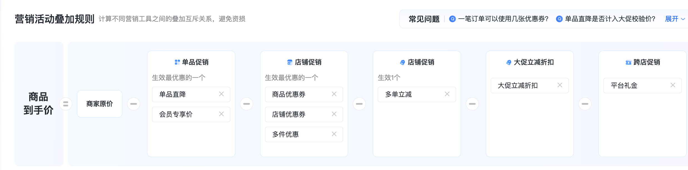
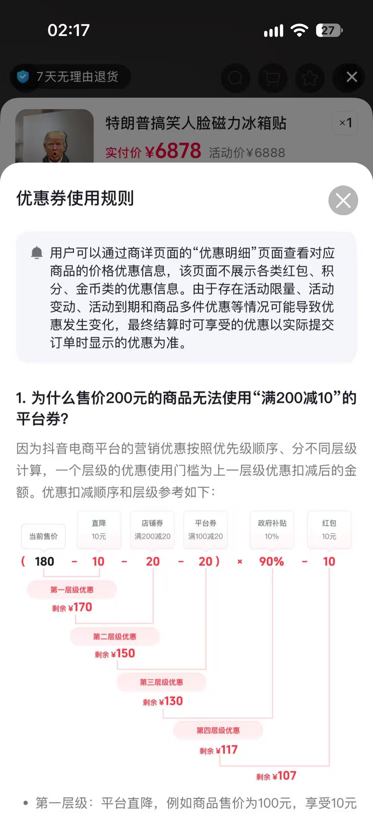
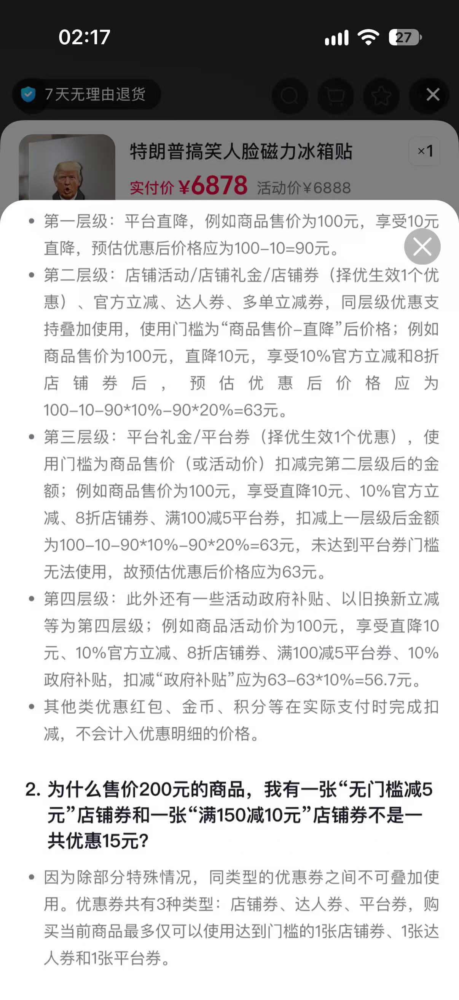
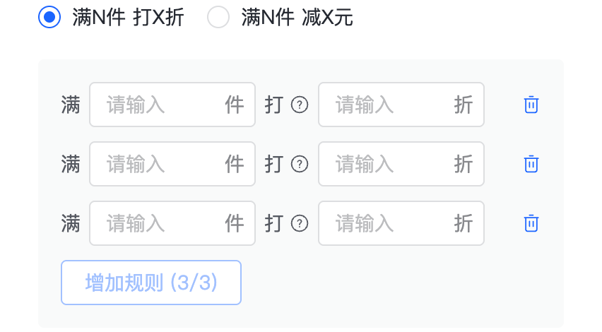
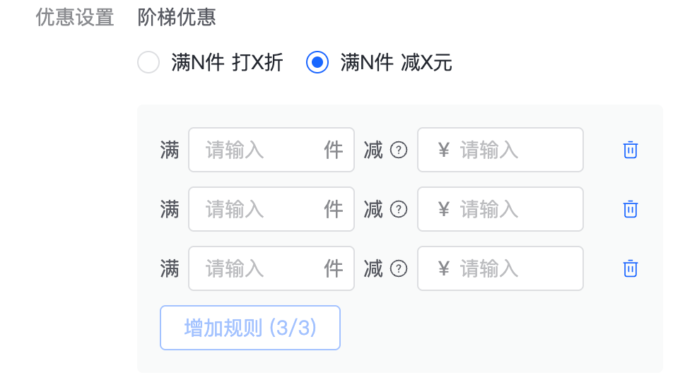

# 营销活动叠加规则

## 单品促销（生效最优惠的一个）
同一个商品同一个sku同一个时间段内，仅生效一个单品促销活动，其他招商规则或活动规则有特殊规定的除外
- 单品直降
- 会员专享价

# 店铺促销（生效最优惠的一个）
一笔订单满足店铺促销活动的生效条件即可使用对应优惠
- 商品优惠券
  - 支持满减、立减、折扣，指定商品生效
- 店铺优惠券
  - 支持满减、立减、折扣，全店商品生效
- 多件优惠
  - 
  - 支持满件打折、减钱，指定商品生效，可以设置阶梯打折减钱规则

# 大促立减折扣（生效一个）
可与单品促销、店铺促销、跨店促销叠加使用
- 大促立减折扣

# 跨店促销（不考虑） 
生效最优惠的一个活动，可与单品促销、店铺促销、大促立减折扣叠加