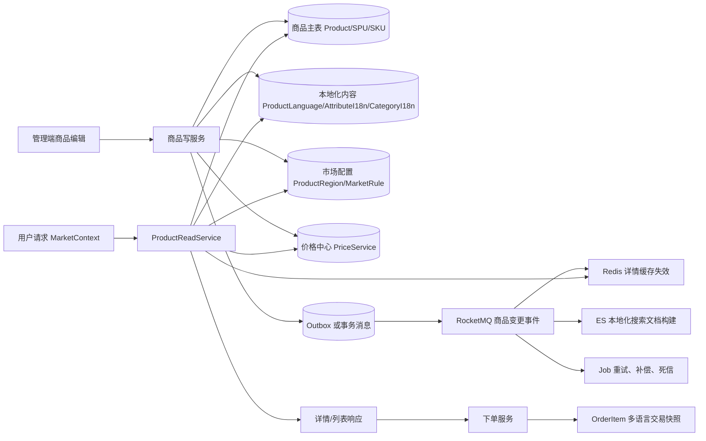

# 商品国际化技术设计

> 适用范围：`order-java` 当前商品域，包括商品/SPU、SKU、属性、类目、区域销售、价格、搜索和订单商品快照。
>
> 说明：本文参考阿里、京东等大型电商公开可见的商品中台、全球化商品和交易系统的通用模式，不声称复刻任何公司的内部实现。

## 1. 设计目标

商品国际化不是简单地给 `product_name` 增加几列语言字段，而是让同一个商品在不同市场具备独立的内容、销售资格、价格、税费、物流和搜索表现，同时保持 SKU、库存、订单和履约链路稳定。

本方案的目标是：

1. 同一商品使用稳定的 `productId`、`skuId`，语言和市场切换不改变商品身份。
2. 商品内容支持 `zh-CN`、`en-US` 等 BCP 47 Locale，具备可审计的翻译、审核、发布和回退能力。
3. 区域销售资格、库存、价格、币种、税费和物流规则独立于语言内容。
4. 搜索、详情、购物车、下单、订单查询和 ERP 同步都能明确使用哪个市场和 Locale。
5. 保持现有接口和中文数据兼容，支持逐步迁移和灰度上线。
6. 商品变更可可靠地驱动 Redis、ES 和下游服务更新，避免数据库与搜索数据长期不一致。

## 2. 当前系统基线

仓库目前已经具备几个很好的扩展点：

| 现有能力 | 位置 | 对国际化的意义 |
|---|---|---|
| 商品主表 | `trade_pd_product` / `Product` | 保留为商品身份、通用属性和默认语言的兼容主表 |
| SKU 主表 | `trade_pd_sku` / `Sku` | `skuId`、库存和 SKU 结构不随语言变化 |
| 商品语言表 | `trade_pd_product_language` / `ProductLanguage` | 已有商品名、描述、图片、详情、状态、版本字段，可作为第一阶段内容表 |
| 商品区域表 | `trade_pd_product_region` / `ProductRegion` | 已有区域状态、发货模式、运费配置，是市场销售配置的基础 |
| 商品草稿 | `ProductDraft` | 已包含 `regionCode`、`languageCode`，可扩展为按市场/Locale 的编辑草稿 |
| 价格与库存 | `PriceService`、`StockReadService`、SKU 服务 | 可继续作为独立的价格中心、库存中心接入市场维度 |
| 商品搜索 | `ProductIndex`、`ProductReadServiceImpl`、`ProductIndex.json` | 需要从单商品文档升级为带市场/Locale 的物化搜索文档 |
| 商品缓存 | `RedisKey.Product.DETAIL_REGION_LANGUAGE` | 已经预留了区域+语言详情缓存命名空间 |
| 订单快照 | `OrderItem.productName/productInfo/description` | 下单时已有快照语义，应补充市场、Locale、币种和目录版本 |
| 消息和任务 | RocketMQ、DTS、`trade-order-job` | 适合承载内容发布、索引重建、缓存失效和失败重试 |

当前主要缺口是：`ProductLanguageRepository` 尚未形成完整读写链路；详情仍直接读取 `Product.productName/description`；ES 文档只有一份中文无 Locale 文档；属性和 SKU 属性将名称和值直接存成文本；订单快照没有保存 Locale、市场和币种。

## 3. 总体架构

### 3.1 领域边界

将国际化拆成五个维度：

| 维度 | 负责内容 | 是否允许回退 |
|---|---|---|
| 商品身份 | `productId`、`spuId`、`skuId`、SKU 编码 | 不回退，ID 全局稳定 |
| 本地化内容 | 名称、短描述、详情、属性展示名、类目名、图片 Alt 文案 | 允许按 Locale 链回退 |
| 市场配置 | 销售国家/地区、上下架、禁售、物流、运费、税制 | 不允许用其他市场替代 |
| 商业数据 | 价格、币种、促销、库存 | 结算不回退；展示只能按明确策略回退 |
| 交易快照 | 下单时的名称、属性、价格、币种、税费、市场、Locale | 不回退、不追随商品后续修改 |

### 3.2 逻辑架构



### 3.3 MarketContext

所有商品读写接口统一传递市场上下文，避免在各个 Service 内部自行猜测地区：

```java
public class MarketContext {
    private String marketCode;   // US、JP、EU 等销售市场
    private String regionCode;   // 国家或履约区域，沿用现有区域编码体系
    private String locale;       // zh-CN、en-US、ja-JP
    private String currencyCode; // CNY、USD、JPY
    private String channel;      // APP、WEB、XHS 等现有渠道
    private String timezone;
}
```

优先级建议：显式请求参数/用户已选市场 > 用户资料 > 站点默认市场 > 网关推断。IP 只能用于初始推荐，不能作为最终结算市场。结算时以用户确认的收货国家、市场和币种为准。

## 4. 数据模型设计

### 4.1 商品主数据与本地化内容

第一阶段不改掉 `trade_pd_product.product_name` 等旧字段：

- 旧字段作为默认语言和历史接口兼容字段，建议约定为 `zh-CN`。
- 新接口优先从 `trade_pd_product_language` 读取本地化内容。
- 新写入同时更新主表兼容字段和本地化表；迁移完成后再减少对主表文本字段的读取。

建议扩展现有语言表，而不是立即大范围重命名：

```sql
ALTER TABLE trade_pd_product_language
    ADD COLUMN locale varchar(35) NULL COMMENT 'BCP47，如 en-US，回填后改为 NOT NULL',
    ADD COLUMN region_code varchar(32) NULL COMMENT '可选市场覆盖范围，回填后用 GLOBAL 表示通用内容',
    ADD COLUMN short_description text NULL,
    ADD COLUMN content_format varchar(16) NOT NULL DEFAULT 'HTML',
    ADD COLUMN translation_status varchar(32) NOT NULL DEFAULT 'SOURCE',
    ADD COLUMN translation_source varchar(32) NULL,
    ADD COLUMN source_version int NOT NULL DEFAULT 1,
    ADD COLUMN content_hash varchar(64) NULL,
    ADD COLUMN published_time datetime NULL,
    ADD COLUMN review_by varchar(64) NULL,
    ADD COLUMN review_time datetime NULL;

-- 完成历史数据回填后，再将 locale 和 region_code 设为 NOT NULL，
-- 通用内容的 region_code 固定写 GLOBAL，避免 MySQL 唯一索引中的 NULL 可重复问题。
CREATE UNIQUE INDEX uk_product_locale_region
    ON trade_pd_product_language(product_id, locale, region_code);
CREATE INDEX idx_product_locale_status
    ON trade_pd_product_language(product_id, locale, region_code, status, closed);
```

落地时可以先把 `languageCode` 规范化为 Locale：已有 `en` 仍可保留，新增数据统一使用 `en-US`、`ja-JP`。代码层将 `languageCode` 和 `locale` 做兼容映射，避免一次性修改所有 DTO；唯一键只使用规范化后的 `locale`，不要同时把 `language_code` 加入唯一键。

当一个 Locale 在多个市场复用时，`region_code` 为空；只有内容确实因法规、包装或市场文案不同，才创建区域覆盖版本，避免出现“每个国家复制一份商品详情”的数据爆炸。

### 4.2 市场和区域销售配置

现有 `ProductRegion` 已具备区域状态、发货和运费字段，建议补齐以下字段：

```text
product_id / unique_product_id
market_code
region_code
sale_status          可售、下架、禁售、售罄
tax_mode             含税/未税
default_currency
shipping_template_id
compliance_status
effective_time
version
```

唯一键应明确为“商品 + 市场/区域”。如果历史表只能使用 `uniqueProductId`，先在 Repository 中统一封装映射，禁止业务方自行拼接两个 ID。

市场配置必须独立判断：没有美国销售资格时，不能因为中文商品存在就把中国商品展示为美国可购买商品。内容可以回退，销售资格不可以回退。

### 4.3 价格、币种和税费

不要把汇率换算结果写回 `Product.price` 或 `Sku.price`。现有价格策略继续负责促销计算，增加市场输入：

```text
sku_id
market_code / region_code
currency_code
list_amount
sale_amount
tax_amount 或 tax_included
price_type
effective_from / effective_to
version
```

金额在领域对象中使用 `Money(amount, currency)`。数据库可继续使用 `DECIMAL` 兼容现有代码，但必须同时保存币种和货币精度。前端只展示服务端返回的格式化金额，不能自行做汇率计算。

结算原则：

1. 市场、币种和税费规则必须命中明确配置，否则返回“该市场暂不可售”。
2. 价格查询、优惠计算、库存校验和下单使用同一个 `MarketContext`。
3. 创建订单时保存标价、优惠后价、税费、币种、汇率版本（若发生换算）和价格版本。
4. 现有 `PriceService` 的促销策略保持不变，通过 `PricingSkuRequest` 增加市场和币种字段，避免在商品详情层复制促销逻辑。

### 4.4 属性、SKU 属性和类目

现有 `ProductAttribute`、`SkuAttribute` 同时保存 `attributeName/attributeValue` 文本，适合中文单市场，但不适合稳定翻译。建议演进为：

```text
attribute.code                 稳定属性编码，如 material
attribute_value.value_code     稳定属性值编码，如 silver
attribute_i18n(attribute_id, locale, name, unit)
attribute_value_i18n(value_id, locale, display_value)
sku_attribute(sku_id, attribute_id, value_id)
category_i18n(category_id, locale, name, path_name)
```

旧文本字段保留用于兼容和历史数据回退；新商品必须优先写入编码。比如同一个 `silver` 在中文、英文、日文分别展示“纯银”“Sterling Silver”“スターリングシルバー”，但 SKU 仍引用同一个 `value_code`。

类目 ID、属性 ID 和值 ID 永远是语言无关的。类目树的排序和父子关系也不应该复制到不同语言表。

### 4.5 订单商品快照

`OrderItem` 当前已有 `productName`、`description`、`productInfo`，继续保留并增加：

```text
market_code
region_code
locale
currency_code
catalog_version
product_name_snapshot
description_snapshot
sku_attribute_snapshot_json
price_snapshot_json
translation_version
```

下单时把最终展示文本和销售数据一次性写入订单。订单、售后、客服、发票、ERP 对历史订单都读取快照；商品后续翻译修改不会改变历史订单。ERP 若要求中文名称，单独保留 `erp_product_name` 或使用主数据名称，不要覆盖用户看到的本地化名称。

## 5. Locale 和回退策略

Locale 采用 BCP 47，统一大小写和分隔符，例如 `en-US`、`zh-CN`、`ja-JP`。服务端维护受支持 Locale 白名单、语言到默认地区的映射和市场默认 Locale。

以请求 `en-US`、市场 `US` 为例，内容回退链：

```text
en-US -> en -> US 市场默认 Locale -> zh-CN 商品主表兼容字段
```

回退规则按字段计算，但有完成度门槛：

- 标题、销售属性名称是必需字段；缺失时可以回退。
- 详情、营销文案、Alt 文案可以按字段回退，并返回 `fallbackFields` 供监控。
- 禁售、价格、库存、税费、物流不走语言回退。
- 搜索只查询当前 Locale 和明确允许的备用 Locale，不把所有语言混进一个分词字段。

建议响应增加元数据：

```json
{
  "locale": "en-US",
  "resolvedLocale": "en",
  "marketCode": "US",
  "fallback": true,
  "fallbackFields": ["description"]
}
```

这能让运营知道“页面显示了中文”是翻译缺失还是程序错误。

## 6. 读链路设计

### 6.1 商品详情

改造 `ProductReadServiceImpl`，增加一个统一的组装入口：

```text
ProductReadService.getProductDetail(productId, MarketContext)
  1. 查询 Product 基础数据
  2. 查询 ProductRegion，校验市场可售和物流配置
  3. 按回退链批量查询 ProductLanguage
  4. 批量查询属性、SKU 属性和对应本地化字典
  5. 调用 PriceService 查询该市场价格
  6. 调用 StockReadService 查询库存
  7. 组合 ProductDetailResp，并填充 resolvedLocale/fallback 信息
```

详情缓存建议使用现有命名空间升级版本：

```text
trade:product:detail:v2:{productId}:{marketCode}:{regionCode}:{locale}:{currency}:{channel}
```

缓存 value 包含目录版本和价格版本。商品内容、区域配置、价格或库存变更时按事件失效；库存仍沿用库存服务的短缓存或实时查询，避免把高频库存写入商品大缓存。

### 6.2 列表和搜索

当前 `ProductIndex` 是一商品一文档，且 `productName/description/detail` 使用中文 IK 分词。国际化建议使用物化文档：

```text
docId = productId#marketCode#locale
```

文档至少包含：

```text
productId, marketCode, regionCode, locale
productName, description, detail
categoryId, attribute filters, status, saleStatus
price range, currencyCode, stockDisplay
score, totalSales, precedence, publishTime
```

可以先建立 `trade_product_v2` 索引并通过 alias 切换，避免直接破坏现有索引。Locale 数量较少时，一份索引配 `marketCode/locale` 过滤即可；如果不同语言需要不同 analyzer，则按语言或语言族拆分索引。不要把多语言文本拼成一个字段，否则中文、英文和日文会互相污染召回和排序。

索引更新采用事件驱动：

```text
ProductChanged
ProductI18nChanged
ProductRegionChanged
SkuPriceChanged
SkuStockChanged
```

消费者幂等写入 ES，失败进入重试队列和死信队列；`trade-order-job` 增加按版本补偿的重建任务。搜索结果仍回源 `ProductReadService` 补齐价格和实时库存，但只允许批量查询，避免循环内逐个 RPC/DB 调用。

## 7. 写链路与翻译工作流

### 7.1 管理端状态机

每个 `productId + marketCode + locale` 维护独立状态：

```text
SOURCE -> MACHINE_TRANSLATED -> HUMAN_REVIEWING -> APPROVED -> PUBLISHED
                                      |                 |
                                      +-> REJECTED <----+
```

源语言内容变更时：

1. 源版本号递增。
2. 已发布翻译标记为 `STALE`，保留线上旧版本。
3. 机器翻译只填充未人工确认的内容，不覆盖已审核内容。
4. 审核通过后按版本发布，并触发缓存和 ES 更新。

翻译供应商可通过适配器接入，不把具体厂商 SDK 写进商品领域服务。机器翻译结果必须经过敏感词、长度、HTML 安全和变量占位符校验；涉及珠宝材质、过敏、尺寸、税费、合规的字段必须支持人工审核。

### 7.2 建议接口

沿用现有 `ProductController`、`SpuInnerController` 和内部商品接口，增加以下语义，路径可按当前路由规范调整：

```http
GET  /product/{productId}?marketCode=US&regionCode=US&locale=en-US&currency=USD
GET  /product/search?marketCode=US&locale=en-US&q=ring

PUT  /inner/product/{productId}/i18n/{locale}
POST /inner/product/{productId}/i18n/{locale}/submit-review
POST /inner/product/{productId}/i18n/{locale}/publish
GET  /inner/product/{productId}/i18n/status
```

写接口使用 `version` 做乐观锁，重复发布请求必须幂等。响应中明确返回 `catalogVersion`，客户端或网关可以按版本做条件缓存。

## 8. 发布一致性和缓存策略

商品写事务内同时写业务表和 Outbox 记录：

```text
本地事务：Product/ProductLanguage/ProductRegion/版本更新 + Outbox
异步投递：RocketMQ 商品变更事件
消费：缓存失效、ES 更新、翻译任务、下游同步
补偿：Job 扫描未投递或处理失败的 Outbox/事件
```

如果基础设施已经通过 DTS 保证数据库变更捕获，也可以把 DTS 作为索引同步入口，但仍建议保留业务事件，用于表达“发布”“下架”“翻译审核通过”等语义，而不是只依赖字段变更。

缓存采用 Cache Aside：

- 读：缓存命中直接返回，未命中批量组装后写入。
- 写：数据库提交后发事件，消费者失效相关版本缓存。
- 防击穿：沿用 Redisson/Caffeine，按商品+市场维度加短锁；不要在子线程显式读取 `AuthContext`。
- 失效失败：事件重试和 Job 补偿；详情响应携带版本，发现旧版本时主动回源。

## 9. 典型流程

### 9.1 用户浏览英文美国站商品

1. 网关解析站点和用户选择，形成 `US/en-US/USD` 的 `MarketContext`。
2. 搜索只召回 `US + en-US` 的已发布文档。
3. 详情服务校验 `ProductRegion.saleStatus`、合规和物流，读取英文内容。
4. 英文详情缺失的非关键字段按 `en -> 市场默认 Locale` 回退，并打点。
5. 价格服务返回 USD 含税/未税结果，库存服务返回美国履约库存。
6. 用户加购时，购物车保存 `productId/skuId/marketCode/locale/currency`，价格以服务端重算为准。
7. 下单时把商品名称、属性、价格、税费、币种和 Locale 写入 `OrderItem` 快照。

### 9.2 中文商品更新名称

1. 管理端更新 `zh-CN` 源内容，版本从 10 变为 11。
2. 英文已发布版本标记 `STALE`，线上仍使用英文版本 10。
3. 翻译任务生成英文版本 11，完成机器翻译和人工审核。
4. 发布事件使英文详情缓存失效，重建 `productId#US#en-US` 的 ES 文档。
5. 历史订单仍读取自己的名称快照，不受此次更新影响。

## 10. 迁移和上线计划

### Phase 0：规范和观测

- 确认市场、国家/地区、Locale、币种、时区的字典。
- 给接口增加可选 `MarketContext`，默认保持现有中文站行为。
- 为详情、搜索、下单打点 `marketCode/locale/resolvedLocale`。

### Phase 1：只读多语言

- 回填 `ProductLanguage` 的 `zh-CN` 主版本。
- 完成 `ProductLanguageRepository` 批量查询、回退解析和详情缓存 v2。
- 详情接口先灰度读取英文内容，不改变价格和结算。

### Phase 2：后台翻译和搜索

- 增加草稿、审核、发布接口和翻译任务。
- 建立 `trade_product_v2`，按 Locale 回填 ES 文档，通过 alias 灰度切流。
- 建立事件重试、死信和索引对账任务。

### Phase 3：市场价格和订单快照

- `PriceService`、购物车、结算和订单统一传递市场与币种。
- 增加区域价格、税费和合规校验。
- 订单写入 Locale、币种、价格版本和多语言快照。

### Phase 4：属性、类目和全链路治理

- 属性值编码化，增加属性/类目翻译表。
- 接通 ERP、物流、售后、客服和报表的市场维度。
- 清理旧字段的直接读取，保留兼容写入和历史数据回查能力。

## 11. 监控、对账和质量门禁

建议至少建设以下指标：

| 指标 | 含义 |
|---|---|
| `product_i18n_fallback_rate` | 详情按字段发生回退的比例 |
| `product_i18n_publish_lag` | 审核通过到缓存/ES 生效的延迟 |
| `product_i18n_missing_required` | 缺少标题、销售属性等必填翻译的商品数 |
| `product_market_sellable_mismatch` | 市场配置、搜索文档和详情可售状态不一致 |
| `product_search_zero_result_rate` | 各 Locale 搜索无结果比例 |
| `product_price_currency_mismatch` | 订单币种与价格来源币种不一致次数 |
| `product_snapshot_missing_locale` | 新订单缺少市场/Locale 快照的数量 |
| `product_event_dlq_count` | 商品变更事件死信数 |

发布前门禁：

1. 当前市场必需字段齐全，或明确允许回退。
2. HTML/富文本通过安全清洗，变量占位符数量一致。
3. 禁用词、敏感材质、计量单位、尺寸和货币格式校验通过。
4. 区域可售、库存、价格和物流配置存在且版本有效。
5. ES 文档、详情读模型和数据库版本一致。

## 12. 方案取舍和大厂实践映射

### 12.1 与大型电商通用做法的对应关系

| 通用实践 | 本方案落点 | 学习重点 |
|---|---|---|
| 商品中心拆分 SPU、SKU、属性 | 保留现有 Product/SKU，属性改用稳定编码 | 商品身份和展示文本解耦 |
| 价格、库存独立中心 | 复用 `PriceService`、`StockReadService`，增加市场维度 | 国际化不能把价格塞进语言表 |
| 站点/国家/渠道销售模型 | `ProductRegion + MarketContext` | 内容语言和销售市场不是同一维度 |
| 搜索物化和异步更新 | Locale/市场维度 ES 文档 + RocketMQ/Job | 读模型服务于查询性能，数据库是事实来源 |
| 翻译审核和版本发布 | ProductLanguage 状态机、版本号、审计字段 | 翻译是商品发布流程的一部分 |
| 订单不可变快照 | OrderItem 保存本地化文本、价格和币种 | 历史交易不能依赖实时商品表 |
| 缓存和事件最终一致 | Cache Aside + Outbox/DTS + 补偿任务 | 先保证可恢复，再追求实时 |

### 12.2 为什么不把语言字段全部放进 JSON

JSON 适合详情富文本和扩展属性，但不适合标题搜索、唯一约束、审核状态、Locale 回退和按语言索引。建议：结构化字段落表，富文本正文保留 HTML/JSON，搜索和详情再做物化。

### 12.3 为什么不复制一套商品表到每个国家

国家数量增长会导致商品、SKU、属性、库存和订单关联关系复制，修改容易产生数据漂移。稳定的商品身份配合市场配置更适合当前系统；只有价格、税费、禁售和物流这些确实市场化的数据才按市场独立存储。

## 13. 推荐的第一批代码改造点

按风险和收益排序：

1. 增加 `MarketContext`、Locale 规范化器和回退解析器，先不改旧接口行为。
2. 完善 `ProductLanguageRepository` 的批量查询、按版本发布和唯一约束。
3. 在 `ProductReadServiceImpl` 统一接入语言内容，并升级详情缓存 key。
4. 给 `ProductDetailResp` 增加 `locale/resolvedLocale/marketCode/currencyCode/catalogVersion`。
5. 给 `ProductIndex` 增加 `marketCode/regionCode/locale`，新增 v2 mapping 和重建任务。
6. 给 `OrderItem` 增加市场、Locale、币种和快照版本字段，在下单事务中一次性写入。
7. 再改造价格市场维度、属性/类目翻译、翻译后台和合规规则。

这样可以先让英文商品详情可用，再逐步扩展到真正的跨境销售，而不需要一次重写当前商品、价格、库存和订单链路。
