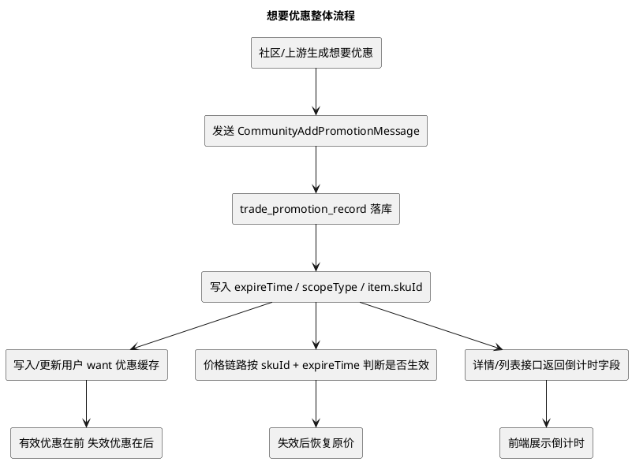
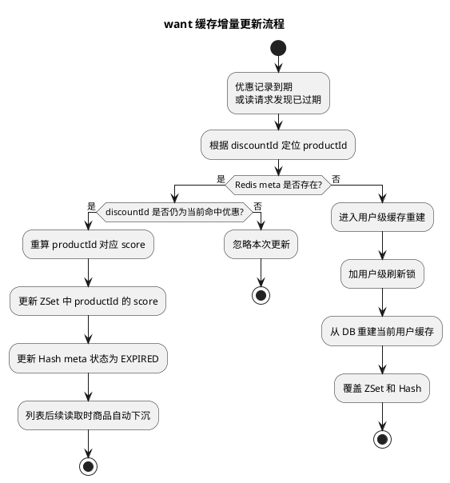
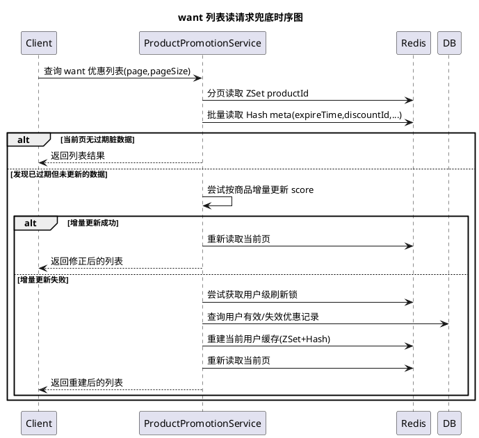

# 想要折扣增加时效限制 & 商品规格价格解耦 技术方案（初稿）

评审主 RD：待补充

单个需求评估时间大于 3PD，适用本模板。  
建议提前发出文档，预留 0.5 天 review 时间。

## 一、背景与目标

当前“想要”商品优惠存在两个核心问题：

1. **缺少时效限制**
   - 用户拿到“想要折扣”后，当前没有明确的失效时间控制。
   - 产品希望基于“优惠失效时间”展示倒计时，形成逼单能力，提高转化。

2. **折扣与商品规格未解耦**
   - 当前想要折扣更偏向作用在“商品整体”层面。
   - 当某商品存在附加规格差异时，无法做到 SKU 级精细化定价，灵活性不足。

### 需求文档 PRD

- https://mathmagic.feishu.cn/wiki/MuHzwcuTEikIUTkjhgbck6RqnDf?renamingWikiNode=true

### 参考文档

- https://mathmagic.feishu.cn/wiki/K7zXwv3ceid5DNk64vycjeJ6nVc

### 本次目标

- 为想要折扣补充**失效时间**，并以此作为服务端唯一生效判断依据。
- 商品详情、列表、站内信可展示优惠倒计时。
- 折扣失效后恢复原价，不再展示想要折扣信息。
- 支持想要折扣从商品级过渡到 **SKU 级**。
- 保持对现有价格链路、缓存链路、搜索链路的兼容。

### 非目标

- 不重做整套营销活动中心。
- 不修改通用 ES 排序策略为强个性化排序。
- 不在本期重构全部营销活动模型，仅聚焦 want discount 链路。

## 二、现状梳理与业界方案

### 2.1 现状梳理

#### 1. 想要折扣列表已有两条链路

一条是用户专属的“想要优惠列表”接口：

```java
@GetMapping("/user/discount/want/list")
public CommonJsonObject<PageReturnData<ProductDetailDto>> getUserDiscountWantProducts(
    ProductDiscountReq req) {
    req.setUserId(AuthContext.getCurrentUserId());
    return ResponseDataUtil.buildPageSuccess(productPromotionService.getUserDiscountProducts(req));
}
```

另一条是商品搜索接口里的“想要折扣筛选”：

```java
List<String> filterProductIdList = null;
if (Boolean.TRUE.equals(searchRequest.getFilterWantDiscount())) {
    String userId = AuthContext.getCurrentUserId();
    ...
    List<Long> wantUserActivityIds = nacosConfig.getActivityIdsByActivityType("TARGET_GROUP_WANTIT_USER");
    List<String> wantDiscountProductIds = promotionRecordService
            .findAllWantDiscountProductIdsByUserId(userId, wantUserActivityIds, MAX_WANT_DISCOUNT_PRODUCT_LIMIT);
    ...
    filterProductIdList = wantDiscountProductIds;
}
```

#### 2. 当前优惠记录模型没有失效时间

`trade_promotion_record` 已有 `status`、`scopeType`，但没有单条记录级别的 `expireTime`。

```java
@ApiModelProperty(value = "折扣ID")
private String discountId;

@ApiModelProperty(value = "用户id")
private String userId;

@ApiModelProperty(value = "状态 0 普通 1 已用 2 冻结 3失效")
private Integer status;

@ApiModelProperty(value = "作用范围 1 商品 2 sku")
private Integer scopeType;

@ApiModelProperty(value = "优惠金额")
private BigDecimal discountValue;
...
@ApiModelProperty(value = "1 删除 0 未删除")
private Integer closed;
```

#### 3. 当前记录生成消息也没有失效时间字段

```java
public class CommunityAddPromotionMessage {
    private String discountId;
    private Long activityId;
    private String bizType;
    private String userId;
    private Integer scopeType;
    private List<ApplicableItem> applicableItemList;
    private Integer discountType;
    private BigDecimal discountValue;
    private Integer discountCount;
    private Integer selfRefundRecover;
    private Integer shopRefundRecover;
}
```

这意味着：

- 当前想要优惠是否有效，主要依赖 `status/closed`。
- 无法直接支持“基于失效时间倒计时”的判断。
- 也无法精确在失效边界时刷新列表状态。

#### 4. SKU 级能力底层其实已经部分存在

虽然产品侧感知还是“商品整体优惠”，但技术上已有：

- `PromotionRecord.scopeType = SKU`
- `PromotionRecordItem.skuId`
- 定价链路以 `skuId` 为核心输入
- `PricingService` 已按 sku 计算折扣

所以本期不需要从零造 SKU 定价体系，重点是：

- **记录生成链路**要真正写入 SKU 级适用范围
- **查询与展示链路**要按 SKU 级正确透出和判断

#### 5. 当前列表排序现状

用户专属想要优惠列表当前通过 Redis ZSet 做分页缓存，排序核心是：

- 折扣值
- 发布时间

```java
private double calculateProductScore(BigDecimal discountValue, LocalDateTime lastPublishTime) {
  long score = 0L;
  long baseTimestamp = 1_000_000_000L;

  if (discountValue != null) {
    long discountInt = discountValue.multiply(BigDecimal.valueOf(100)).longValue();
    score = discountInt * 1_000_000_000L;
  }

  if (lastPublishTime != null) {
    long publishTimeSeconds = lastPublishTime.atZone(DateUtil.ZONE_UTC).toEpochSecond();
    score = score + (baseTimestamp - publishTimeSeconds);
  } else {
    score = score + baseTimestamp;
  }
  return (double) score;
}
```

问题是：

- 排序没有“有效 / 已过期”分组维度
- 缓存也不知道“最近哪条优惠会在何时过期”

#### 6. 当前活动模型有 `endTime`，但不适合作为最终唯一数据源

`trade_promotion_activity` 已有 `startTime/endTime`，但当前用户优惠记录是异步发消息落库的。  
只依赖活动表 `endTime` 会有几个问题：

- 记录查询时需要额外 join 或额外查活动
- 无法支持未来“单条用户优惠不同失效时间”
- 当前 `CommunityAddPromotionMessage` 没有把失效时间带下来
- 列表缓存、价格链路都更适合直接读“用户优惠记录”自身字段

### 2.2 业界方案

常见电商限时优惠方案基本都是：

- **服务端持久化优惠失效时间**
- **前端倒计时只是展示，服务端才是最终判定源**
- **商品 / SKU 维度独立建优惠作用范围**
- **列表分组排序：有效优惠优先，失效商品恢复原价并下沉**

本次建议沿用这个方向，避免把时效逻辑散落在前端或活动表侧推断。

## 三、技术方案

### 必选部分：整体方案，存储设计，核心逻辑，API 接口设计

### 3.1 整体方案

#### 方案结论

本次采用：

1. **在用户优惠记录 `trade_promotion_record` 上新增 `expire_time`**
2. **保留并真正启用 `scopeType=SKU` + `record_item.sku_id`**
3. **服务端统一按 `expire_time` 判断优惠是否有效**
4. **用户专属 want 列表按“有效优惠在前，失效优惠在后”排序**
5. **商城 want 折扣筛选接口仅返回当前有效优惠商品**
6. **商品详情 / 商品卡 / 站内信统一透出失效时间或剩余秒数**

本方案分为四层：

1. **记录层**
   - 由 `PromotionRecord` / `PromotionRecordItem` 承担 want 优惠的最终存储。
   - 新增 `expire_time` 作为服务端唯一失效依据。

2. **定价层**
   - 继续复用现有 `PricingService` / `MarketingService` 按 `skuId` 计算价格。
   - 补充“商品级 / SKU级”命中规则和到期判定。

3. **列表层**
   - 继续复用 `ProductPromotionService` 的用户级缓存。
   - 改为 `ZSet + Hash meta` 模型，主路径按商品增量更新 score。

4. **展示层**
   - 详情、列表、站内信统一透出 `expireTime` / `remainingSeconds` / `wantDiscountStatus`。
   - 展示逻辑统一建立在服务端判定结果之上。

#### 为什么不只用活动 `endTime`

不选“只依赖 `trade_promotion_activity.end_time`”的原因：

- 当前记录生成消息没有带失效时间，链路不闭环
- 查询和缓存依赖用户优惠记录本身更自然
- 后续若出现个性化时效、补发、延长有效期等场景，记录级字段更可扩展
- 价格判断、列表判断都需要“用户维度”的最终生效状态

#### 整体流程图



#### 模块职责

| 模块 | 现有类 | 本次职责 |
| --- | --- | --- |
| 优惠记录写入 | `PromotionRecordServiceImpl` | 接收上游 want 优惠消息，落库 `expire_time` / `scopeType` / `skuId` |
| 用户优惠查询 | `PromotionRecordRepository` | 查询用户有效/全部 want 优惠记录，支撑列表和补偿 |
| want 列表缓存 | `ProductPromotionService` | 构建 Redis ZSet + Hash，按商品增量更新 score |
| 搜索筛选 | `ProductReadServiceImpl` | 只筛选当前有效 want 折扣商品 |
| 定价链路 | `MarketingService` / `PricingService` | 根据 `productId + skuId + expireTime` 判断当前价格 |
| 详情返回 | `ProductReadServiceImpl` / DTO Converter | 返回倒计时和想要优惠状态 |
| 通知集成 | 上游/notify 服务 | 透传 `expireTime` 和文案参数 |

### 3.2 存储设计

#### MySQL

##### 1. `trade_promotion_record`

新增字段：

- `expire_time DATETIME NULL COMMENT '优惠失效时间，UTC存储'`

建议索引：

- `idx_user_activity_status_expire(user_id, activity_id, status, closed, expire_time)`

字段含义：

- `expire_time is null`
  - 兼容历史数据，表示“未配置失效时间”
  - 兼容期内按兜底策略处理
- `expire_time > now`
  - 当前有效
- `expire_time <= now`
  - 已失效

有效性判断建议统一为：

- `closed = 0`
- `status = NORMAL`
- `expire_time is null or now < expire_time`

兼容策略建议：

- 新数据必须写 `expire_time`
- 老数据若为空，可优先回填；未回填前可兜底取活动 `endTime`

DDL 草案：

```sql
ALTER TABLE trade_promotion_record
    ADD COLUMN expire_time DATETIME NULL COMMENT '优惠失效时间，UTC存储' AFTER discount_count;

CREATE INDEX idx_user_activity_status_expire
    ON trade_promotion_record (user_id, activity_id, status, closed, expire_time);

CREATE INDEX idx_discount_expire
    ON trade_promotion_record (discount_id, expire_time);
```

查询原则：

- **列表查询**
  - 需要查“当前有效 + 已失效但仍可展示”的集合，不能只查有效记录。
- **价格查询 / 搜索筛选**
  - 只查当前有效记录。
- **增量更新**
  - 通过 `discountId` 精确反查记录状态和 `expireTime`。

##### 2. `trade_promotion_record_item`

本次**不新增字段**。  
继续复用：

- `product_id`
- `sku_id`

其中：

- 商品级优惠：`scopeType=1`，`sku_id` 可空
- SKU级优惠：`scopeType=2`，必须写 `sku_id`

#### Redis

现有 want 优惠列表缓存 key 建议升级版本，避免新老 score 逻辑冲突：

- `promotion:user:list:v2:{userId}:{activityHash}`
- `promotion:user:list:meta:v2:{userId}:{activityHash}`
- `promotion:user:list:refresh:lock:v2:{userId}:{activityHash}`

缓存设计采用“**ZSet 排序 + Hash 元信息**”：

1. `ZSet`
   - member：`productId`
   - score：当前列表排序分数
2. `Hash`
   - field：`productId`
   - value：当前商品命中的 want 优惠元信息，至少包含：
     - `discountId`
     - `expireTime`
     - `discountValue`
     - `discountType`
     - `scopeType`
     - `skuId`

score 设计改为：

- 一级：是否有效
- 二级：现有折扣排序
- 三级：发布时间

示意：

- `score = groupWeight * GROUP_BASE + oldScore`
- `groupWeight`
  - 有效优惠 = `0`
  - 已失效 = `1`

这样在 `zRange` 升序读取时，可天然实现：

- 有效优惠在前
- 已失效在后

本方案的关键点不是“到期后整包重建缓存”，而是：

- **主路径：按商品增量更新 ZSet score**
- **兜底路径：元信息缺失、状态异常、或发现脏数据时，才重建当前用户缓存**

也就是说，`expireTime` 到期后，优先做：

1. 根据 `discountId` 找到受影响的 `productId`
2. 判断该 `discountId` 是否仍是该商品当前命中的优惠
3. 若是，则把该 `productId` 的 score 更新为“已失效分组”对应的 score
4. 同步更新 `meta` 中的状态/过期信息

只有在以下场景才退化为重建：

- Redis 中找不到该商品对应的 meta
- 当前 `productId -> discountId` 映射不一致
- 发现一个商品存在多条记录且无法快速确定应切换到哪条优惠
- 当前请求读到已过期但缓存未完成更新的数据

Redis value 示例：

```json
{
  "discountId": "discount_123",
  "productId": "p_1001",
  "skuId": "sku_1001_a",
  "scopeType": 2,
  "discountType": 3,
  "discountValue": "129.00",
  "expireTime": "2026-04-30 16:00:00",
  "status": "ACTIVE",
  "lastPublishTime": "2026-04-20 12:00:00"
}
```

score 计算建议：

```text
score = groupWeight * 10^18 + discountPart * 10^9 + publishPart

groupWeight:
  ACTIVE = 0
  EXPIRED = 1

discountPart:
  按现有业务规则保留（折扣越大越靠前 / 价格越低越靠前）

publishPart:
  沿用当前发布时间排序逻辑
```

说明：

- 这样可以保证：
  - 状态分组稳定
  - 不影响当前组内排序
  - 到期后只需要改一条 `productId` 的 score
- `productId` 仍作为 ZSet member，降低列表分页复杂度
- `Hash meta` 负责补充 `discountId -> 当前命中优惠` 的追踪能力

缓存更新流程图：



### 3.3 核心逻辑

#### 1. 用户优惠记录生成 / 更新

改造点：

- `CommunityAddPromotionMessage` 增加 `expireTime`
- `PromotionRecordServiceImpl.addPromotionRecord/updatePromotionRecord`
  - 写入 `expire_time`
  - 按 `scopeType` 写商品级或 SKU 级 `item`

兼容逻辑：

- 若消息未带 `expireTime`
  - 兼容期内可回退读取 `promotionActivity.endTime`
- 若两者都没有
  - 记录告警，并按“不带倒计时的历史优惠”处理

消息体建议改为：

```java
public class CommunityAddPromotionMessage {
    private String discountId;
    private Long activityId;
    private String bizType;
    private String userId;
    private Integer scopeType;
    private List<ApplicableItem> applicableItemList;
    private Integer discountType;
    private BigDecimal discountValue;
    private Integer discountCount;
    private Integer selfRefundRecover;
    private Integer shopRefundRecover;
    private String expireTime; // UTC yyyy-MM-dd HH:mm:ss
}
```

写入伪代码：

```java
PromotionRecord record = findByDiscountId(message.getDiscountId());
if (record == null) {
    record = new PromotionRecord();
}

record.setDiscountId(message.getDiscountId());
record.setUserId(message.getUserId());
record.setActivityId(message.getActivityId());
record.setScopeType(message.getScopeType());
record.setDiscountType(message.getDiscountType());
record.setDiscountValue(message.getDiscountValue());
record.setExpireTime(resolveExpireTime(message, activity));
record.setStatus(PromotionRecord.Status.NORMAL.getValue());
saveOrUpdate(record);

saveRecordItems(message.getApplicableItemList());
refreshWantCacheIncremental(record);
```

#### 2. 优惠有效性统一判断

新增统一方法，例如：

- `isWantDiscountActive(record, now)`

规则：

- `record.closed != 0` -> 无效
- `record.status != NORMAL` -> 无效
- `record.expireTime != null && now >= record.expireTime` -> 无效
- 其他 -> 有效

这套规则用于：

- want 列表
- want 折扣筛选
- 商品详情优惠卡
- SKU 定价
- 下单价格校验

建议落一个统一工具方法，避免不同链路复制判断条件：

```java
public boolean isWantDiscountActive(PromotionRecord record, LocalDateTime now) {
    if (record == null) {
        return false;
    }
    if (!Objects.equals(record.getClosed(), 0)) {
        return false;
    }
    if (!Objects.equals(record.getStatus(), PromotionRecord.Status.NORMAL.getValue())) {
        return false;
    }
    if (record.getExpireTime() != null && !record.getExpireTime().isAfter(now)) {
        return false;
    }
    return true;
}
```

要求：

- 列表、详情、搜索、价格、下单校验必须统一复用这一判断。
- 不允许某个接口只看 `status/closed`，另一个接口再看 `expireTime`。

#### 3. 商品规格价格解耦

现状里价格计算已经以 `skuId` 为核心输入，因此本次重点不在价格引擎，而在**记录生成与命中规则**。

改造后：

- 商品级想要折扣：
  - 命中 `scopeType=PRODUCT`
  - 适用于该商品所有 sku
- SKU级想要折扣：
  - 命中 `scopeType=SKU`
  - 仅对 `record_item.sku_id = 当前skuId` 生效

命中优先级建议：

1. SKU 级 want 折扣
2. 商品级 want 折扣
3. 无 want 折扣

如果同时存在 SKU 级与商品级记录，优先使用 SKU 级。

落地规则：

- `scopeType = PRODUCT`
  - 命中条件：`recordItem.productId = 当前productId`
  - 对所有 sku 生效
- `scopeType = SKU`
  - 命中条件：`recordItem.productId = 当前productId && recordItem.skuId = 当前skuId`
  - 仅对该 sku 生效

价格链路改造建议：

1. `MarketingService.getDiscountV2()`
   - 查询 want 优惠时带上 `skuId`
2. `PromotionRecordRepository`
   - 增加按 `userId + productId + skuId` 查询当前有效记录的方法
3. 若命中多个记录
   - 先按 `scopeType` 优先级
   - 再按 `discountValue` / `id desc`
4. 输出到 `SkuDto`
   - `discountPrice`
   - `discountValue`
   - `discountType`
   - `wantDiscountStatus`
   - `wantDiscountExpireTime`

#### 4. 用户 want 优惠列表

接口：

- `GET /product/user/discount/want/list`

新规则：

- 列表中保留用户与 want 优惠相关商品
- 按分组排序：
  - 有效 want 优惠
  - 已失效 want 优惠
- 组内继续沿用当前折扣/发布时间排序
- 已失效商品：
  - 展示原价
  - 不展示想要优惠文案
  - 但仍保留在列表靠后位置

列表查询原则：

1. 返回的是“用户拿到过的 want 优惠商品列表”，不是“当前仍有有效优惠的商品列表”。
2. 因此：
   - 列表可以包含已过期商品
   - 但已过期商品必须展示原价、且排序后移
3. 如果一个商品同时有多条 want 优惠记录：
   - 先选“当前命中展示规则”的那一条
   - 用其状态和 score 决定当前列表位置

缓存更新策略：

- 优惠创建/变更时，写入 `productId -> 当前命中 discountId/meta`
- 优惠到期时，不直接重建整个用户缓存，而是**按商品增量更新**
- 增量更新步骤：
  1. 通过 `discountId` 找到对应 `productId`
  2. 校验该优惠是否仍为该商品当前命中的优惠
  3. 若是，重算该商品 score 并调用 `zadd` 覆盖原 score
  4. 更新 meta 状态为 `EXPIRED`
- 若校验失败或元信息不完整，则加用户级锁后重建当前用户缓存

读请求兜底策略：

- 分页从 ZSet 获取 `productId`
- 批量读取 meta 中的 `expireTime`
- 若发现当前页存在已过期但未迁移的数据：
  - 优先尝试按商品增量修正
  - 修正失败时退化为当前用户缓存重建
  - 当前请求重试一次分页读取，保证返回结果稳定

推荐的实现步骤：

1. 分页取 `productId`
2. 批量取 `meta`
3. 批量校验 `expireTime`
4. 对过期商品逐个尝试 `updateProductScoreToExpired(productId, meta)`
5. 如果某个商品更新失败：
   - 标记 `needRebuild = true`
6. 仅当 `needRebuild = true` 时：
   - 获取用户级锁
   - 调 DB 查询该用户 want 记录
   - 重建这一个用户的 ZSet + Hash
7. 当前请求重试一次查询并返回

建议新增方法：

- `buildUserWantPromotionCache(userId, activityIds)`
- `updateProductWantPromotionScore(userId, productId, meta)`
- `rebuildUserWantPromotionCache(userId, activityIds)`
- `loadCurrentWantMeta(userId, productId)`
- `resolveCurrentWantRecord(productId, List<PromotionRecord>)`

缓存构建伪代码：

```java
for (ProductCurrentWantMeta meta : currentWantMetaList) {
    double score = buildScore(meta);
    zset.put(meta.getProductId(), score);
    hash.put(meta.getProductId(), toJson(meta));
}
redis.zAdd(zsetKey, zset);
redis.hmset(metaKey, hash);
```

增量更新伪代码：

```java
WantMeta meta = redis.hGet(metaKey, productId);
if (meta == null) {
    return REBUILD;
}
if (!Objects.equals(meta.getDiscountId(), discountId)) {
    return IGNORE;
}

meta.setStatus("EXPIRED");
double expiredScore = buildExpiredScore(meta);
redis.zAdd(zsetKey, productId, expiredScore);
redis.hSet(metaKey, productId, toJson(meta));
return UPDATED;
```

读请求兜底时序图：



#### 5. 商城 want 折扣筛选

接口：

- `POST /product/search` with `filterWantDiscount=true`

建议保持语义简单明确：

- **仅筛选当前有效 want 折扣商品**
- 已失效商品不出现在该筛选结果中

原因：

- 这个入口本质是“筛选想要折扣商品”
- 语义上更适合只返回有效优惠
- 避免与普通商品列表“恢复原价但下沉”混淆

实现建议：

- 不复用用户专属列表缓存的“有效+失效商品全集”
- 单独查用户当前有效的 want 优惠 `productId`
- 传给 ES 作为 `termsQuery(productId)`
- 如果未来要优化性能，可增加一个“用户有效 want 商品集合”缓存，但不是本期必做

#### 6. 普通商品卡 / 想要 Tab / AI 创意榜

已失效商品处理：

- 不再展示 want 折扣
- 恢复原价
- 排在现有有效 want 折扣商品后面

这里建议前后端口径统一为：

- “倒计时”是展示层
- “是否有效”由服务端根据 `expireTime` 判定
- “是否排前”由服务端按有效状态分组控制

本期约束：

- 不改 ES 的通用排序逻辑
- “想要折扣筛选 Tab”通过有效商品过滤实现
- “用户专属 want 优惠列表”通过缓存 score 分组实现
- 其他普通商品流若需要“失效后排后”，应由调用链路明确复用 want 列表结果或新增专用接口，避免把个性化规则塞进通用搜索

#### 7. 商品详情页优惠卡

规则：

- 当前选中规格有有效 want 折扣 -> 展示优惠卡 + 倒计时
- 当前选中规格优惠已失效 -> 不展示优惠卡
- 当前选中规格无 want 折扣 -> 不展示优惠卡

这里有一个待确认口径：

- **未选规格时，详情页默认以哪个 SKU 的倒计时做展示**
  - 建议默认跟随“默认选中 SKU”
  - 不建议做“商品层聚合一个倒计时”，否则 SKU 解耦后容易产生歧义

服务端返回建议：

- 商品层：
  - 返回是否存在任一可展示 want 优惠，用于首屏兜底
- SKU层：
  - 返回真实展示所需字段
  - 前端切换规格时直接使用当前 sku 数据，不再自行推导

#### 8. 站内信

目标：

- 商品上架后，给用户发送站内信
- 站内信内容里带 `expireTime`
- 客户端按失效时间展示：
  - `去抢购 X天后过期`
  - `去抢购 XX:XX:XX`
  - `限时优惠结束，已恢复原价`

现状里本仓库能看到通知基础设施，但**未明确定位到“想要商品上架站内信”的直接发送链路**。  
因此本期建议：

- 本服务负责提供 `expireTime` 和优惠状态字段
- 若上架通知在社区侧或 notify 服务侧发送，则由调用方传模板参数
- 增加告警：通知发送失败 / 参数缺失

建议模板参数：

- `productName`
- `discountType`
- `discountValue`
- `expireTime`
- `remainingSeconds`
- `landingUrl`

### 3.4 API 接口设计

#### 1. 用户想要优惠列表

接口名称：用户想要优惠列表  
Path：`/product/user/discount/want/list`  
方法：GET  
调用时机：用户进入想要优惠相关页面

请求参数：

- `page`
- `pageSize`
- `discountType`
  - 固定为 `WANT_IT_USER`

返回字段新增建议：

- `wantDiscountStatus`
  - `ACTIVE`
  - `EXPIRED`
  - `NONE`
- `wantDiscountExpireTime`
  - UTC 时间
- `wantDiscountRemainingSeconds`
  - 剩余秒数，失效后为 `0`
- `discountPrice`
- `discountValue`
- `discountType`

返回示例：

```json
{
  "code": 200,
  "msg": "success",
  "data": {
    "page": 1,
    "pageSize": 10,
    "totalCount": 23,
    "dataList": [
      {
        "productId": "p_1001",
        "productName": "示例商品",
        "price": 199.00,
        "discountPrice": 129.00,
        "discountValue": 129.00,
        "discountType": 3,
        "wantDiscountStatus": "ACTIVE",
        "wantDiscountExpireTime": "2026-04-30 16:00:00",
        "wantDiscountRemainingSeconds": 86400
      }
    ]
  }
}
```

说明：

- 返回值中不允许返回 `null` 的状态字段
- 倒计时相关字段仅为展示辅助，最终有效性仍以服务端判定为准
- 已过期商品：
  - `wantDiscountStatus = EXPIRED`
  - `wantDiscountRemainingSeconds = 0`
  - `discountPrice` 返回原价，或返回 `null` 但需前后端口径统一，建议直接返回原价以减少前端分支

#### 2. 商品搜索接口

接口名称：商品搜索  
Path：`/product/search`  
方法：POST

请求参数新增 / 维持：

- `filterWantDiscount`
  - `true`：只返回当前有效 want 折扣商品
  - `false / null`：普通搜索

说明：

- 该接口不承担“有效+失效混排”的复杂个性化分页职责
- 想要优惠专属列表统一由 `/product/user/discount/want/list` 承接更合适

响应要求：

- 仅返回当前有效 want 优惠商品
- 已过期商品不得出现在该筛选结果中
- 如果用户未登录，直接返回空列表，不走兜底逻辑

#### 3. 商品详情接口

涉及接口：当前商品详情查询接口

返回建议新增：

- 商品层：
  - `wantDiscountStatus`
  - `wantDiscountExpireTime`
  - `wantDiscountRemainingSeconds`
- SKU层：
  - `discountPrice`
  - `discountValue`
  - `discountType`
  - `wantDiscountStatus`
  - `wantDiscountExpireTime`
  - `wantDiscountRemainingSeconds`

详情页示例：

```json
{
  "productId": "p_1001",
  "price": 199.00,
  "skuDtoList": [
    {
      "skuId": "sku_1",
      "price": 199.00,
      "discountPrice": 129.00,
      "discountType": 3,
      "discountValue": 129.00,
      "wantDiscountStatus": "ACTIVE",
      "wantDiscountExpireTime": "2026-04-30 16:00:00",
      "wantDiscountRemainingSeconds": 86400
    },
    {
      "skuId": "sku_2",
      "price": 259.00,
      "discountPrice": 259.00,
      "wantDiscountStatus": "EXPIRED",
      "wantDiscountRemainingSeconds": 0
    }
  ]
}
```

### 3.5 代码改造点清单

#### 数据模型

- `PromotionRecord`
  - 新增 `expireTime`
- `CommunityAddPromotionMessage`
  - 新增 `expireTime`
- `ProductDetailDto`
  - 新增 `wantDiscountStatus / wantDiscountExpireTime / wantDiscountRemainingSeconds`
- `ProductDetailResp`
  - 新增相同字段
- `SkuDto`
  - 新增相同字段

#### Repository / Mapper

- `PromotionRecordRepository`
  - 增加当前有效记录查询方法
  - 增加按 `discountId` 查 `expireTime/status` 方法
  - 增加用户 want 全量记录查询方法（重建缓存用）
- `PromotionRecordMapper`
  - 调整 SQL，支持读取 `expire_time`
  - 条件查询时区分“全部记录”和“仅有效记录”

#### Service

- `PromotionRecordServiceImpl`
  - 写入 `expireTime`
  - 更新消息兼容逻辑
- `ProductPromotionService`
  - 新增 `ZSet + Hash meta` 写入逻辑
  - 新增按商品增量更新 score 逻辑
  - 新增脏数据兜底重建逻辑
- `MarketingService`
  - 统一 want 优惠有效性判断
- `ProductReadServiceImpl`
  - 搜索筛选只查当前有效 want 优惠
  - 详情/列表补充倒计时字段

#### 常量 / 工具

- 新增 want 优惠状态枚举
- 新增 score 计算工具类或方法
- 新增统一的有效性判断工具

### 3.6 上线与回滚方案

#### 上线步骤

1. 发版前执行 DDL，新增 `expire_time`
2. 服务发布，支持新字段读写，但暂不强依赖
3. 上游开始透传 `expireTime`
4. 打开 want 详情/列表字段返回开关
5. 打开 want 列表缓存新版本 key 开关
6. 灰度验证后切全量
7. 视情况启动历史数据回填任务

#### 灰度建议

- 第一步只开写，不开读
- 第二步开详情页读
- 第三步开 want 列表读
- 第四步开搜索筛选生效

#### 回滚方案

- 接口回滚：关闭 want 新字段返回开关
- 缓存回滚：切回旧版 `promotion:user:list:v1`
- 写入回滚：上游停止透传 `expireTime`
- DB 不回滚字段，只停止使用

#### 历史数据处理

建议补一个一次性回填任务：

- 目标：历史 `trade_promotion_record.expire_time is null` 的 want 优惠记录
- 回填策略优先级：
  1. 若能从上游补数，以上游为准
  2. 否则尝试取 `promotionActivity.endTime`
  3. 仍无法确定则标记为历史兼容记录，并记录告警

#### 测试要点

1. 商品级优惠到期后，列表下沉且详情恢复原价
2. SKU级优惠到期后，仅对应 sku 恢复原价
3. 同商品存在商品级和 SKU级优惠时，优先命中 SKU级
4. 当前页命中过期脏数据时，列表能自动修正
5. 搜索筛选结果只返回有效 want 优惠商品
6. 未登录用户访问筛选接口返回空列表
7. 历史无 `expireTime` 数据兼容正常

## 监控与告警

重点监控：

- want 优惠记录写入成功数 / 失败数
- 未带 `expireTime` 的消息数量
- 失效后仍命中折扣的异常数量
- want 优惠列表缓存增量更新失败次数
- want 优惠列表缓存重建次数
- 用户列表中 active / expired 商品数量分布
- 站内信发送失败次数

重点告警：

- `PromotionRecord` 写入异常
- 缓存刷新异常
- 价格链路发现 `expireTime <= now` 但仍返回 discount
- 通知参数缺失或发送失败

## 人力排期

总体排期：约 `5 ~ 7 PD`

分模块预估：

- 数据模型 & 兼容改造：`1 PD`
- 优惠记录生成链路改造：`1 PD`
- want 列表缓存与排序改造：`1.5 PD`
- 价格/详情/SKU 展示字段改造：`1.5 PD`
- 联调、灰度、回归：`1 ~ 2 PD`

依赖方：

- 社区/上游消息生产方：补充 `expireTime`、SKU 级适用范围
- 前端：接入倒计时字段与失效态展示
- 通知侧：支持模板参数透传

## Check List

### 整体评估

- 是否已明确失效时间来源：是，统一来自优惠失效时间
- 是否明确商品级 / SKU级命中规则：是
- 是否明确筛选接口与专属列表职责边界：是
- 是否涉及外部依赖：是，涉及上游消息、前端、通知服务

### 接口评估

- 是否需要幂等：需要，优惠记录新增/重放消息必须幂等
- 性能是否可控：可控，核心仍复用现有 Redis + ES + MySQL 结构
- 是否有缓存一致性风险：有，需要围绕最近过期时间缩短刷新窗口

### 上线评估

- 历史数据是否需要回扫：建议需要
- 是否能灰度：可以
- 是否能回滚：可以，字段新增兼容、接口字段可选返回

### 上线后关注

- 关注过期边界时刻列表是否正确下沉
- 关注详情页是否仍展示过期优惠卡
- 关注订单创建价与详情展示价是否一致
- 关注站内信文案倒计时是否和服务端失效时间一致

## 评审会议纪要

参会人员  
QA：待补充  
开发：待补充  
产品：待补充

Todo List

- 确认详情页未选规格时倒计时展示口径
- 确认想要 Tab / AI 创意榜最终调用哪个后端接口
- 确认上游消息何时补齐 `expireTime`
- 确认历史 want 优惠记录回填策略
- 确认站内信由本服务触发还是 notify/社区侧触发
