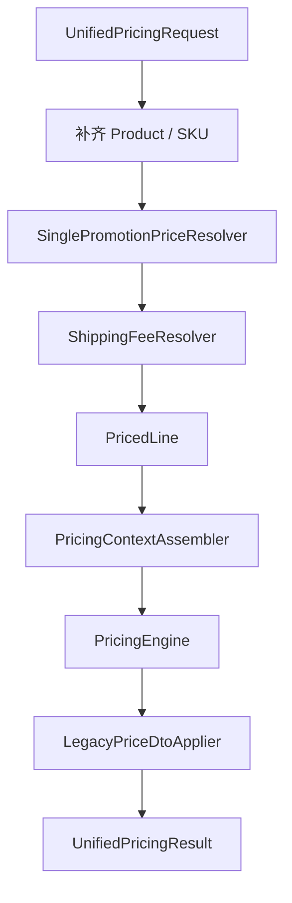

# 新价格服务技术分享

> 本文基于当前 `order-java` 仓库中的新统一价格链路整理，重点说明调用入口、算价流程、优惠互斥与叠加、代码设计，以及后续扩展优惠券立减、折扣和单品促销同层互斥的接入方式。
>
> 文中“当前”指代码已经实现的行为；“建议”指后续扩展方向。历史 `business/pricing` 营销算价链路会单独标注，不把它和新链路混为一谈。

## 1. 先看结论

新价格服务已经形成了一条比较完整的统一报价链路：

```text
业务入口
  → PriceService / BatchSkuPriceTradeAdapter / ProductDisplayPricingService
  → PricingFacade
  → PricingContextAssembler
  → PricingEngine
  → PricingLedger
  → LegacyPriceDtoApplier
  → PriceDto / UnifiedPricingResult
```

核心计算顺序是：

```text
商品原价
  → 单品促销层
  → 优惠券层
  → 商品行实付、运费、整单应付
```

当前已经实现的规则是：

1. 单品促销和优惠券是两个不同阶段。
2. 当前单品促销只有 `SINGLE_PROMOTION`，每行最多生效一个促销候选。
3. 当前优惠券只启用满减券，一笔交易最多使用一张券。
4. `stackable=true` 时，券以单品促销后的金额为基数；`stackable=false` 时，适用商品行存在单品促销则券不可用。
5. 优惠券满减金额对适用商品集合只计算一次，再按行、按件分摊。
6. 引擎内部使用整数分和逐件账本，金额在边界转换为 `BigDecimal`。
7. 商品详情、购物车、结算和提交会复用新统一报价入口；展示标签有一条直接使用 `PricingEngine` 的轻量路径。

当前还没有实现的能力包括：

- 优惠券立减策略；
- 优惠券折扣策略；
- 多张券按商家券、平台券等层级叠加；
- 达人专属价与单品直降作为同一促销层候选进行互斥择优；
- 满件优惠、跨行阶梯优惠等订单级促销。

## 2. 新价格服务的边界

### 2.1 新链路的唯一完整报价编排入口

`PricingFacade` 是新链路的完整报价入口。它负责：

- 补齐商品和 SKU 快照；
- 批量读取单品促销；
- 计算运费；
- 加载用户券候选；
- 组装引擎上下文；
- 执行 `PricingEngine`；
- 把账本结果回写成现有 `PriceDto`；
- 返回每行价格、促销信息和券决策。

代码位置：

- [`PricingFacade.java`](../trade-order-service/src/main/java/cn/mathmagic/jjewelry/business/couponv1/pricing/support/PricingFacade.java)
- [`PricingEngine.java`](../trade-order-service/src/main/java/cn/mathmagic/jjewelry/business/couponv1/pricing/engine/PricingEngine.java)

`PricingEngine` 本身是纯内存计算，不访问商品、券、运费或用户服务；所有外部数据必须在进入引擎前组装进 `PricingContext`。

### 2.2 新链路与旧链路并存

仓库中仍然存在另一套历史营销算价链路：

```text
MarketingService
  → PricingService
  → PricingFlowManager
  → ActivityMatchingService
  → BestDiscountSelector
```

它使用的是 `business/pricing` 包下的活动匹配和用户标签逻辑，当前不能认为它和新 `couponv1/pricing` 链路天然同源。

本文讨论的新价格服务主要是：

```text
business/couponv1/pricing
```

如果某个新业务入口仍然直接调用历史 `MarketingService` 或历史 `PricingService`，它就没有完全进入本文描述的新统一算价体系。后续新增场景应优先接入 `PricingFacade`，而不是重新拼装一套优惠计算。

## 3. 调用方入口与是否复用同一套算价

### 3.1 入口总览

| 场景 | 主要入口 | 是否进入 `PricingFacade` | 模式 | 是否与交易报价完全同源 |
| --- | --- | --- | --- | --- |
| `/price/compute` 单 SKU 预报价 | `PriceController → PriceService.getPriceWithCoupon` | 是 | `ORDER` | 是 |
| 直接购买预提单 | `PreOrderService → PriceService.getPriceWithCoupon` | 是 | `ORDER` | 是 |
| 直接购买建单 | `OrderService → PreOrderService.getPreOrderForCreate` | 是 | `ORDER` | 是 |
| 商城/商详价格 | `ProductDisplayPricingService` | 是 | `INDEPENDENT` | 促销和券规则同源，运费/选券上下文不同 |
| 购物车价格 | `CartProductQueryServiceImpl → PriceService.batchGetSkuPrice` | 是 | `CART` | 是，购物车会区分勾选和未勾选 |
| 交易 checkout | `TradeCheckoutService → BatchSkuPriceTradeAdapter → PriceService.batchGetSkuPrice` | 是 | 批量交易报价 | 是 |
| 交易 submit | `TradeSubmitService → BatchSkuPriceTradeAdapter → PriceService.batchGetSkuPrice` | 是 | 批量交易报价 | 是，并且会重新报价校验 |
| 展示券/促销标签 | `PromotionLabelService → PricingEngine.price` | 否，直接进引擎 | 独立标签上下文 | 只复用引擎规则，不负责完整报价 |
| 历史营销入口 | `MarketingService → business/pricing` | 否 | 历史逻辑 | 否 |

### 3.2 单 SKU 价格入口

`PriceController` 的 `/price/compute` 接收商品、SKU、数量、地址和券选择意图：

```text
PriceController
  → CouponIntentParser
  → PriceService.getPriceWithCoupon
  → PricingFacade.price
```

指定券不可用时，控制层调用 `CouponPricingResult.assertSpecifiedUsable()` 抛出错误，并把候选券及不可用原因返回给前端；不会静默换成另一张券。

`PreOrderService` 的预提单和 `OrderService` 的直接购买建单也复用 `PriceService.getPriceWithCoupon`，因此商品价格、券选择、金额字段和折扣明细来自同一份报价结果。

### 3.3 购物车入口

购物车实时数据由 `CartProductQueryServiceImpl` 组装，最终调用：

```text
CartProductQueryServiceImpl
  → PriceService.batchGetSkuPrice
  → BatchSkuPriceCalculator.calculate
  → PricingFacade.price
```

购物车使用 `CART` 语义：

- 勾选行作为一个交易集合计算；
- 未勾选行可以按自身数量做独立预估；
- 未勾选行不参与勾选集合的整单券门槛；
- 购物车只预估，不锁券；
- 购物车计算失败时，展示场景可以按配置降级到促销报价。

### 3.4 checkout 和 submit 入口

交易层没有重新实现优惠算法，而是通过批量算价端口转发：

```text
TradeCheckoutService
  → BatchSkuPriceTradeAdapter
  → PriceService.batchGetSkuPrice
  → BatchSkuPriceCalculator
  → PricingFacade
```

checkout 会生成 `preTradeId`，保存购买行、应付金额、选券结果和价格指纹。

submit 会再次调用相同的批量报价入口，并校验：

- 购买行是否一致；
- 券选择意图是否一致；
- 券当前是否仍然可用；
- 应付金额是否变化；
- 价格指纹是否变化。

校验通过后才创建订单，并在事务内写优惠分摊和锁券。这保证了 checkout 展示价格与最终订单价格之间存在可验证的一致性。

相关代码：

- [`BatchSkuPriceTradeAdapter.java`](../trade-order-service/src/main/java/cn/mathmagic/jjewelry/business/trade/pricing/BatchSkuPriceTradeAdapter.java)
- [`TradeCheckoutService.java`](../trade-order-service/src/main/java/cn/mathmagic/jjewelry/business/trade/service/TradeCheckoutService.java)
- [`TradeSubmitService.java`](../trade-order-service/src/main/java/cn/mathmagic/jjewelry/business/trade/service/TradeSubmitService.java)

### 3.5 展示标签为什么直接调用 `PricingEngine`

`PromotionLabelService` 的职责是计算商品标签和券候选文案。它已经有商品价格、促销金额和券候选，因此可以直接组装一个最小 `PricingContext` 调用引擎。

这条路径只用于：

- 判断券是否达到门槛；
- 选择展示用的最优券；
- 生成“满 100 减 20”等标签。

它不负责：

- 商品/SKU 查询；
- 运费计算；
- 完整 `PriceDto` 回写；
- 锁券或核销。

因此，新的交易、购物车、价格接口不要直接照搬这条路径。完整报价仍应走 `PricingFacade`。

## 4. 核心对象和数据流

### 4.1 输入对象

统一报价入口使用 `UnifiedPricingRequest`：

```text
UnifiedPricingRequest
├── couponRequest
│   ├── tenantId
│   ├── userId
│   └── intent: NONE / AUTO / SPECIFIED
├── addressId
├── mode: ORDER / CART / INDEPENDENT
├── includeShipping
├── allowCouponFallback
└── lines[]
    ├── productId
    ├── skuId
    ├── cartItemId
    ├── quantity
    ├── selected
    ├── product（可选快照）
    └── sku（可选快照）
```

`CouponPricingRequest` 是新链路的身份边界。下游报价组件通过显式参数传递用户和租户，不应在引擎内部读取 `AuthContext`。

### 4.2 内部上下文

`PricingContextAssembler` 将报价输入转换为纯计算上下文：

```text
PricingContext
├── PricingLine[]
├── lineId → PromotionRule[]
├── CouponCandidate[]
├── CouponIntent
├── shippingFeeCents
└── now
```

当前 `PricingContextAssembler` 只把 `DiscountDto` 转成一个 `SINGLE_PROMOTION` 规则。也就是说，当前新链路中一个 SKU 进入引擎前已经只有一个促销结果。

这点对后续达人专属价很关键：如果在 resolver 阶段先选掉单品直降，之后再把达人价放进去，就无法让引擎比较两者。后续需要把“候选促销”而不是“已选促销”传入引擎，见第 8 节。

### 4.3 输出对象

`UnifiedPricingResult` 按行返回：

```text
UnifiedPricingResult
├── lines: lineId → Line
│   ├── price: PriceDto
│   ├── promotion: DiscountDto
│   ├── couponResult: CouponPricingResult
│   └── error
└── selectedResult: 整组券决策
```

引擎内部的 `PricingDecision` 则包含：

- 最终 `PricingLedger`；
- 全部券评估结果；
- 选中的券；
- 当前优惠类型。

## 5. 当前算价流程

### 5.1 `PricingFacade` 编排流程



`PricingFacade.prepare()` 的主要步骤：

1. 使用请求中已有的商品/SKU 快照，缺失时批量查库补齐。
2. 校验商品、SKU、归属关系、数量和价格。
3. 非众筹商品送入 `SinglePromotionPriceResolver` 读取单品直降。
4. 批量计算运费。
5. 组装 `PricedLine`。
6. 根据模式决定整单报价、独立报价或购物车预估。

众筹商品在新链路中不参与优惠计算；它们可以保留行和运费，但不会进入促销或券的有效计算集合。

### 5.2 引擎阶段

当前阶段顺序由 `PricingStage.order()` 决定：

| 顺序 | 阶段 | 当前职责 |
| ---: | --- | --- |
| 0 | `BasePriceStage` | 以 SKU 原价打开账本 |
| 100 | `PromotionStage` | 计算单品促销候选，按当前策略选出并落账 |
| 200 | `CouponStage` | 校验券候选、计算券优惠、选择一张券并落账 |

引擎执行方式是：

```java
PricingSession session = new PricingSession(context);
for (PricingStage stage : orderedStages) {
    stage.apply(session);
}
return PricingDecision.of(session);
```

新增优惠阶段时，应实现 `PricingStage`，由 `order()` 参与排序；阶段本身不应访问数据库。

## 6. 账本、分摊和金额口径

### 6.1 金额统一使用分

`Cents` 负责人民币和整数分的转换：

```text
BigDecimal 元 → long 分：边界处 HALF_UP
long 分 → BigDecimal 元：边界处转换
```

引擎内部不使用浮点数，也不在每个优惠策略中重复处理小数舍入。

### 6.2 账本按行、按件保存剩余金额

`PricingLedger` 初始状态如下：

```text
line A, quantity=2, unitPrice=100.00
remainingUnits[A] = [10000, 10000]
```

每个优惠通过 `DiscountEntry` 追加到账本：

```text
DiscountEntry
├── layer
├── lineId
├── promotionId / couponId
├── baseCents
└── unitAmountCents[]
```

`post()` 会校验：

- 行存在；
- 单位数一致；
- 优惠金额不为负；
- 每件优惠后金额不低于 0。

当前 `Cents.MIN_UNIT_PAY = 0`，因此商品行和子单允许 0 元；整笔交易的支付下限由支付入口负责。

### 6.3 比例分摊

`CappedProportionalAllocator` 用于行级和件级分摊：

1. 按权重比例分配；
2. 不超过每行或每件的抵扣上限；
3. 已达到上限的项退出后继续分配；
4. 不可整除的尾差按稳定顺序补齐；
5. 分配总额必须完全落到各项上限内。

这套分摊逻辑使得订单级券可以落到子单和件级，支持后续退款、拆单和优惠明细展示。

### 6.4 当前单品促销的落账

`SinglePromotionPriceResolver` 已经根据活动和 SKU 数量算出一条 `DiscountDto`。`PricingContextAssembler` 将其转换为一条 `PromotionRule`，其中 `lineDiscountCents` 是整行优惠金额。

`SinglePromotionCalculator` 再把整行优惠按件分配，最终写入 `PromotionOffer` 和 `DiscountEntry`。

### 6.5 当前满减券的落账

`CouponQuoteCalculator` 的流程是：

```text
候选券
  → 适用性规则
  → 找到券策略
  → 计算适用行总基数
  → 计算整张券优惠金额
  → 行级分摊
  → 件级分摊
  → 生成 CouponQuote
```

当前满减策略：

```text
baseTotal >= threshold
discount = min(discountValue, deductible)
```

其中 `baseTotal` 是该券适用行的当前账本金额。`stackable=true` 时，它是单品促销后的金额；`stackable=false` 且没有冲突时，规则会把券基数切回原价。

## 7. 当前互斥与叠加规则

### 7.1 单品促销层

当前只有一种 `PromotionType`：

```text
SINGLE_PROMOTION
  channel = 9
  mutexGroup = DEFAULT
  priority = 100
```

`BestSinglePromotionPolicy` 当前直接从一行候选中选择一个，策略层的排序规则是优惠金额更大、平手时 `activityId` 更小。不过在进入引擎前，`SinglePromotionPriceResolver` 通常已经按活动 `precedence`、折后价和活动 ID 选出一条单品直降结果，因此当前运行时往往只有一个 `PromotionRule`。

虽然 `PromotionOffer` 已经有 `mutexGroup` 和 `priority` 字段，`PromotionCombinationPolicy` 也已经抽象出来，但当前策略还没有按互斥组实现跨组叠加。

### 7.2 优惠券层

当前 `SingleBestCouponPolicy` 明确规定一笔交易最多一张券：

- `NONE`：不选券；
- `SPECIFIED`：只评估指定券，不可用就报错；
- `AUTO`：选最终应付最低的候选券；如果使用券后应付金额没有变低，则不锁券。

AUTO 的比较顺序由 `CouponQuoteOrder` 定义，核心目标是候选券后的最终应付金额最低。

当前 `CouponCandidate.DEFAULT_MUTEX_GROUP` 已存在，但 `SingleBestCouponPolicy` 还没有按互斥组分组选择；它是“一笔交易最多一张”的 MVP 规则。

### 7.3 券与促销的兼容关系

`CouponPromotionCompatibilityRule` 是当前叠加规则的关键：

| `stackable` | 适用行有单品促销 | 券基数 | 结果 |
| --- | --- | --- | --- |
| `true` | 有 | 促销后金额 | `STACKED`，促销和券同时生效 |
| `true` | 无 | 原价 | `COUPON_ONLY` |
| `false` | 有 | 不计算 | `PROMOTION_CONFLICT`，券不可用 |
| `false` | 无 | 原价 | `COUPON_ONLY` |

这里的“有促销”只检查券适用范围内的行。券范围外商品有单品促销，不影响这张券。

### 7.4 当前不是“所有优惠都自动叠加”

当前引擎的叠加关系是显式的：

```text
单品促销层：内部择一
优惠券层：整单择一
促销层与券层：由 stackable 决定叠加或冲突
```

不能因为 `DiscountEntry` 支持多条明细，就认为当前业务已经支持多种优惠无限叠加。账本是承载能力，组合策略才是业务规则。

## 8. 后续扩展设计

### 8.1 扩展优惠券立减

当前枚举已经预留：

```java
CouponDiscountType.DIRECT_REDUCTION(1, "立减")
```

但 `CouponPricingStrategyRegistry` 当前只注册满减策略，因此立减券会被 `CouponTypeSupportedRule` 判为不支持。

建议新增：

```java
@Component
public class DirectReductionStrategy implements CouponPricingStrategy {

    @Override
    public CouponDiscountType type() {
        return CouponDiscountType.DIRECT_REDUCTION;
    }

    @Override
    public CouponDiscountResult calculate(CouponCandidate coupon,
                                          long baseTotalCents,
                                          long deductibleCents) {
        long discount = Math.min(coupon.getDiscountValueCents(), deductibleCents);
        return discount > 0
                ? CouponDiscountResult.discount(discount)
                : CouponDiscountResult.unavailable(UnavailableReason.NO_DEDUCTIBLE);
    }
}
```

预计需要同步调整：

- `CouponTemplateValidator`：允许 `discountType=1`，校验立减金额，门槛按无门槛处理；
- 策略单测和集成测试；
- 建券接口文案和错误提示；
- 如果产品要求严格区分“无门槛”和“满 0 元”，补充明确的展示口径。

现有用户券表、模板快照、订单券明细和分摊器已经可以承载立减券，不需要新增表。

本文采用的默认语义是：**一张立减券对其全部适用商品集合只减一次，再按行和件分摊**。如果产品要表达“每件减 X 元”，应新增独立券类型或规则字段，不能复用同一个 `DIRECT_REDUCTION` 语义。

### 8.2 扩展优惠券折扣

当前枚举也已经预留：

```java
CouponDiscountType.DISCOUNT(3, "折扣")
```

但 `CouponCandidate` 当前只保存：

- `thresholdCents`；
- `discountValueCents`。

折扣券需要把模板/用户券快照中的以下字段带入候选：

- `discountRate`；
- `maxDiscountAmount`，可选封顶金额。

建议扩展 `CouponCandidate`：

```text
discountRateBasisPoints / discountRate
maxDiscountCents
```

并新增 `DiscountCouponPricingStrategy`：

```text
baseTotal < threshold
    → 不可用

rawDiscount = baseTotal × (1 - discountRate)

discount = min(rawDiscount, maxDiscountAmount, deductible)
```

需要提前确定的业务口径：

1. `discountRate` 是折后比例还是减免比例。现有活动代码中 `0.8` 更接近八折，券策略应明确保持同一口径。
2. 折扣券的门槛基数是否仍然是适用行合计。
3. 折扣计算的舍入是在整单后处理，还是按行处理。
4. 封顶金额是整张券封顶，还是每行封顶。

建议整张券先在分单位计算出总优惠，再复用现有行级、件级分摊器，避免每行独立舍入造成总额不一致。

### 8.3 单品促销同层级互斥：达人价与单品直降

如果达人专属价和单品直降属于同一个“单品促销层”，目标规则应是：

```text
同一 SKU / 同一时间段 / 同一单品层
  → 先筛选符合资格的候选
  → 比较候选最终折后价
  → 只生效一个
```

当前代码还不能直接完成这个规则，原因是 `SinglePromotionPriceResolver` 当前返回的是每个 SKU 的一个 `DiscountDto`，它在进入引擎之前已经完成了候选选择。

推荐改造为两步：

#### 第一步：读取候选，不提前择一

将单品促销读取器的输出从：

```text
skuId → DiscountDto
```

扩展为：

```text
skuId → List<PromotionCandidate>
```

候选至少包含：

- 促销类型；
- 活动 ID；
- 渠道；
- 资格结果；
- 折扣类型和值；
- 计算后的整行优惠金额；
- 折后价；
- 互斥组。

达人身份、作者关系、活动资格等外部条件在候选收集阶段完成；不符合资格的候选不要进入引擎。

#### 第二步：交给促销组合策略择一

可以将 `PromotionRule` 扩展为：

```text
PromotionRule
├── promotionType
├── mutexGroup
├── activityId
├── activityName
├── lineDiscountCents
└── metadata / channel
```

`PromotionStage` 将同一行的候选按 `mutexGroup` 分组：

- 同组内比较最终折后价，选择一个；
- 不同组是否叠加，由组合策略决定；
- 单品直降和达人专属价使用同一个 `ITEM_PRICE` 互斥组时，只保留一个。

当前 `BestSinglePromotionPolicy` 可以作为兼容实现，但需要把“所有候选只选一个”改成“按组选择”。否则未来新增会员价、作者价时，`mutexGroup` 字段仍然只是摆设。

### 8.4 促销类型和促销阶段的建议划分

建议把“优惠是什么”和“优惠怎么组合”分开：

```text
PromotionType：优惠计算方式或业务类型
PromotionGroup：互斥/叠加关系
PricingStage：执行顺序
PromotionCombinationPolicy：同阶段如何组合
```

一个可扩展的配置示例：

| 候选 | 阶段 | 互斥组 | 组合方式 |
| --- | --- | --- | --- |
| 单品直降 | ITEM | ITEM_PRICE | 同组择优 |
| 达人专属价 | ITEM | ITEM_PRICE | 同组择优 |
| 会员专享价 | ITEM | ITEM_PRICE | 同组择优 |
| 店铺满减活动 | SHOP | SHOP_BENEFIT | 同组择优 |
| 多件优惠 | SHOP | SHOP_BENEFIT | 同组择优 |
| 店铺券 | SHOP_COUPON | SHOP_COUPON | 同类择一 |
| 平台券 | PLATFORM_COUPON | PLATFORM_COUPON | 同类择一 |
| 赠品 | GIFT | GIFT | 全部生效，不改商品金额 |

当前实现不需要马上引入数据库化规则配置。第一步可以先用枚举和策略类表达，等促销类型和叠加关系稳定后再配置化。

### 8.5 多券分层叠加

当前 `DiscountLayer` 已经预留：

```text
PROMOTION(1)
SHOP_COUPON(2)
PLATFORM_COUPON(3)
```

但当前 `CouponStage` 仍然只选择一张券。后续支持商家券和平台券叠加时，建议不要直接把 `SingleBestCouponPolicy` 改成“返回多张”就结束，而是明确三层语义：

1. 同一券层/同一互斥组内，只选一张；
2. 不同券层可以按层级顺序叠加；
3. 每层的门槛基于该层规定的输入金额。

推荐的引擎形态是：

```text
BasePriceStage
  → PromotionStage
  → MerchantCouponStage
  → PlatformCouponStage
```

如果同一计算层内存在多个可以共同生效的工具，则需要定义“共同基数”还是“前一工具扣减后的基数”。不能仅依赖 `PricingLedger` 的顺序追加来隐式决定公式。

扩展时还要同步处理：

- `CouponSelectionOutcome` 从单张券改成多张券；
- `CouponPricingResult.couponIds()` 返回多个 ID；
- 订单锁券、核销、解锁从单券变成券集合；
- `CouponOrderAllocationService` 写入多张券的分摊明细；
- checkout/submit 快照记录完整券组合；
- 指定券选择的接口协议和失败原因。

因此，立减和折扣是策略级扩展；多券跨层叠加是组合策略和订单生命周期扩展，规模明显更大。

## 9. 新场景如何接入

### 9.1 推荐接入方式

新场景应按以下步骤接入：

1. 将商品行转换为 `UnifiedPricingRequest.Line`。
2. 尽量批量加载并传入 `Product`、`Sku` 快照，避免 `PricingFacade` 重复查库。
3. 根据场景选择 `mode`：
   - 商品详情/列表：`INDEPENDENT`；
   - 购物车：`CART`；
   - checkout、submit、预下单：`ORDER`。
4. 需要用户券时显式传入 `CouponPricingRequest`；无券场景使用 `CouponPricingRequest.promotionOnly()`。
5. 通过 `UnifiedPricingResult` 消费 `PriceDto`、促销信息和券结果。
6. 交易场景必须处理指定券不可用和价格变化，不应静默降级。

### 9.2 不建议的接入方式

不要在业务层：

- 直接读取 `PromotionActivity` 后自行计算折扣；
- 直接调用 `SinglePromotionPriceResolver` 再拼券金额；
- 为新场景复制一套“满减/立减/折扣”分支；
- 使用 `PriceDto.discount` 反推每层优惠，而忽略 `discountList`；
- 让引擎内部读取 `AuthContext`、商品仓储或券仓储；
- 把展示标签结果当作交易报价结果。

如果场景只是展示标签，可以像 `PromotionLabelService` 一样直接组装最小 `PricingContext`；只要涉及真实商品金额、运费、券选择或下单，就应通过 `PricingFacade`。

### 9.3 新接入场景的验收清单

- 单 SKU 和多 SKU 是否都使用 `PricingFacade`；
- 是否明确 `ORDER`、`CART`、`INDEPENDENT` 的场景语义；
- 是否显式传递用户、租户和券意图；
- 是否处理商品/ SKU 不存在、价格失败和运费失败；
- 是否消费 `discountList` 而不是只消费一个主优惠字段；
- 是否在提交时重新报价并校验金额/价格指纹；
- 是否为新场景增加“无促销、促销、券、促销叠券、指定券失败”的测试；
- 是否避免在异步子线程中读取请求上下文。

## 10. 代码设计评价

### 10.1 当前设计的优点

1. **计算和 IO 已经分离**：`PricingFacade` 负责准备数据，`PricingEngine` 负责纯计算。
2. **阶段扩展点清楚**：`PricingStage` 可以增加新的执行阶段。
3. **策略扩展点清楚**：券通过 `CouponPricingStrategy` 注册；促销通过 `PromotionCalculator` 注册。
4. **账本可复算**：每条优惠都以 `DiscountEntry` 记录，最终金额可以还原。
5. **金额分摊可复用**：行级、件级共用带上限分摊器。
6. **展示和交易结果同源**：统一报价结果回写 `PriceDto`，交易提交使用同一批量报价端口重新校验。
7. **失败原因可解释**：券候选保存不可用原因，能够返回门槛未达、范围不匹配、促销冲突、券类型不支持等信息。

### 10.2 当前设计的限制

1. 单品促销 resolver 提前选优，导致引擎还不能真正比较多种单品促销候选。
2. `PromotionOffer.mutexGroup` 和 `priority` 已预留，但当前组合策略没有真正按组处理。
3. 优惠券层仍然是“一笔交易最多一张”，`stackLayer` 尚未变成多层执行阶段。
4. `CouponCandidate` 尚未携带折扣率和折扣封顶，直接扩展折扣券还需要补齐候选模型。
5. `PricingContextAssembler` 只接入单品直降结果，其他历史营销渠道不会自动进入新引擎。
6. `LegacyPriceDtoApplier` 仍需兼容旧 `PriceDto` 字段，因此新增优惠类型时要同时维护明细和主字段的展示语义。

## 11. 推荐演进顺序

建议按下面顺序演进，避免一次性改变互斥、金额和订单生命周期：

### 第一步：补齐当前单品层候选模型

- 将单品直降 resolver 的单结果改为候选结果；
- 让达人专属价和单品直降进入同一个 `ITEM_PRICE` 互斥组；
- 在 `PromotionCombinationPolicy` 中按组择优；
- 保持券仍然一张、满减仍然一个策略。

### 第二步：增加优惠券立减

- 新增 `DirectReductionStrategy`；
- 放开建券校验；
- 复用现有分摊和订单明细；
- 保持一张券的生命周期不变。

### 第三步：增加优惠券折扣

- 扩展 `CouponCandidate` 的折扣率和封顶字段；
- 新增折扣策略；
- 明确折扣率、舍入和封顶口径；
- 增加跨行、跨件测试。

### 第四步：增加多券分层

- 将单券组合策略升级为按互斥组选择；
- 按 `DiscountLayer` 分阶段执行；
- 扩展 checkout/submit 快照；
- 扩展锁券、核销、解锁和分摊表处理券集合。

### 第五步：扩展订单级促销

- 引入订单级候选和跨行门槛；
- 明确优惠共同基数；
- 复用行/件分摊；
- 增加拆单、退款和分账口径。

## 12. 测试矩阵

### 12.1 当前链路基础用例

| 场景 | 预期 |
| --- | --- |
| 无促销、无券 | 原价 + 运费 |
| 单品直降 | 促销落账，商品实付下降 |
| 满减券达门槛 | 券优惠一次计算，按行/件分摊 |
| 满减券未达门槛 | 券不可用，返回 `THRESHOLD_NOT_MET` |
| `stackable=true` | 促销和券同时生效 |
| `stackable=false` 且有促销 | 券返回 `PROMOTION_CONFLICT` |
| 多张券 AUTO | 只选最终应付最低的一张 |
| 多张券应付相同 | 不应为了相同金额锁券 |
| 指定券不可用 | 报错，不静默换券 |
| 多行满减 | 适用行合计达门槛，按行/件分摊 |
| 众筹商品 | 不进入促销和券计算 |
| checkout → submit | 重新报价后金额和指纹一致才提交 |

### 12.2 扩展用例

| 场景 | 预期 |
| --- | --- |
| 立减券 | `min(面额, 可抵扣金额)` |
| 立减券多行 | 一张券只计算一次，再按行/件分摊 |
| 折扣券 | 按共同基数计算，应用封顶和可抵扣上限 |
| 达人价 vs 单品直降 | 同组只生效最终折后价更低者 |
| 达人价不满足资格 | 不进入候选，不影响单品直降 |
| 商家券 + 平台券 | 各自按互斥组选择，再按明确层级叠加 |
| 同类两张平台券 | 只保留一张 |
| 部分退款 | 按实际优惠分摊明细计算，不重新猜测活动规则 |

## 13. 关键代码索引

### 新统一报价入口

- [`PricingFacade.java`](../trade-order-service/src/main/java/cn/mathmagic/jjewelry/business/couponv1/pricing/support/PricingFacade.java)
- [`UnifiedPricingRequest.java`](../trade-order-service/src/main/java/cn/mathmagic/jjewelry/business/couponv1/pricing/support/UnifiedPricingRequest.java)
- [`UnifiedPricingResult.java`](../trade-order-service/src/main/java/cn/mathmagic/jjewelry/business/couponv1/pricing/support/UnifiedPricingResult.java)
- [`PriceService.java`](../trade-order-service/src/main/java/cn/mathmagic/jjewelry/business/price/service/PriceService.java)
- [`BatchSkuPriceCalculator.java`](../trade-order-service/src/main/java/cn/mathmagic/jjewelry/business/price/service/BatchSkuPriceCalculator.java)

### 引擎和账本

- [`PricingEngine.java`](../trade-order-service/src/main/java/cn/mathmagic/jjewelry/business/couponv1/pricing/engine/PricingEngine.java)
- [`PricingStage.java`](../trade-order-service/src/main/java/cn/mathmagic/jjewelry/business/couponv1/pricing/engine/PricingStage.java)
- [`PricingLedger.java`](../trade-order-service/src/main/java/cn/mathmagic/jjewelry/business/couponv1/pricing/model/PricingLedger.java)
- [`DiscountEntry.java`](../trade-order-service/src/main/java/cn/mathmagic/jjewelry/business/couponv1/pricing/model/DiscountEntry.java)
- [`CappedProportionalAllocator.java`](../trade-order-service/src/main/java/cn/mathmagic/jjewelry/business/couponv1/pricing/engine/CappedProportionalAllocator.java)

### 促销

- [`PromotionStage.java`](../trade-order-service/src/main/java/cn/mathmagic/jjewelry/business/couponv1/pricing/engine/stage/PromotionStage.java)
- [`PromotionCalculator.java`](../trade-order-service/src/main/java/cn/mathmagic/jjewelry/business/couponv1/pricing/engine/promotion/PromotionCalculator.java)
- [`PromotionCombinationPolicy.java`](../trade-order-service/src/main/java/cn/mathmagic/jjewelry/business/couponv1/pricing/engine/promotion/PromotionCombinationPolicy.java)
- [`BestSinglePromotionPolicy.java`](../trade-order-service/src/main/java/cn/mathmagic/jjewelry/business/couponv1/pricing/engine/promotion/BestSinglePromotionPolicy.java)
- [`SinglePromotionPriceResolver.java`](../trade-order-service/src/main/java/cn/mathmagic/jjewelry/business/couponv1/pricing/support/SinglePromotionPriceResolver.java)

### 优惠券

- [`CouponStage.java`](../trade-order-service/src/main/java/cn/mathmagic/jjewelry/business/couponv1/pricing/engine/stage/CouponStage.java)
- [`CouponPricingStrategy.java`](../trade-order-service/src/main/java/cn/mathmagic/jjewelry/business/couponv1/pricing/engine/coupon/CouponPricingStrategy.java)
- [`CouponPricingStrategyRegistry.java`](../trade-order-service/src/main/java/cn/mathmagic/jjewelry/business/couponv1/pricing/engine/coupon/CouponPricingStrategyRegistry.java)
- [`FullReductionStrategy.java`](../trade-order-service/src/main/java/cn/mathmagic/jjewelry/business/couponv1/pricing/engine/coupon/FullReductionStrategy.java)
- [`SingleBestCouponPolicy.java`](../trade-order-service/src/main/java/cn/mathmagic/jjewelry/business/couponv1/pricing/engine/coupon/SingleBestCouponPolicy.java)
- [`CouponPromotionCompatibilityRule.java`](../trade-order-service/src/main/java/cn/mathmagic/jjewelry/business/couponv1/pricing/engine/coupon/rule/CouponPromotionCompatibilityRule.java)
- [`LegacyPriceDtoApplier.java`](../trade-order-service/src/main/java/cn/mathmagic/jjewelry/business/couponv1/pricing/support/LegacyPriceDtoApplier.java)

### 交易生命周期

- [`TradeCheckoutService.java`](../trade-order-service/src/main/java/cn/mathmagic/jjewelry/business/trade/service/TradeCheckoutService.java)
- [`TradeSubmitService.java`](../trade-order-service/src/main/java/cn/mathmagic/jjewelry/business/trade/service/TradeSubmitService.java)
- [`TradeCouponService.java`](../trade-order-service/src/main/java/cn/mathmagic/jjewelry/business/couponv1/service/order/TradeCouponService.java)
- [`CouponOrderAllocationService.java`](../trade-order-service/src/main/java/cn/mathmagic/jjewelry/business/couponv1/service/order/CouponOrderAllocationService.java)

