# 统一算价领域化重构计划

## Summary

基于 `main...feature/coupon` 的现有改动，重构统一算价内部编排，保持 C 端 HTTP 请求和响应结构不变。

所有完整报价统一进入一个新算价入口：

```text
调用方组装领域请求
  → PricingFacade.price(...)
  → 场景策略执行
  → 单品促销互斥
  → 店铺促销 / 优惠券组合
  → 账本输出最终金额
  → 适配为历史 PriceDto 和接口字段
```

调用方只做请求适配和结果转换，不再保留“先算基础价、再二次叠券”的实现。

本期实际支持：

- 单品促销互斥；
- 店铺促销策略 A、B；
- 优惠券满减、立减、折扣；
- 统一金额、门槛、分摊和历史字段回填；
- 平台、大促、补贴层的可插拔扩展协议，本期不接入真实活动数据。

## 与 main 分支的适配原则

- 以 `git diff main...feature/coupon` 为改造基线，优先重构当前新增的优惠券和统一算价代码。
- `PriceService`、购物车、商品展示、预下单、checkout、submit 等调用方尽可能保持现有方法签名和业务流程。
- 调用方只负责组装统一领域请求、调用统一入口和转换结果，不复制算价、券加载或金额合并逻辑。
- 与优惠冻结、核销、释放无关的历史方法保持不动。
- 不新增第二套基础价加券链路；所有完整报价都必须经过统一入口。

## 统一算价入口

统一入口为：

```java
public PricingResult price(PricingRequest request)
```

入口必须补充完整 Javadoc，说明：

- `ORDER`：所有有效商品行共同参与门槛、择优和优惠分摊；
- `INDEPENDENT`：每个 SKU 独立报价，不跨 SKU 凑门槛；
- `CART`：勾选行整单报价，未勾选行按单行独立 `AUTO` 预估；
- `NONE`：只计算单品促销，不使用优惠券；
- `AUTO`：选择最终商品实付最低的合法优惠；
- `SPECIFIED`：只使用指定券，不可用时返回明确错误；
- 运费是否参与报价；
- 领域结果中每行金额、优惠明细、券决策和错误的来源；
- 商品展示、购物车和交易场景的使用示例。

典型调用：

```java
// 直接下单、checkout、submit
PricingRequest.order(...).coupon(AUTO);

// 商品详情、列表、搜索
PricingRequest.independent(...).coupon(AUTO);

// 购物车
PricingRequest.cart(...).coupon(AUTO);
```

统一入口不读取 `AuthContext`，租户、用户和选券意图由调用方显式传入，避免线程上下文污染。

## 领域分层

### 请求准备层

新增或整理 `PricingPreparationService` 和 `PricingExecutionContext`：

- 批量加载商品和 SKU；
- 优先复用调用方传入的商品、SKU 快照；
- 批量加载单品促销候选；
- 批量加载用户券、模板快照和跳转信息；
- 批量计算运费；
- 校验商品、SKU、数量、商品类型和重复行；
- 形成请求级只读上下文。

准备层完成后，价格引擎和策略层不得访问 DB、Redis 或 RPC。

### 场景策略层

```java
interface PricingScenarioStrategy {
    PricingScenario scenario();
    PricingResult execute(PricingExecutionContext context);
}
```

实现：

- `OrderPricingStrategy`：所有有效行共同计算门槛、择优和分摊；
- `IndependentPricingStrategy`：每个 SKU 独立报价；
- `CartPricingStrategy`：组合 `SelectedCartPricingStrategy` 和 `UnselectedCartPreviewStrategy`。

购物车规则：勾选行作为整单计算；未勾选行使用真实数量和 `AUTO` 独立报价；未勾选行使用零运费参与优惠计算；行级运费继续单独返回；未勾选行不影响整单优惠、汇总金额和选中行数量。

`PricingFacade` 只负责请求校验、批量准备、策略路由、统一日志和结果返回，不再堆叠订单、独立 SKU、购物车的条件分支。

### 领域结果和旧 DTO 适配

新增或整理：

- `PricingResult`；
- `PricingLineResult`；
- `PricingResultAssembler`；
- `LegacyPriceDtoAdapter`。

领域结果保存原价、单品促销、店铺促销、券报价、不可用原因、每行/每件分摊、运费和最终金额。

`LegacyPriceDtoAdapter` 统一转换为 `PriceDto`、`discountList`、`promotionChannelInfo`、`aggPriceInfoList` 以及 checkout、submit、预下单和订单商品历史字段。旧 DTO 不参与领域计算，也不允许从 `PriceDto.discountList` 反向推导新的算价规则。

## 单品促销互斥

保留 `PromotionCombinationStrategy` 扩展点：

- 同一 SKU、同一时间段的单品直降、会员专享价等先过滤资格；
- 候选进入同一单品促销互斥组；
- 按实际折后价或实际优惠金额选择最优一个；
- 平手按优先级、活动 ID 稳定排序；
- 单品直降和会员价不能重复叠加；
- 单品促销结果先写入账本，作为后续券的计算基数。

## 店铺促销 A/B 策略

```java
interface StorePromotionCombinationStrategy {
    StorePromotionPolicy policy();
    PromotionCombination choose(
        List<PromotionCandidate> candidates,
        PricingExecutionContext context
    );
}
```

策略枚举：`WHOLE_ORDER_BEST_ONE`、`DISJOINT_SCOPE_BEST`。

### A：整单只选一个，默认策略

实现 `WholeOrderBestOneStrategy`：商品券、店铺券、多件优惠属于店铺促销主互斥组；一笔订单最多生效一个主组活动；选中的活动可以作用于自身适用商品集合；先判断商品范围、用户资格、有效期、门槛和数量，再比较整单实际优惠金额或最终商品实付；平手按优先级、活动 ID、券 ID 稳定选择。

默认规则：未指定策略、配置缺失或配置非法时均使用 A。

### B：按互不重叠商品集合分别择优

实现 `DisjointScopeBestStrategy`：允许不同促销作用于互不重叠的商品集合；每个商品集合内部只保留一个最优候选；适用行有交集的候选不能同时生效；适用行完全不重叠的候选可以同时生效；全店券与任意商品范围券存在交集，不能同时生效；各候选先独立试算，再按商品行和件分摊并合并领域结果。

外部 HTTP 请求不增加策略字段；领域请求保留可选内部策略字段；默认使用 A；单元测试和内部场景可以显式指定 B；后续可由内部配置切换，不影响 C 端接口。本期不实现 C 的全组合搜索，也不为了满足后续门槛回溯前层优惠。

## 优惠券类型本期实现

### 候选模型扩展

`CouponCandidate` 增加 `discountRate` 和 `maxDiscountCents`。模板实体、用户券实体、模板快照、模板草稿和 `CouponCandidateLoader` 必须完整透传。金额在引擎内部统一转换为分，折扣率保留精确小数或统一转换为基点，禁止使用浮点数。

### 满减券

```text
baseTotal < threshold → THRESHOLD_NOT_MET
discount = min(discountValue, deductible)
```

门槛基数为券适用行在前序优惠后的金额合计。

### 立减券

新增 `DirectReductionStrategy`：

```text
discount = min(discountValue, deductible)
```

一张立减券对全部适用商品集合只计算一次，不把 `discountValue` 乘以商品数量；复用现有行级、件级比例分摊；运费不参与门槛和优惠；没有可抵扣金额时返回 `NO_DEDUCTIBLE`；模板校验要求无门槛，未来“每件减 X 元”必须新增独立券类型。

### 折扣券

新增 `DiscountCouponStrategy`：

```text
baseTotal < threshold → THRESHOLD_NOT_MET
rawDiscount = floorCent(baseTotal × (1 - discountRate))
discount = min(rawDiscount, maxDiscountAmount, deductible)
```

`discountRate=0.8` 表示八折；门槛基数为适用行前序优惠后的金额合计；整张券合计计算一次并向下取整到分；`maxDiscountAmount` 为空表示不封顶；封顶按整张券计算；最终复用现有行级、件级分摊器；折扣率必须大于 0 且小于等于 1；折扣券的 `discountValue` 不参与计算。

### 模板校验和接口

`CouponTemplateValidator` 按券类型校验：

- 立减券：`discountValue > 0`，门槛为 0，折扣率和封顶为空；
- 满减券：门槛非负、优惠金额大于 0，折扣率和封顶为空；
- 折扣券：门槛非负、折扣率在 `(0, 1]`，封顶为空或大于 0，`discountValue` 为空；
- 三种券金额最多两位小数；
- 模板、用户券快照、搜索响应和发券数据完整透传新增字段。

### 券文案

扩展 `CouponTextRenderer`：立减券为“立减 X 元”，满减券为“满 X 减 Y 元”，折扣券为“X 折”。标签继续使用券名称快照；已达门槛券使用实际选中券文案；未达门槛券仍可展示门槛标签；`promotionChannelInfo.productDetails` 不由优惠券逻辑写入；优惠券逻辑只回填现有 `productDetail` 话术。

## 券组合和账本

- `CouponPricingStrategyRegistry` 注册满减、立减、折扣三种实现；
- `CouponTypeSupportedRule` 不再把立减和折扣判为不支持；
- `CouponQuoteCalculator` 对三种券统一执行适用范围、促销兼容性、门槛、金额计算和行/件分摊；
- 默认券组合仍保持一笔交易一张券；
- `CouponSelectionOutcome` 支持一个或多个领域报价结果，为 B 策略保留能力；
- `CouponStage` 按选中的报价写入账本；
- 参与门槛但分摊金额为 0 的行仍保留带券 ID 的关联明细；
- 不适用行不写券明细；
- 商品实付和子单实付允许为 0；
- 运费不参与券优惠，整笔交易支付入口继续执行最低 0.01 元校验。

## 跨层计算和后续扩展层

统一算价不把优惠层写死在 `PricingEngine` 或 `PricingFacade` 的条件分支中。新增平台、大促或补贴能力时，只需新增候选加载器、层处理器和组合策略并注册到层注册表，统一入口、账本、场景策略和历史 DTO 适配器不改。

### 层级协议

新增 `PricingLayerHandler`：

```java
interface PricingLayerHandler {
    PricingLayer layer();
    int order();
    LayerDecision select(List<LayerCandidate> candidates,
                         PricingLayerContext context);
    void apply(LayerDecision decision, PricingLedger ledger);
}
```

新增：

- `PricingLayer`：`ITEM`、`STORE`、`MULTI_ORDER`、`CAMPAIGN`、`CROSS_STORE`、`PLATFORM`、`SUBSIDY`、`PAYMENT`；
- `LayerCandidate`：来源、活动 ID、互斥组、适用行、门槛、计算方式、封顶、资方和扩展参数；
- `LayerDecision`：生效候选、不可用原因、共同基数、优惠金额和行/件分摊；
- `PricingLayerRegistry`：按 `order` 排序并执行已准备候选；
- `LayerCombinationPolicy`：处理层内互斥、层间叠加和稳定平手规则；
- `LayerBasePolicy`：声明门槛和优惠的计算基数，例如上一层剩余金额或本层共同基数。

每个层处理器必须遵守以下约束：

- 候选由准备层批量加载，处理器只能读取请求级 `PricingLayerContext`，不能在执行阶段访问 DB、Redis 或 RPC；
- 只能向 `PricingLedger` 追加明细，不能修改前面层的结果；
- 必须同时返回生效候选和未生效原因，便于优惠明细和诊断；
- 金额统一使用分，折扣率使用精确小数或基点，禁止浮点计算；
- 行级和件级分摊必须复用统一分摊器；
- 层处理器缺失时，若请求未携带该层候选则视为无优惠；若携带了不支持的候选则返回明确的“不支持”错误，不静默按原价继续交易。

### 默认层顺序

```text
原价
  → ITEM：单品直降、会员专享价
  → STORE：商品券、店铺券、多件优惠
  → MULTI_ORDER：多单立减
  → CAMPAIGN：大促立减折扣、官方立减等
  → CROSS_STORE：跨店促销（当前关闭）
  → PLATFORM：平台券、平台礼金、达人券等
  → SUBSIDY：政府补贴、以旧换新立减等
  → PAYMENT：红包、金币、积分（不进入商品优惠明细）
```

默认顺序由 `PricingLayer.order` 控制，不由调用方自行排序。每层可以声明：

- 是否与前后层叠加；
- 是否只允许本层一个候选；
- 是否按互斥组分别择优；
- 门槛使用前层剩余金额还是本层共同基数；
- 优惠金额是否按整层合计后再分摊；
- 是否计入商品优惠明细价或只影响支付金额。

### 本期已实现层

- `ITEM`：单品促销互斥，取同一 SKU 最优候选；
- `STORE`：店铺促销 A/B 策略和满减、立减、折扣券；
- 现有 `CouponPricingStrategyRegistry` 作为 `STORE` 层内的券型计算注册表。

### 平台层扩展点

新增 `PlatformPromotionLayerHandler` 空骨架，支持后续接入：

- 平台券；
- 平台礼金；
- 达人券或其他平台来源权益。

默认协议：平台券和平台礼金使用同一平台互斥组时只选一个；不同平台互斥组按配置叠加；门槛默认使用 `STORE` 层完成后的商品金额；候选实际适用范围和资方由 `LayerCandidate` 携带。具体平台资金和跨店分摊由后续候选加载器提供，不写入核心引擎。

### 多单立减层扩展点

新增 `MultiOrderPromotionLayerHandler`，支持后续接入多单立减。该层独立于 `STORE` 的多件优惠，默认同一互斥组只生效一个，并按自己的订单级门槛、共同基数和分摊规则追加账本明细。

### 大促层扩展点

新增 `CampaignPromotionLayerHandler` 空骨架，支持后续接入：

- 大促立减折扣；
- 官方立减；
- 多单立减等活动型优惠。

默认协议：同一大促互斥组只生效一个；大促层可以与 `ITEM`、`STORE` 和 `PLATFORM` 层叠加；候选声明共同基数、优惠封顶和适用商品集合；同层多个工具是否共用基数由 `LayerBasePolicy` 决定，禁止在循环中隐式连续打折。

### 跨店层扩展点

新增 `CrossStorePromotionLayerHandler`，支持后续接入跨店促销。该层默认关闭；启用后同类活动择优一个，并按候选声明的跨店门槛、参与店铺集合、共同基数、资方和订单分摊规则执行。

### 补贴层扩展点

新增 `SubsidyLayerHandler` 空骨架，支持后续接入：

- 政府补贴；
- 以旧换新立减；
- 其他商品级补贴。

默认协议：补贴基于前面商品优惠层的剩余金额计算；补贴候选按资方和活动规则决定是否互斥；补贴优惠写入商品优惠明细，但不与支付红包、金币、积分混入同一商品价格字段；补贴的资金分摊、资格校验和退款规则通过候选加载器及结果适配器扩展。

### 支付层边界

新增 `PaymentDeductionLayerHandler` 空骨架，但本期不将红包、金币、积分写入商品优惠明细或 `PriceDto.productPayPrice`。支付层只允许在支付确认阶段按支付系统规则处理，避免商品优惠价和最终支付抵扣混淆。

本期按上述默认顺序实际执行 `ITEM → STORE`；`MULTI_ORDER`、`CAMPAIGN`、`CROSS_STORE`、`PLATFORM`、`SUBSIDY`、`PAYMENT` 只创建扩展协议和空处理器，不接入真实候选数据。`CROSS_STORE` 默认关闭。不实现全组合回溯；前层选择不会为了满足后层门槛而重新枚举。所有层仍只能追加账本明细，支付红包、金币和积分不进入商品优惠明细价。

### 扩展层骨架清单

只创建接口、模型、注册表和空处理器，不实现具体资格、金额或分摊逻辑：

- `PricingLayer`、`LayerCandidate`、`LayerDecision`、`PricingLayerContext`；
- `PricingLayerHandler`、`LayerCombinationPolicy`、`LayerBasePolicy`；
- `PricingLayerRegistry`、`AbstractEmptyLayerHandler`；
- `MultiOrderPromotionLayerHandler`；
- `CampaignPromotionLayerHandler`；
- `CrossStorePromotionLayerHandler`；
- `PlatformPromotionLayerHandler`；
- `SubsidyLayerHandler`；
- `PaymentDeductionLayerHandler`。

店铺促销组合策略骨架：

- `StorePromotionPolicy`；
- `StorePromotionCombinationStrategy`；
- `WholeOrderBestOneStrategy`：默认策略 A；
- `DisjointScopeBestStrategy`：策略 B；
- `StorePromotionStrategyResolver`：读取内部配置，缺省和非法值回退 A。

现有优惠券阶段通过 `CouponCombinationPolicyRouter` 接入同一 A/B 配置：默认仍为单券整单择优，配置 `DISJOINT_SCOPE_BEST` 时允许适用行不重叠的券组合；`SPECIFIED` 始终保持指定券校验语义。

空处理器必须返回空决策，`apply` 不修改账本，且暂不挂入现有 `PricingEngine`，保证本次改动不改变任何现有价格结果。店铺促销策略只对已经准备好的候选做内存选择，接入真实 `STORE` 订单级候选后再由场景策略调用。

## 优惠券模板商品范围拆分与本地缓存计划

### 目标

将 `scopeProductIds` 从模板规则 JSON 中拆出，单独存储为 Redis String。算价使用商品范围时，优先读取当前实例的 Caffeine 本地缓存；本地缓存未命中时才读取 Redis，缓存有效期为 5 分钟。

模板规则 JSON 只保存券模板规则，不再携带商品 ID 列表。

### Redis 存储

模板规则 Key 保持不变：

```text
coupon:v1:template-v2:{tenantId}:template:{templateId}
```

新增商品范围 String Key：

```text
coupon:v1:template-v2:{tenantId}:scope:{templateId}
```

String Value 使用 JSON 数组：

```json
["P001","P002","P003"]
```

规则：

- 指定商品券同时写模板 JSON 和商品范围 String；
- 全店券只写模板 JSON，不创建商品范围 Key；
- 两个 Key 使用同一个绝对过期时间；
- 过期时间为模板最晚业务结束时间加 24 小时缓冲；
- 模板作废时不删除商品范围 String，保证已发券继续按原范围算价；
- 不使用 Redis Set，不需要成员级 TTL 和 `SMEMBERS`。

模板创建 Lua 参数：

```text
KEYS[1]：模板规则 JSON Key
KEYS[2]：人群索引 Key，可选
KEYS[3]：商品范围 String Key，可选

ARGV[1]：不含 scopeProductIds 的模板规则 JSON
ARGV[2]：模板规则和商品范围的绝对过期时间
ARGV[3]：模板 ID
ARGV[4]：商品范围 JSON 数组
```

没有商品范围时不传 `KEYS[3]` 和 `ARGV[4]`。

### Java 模型和读取

`CouponTemplateSnapshot.scopeProductIds` 保留为运行时内存字段，但不再序列化进模板规则 JSON。

模板读取流程：

```text
CouponTemplateCache.multiGet(templateIds)
  → 读取模板规则 JSON
CouponTemplateCache.multiGetScopeProductIds(templateIds)
  → 读取商品范围 String
  → JSON 解析为 Set<String>
  → 回填模板快照
```

在 `CouponTemplateCache` 中增加 Caffeine 本地缓存：

```text
key：tenantId + templateId
value：不可变 Set<String>
TTL：5 分钟
maximumSize：2000
```

读取规则：

- 本地缓存命中：直接返回，不访问 Redis；
- 本地缓存未命中：批量读取 Redis 商品范围 String，解析后写入本地缓存；
- 空范围也缓存，避免不存在范围的模板反复访问 Redis；
- 本地缓存只缓存商品范围，不缓存完整模板规则 JSON；
- 算价循环中不访问数据库、Redis 或 RPC。

### 缓存失效

- 模板创建成功后清理该模板的本地范围缓存；
- 模板作废只移除人群索引，不删除模板规则和商品范围，也不清理本地范围缓存；
- 提供 `invalidateScope(tenantId, templateId)` 供缓存重建和人工修复使用；
- Redis 商品范围缺失时不能误判为全店券，应返回范围不匹配并记录告警。

### 代码职责

- `CouponTemplateCache`：写入模板 JSON、写入商品范围 String、批量读取范围和管理 5 分钟本地缓存；
- `CouponRedisKeys`：增加 `scope(tenantId, templateId)`；
- `CouponTemplateAssembler`：模板 JSON 序列化时排除 `scopeProductIds`，内部 MySQL 快照继续组装范围；
- `CouponCandidateLoader`：批量补齐模板商品范围；
- `ScopeRule`：只做内存范围过滤，不执行外部 IO；
- `CouponTemplateServiceImpl`：创建后清理本地范围缓存，作废流程保持范围数据不变。

### 验收

- 模板规则 JSON 不包含 `scopeProductIds`；
- 指定商品模板写入独立 Redis String，全店模板不创建范围 Key；
- 模板规则和范围 String 过期时间一致；
- 本地缓存命中时不访问 Redis；
- 本地缓存未命中时读取 Redis 并缓存 5 分钟；
- 本地缓存最大容量为 2000；
- 作废模板不删除范围 String；
- 指定商品券、全店券和范围缺失场景判断正确；
- 算价循环不新增数据库访问。

## 调用方适配

以下调用方尽可能保持现有接口和代码结构，只改请求组装与结果回填：

- `PriceService`；
- `BatchSkuPriceCalculator`；
- `ProductDisplayPricingService`；
- `CartProductQueryServiceImpl`；
- `PreOrderService`；
- checkout、submit 交易适配器；
- 商品、价格和交易 Controller。

统一改为：

```text
组装领域请求 → 调用 PricingFacade.price(...) → 使用 LegacyPriceDtoAdapter 转换
```

禁止调用方继续执行“旧基础价格接口 → 单独调用优惠券 → 手工叠加金额”。

## 类图

```mermaid
classDiagram
    class PricingFacade {
        +price(request) PricingResult
        +唯一完整报价入口
    }
    class PricingPreparationService
    class PricingExecutionContext
    class PricingScenarioStrategy { <<interface>> }
    class OrderPricingStrategy
    class IndependentPricingStrategy
    class CartPricingStrategy
    class SelectedCartPricingStrategy
    class UnselectedCartPreviewStrategy
    class StorePromotionCombinationStrategy { <<interface>> }
    class WholeOrderBestOneStrategy
    class DisjointScopeBestStrategy
    class CouponPricingStrategy { <<interface>> }
    class FullReductionStrategy
    class DirectReductionStrategy
    class DiscountCouponStrategy
    class PricingEngine
    class PricingLedger
    class PricingLayerRegistry
    class PricingLayerHandler { <<interface>> }
    class MultiOrderPromotionLayerHandler
    class CampaignPromotionLayerHandler
    class CrossStorePromotionLayerHandler
    class PlatformPromotionLayerHandler
    class SubsidyLayerHandler
    class LayerCombinationPolicy
    class LayerBasePolicy
    class PricingResultAssembler
    class LegacyPriceDtoAdapter

    PricingFacade --> PricingPreparationService
    PricingFacade --> PricingScenarioStrategy
    PricingFacade --> LegacyPriceDtoAdapter
    PricingScenarioStrategy <|.. OrderPricingStrategy
    PricingScenarioStrategy <|.. IndependentPricingStrategy
    PricingScenarioStrategy <|.. CartPricingStrategy
    CartPricingStrategy --> SelectedCartPricingStrategy
    CartPricingStrategy --> UnselectedCartPreviewStrategy
    PricingEngine --> PricingLedger
    PricingEngine --> PricingLayerRegistry
    PricingLayerRegistry --> PricingLayerHandler
    PricingLayerHandler <|.. MultiOrderPromotionLayerHandler
    PricingLayerHandler <|.. CampaignPromotionLayerHandler
    PricingLayerHandler <|.. CrossStorePromotionLayerHandler
    PricingLayerHandler <|.. PlatformPromotionLayerHandler
    PricingLayerHandler <|.. SubsidyLayerHandler
    PricingLayerHandler --> LayerCombinationPolicy
    PricingLayerHandler --> LayerBasePolicy
    PricingEngine --> StorePromotionCombinationStrategy
    StorePromotionCombinationStrategy <|.. WholeOrderBestOneStrategy
    StorePromotionCombinationStrategy <|.. DisjointScopeBestStrategy
    PricingEngine --> CouponPricingStrategy
    CouponPricingStrategy <|.. FullReductionStrategy
    CouponPricingStrategy <|.. DirectReductionStrategy
    CouponPricingStrategy <|.. DiscountCouponStrategy
    PricingFacade --> PricingResultAssembler
```



## 测试计划

### 统一入口和适配层

- `ORDER`、`INDEPENDENT`、`CART` 全部通过统一入口；
- 调用方不重复读取价格、券或促销；
- 统一入口 Javadoc 示例与实际行为一致；
- 商品、SKU、促销、券模板和运费按请求批量加载；
- 对比 `main...feature/coupon`，确认适配层没有引入第二套算价逻辑。

### A/B 策略

- 默认使用 A；未配置或非法配置回退 A；
- A 下商品券、店铺券、多件优惠只生效一个；不同商品范围也不能同时生效；
- B 下互不重叠范围可以同时生效，重叠范围只能选择一个；
- 全店券与商品范围券冲突；平手选择稳定。

### 后续优惠层扩展协议

- 新增一个平台、大促或补贴处理器即可被 `PricingLayerRegistry` 发现；
- 层顺序按 `PricingLayer.order` 执行，不依赖调用方顺序；
- 同层互斥、跨层叠加、共同基数和封顶规则由处理器策略声明；
- 新层只能通过账本追加优惠，不能覆盖前层金额；
- 新层候选缺失时不影响已有层；携带不支持候选时返回明确错误；
- 使用虚拟层处理器测试平台、大促、补贴接入后无需修改统一入口；
- 验证门槛基数、共同基数、取整、封顶、行/件分摊和不可用原因均能从领域结果还原。

### 三种券型

- 满减券达门槛和未达门槛；
- 立减券无门槛；面额超过可抵扣金额；多 SKU 只计算一次并正确分摊；
- 折扣券门槛不足、八折公式、封顶、整单取整后分摊；
- 三种券叠加单品促销；`stackable=false` 返回促销冲突；
- `NONE`、`AUTO`、`SPECIFIED` 行为保持一致；指定券不可用时不静默替换。

### 接口回归

- 商品详情、列表、搜索、推荐；
- 购物车勾选和未勾选；
- `/price/compute`、`/trade/checkout`、`/trade/submit`；
- 预下单和订单商品优惠明细；
- 运费不参与券门槛和券优惠；商品实付不含运费，最终支付金额包含运费；
- 众筹商品不参与优惠。

### 后续层回归

- 平台券与平台礼金同组只选一个；不同平台互斥组按配置叠加；
- 大促活动同组只生效一个，并可按声明与单品、店铺和平台层叠加；
- 大促同层候选使用共同基数时不发生连续折扣；
- 补贴基于前层剩余金额计算并写入商品优惠明细；
- 新增层不改变既有 `ITEM`、`STORE` 结果和历史 DTO 字段；
- 支付红包、金币、积分不进入商品优惠明细；
- 新层候选缺失、未注册、门槛不足、范围不符和资质失败均返回可诊断原因；
- 虚拟平台、大促、补贴处理器完成注册、排序和账本追加测试。

### 构建检查

- 运行优惠券、价格、购物车、商品展示和交易相关单测；
- 运行真实 MySQL/Redis Spring 集成测试；
- 构建 `trade-order-service`、`trade-order-api`；
- 执行 `git diff --check`；
- 执行 `git diff main...feature/coupon` 检查调用方改动范围。

## Assumptions

- 店铺促销默认使用 A：整单只选择一个活动；
- 策略 B 允许互不重叠商品集合分别择优；
- 本期不实现 C 的全组合搜索和前层回溯；
- 满减、立减、折扣三种券本期都实际支持；
- 立减券对适用商品集合只计算一次，不按件重复减免；
- 折扣率采用折后比例口径，`0.8` 表示八折；
- 折扣优惠整单计算一次，向下取整到分，再按行和件分摊；
- 折扣封顶金额按整张券计算；
- 外部 HTTP 接口结构保持兼容，调用方只做统一请求适配。
- 平台、大促、补贴层本期完成可插拔协议、注册表、候选模型、账本接口和测试替身，但不接入真实活动数据；
- 后续层默认顺序为 `CAMPAIGN → PLATFORM → SUBSIDY`，实际叠加和共同基数由层策略声明；
- 支付抵扣层只预留接口，不进入商品优惠价和优惠明细。
