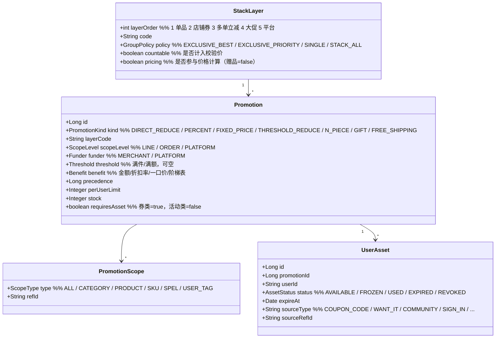
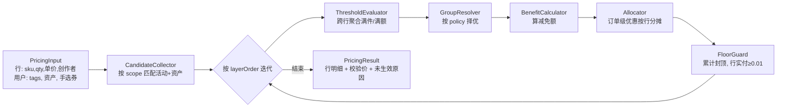
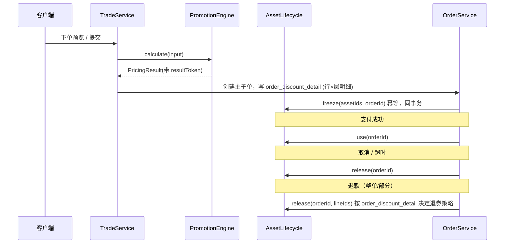

# 营销优惠叠加规则 - 技术设计分析

> 参考：抖店「营销活动叠加规则」页面（fxg.jinritemai.com/ffa/marketing/marketing-overlay-query）。
> 日期：2026-09-17。范围：trade-order-service 的算价 / 营销 / 优惠券 / 订单折扣链路。
> 前提：现有优惠代码允许整体重构或删除，本文按"重建促销引擎"给方案，并给出迁移与删除清单。

---

## 1. 抖店叠加规则解读

截图表达的是一条**有序的价格流水线**，每一层拿上一层的结果价继续减：

```
商品到手价 = 商家原价
            ⊖ 单品促销        （层内互斥，按"大促活动报名价"生效 1 个）
            ⊖ 店铺促销·券类    （层内择优，生效最优惠的 1 个：商品券/店铺券/多件优惠/新人礼金/会员开卡礼/复购券…）
            ⊖ 店铺促销·多单立减（层内生效 1 个）
            ⊖ 大促立减折扣     （平台大促专属层）
            ⊖ 跨店促销        （层内择优，生效最优惠的 1 个：平台礼金/平台优惠券）
赠品：与所有层"叠加生效"，不参与价格计算。
```

从中提炼出 6 个规则维度：

| 维度 | 含义 | 截图里的体现 |
|---|---|---|
| **层 (Layer)** | 优惠的先后顺序，决定"在什么价格基础上算" | 5 个纵向卡片，用 ⊖ 串联 |
| **层内策略 (Group Policy)** | 同层多个候选如何取舍 | "生效最优惠的一个" / "生效 1 个" / "生效大促活动报名价" |
| **作用域 (Scope Level)** | 优惠作用在单件、单店订单还是跨店订单 | 单品促销 / 店铺促销 / 跨店促销 |
| **出资方 (Funder)** | 商家出资还是平台出资，影响分账与退款 | 店铺促销（商家） vs 大促立减、平台礼金（平台） |
| **是否计入校验价 (Countable)** | 大促报名时的价格合规校验，用的是"部分层叠加后的价" | 页面底部"计入大促校验价 / 不计入" |
| **叠加型 (Additive)** | 不参与价格计算、与所有层共存的权益 | 赠品 |

FAQ 中的两个问题也直接对应模型：
- "一笔订单可以用几张优惠券" → 层内策略 = 择优 1 个，但券可以跨层各用 1 张（店铺券 + 平台券）。
- "单品直降是否计入大促校验价" → 层的 `countable` 属性。

### 1.1 映射到本业务

本项目是造好物 / 饰品定制电商，单商户多创作者。抖店的"店铺 / 跨店"映射如下：

| 抖店层 | 本业务对应 | 现有代码里的雏形 |
|---|---|---|
| 单品促销 | 单品直降、SKU 活动价、端盒折扣、限时限量 | `trade_promotion_activity` (activityScope=SKU/PRODUCT)、`SkuDiscount`、端盒 `boxDiscount` |
| 店铺促销·券类 | 人群优惠（新人、学生、作者）、优惠券、想要折扣、社区权益 | `PromotionChannel` 1~13、`Coupon`、`PromotionRecord`、`WantIt` |
| 店铺促销·多单立减 | 满 N 件 / 满 X 元 减、多件折 | `TIERED_*` SpEL 阶梯折扣（目前只在单行内生效） |
| 大促立减折扣 | 平台大促活动（暂无） | 无 |
| 跨店促销 | 平台礼金 / 平台券（对本业务=平台出资、跨创作者商品） | 无 |
| 赠品 | 赠品、包邮权益 | `PromotionRecord.freeShipping` |

---

## 2. 现状分析

### 2.1 现有链路

```
下单/购物车
 └─ BatchSkuPriceCalculator.calculate
     ├─ PricingService.calculateMultiProductSkuPricing   ← 营销活动匹配
     │    └─ PricingFlowManager → ActivityMatchingService → DiscountCalculator → BestDiscountSelector
     │         (每个 SKU 只留 1 个最优活动：precedence → discountedPrice → activityGroup)
     ├─ MarketingService.getBoxDiscount                  ← 端盒折扣（硬编码第二路）
     ├─ PriceStrategy.buildDiscountList / buildPriceDto  ← 拼两路折扣，pickPrimary 选主折扣
     └─ capDiscountsToLineMinimum                        ← 盲盒封顶到 0.01
 └─ TradeDiscountFiller.fill → OrderProductResponse → Order.discountInfo (单个 JSON)
 └─ OrderService: priceService.freeze / use / unFreeze
     └─ MarketingService → PromotionStrategyFactory → 13 个 PromotionStrategy (按 channel)
```

### 2.2 主要问题

1. **只有"单活动择优"，没有"分层叠加"**。`BestDiscountSelector` 在所有候选里取 1 个，优惠券 (`COUPON_PRICE=6`) 和人群活动、单品活动是**同一池子里竞争**，无法表达"单品直降 + 店铺券 + 平台券"同时生效。
2. **叠加逻辑散落且硬编码**。端盒折扣走 `attachBoxDiscounts` 单独一路，再在 `PriceStrategy.buildDiscountList` 手工拼接；`stack_group` 列已加但 Java 侧零引用（见 `购物车支持盲盒_fable.md` 第 88 行）。新增一种叠加就要改算价主干。
3. **没有订单级优惠**。满减 / 多件优惠依赖 SpEL 在单行内算阶梯，无法跨行聚合门槛（买 A+B 共 3 件满 3 件减）；也没有分摊逻辑。
4. **优惠身份用 `PromotionChannel` 枚举 + 13 个策略类硬编码**。每种权益一个 channel、一个策略、一个资产表（`Coupon` / `PromotionRecord` / `DiscountRecord` / `WantIt`），冻结、核销、回退各写一遍，`SchoolFirstStrategy`、`MotherDayStrategy` 这类活动级代码不可复用。
5. **子单折扣快照是单槽位**。`Order.discountInfo` 是一个 `DiscountContext` 的 JSON（`discountId` / `chanel`(拼写错误) / `couponId` / `activityId`）。`PriceDto.discountList` 已是列表，但 freeze/use/unFreeze 只处理 `pickPrimary` 的那一个，多权益回退会丢。
6. **没有"校验价"、"出资方"概念**。退款、分账、合规校验无法区分平台出资和商家出资。
7. **规则不可解释**。响应里没有"为什么 A 券没生效"的信息，客服和运营排查困难。

---

## 3. 目标设计

### 3.1 设计原则

- **规则配置化**：层、层内策略、可叠加关系存表 + 缓存，活动只声明"我属于哪一层 / 哪一组"。
- **计算与资产分离**：促销引擎只算钱，不碰库存 / 券状态；权益资产的冻结核销由统一的 `AssetLifecycle` 处理。
- **逐层贪心，不做全局最优**：抖店规则本身就是"每层取最优"，贪心可解释、可复算，性能可控。
- **结果可解释、可复算**：输出每行每层的优惠明细，以及未生效候选的原因码。
- **订单级优惠必须分摊到行**：退款、分账、拆单都以行为粒度。

### 3.2 领域模型



**`GroupPolicy` 语义**

| 策略 | 语义 | 抖店对应 |
|---|---|---|
| `EXCLUSIVE_BEST` | 在当前基价上逐个试算，取减免最大者；平手按 `precedence`、再按 id | "生效最优惠的一个" |
| `EXCLUSIVE_PRIORITY` | 按 `precedence` 取第一个命中的 | "生效大促活动报名价"（大促报名价优先于日常直降） |
| `SINGLE` | 同层只允许配置 1 个可用活动，多命中告警并取 precedence 首个 | "生效 1 个" |
| `STACK_ALL` | 全部生效 | 赠品 |

### 3.3 计算流水线



每层的处理都是纯函数：`LayerResult apply(LayerState base, List<Candidate> candidates)`，`base` 是上一层输出的每行折后价，方便单测和复算。

**步骤要点**

1. **CandidateCollector**：一次批量查有效活动（缓存）+ 用户可用资产，按 `PromotionScope` 过滤出每个活动能作用的行集合。券类活动要求 `UserAsset.status=AVAILABLE`；用户手动选择的券覆盖自动择优。
2. **ThresholdEvaluator**：门槛按活动的 scope 行集合聚合（件数 / 折后金额），基价用**上一层输出价**，与抖店"逐层"语义一致。
3. **GroupResolver**：`EXCLUSIVE_BEST` 需要对每个候选试算减免额；候选数 × 行数 一般在百级，直接算即可，不需要搜索。
4. **BenefitCalculator**：`PromotionKind` 各自实现；阶梯表用结构化 JSON 替代现在的 SpEL 字符串（保留 SpEL 作为 `SPEL` 兜底类型给运营写复杂规则）。
5. **Allocator**：订单级减免按各行"当前折后金额"占比分摊，`RoundingMode.DOWN` 保两位，尾差补到金额最大的行；每行分摊后不得低于 0.01，否则按该行上限截断并把剩余额继续分给其他行（一次重分配，不递归）。
6. **FloorGuard**：把现在 `capDiscountsToLineMinimum` 的盲盒按件封顶逻辑收敛为通用 `LineFloorPolicy`（普通行 = 整行 ≥0.01，盲盒行 = 每件 ≥0.01）。

### 3.4 输出结构

```json
{
  "lines": [{
    "lineId": "...", "skuId": "...", "quantity": 2,
    "originalUnitPrice": 100.00, "originalAmount": 200.00,
    "payAmount": 158.00,
    "discounts": [
      {"layer": "ITEM",        "promotionId": 11, "kind": "DIRECT_REDUCE",     "amount": 20.00, "funder": "MERCHANT", "assetId": null},
      {"layer": "SHOP_COUPON", "promotionId": 32, "kind": "THRESHOLD_REDUCE",  "amount": 12.00, "funder": "MERCHANT", "assetId": 9001, "allocatedFrom": 30.00},
      {"layer": "PLATFORM",    "promotionId": 77, "kind": "PERCENT",           "amount": 10.00, "funder": "PLATFORM",  "assetId": 9002}
    ],
    "validationPrice": 168.00
  }],
  "summary": {"originalAmount": 500.00, "discountAmount": 92.00, "payAmount": 408.00, "merchantFunded": 72.00, "platformFunded": 20.00},
  "gifts": [{"promotionId": 90, "skuId": "GIFT-1", "quantity": 1}],
  "rejected": [{"promotionId": 33, "assetId": 9003, "reason": "LAYER_EXCLUSIVE_LOST", "detail": "同层择优，减免 8.00 < 12.00"}]
}
```

`rejected` 里的原因码是可解释性的关键：`SCOPE_MISMATCH` / `THRESHOLD_NOT_MET` / `LAYER_EXCLUSIVE_LOST` / `ASSET_EXPIRED` / `PER_USER_LIMIT` / `STOCK_EXHAUSTED` / `FLOOR_CAPPED`。

### 3.5 逐层贪心的已知局限

按层贪心不是全局最优。例：单品层 A 券减 10，导致店铺层"满 200 减 30"的门槛差 5 元不满足；如果不用 A 券，总减免 30 > 10。抖店同样接受这一结果（"每层生效最优惠的一个"），我们沿用，并在 `rejected` 里给出 `THRESHOLD_NOT_MET` 原因。若后续要做"凑单提示"，在引擎外做增量试算即可，不改核心。

### 3.6 与订单生命周期的集成



- **快照**：提交下单时复算一次并与预览 `resultToken`（输入哈希 + 规则版本）比对，不一致则返回"价格已变化"。
- **资产冻结**：`AssetLifecycle.freeze` 一次处理订单内所有 `assetId`，用 `UPDATE ... WHERE status=AVAILABLE` 的 CAS 保证并发安全，替代 13 个策略类各自的实现；作者配额 (`ActivityAuthorQuota`) 作为一种 `PromotionKind=AUTHOR_QUOTA_FREE` 的库存类资源接入，不再走特殊分支。
- **退款**：读取 `order_discount_detail`，按行退；订单级优惠全退时资产回退，部分退货按分摊额只退现金不退券（与现在 `PromotionChannel.needRefundAfterRefund` 的语义等价，改成活动上的 `refundPolicy` 字段）。
- **分账**：`funder=PLATFORM` 的减免额进入平台补贴科目，`MERCHANT` 的直接从商家结算扣减。

### 3.7 数据模型

```sql
-- 叠加层配置（低频改动，全量缓存）
CREATE TABLE trade_promotion_layer (
  id            BIGINT PRIMARY KEY AUTO_INCREMENT,
  code          VARCHAR(32)  NOT NULL UNIQUE,          -- ITEM / SHOP_COUPON / SHOP_MULTI / CAMPAIGN / PLATFORM / GIFT
  name          VARCHAR(64)  NOT NULL,
  layer_order   INT          NOT NULL,
  group_policy  VARCHAR(32)  NOT NULL,                 -- EXCLUSIVE_BEST / EXCLUSIVE_PRIORITY / SINGLE / STACK_ALL
  countable     TINYINT      NOT NULL DEFAULT 1,       -- 计入校验价
  pricing       TINYINT      NOT NULL DEFAULT 1,       -- 参与价格计算
  enabled       TINYINT      NOT NULL DEFAULT 1,
  updated_at    DATETIME     NOT NULL DEFAULT CURRENT_TIMESTAMP ON UPDATE CURRENT_TIMESTAMP
);

-- 促销活动（替代 trade_promotion_activity；券模板也是一条 promotion，requires_asset=1）
CREATE TABLE trade_promotion (
  id              BIGINT PRIMARY KEY AUTO_INCREMENT,
  name            VARCHAR(128) NOT NULL,
  kind            VARCHAR(32)  NOT NULL,   -- DIRECT_REDUCE / PERCENT / FIXED_PRICE / THRESHOLD_REDUCE / N_PIECE / TIERED / GIFT / FREE_SHIPPING / AUTHOR_QUOTA_FREE
  layer_code      VARCHAR(32)  NOT NULL,
  scope_level     VARCHAR(16)  NOT NULL,   -- LINE / ORDER / PLATFORM
  funder          VARCHAR(16)  NOT NULL,   -- MERCHANT / PLATFORM
  requires_asset  TINYINT      NOT NULL DEFAULT 0,
  threshold_json  JSON         NULL,       -- {"type":"AMOUNT","value":200} / {"type":"PIECE","value":3}
  benefit_json    JSON         NOT NULL,   -- {"amount":30} / {"rate":0.9} / {"price":99} / {"tiers":[...]}
  precedence      BIGINT       NOT NULL DEFAULT 0,
  per_user_limit  INT          NULL,
  total_stock     INT          NULL,
  refund_policy   VARCHAR(32)  NOT NULL DEFAULT 'RETURN_ON_FULL_REFUND',
  start_time      DATETIME     NOT NULL,
  end_time        DATETIME     NOT NULL,
  status          TINYINT      NOT NULL,
  deleted         TINYINT      NOT NULL DEFAULT 0,
  created_at      DATETIME, updated_at DATETIME, create_by VARCHAR(64), update_by VARCHAR(64),
  KEY idx_layer_time (layer_code, status, start_time, end_time)
);

-- 作用范围（商品 / SKU / 类目 / 用户标签 / SpEL），一行一条
CREATE TABLE trade_promotion_scope (
  id            BIGINT PRIMARY KEY AUTO_INCREMENT,
  promotion_id  BIGINT      NOT NULL,
  scope_type    VARCHAR(16) NOT NULL,      -- ALL / CATEGORY / PRODUCT / SKU / SPEL / USER_TAG / CREATOR
  ref_id        VARCHAR(64) NOT NULL,
  extra_json    JSON        NULL,          -- SKU 级活动价、活动库存、每人限购
  KEY idx_ref (scope_type, ref_id), KEY idx_promotion (promotion_id)
);

-- 用户持有的权益资产（统一 Coupon / PromotionRecord / DiscountRecord / 礼金）
CREATE TABLE trade_user_asset (
  id            BIGINT PRIMARY KEY AUTO_INCREMENT,
  promotion_id  BIGINT       NOT NULL,
  user_id       VARCHAR(64)  NOT NULL,
  code          VARCHAR(64)  NULL,         -- 券码，可空
  status        TINYINT      NOT NULL,     -- 0 可用 1 冻结 2 已用 3 过期 4 作废
  frozen_order_id VARCHAR(64) NULL,
  source_type   VARCHAR(32)  NOT NULL,     -- COUPON_CODE / WANT_IT / COMMUNITY / SIGN_IN / MANUAL
  source_ref_id VARCHAR(64)  NULL,
  expire_at     DATETIME     NULL,
  created_at    DATETIME, updated_at DATETIME,
  UNIQUE KEY uk_code (code),
  KEY idx_user_status (user_id, status, expire_at)
);

-- 订单折扣明细：行 × 层 × 活动，一行一条（替代 Order.discountInfo 单 JSON）
CREATE TABLE trade_order_discount_detail (
  id              BIGINT PRIMARY KEY AUTO_INCREMENT,
  main_order_id   VARCHAR(64)   NOT NULL,
  order_id        VARCHAR(64)   NOT NULL,   -- 子单
  sku_id          VARCHAR(64)   NOT NULL,
  layer_code      VARCHAR(32)   NOT NULL,
  promotion_id    BIGINT        NOT NULL,
  asset_id        BIGINT        NULL,
  kind            VARCHAR(32)   NOT NULL,
  funder          VARCHAR(16)   NOT NULL,
  amount          DECIMAL(12,2) NOT NULL,   -- 分摊到本行的减免
  allocated_from  DECIMAL(12,2) NULL,       -- 订单级优惠的总减免
  refunded_amount DECIMAL(12,2) NOT NULL DEFAULT 0,
  created_at      DATETIME,
  KEY idx_order (order_id), KEY idx_main (main_order_id), KEY idx_asset (asset_id)
);

-- 资产状态流水，用于对账与回退重试（替代 trade_coupons_refund_record）
CREATE TABLE trade_user_asset_log (
  id          BIGINT PRIMARY KEY AUTO_INCREMENT,
  asset_id    BIGINT      NOT NULL,
  order_id    VARCHAR(64) NULL,
  action      VARCHAR(16) NOT NULL,          -- FREEZE / USE / RELEASE / EXPIRE
  from_status TINYINT, to_status TINYINT,
  result      TINYINT     NOT NULL,          -- 0 成功 1 失败
  error_msg   VARCHAR(512),
  created_at  DATETIME,
  KEY idx_asset (asset_id), KEY idx_order (order_id)
);
```

`Order.discountAmount` / `MainOrder.discountAmount` 保留为汇总字段；`Order.discountInfo` 在迁移期保留只读，新订单不再写。

### 3.8 接口

| 接口 | 说明 |
|---|---|
| `POST /pricing/calculate` | 入参：行列表、用户、手选资产 id、是否自动择优；出参：3.4 的结果结构。购物车、商品详情、下单预览、下单提交共用。 |
| `GET /promotion/assets/available?skuIds=` | 返回用户对当前行集合可用 / 不可用的资产及原因，用于券列表页。 |
| `POST /admin/promotion` 系列 | 活动 CRUD，创建时校验 `layer_code` 存在、`scope_level` 与 `kind` 匹配。 |
| `GET /admin/promotion/layers` | 层配置查询与修改，修改后广播缓存失效。 |
| `POST /admin/pricing/explain` | 运营 / 客服排查用，输入订单号或模拟入参，返回完整逐层试算过程。 |

### 3.9 性能与缓存

- 有效活动 + scope 按 `layer_code` 全量缓存（Redis + 本地 Caffeine，活动变更事件失效），替代现在的 `queryValidActivitiesByTags` 每次查库 + 按 (userId, productId) 缓存结果。
- 用户资产按 `userId` 查一次，购物车 50 行也只查 1 次。
- 计算复杂度 O(层 × 候选 × 行)，购物车 50 行、每层 10 个候选，试算次数在数千级，单线程毫秒级完成，可以去掉现在 `PricingFlowManager` 的 20 个 SKU 一批的多线程分片。
- 结果不再缓存整包（购物车行组合多变），只缓存活动与 scope。

---

## 4. 算例

配置：层 1 单品 (`EXCLUSIVE_PRIORITY`)，层 2 店铺券 (`EXCLUSIVE_BEST`)，层 3 多单立减 (`SINGLE`)，层 5 平台 (`EXCLUSIVE_BEST`)。

购物车：A 单价 100 × 2，B 单价 60 × 1。用户持有店铺券 X "满 200 减 30"、店铺券 Y "满 100 减 12"、平台券 Z "9 折上限 20"。活动：A 单品直降 10 / 件；多单立减"满 3 件减 15"。

| 层 | 操作 | A 行 | B 行 | 合计 |
|---|---|---|---|---|
| 原价 | | 200.00 | 60.00 | 260.00 |
| 1 单品 | A 直降 10×2 | 180.00 | 60.00 | 240.00 |
| 2 店铺券 | X 满 200 减 30 命中(240≥200)，Y 减 12，择优取 X；按 180:60 分摊 22.50 / 7.50 | 157.50 | 52.50 | 210.00 |
| 3 多单立减 | 满 3 件减 15，按 157.5:52.5 分摊 11.25 / 3.75 | 146.25 | 48.75 | 195.00 |
| 5 平台 | Z 9 折 = 19.50 ≤ 上限 20，按比例分摊 14.63 / 4.87（尾差 0.01 补给大行→14.63） | 131.62 | 43.88 | 175.50 |

校验价（层 1、2、3 计入，层 5 不计入）：A 行 146.25，B 行 48.75。
`rejected`：券 Y，`LAYER_EXCLUSIVE_LOST`，"同层择优，减免 12.00 < 30.00"。

---

## 5. 删除 / 保留 / 迁移清单

### 5.1 删除（被新引擎整体替代）

| 包 / 类 | 说明 |
|---|---|
| `business/pricing/**`（`PricingService`、`PricingFlowManager`、`ActivityMatchingService`、`BestDiscountSelector`、`DiscountCalculator`、`SkuPromotionQuotaAllocator`、`strategy/**`、`builder/**`） | 单活动择优引擎，被 `promotion/engine` 替代 |
| `business/price/service/PriceStrategy`、`BatchSkuPriceCalculator` 中的折扣拼装与 `capDiscountsToLineMinimum` | 拼装逻辑进入 `Allocator` / `FloorGuard`；运费分摊部分保留并迁到 `trade/pricing` |
| `business/marketing/service/MarketingService`、`PromotionStrategy`、`PromotionStrategyFactory`、`strategy/**` 13 个策略、`@SupportedChannels` | 冻结 / 核销 / 回退统一为 `AssetLifecycle` |
| `common/constant/PromotionChannel`、`enums/promotion/PromotionType`、`PromotionTargetUserGroupType`、`PromotionActivityGroup`、`marketing/enums/PromotionDiscountTypeEnum` | 硬编码枚举被 `layer_code` / `kind` / `scope_type=USER_TAG` 取代 |
| `business/coupon/**`（`Coupon`、`CouponService`、`CouponsRefundRecord*`、`CouponsRefundRetryJob`） | 券 = `trade_user_asset`，退券记录 = `trade_user_asset_log`，重试 Job 改为扫 `result=1` 的日志 |
| `marketing/entity` 中 `PromotionRecord`、`PromotionRecordItem`、`DiscountRecord`、`PromotionActivityRecord`、`PromotionActivityUserScope`、`PromotionActivitySku`、`PromotionActivityProductScope`、`PromotionActivityItem` 及其 Repository / Mapper | 合并进 `trade_promotion` / `trade_promotion_scope` / `trade_user_asset` |
| `productdomain/entity/SkuDiscount`、`NacosUserDiscountProductConfig`、`NacosPromoActivityMapConfig` | SKU 折扣价改为单品层活动 + `scope.extra_json` |
| `trade/support/TradeDiscountFiller` 及 `OrderProductResponse` 上的 `discountId / bizType / channel / couponId / couponCode / activityId / discountValue / discountType / uniqueTopicId / enableActivityAuthorQuota / expectFree` 字段 | 换成 `List<OrderDiscountDetail>` |

### 5.2 保留并接入

| 类 | 处理 |
|---|---|
| `ActivityAuthorQuota*`（作者免单配额） | 保留表；以 `kind=AUTHOR_QUOTA_FREE` 的活动接入，配额扣减在 `AssetLifecycle.freeze` 内以库存资源方式处理 |
| `WantIt*`、`CommunityPromotionConsumerConfig` | 保留为**资产发放来源**：投票 / 社区事件 → 写 `trade_user_asset(source_type=WANT_IT/COMMUNITY)` |
| `ShippingFeeResolver`、`ShippingFeeService` | 运费独立于优惠层，`FREE_SHIPPING` 赠品类活动只输出标记，运费模块读标记 |
| `usertag/**`、`PricingUserTagService` 的标签查询 | 作为 `scope_type=USER_TAG` 的匹配输入 |
| `PromotionChannelInfo` 渠道文案渲染 | 改读 `PricingResult.lines[].discounts[].promotionId` 对应的活动文案 |

### 5.3 迁移步骤

1. **建表 + 数据迁移脚本**：`trade_promotion_activity` → `trade_promotion`（`activityGroup` 1/2/3 映射到层 `SHOP_COUPON` / `CAMPAIGN` / `ITEM`，`discountType` → `kind`，SpEL 阶梯 → `kind=TIERED` + `benefit_json.spel`）；`Coupon` / `PromotionRecord` / `DiscountRecord` 未使用记录 → `trade_user_asset`。
2. **双跑对账**：新引擎以 `explain` 接口只读运行 1~2 周，对比现网 `PriceDto.payPrice`，差异归因（预期差异：新引擎允许叠加，金额只会更低或相同；出现更高即为 bug）。
3. **切流**：购物车 → 商品详情 → 下单预览 → 下单提交，按接口灰度。
4. **在途订单兼容**：保留一个 `LegacyDiscountReleaser`，专门解析旧 `Order.discountInfo` JSON 做取消 / 退款回退，直到旧订单全部终态后删除（预计 90 天后可删）。
5. **删除旧代码**：按 5.1 清单一次性删除，避免长期双轨。

---

## 6. 风险与待确认

| # | 问题 | 建议 |
|---|---|---|
| 1 | 本业务是否需要"大促层"和"平台层"，还是先落 单品 / 店铺券 / 多单 三层 | 层配置化后可先建 3 层，后续加行即可，不影响代码 |
| 2 | 订单级优惠退款时"部分退不退券"的规则 | 用活动上的 `refund_policy`，默认整单退才退券 |
| 3 | 盲盒 / 端盒"每件优惠一次"的封顶规则是否全局适用 | `FloorGuard` 按 `product.saleMode` 选策略，保持现有语义 |
| 4 | 平台出资的分账目前没有科目 | 先落 `funder` 字段和 `summary.platformFunded`，财务对接另立需求 |
| 5 | 旧 `Order.discountInfo` 里 `chanel` 拼写错误字段仍需被 `LegacyDiscountReleaser` 读取 | 迁移期保留，不修正 |
| 6 | 预览与提交之间价格变动 | `resultToken` 比对，不一致返回明确错误码让前端刷新 |
| 7 | `EXCLUSIVE_BEST` 与"用户手选券"冲突 | 手选优先，手选券若门槛不满足返回 `rejected` 原因并回落到自动择优 |

---

## 7. 工作量预估

| 模块 | 内容 | 人日 |
|---|---|---|
| 领域模型 + 表 + 迁移脚本 | 6 张表、枚举、Entity / Repository、旧数据迁移 | 4 |
| 促销引擎 | Collector / Threshold / GroupResolver / Benefit×8 / Allocator / FloorGuard / explain | 8 |
| 资产生命周期 | freeze / use / release CAS、日志、重试 Job、作者配额接入 | 4 |
| 订单集成 | 下单快照、`order_discount_detail` 落库、退款按行回退、`LegacyDiscountReleaser` | 5 |
| 接口 + 后台 | calculate / assets / admin CRUD / layers | 3 |
| 单测 + 双跑对账工具 | 引擎纯函数单测、对账脚本 | 4 |
| 旧代码删除与回归 | 5.1 清单、回归 | 3 |
| **合计** | | **31** |
