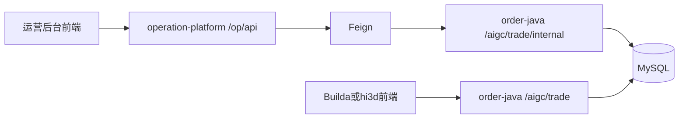
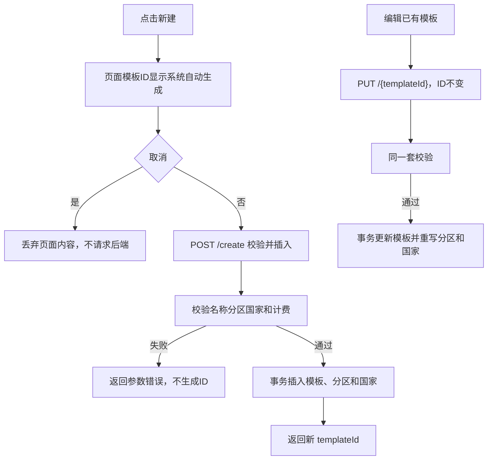
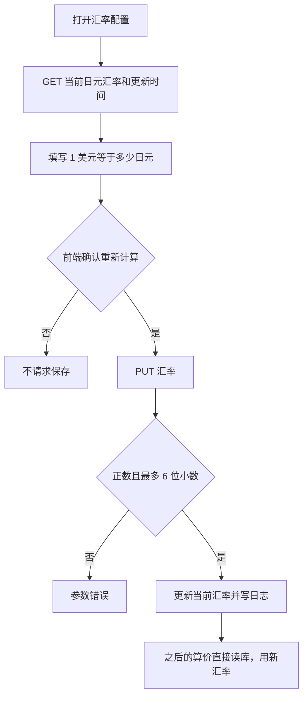
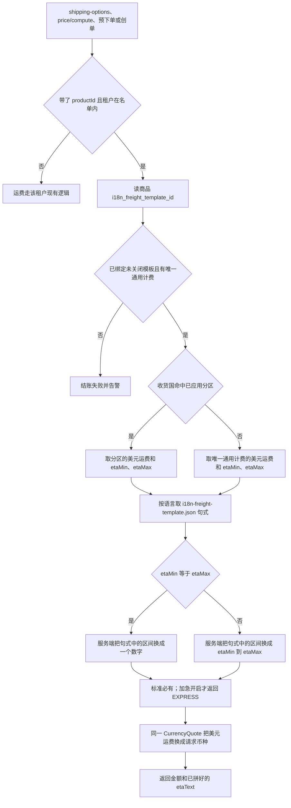
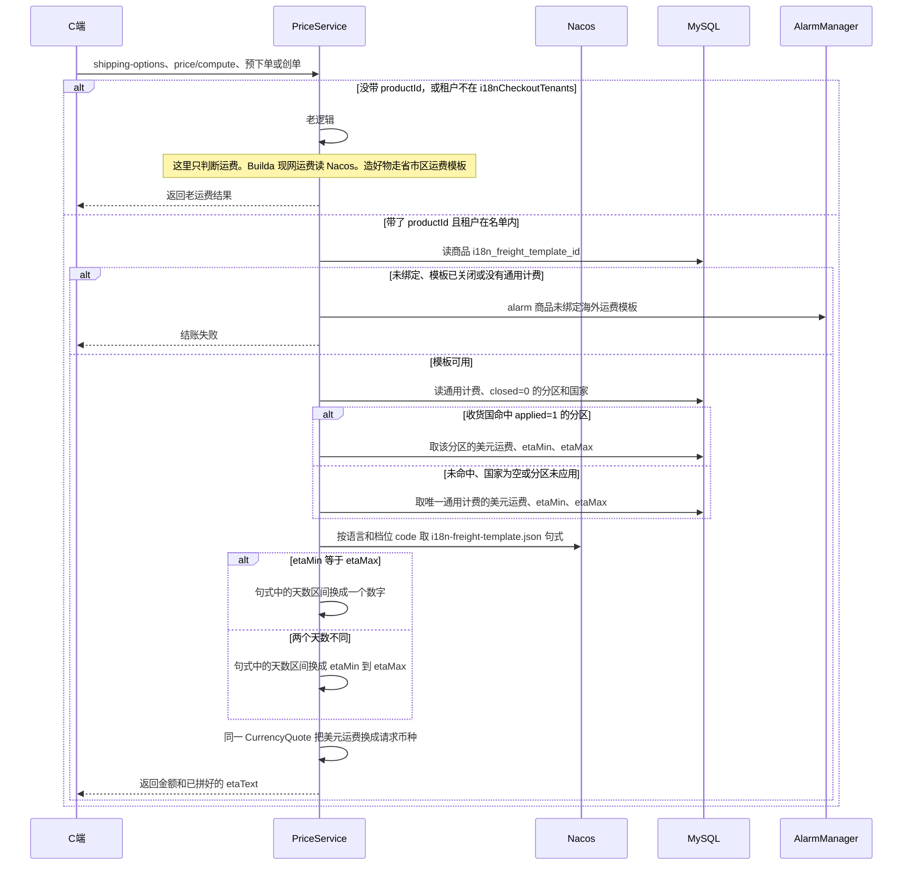
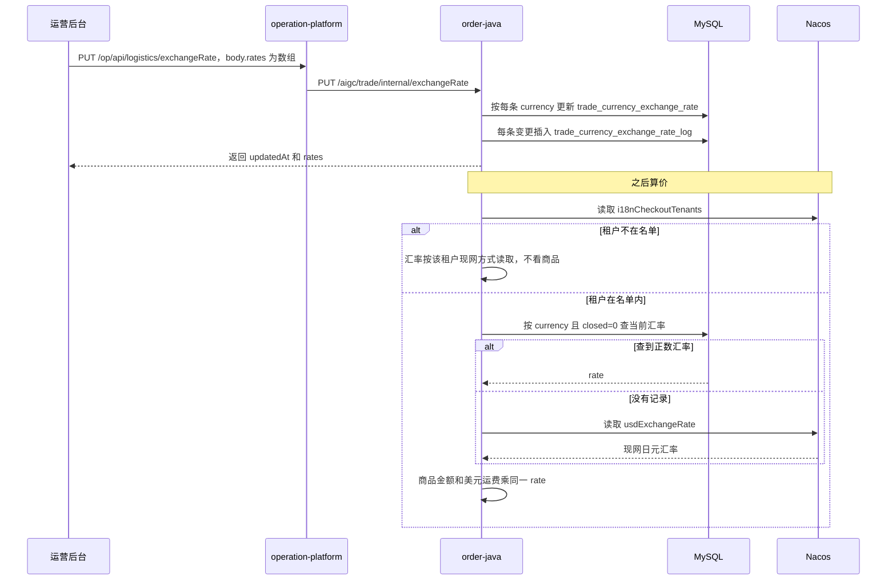

# 【海外后台】运费、币种汇率配置-技术设计

## 一、需求背景

- 需求简介：海外后台支持按模板配置运费，并支持维护美元到目标货币的汇率。汇率下拉当前是人民币和日元。运费金额一律按美元填写，结账时按用户所选币种和最新汇率换算。覆盖 hi3d、builda。国内造好物的省市区运费模板不在本期范围。
- 产品需求文档：`doc/运费与汇率配置/【海外后台】运费、币种汇率配置.pdf`
- 设计稿：需求 PDF 内示意图。配送分区的国家选项使用 `doc/运费与汇率配置/stripe_countries_zh_verified.json`，共 237 条。每条含 `code`、`nameEn`、`nameZh`、`sort`。`code` 为两位大写，包含 Stripe 地址里使用的地区码（如 `AC` 阿森松岛），保存时必须落在这份列表内。
- 现状：
  - 汇率在 Nacos `order-common.json` 的 `usdExchangeRate`，由 `UsdExchangeRateService` 把美元商品价换成请求货币。订单不存汇率。
  - Builda 运费在 Nacos `builda-checkout-delivery.json` 的 `feesByCurrency`，按国家和省/州取各币种金额，不乘汇率。
  - 国内运费在 `freight_template`、`freight_template_rule_area`，运营后台经 Feign 调 `/aigc/trade/internal/freightTemplate`。这套按「省_市_区」匹配，没有标准/加急，也没有时效天数。

## 二、概要设计

### 1. 系统架构

运营后台只做登录态转发。模板、汇率、计价都放在 order-java，避免两套存储。



职责：

| 模块 | 改动 |
| --- | --- |
| order-java | 新表、内部管理接口、C 端配送解析改为「商品上的海外模板 + 美元运费 × 汇率」。新逻辑未命中分区时用该模板唯一的通用计费 |
| operation-platform | 新增物流菜单接口，Feign 转发。商品创建/编辑增加 `i18nFreightTemplateId` |
| 国内运费 | `freight_template` 与现有 `/logistics/freightTemplate` 不改 |
| C 端计价入口 | 仍是 `GET /checkout/shipping-options`、`POST /price/compute`、预下单、创单。不新开算价接口 |

新老逻辑按请求里的租户判断，运费和汇率用同一份名单。名单放在 Nacos `order-common.json`，默认只有 `builda`。以后把 `hi3d` 加进列表即可，不用改代码。

```json
{
  "i18nCheckoutTenants": ["builda"]
}
```

运费和汇率分开判断。汇率和商品无关，不看 `productId`。

- 运费新逻辑：请求带了 `productId`，并且租户在 `i18nCheckoutTenants` 中。用海外模板，未命中已应用分区时用该模板唯一的通用计费。
- 运费老逻辑：没带 `productId`，或租户不在名单里。Builda 现网运费是 Nacos 配送档位，造好物现网运费是省市区模板。
- 汇率新逻辑：租户在 `i18nCheckoutTenants` 中。读 `trade_currency_exchange_rate`，没有记录再读现有 Nacos `usdExchangeRate`。商详、算价、下单只要租户在名单里就用这套，不管有没有商品 ID。
- 汇率老逻辑：租户不在名单里。Builda 读 Nacos `usdExchangeRate`，造好物不读新汇率表。

比较租户时忽略大小写。名单为空或未配置时，全部走老逻辑。

档位 code 保持 `STANDARD`、`EXPRESS`。订单仍写 `trade_order.shipping_fee`、`trade_order.currency`、`trade_order_ext.extend.shippingMethodCode`。汇率本身不落订单。

### 2. 核心流程

#### 2.1 新建并保存运费模板



创建页不预占模板 ID。编辑页展示已有模板 ID，保存仍用这个 ID。取消编辑只丢弃未提交内容，不删库。

#### 2.2 保存汇率



确认文案由前端展示：「更新后，价格按照新汇率全部重新计算，是否确认更新？」。后端收到 PUT 即视为已确认。已创建订单的金额不回溯。

#### 2.3 C 端选档位并算运费



`shipping-options`、`/price/compute`、预下单、创单都用这一条判断。带了 `productId` 且租户在 `i18nCheckoutTenants` 中，走新逻辑。商品必须绑定一张未关闭的海外模板，模板上必须有一份通用计费。收货国命中已应用分区时用分区价；未命中、国家为空、或分区未应用时，用这份通用计费。新逻辑的运费金额、档位名、时效句式和免费展示都不读 `builda-checkout-delivery.json`。文案读 `i18n-freight-template.json`，没有对应配置时用代码里的英语、日语、简体中文默认文案。商品未绑定模板，或已保存模板已关闭、缺少通用计费，结账失败，并打告警。告警不影响返回，也不改走老逻辑。

运费任一条件不满足都走该租户现有运费逻辑，包括没带 `productId`、租户不在名单、名单为空。汇率不看 `productId`，只看租户是否在名单里。

新逻辑下，`/price/compute`、预下单、创单在得到档位金额后的顺序是：商品金额换汇、加上海外模板运费、优惠码只减商品、Stripe Tax 把大于 0 的运费作为价外运费计税。

## 三、详细设计

### 1. 运费模板

一张已保存模板包含：

- 基础信息：模板 ID、名称、运费标签、最近保存时间。
- 通用计费：每张已保存模板必填，且只有一份。新运费逻辑里，收货国未命中已应用分区时只用它，不再回退 Nacos 运费。
- 配送分区：0 到 10 个。每个分区有名称、国家列表、是否已应用，以及应用后的标准/加急计费。

匹配规则：

1. 只在 `applied=1` 的分区里，用收货地址 `countryCode` 转大写后精确匹配。
2. 命中则用该分区计费。
3. 未命中、地址国家为空、或分区未应用，用该模板唯一的通用计费。不读取 Nacos 配送配置。
4. 未应用分区里的国家仍然占名额，同一模板不能把同一个国家配进两个分区。这些国家在未应用前不参与计价。
5. 标准物流始终返回，code=`STANDARD`。
6. `express_enabled=1` 才返回 code=`EXPRESS`。前端按返回列表决定是否展示加急。用户提交未开放的 `EXPRESS` 时，沿用现有错误 `CHECKOUT_DELIVERY_METHOD_INVALID`。
7. 运费与购买数量无关，是订单上的一笔。
8. 本期不做州/省覆盖。老运费仍读 `builda-checkout-delivery.json` 或 `hi3d-checkout-delivery.json`。新运费的金额、名称、时效和免费展示都不读这两份配置。

新逻辑的 `name`、`etaText`、`feeDisplay` 由 order-java 拼好后返回。句式取 Nacos `i18n-freight-template.json`，样例在 `doc/运费与汇率配置/i18n-freight-template.json`。同一份文案也写在代码默认值里。Nacos 缺少的语言或档位用代码默认值，Nacos 已有的键覆盖默认值。天数取数据库的 `etaMin`、`etaMax`。国家只决定金额和天数，不参与选文案。

选文案分两步。先用 `Accept-Language` 第一段做完整标签匹配，例如 `zh-TW`、`ja-JP`。匹配不到时，再按现有方式收成 `en`、`ja`、`zh` 精确匹配。还没有就用 `en`。`zh-TW`、`zh-HK`、`zh-CN` 在没有单独配置时都落到 `zh`。不使用 `pickLocaleText`，也不会落到任意一条文案。

标准和加急使用同一套时效句式，分隔符是 `–`。占位符是 `{min}`、`{max}`。

- 英文：`Estimated Delivery: {min}–{max} Business Days`，名称 `Standard Shipping` / `Express Shipping`，免费 `FREE`
- 日文：`お届け目安： {min}～{max}営業日`，名称 `通常配送` / `お急ぎ便`，免费 `送料無料`
- 简体中文：`预计送达时间：{min}～{max} 个工作日`，名称 `标准配送` / `加急配送`，免费 `免费`

`etaMin` 与 `etaMax` 不同时替换两个占位符。两者相等时，把 `{min}–{max}` 或 `{min}～{max}` 换成一个数字，不写成 `7–7` 或 `7～7`。例如英文天数都是 7 时，返回 `Estimated Delivery: 7 Business Days`。数据库是 7 和 12 时，英文返回 `Estimated Delivery: 7–12 Business Days`。

换算后金额为 0 时，`feeDisplay` 用该语言的免费词。大于 0 时为 `+` 加货币符号加金额，例如 `+$20.00`、`+¥3,000`。新运费不调用 `CheckoutDeliveryFeeDisplayFormatter.formatFeeDisplay`。老运费仍用它，0 元展示 `FREE`。

#### 运费时序图



### 2. 汇率与运费计算

商品价、活动优惠、优惠码立减和一口价，继续由 `UsdExchangeRateService` 按「1 美元 = rate 目标货币」换算。百分比优惠码不乘汇率。

本期差异是海外运费也进入同一次换算。配置库存美元，结账不再读取 `feesByCurrency` 里的日元运费。

`UsdExchangeRateService.resolve` 的现有规则保持：

- 请求头 `Currency` 空白，或解析后退回美元：不乘汇率，金额保持美元，订单币种 `usd`。
- 请求币种必须是三位小写。`jpy` 有合法正汇率时，`converted=true`，小数位 0。
- `usd` 小数位 2。乘积按 `HALF_UP` 落到该小数位。

租户在 `i18nCheckoutTenants` 中就读 `trade_currency_exchange_rate`，没有记录再读现有 Nacos `usdExchangeRate`。不看商品，也不看有没有 `productId`。不新增 Redis。后台还没配汇率时，现网 Nacos 日元汇率继续生效。保存提交后，下一次该租户的算价读到的就是新汇率。租户不在名单里时，汇率按该租户现网方式读取。

#### 汇率时序图



汇率不读取国家列表，也不读取商品。收货国家只决定用分区价还是通用计费，结算币种来自请求头 `Currency`。

运费换算使用这次算价已经得到的 `CurrencyQuote`，和商品金额是同一汇率、同一币种。请求是 `jpy` 但汇率非法并退回美元时，运费也保持美元数字，不再出现「商品是美元、运费却取了一档日元配置」的组合。

优惠和最低交易额仍只约束商品净额，不减运费。

#### 算例

模板如下。汇率 `jpy=150`，表示 1 美元 = 150 日元。

| 范围 | 标准物流 | 加急物流 |
| --- | --- | --- |
| 通用计费 | 9.99 美元，7–12 天 | 关闭 |
| 已应用分区「日本」，国家 JP | 0.00 美元，7–10 天 | 开启，20.00 美元，3–5 天 |
| 未应用分区「欧洲」，国家 DE | 不参与计价 | 不参与计价 |

例 1：收货国 JP，请求币种 `usd`，档位 `EXPRESS`。

```text
命中日本分区
shippingFee = 20.00
currency = usd
服务端按英文句式 Estimated Delivery: {min}–{max} Business Days 拼接
数据库天数为 3 和 5，返回 etaText = Estimated Delivery: 3–5 Business Days
name = Express Shipping
feeDisplay = +$20.00
```

例 2：收货国 JP，请求币种 `jpy`，档位 `STANDARD`。

```text
命中日本分区，标准价 0.00
0.00 × 150 = 0
shippingFee = 0
currency = jpy
feeDisplay = FREE
```

例 3：收货国 JP，请求币种 `jpy`，档位 `EXPRESS`。

```text
20.00 × 150 = 3000
日元小数位为 0
shippingFee = 3000
feeDisplay = +¥3,000
```

例 4：收货国 US，没有已应用分区命中，请求币种 `jpy`，只能选 `STANDARD`。

```text
走通用计费 9.99
9.99 × 150 = 1498.50
HALF_UP 到 0 位小数 = 1499
shippingFee = 1499
不返回 EXPRESS
```

例 5：收货国 DE。DE 只出现在未应用分区，计价与 US 相同，走通用计费。

例 6：商品价 10.00 美元，数量 2，活动优惠 1.00 美元，无优惠码，例 3 的运费。

```text
单价 = 10.00 × 150 = 1500
商品总额 = 1500 × 2 = 3000
活动优惠 = 1.00 × 150 = 150
运费 = 3000
total_amount = 3000 + 3000 = 6000
不含税应付 = 6000 - 150 = 5850
```

税额仍由现有 Stripe Tax 加在不含税应付上，运费列保存的是税前运费 3000。

### 3. 商品绑定

`trade_pd_product` 增加可空列 `i18n_freight_template_id`。不复用 `freight_template_id`，避免和国内模板主键撞号，也避免 `ShippingFeeService` 把海外模板 ID 当成省市区模板去查。

运营后台现有商品接口扩展字段，不新建商品接口：

- `POST /op/api/trade/product` 的 `TradeProductCreateReq` 增加 `i18nFreightTemplateId`
- `GET /op/api/trade/product/detail` 原样返回该字段

名单内租户的商品保存时，若传入该字段，必须指向未关闭的海外模板。其他租户不传则保持 null，计价继续读 `freight_template_id`。

设计师发品里查找「全包邮」国内模板的逻辑不改。

C 端 `GET /aigc/trade/checkout/shipping-options` 增加可选查询参数 `productId`。带了 `productId` 且租户在 `i18nCheckoutTenants` 中时走新运费逻辑：未命中已应用分区用该模板唯一的通用计费；商品未绑定已保存模板则失败。没带 `productId`，或租户不在名单里，走老逻辑。

### 4. 后台校验

保存已生效模板时在一个事务内全部校验，失败则整单不写：

| 项 | 规则 |
| --- | --- |
| 模板名称 | 必填，去首尾空格后 1–30 个字符。不做全局唯一，模板 ID 才是主键 |
| 运费标签 | 可空，有值时 1–10 个字符 |
| 分区数量 | 0–10。默认没有分区 |
| 分区名称 | 必填，1–20 个字符。同一模板内唯一。新建时前端可预填「指定地区1」，序号只是前端默认文案 |
| 国家 | `code` 必须存在于 `stripe_countries_zh_verified.json`。请求里的小写先转成大写再查。同一模板内一个国家只能出现一次。不在列表中的码返回 `errorCode.i18nFreight.countryInvalid` |
| 通用计费 | 每张已保存模板有且只有一份，写在模板主表，不按分区复制。标准物流必填。金额 `DECIMAL(10,2)` 且大于等于 0。天数 min、max 为大于等于 0 的整数，且 max 大于等于 min |
| 通用加急 | 默认关闭。关闭时金额和天数必须为空。开启时金额必填，默认由前端带 0.00，天数规则同标准 |
| 已应用分区 | 计费规则与通用计费相同 |
| 未应用分区 | 可以不带计费。带了也不参与 C 端匹配 |
| 已应用分区的编辑限制 | 前端隐藏改名、改国家、删除。后端同样拒绝：`applied=1` 的分区若改名、改国家集合或从列表删除，返回参数错误。先把 `applied` 改为 0 再修改 |

库里的模板都是保存成功的完整模板。创建页取消不产生记录。

## 四、存储与中间件

### 数据库

金额用 `DECIMAL(10,2)`，单位美元。汇率用 `DECIMAL(18,6)`，表示 1 美元等于多少目标货币。创建和更新时间跟现有表一样，用 `create_time`、`modified_time` 存 UTC 字符串 `yyyy-MM-dd HH:mm:ss`。接口返回的 `updatedAt` 转成北京时间。

```sql
ALTER TABLE trade_pd_product
    ADD COLUMN i18n_freight_template_id BIGINT NULL COMMENT '海外运费模板ID' AFTER freight_template_id;

CREATE TABLE trade_i18n_freight_template (
    id              BIGINT       NOT NULL AUTO_INCREMENT COMMENT '模板ID',
    template_name   VARCHAR(30)  NOT NULL COMMENT '模板名称',
    freight_tag     VARCHAR(10)  NULL COMMENT '运费标签',
    standard_fee_usd DECIMAL(10,2) NOT NULL COMMENT '通用标准运费，美元',
    standard_eta_min INT         NOT NULL COMMENT '通用标准时效起',
    standard_eta_max INT         NOT NULL COMMENT '通用标准时效止',
    express_enabled TINYINT      NOT NULL DEFAULT 0 COMMENT '通用加急：0关闭 1开启',
    express_fee_usd DECIMAL(10,2) NULL COMMENT '通用加急运费，美元',
    express_eta_min INT          NULL COMMENT '通用加急时效起',
    express_eta_max INT          NULL COMMENT '通用加急时效止',
    closed          TINYINT      NOT NULL DEFAULT 0 COMMENT '0未关闭 1已关闭',
    created_by      VARCHAR(64)  NULL,
    updated_by      VARCHAR(64)  NULL,
    create_time     VARCHAR(50)  NOT NULL COMMENT '创建时间UTC',
    modified_time   VARCHAR(50)  NOT NULL COMMENT '更新时间UTC',
    PRIMARY KEY (id) COMMENT '按模板ID查详情和结账读模板',
    KEY idx_closed_updated (closed, modified_time) COMMENT '后台下拉：未关闭模板按更新时间倒序'
) ENGINE=InnoDB DEFAULT CHARSET=utf8mb4 COLLATE=utf8mb4_unicode_ci COMMENT='海外运费模板';

CREATE TABLE trade_i18n_freight_zone (
    id               BIGINT       NOT NULL AUTO_INCREMENT,
    template_id      BIGINT       NOT NULL,
    zone_name        VARCHAR(20)  NOT NULL,
    sort_no          INT          NOT NULL DEFAULT 0,
    applied          TINYINT      NOT NULL DEFAULT 0 COMMENT '0未应用 1已应用',
    standard_fee_usd DECIMAL(10,2) NULL,
    standard_eta_min INT          NULL,
    standard_eta_max INT          NULL,
    express_enabled  TINYINT      NOT NULL DEFAULT 0,
    express_fee_usd  DECIMAL(10,2) NULL,
    express_eta_min  INT          NULL,
    express_eta_max  INT          NULL,
    closed           TINYINT      NOT NULL DEFAULT 0 COMMENT '0未关闭 1已关闭',
    create_time      VARCHAR(50)  NOT NULL COMMENT '创建时间UTC',
    modified_time    VARCHAR(50)  NOT NULL COMMENT '更新时间UTC',
    PRIMARY KEY (id) COMMENT '按分区ID定位一行',
    UNIQUE KEY uk_template_zone_name (template_id, zone_name) COMMENT '同一模板内分区名不可重复',
    KEY idx_template_closed_sort (template_id, closed, sort_no) COMMENT '按模板读取未关闭分区并按展示顺序排序'
) ENGINE=InnoDB DEFAULT CHARSET=utf8mb4 COLLATE=utf8mb4_unicode_ci COMMENT='海外运费分区';

CREATE TABLE trade_i18n_freight_zone_country (
    id           BIGINT      NOT NULL AUTO_INCREMENT,
    template_id  BIGINT      NOT NULL,
    zone_id      BIGINT      NOT NULL,
    country_code CHAR(2)     NOT NULL COMMENT 'stripe_countries_zh_verified.json 的 code',
    closed       TINYINT     NOT NULL DEFAULT 0 COMMENT '0未关闭 1已关闭',
    create_time  VARCHAR(50) NOT NULL COMMENT '创建时间UTC',
    modified_time VARCHAR(50) NOT NULL COMMENT '更新时间UTC',
    PRIMARY KEY (id) COMMENT '按国家行ID定位一行',
    UNIQUE KEY uk_template_country (template_id, country_code) COMMENT '结账按模板加国家码匹配分区，并保证同一模板国家不重复',
    KEY idx_zone_closed (zone_id, closed) COMMENT '编辑和详情按分区带出未关闭国家'
) ENGINE=InnoDB DEFAULT CHARSET=utf8mb4 COLLATE=utf8mb4_unicode_ci COMMENT='海外运费分区国家';

CREATE TABLE trade_currency_exchange_rate (
    id          BIGINT        NOT NULL AUTO_INCREMENT,
    currency    CHAR(3)       NOT NULL COMMENT '小写货币代码，如 cny、jpy',
    rate        DECIMAL(18,6) NOT NULL COMMENT '1 USD 等于多少该货币',
    closed      TINYINT       NOT NULL DEFAULT 0 COMMENT '0未关闭 1已关闭',
    updated_by  VARCHAR(64)   NULL,
    create_time VARCHAR(50)   NOT NULL COMMENT '创建时间UTC',
    modified_time VARCHAR(50) NOT NULL COMMENT '更新时间UTC',
    PRIMARY KEY (id) COMMENT '按汇率行ID定位一行',
    UNIQUE KEY uk_currency (currency) COMMENT '结账和后台按币种读取当前汇率，同一币种只有一行'
) ENGINE=InnoDB DEFAULT CHARSET=utf8mb4 COLLATE=utf8mb4_unicode_ci COMMENT='美元汇率当前值';

CREATE TABLE trade_currency_exchange_rate_log (
    id          BIGINT        NOT NULL AUTO_INCREMENT,
    currency    CHAR(3)       NOT NULL,
    rate        DECIMAL(18,6) NOT NULL,
    closed      TINYINT       NOT NULL DEFAULT 0 COMMENT '0未关闭 1已关闭',
    updated_by  VARCHAR(64)   NULL,
    create_time VARCHAR(50)   NOT NULL COMMENT '创建时间UTC',
    modified_time VARCHAR(50) NOT NULL COMMENT '更新时间UTC',
    PRIMARY KEY (id) COMMENT '按日志行ID定位一行',
    KEY idx_currency_closed_created (currency, closed, create_time) COMMENT '按币种查未关闭的汇率变更记录并按时间排序'
) ENGINE=InnoDB DEFAULT CHARSET=utf8mb4 COLLATE=utf8mb4_unicode_ci COMMENT='美元汇率变更日志';
```

编辑保存时，分区和国家按 `template_id` 物理删除后按请求重插。模板行不删，所以模板 ID 不变，`modified_time` 更新。分区名和国家码的唯一索引不包含 `closed`。创建取消不落库。下拉列表使用 `idx_closed_updated`，条件是 `closed=0`，按 `modified_time` 倒序。结账用主键读模板，用 `uk_template_country` 按模板和国家匹配。

已保存模板若被商品引用，不允许物理删除。本期后台没有删除已保存模板的入口。

#### 性能评估

单次保存最多 1 行模板、10 行分区、分区内国家若干。事务内是按模板 ID 删除再批量插入，单次写入在百行以内。C 端每次按主键读模板，再按 `template_id` 读分区和国家。三张表都有对应索引。模板百级、汇率一行，结账直接读库。

#### 容量评估

模板按百级估计，分区不超过 10 × 模板数，国家行按每个模板几十个国家估计，三张业务表合计在万行级。汇率当前表本期 1 行。日志按每次保存 1 行，一年量级可忽略。商品表只加一列可空 BIGINT。

### Redis

本期不新增 Redis 键，也不新增 Redis 实例。模板和汇率不写缓存。保存不用 Redis 锁，也不用 `SELECT ... FOR UPDATE`。结账按模板 ID 读 MySQL，汇率按币种读 `trade_currency_exchange_rate`。保存与现有 `FreightTemplateWriteServiceImpl.add` 一样，放在一个事务里写主表和子表。两个人同时保存同一模板时，后提交的覆盖先提交的。

### MQ

本期不使用 MQ。没有缓存，保存提交后的下一次算价直接读到新模板和新汇率。已生成订单不因配置变更重算。

### ES

本期不改商品索引。结账按 `productId` 读 `trade_pd_product.i18n_freight_template_id`，不依赖 ES 里的运费字段。

## 五、内外部依赖

### 内部依赖

| 依赖 | 用途 |
| --- | --- |
| operation-platform 现有 Feign 与 `Result` 解析 | 后台接口转发，模式同 `FreightTemplateClient` |
| `UsdExchangeRateService` | 汇率解析、小数位、活动优惠和优惠码金额换算 |
| `PriceService.getPrice` | 运费看 `productId` 和租户。汇率只看租户 |
| `CheckoutDeliveryService` | 地址归属校验、档位 code、展示文案。老逻辑下的 Builda 运费仍由它读取 Nacos |
| `CheckoutDeliveryConfigService` | 老逻辑读取 `builda-checkout-delivery.json`。新逻辑不调用它 |
| `StripeTaxQuoteService` | 大于 0 的换算后运费继续作为价外运费 |
| 商品保存链路 `TradeProductCreateReq` | 写入 `i18nFreightTemplateId` |
| `trade-order-client` 的 `CurrencyEnum` | 结算币种与汇率下拉。运营平台 `GET /op/api/select/options` 的 `currencyOptions` 从这里组装 |

### 外部依赖

无新的三方接口。Stripe Tax 仍使用现有密钥和 Nacos `builda-payment.json`。国家列表不调用 Stripe，启动时读取仓库内的 `stripe_countries_zh_verified.json`。

## 六、接口设计

统一约定：

- order-java 上下文路径 `/aigc/trade`。运营后台上下文路径 `/op/api`。
- 内部接口和运营后台接口返回 `Result`：`code`、`msg`、`data`。成功码与现有 `ErrorCodeEnum.SUCCESS` 一致。
- C 端返回现有 `CommonJsonObject`。
- 金额字段用字符串传输，避免 JSON 数字丢精度。例如 `"9.99"`、`"150"`。
- 接口返回的时间字段为 `yyyy-MM-dd HH:mm:ss`，北京时间（Asia/Shanghai，UTC+8）。库内 `modified_time` 仍按 UTC 字符串写入，返回前转换。

新增错误文案走现有 i18n key，由 `GlobalExceptionHandler` 按语言返回：

| key | 场景 |
| --- | --- |
| `errorCode.i18nFreight.templateNotFound` | 模板不存在或已关闭 |
| `errorCode.i18nFreight.zoneNameDuplicate` | 同一模板分区名重复 |
| `errorCode.i18nFreight.countryInvalid` | 国家码不在 `stripe_countries_zh_verified.json` |
| `errorCode.i18nFreight.countryDuplicate` | 同一模板国家重复 |
| `errorCode.i18nFreight.zoneLimit` | 分区超过 10 个 |
| `errorCode.i18nFreight.appliedZoneLocked` | 已应用分区被改名、改国家或删除 |
| `errorCode.i18nFreight.billingInvalid` | 金额或天数不合法 |
| `errorCode.i18nFreight.rateInvalid` | 汇率缺失、小于等于 0、小数超过 6 位，或币种不在汇率下拉中、重复 |
| `errorCode.i18nFreight.productTemplateInvalid` | 商品未绑定已保存模板，或模板缺少唯一通用计费。同时 `AlarmManager.alarm("i18nFreight", "商品未绑定海外运费模板", "productId, tenantId, userId, templateId")` |

名称、标签、分区名超长沿用参数错误。

### 前端（B 端）

运营后台接口需要登录，注解与 `TradeProductController` 的 `@OpLogin` 相同。

#### 1. 模板下拉

`GET /op/api/logistics/i18nFreightTemplate/list`

| 参数 | 位置 | 必填 | 说明 |
| --- | --- | --- | --- |
| 无 |  |  | 不接收查询参数。返回 `closed=0` 的模板，按 `modified_time` 倒序 |

| 响应字段 | 类型 | 说明 |
| --- | --- | --- |
| templateId | long | 模板 ID |
| templateName | string | 模板名称 |
| freightTag | string | 运费标签，可空 |
| updatedAt | string | 最近保存时间，北京时间，`yyyy-MM-dd HH:mm:ss` |

响应 `data`：

```json
[
  {
    "templateId": 12,
    "templateName": "日本美国通用",
    "freightTag": "包邮",
    "updatedAt": "2026-11-18 02:00:00"
  }
]
```

#### 2. 创建模板

`POST /op/api/logistics/i18nFreightTemplate/create`

创建页的模板 ID 固定展示「系统自动生成」，不预占数据库 ID。请求体字段见下表。校验通过后插入模板、分区和国家，由数据库自增生成 `templateId`。校验失败不插入。

| 参数 | 位置 | 必填 | 说明 |
| --- | --- | --- | --- |
| templateName | body | 是 | 模板名称，1–30 个字符 |
| freightTag | body | 否 | 运费标签，有值时 1–10 个字符 |
| general.standardFeeUsd | body | 是 | 通用标准运费，美元字符串，大于等于 0，两位小数 |
| general.standardEtaMin | body | 是 | 通用标准时效起，大于等于 0 的整数 |
| general.standardEtaMax | body | 是 | 通用标准时效止，大于等于 `standardEtaMin` |
| general.expressEnabled | body | 是 | 通用加急：0 关闭，1 开启 |
| general.expressFeeUsd | body | 开启加急时必填 | 通用加急运费，美元字符串 |
| general.expressEtaMin | body | 开启加急时必填 | 通用加急时效起 |
| general.expressEtaMax | body | 开启加急时必填 | 通用加急时效止，大于等于起 |
| zones | body | 否 | 分区数组，0–10 个 |
| zones[].zoneName | body | 是 | 分区名，1–20 个字符，同一模板内唯一 |
| zones[].sortNo | body | 是 | 展示顺序 |
| zones[].applied | body | 是 | 0 未应用，1 已应用 |
| zones[].countryCodes | body | 否 | 国家码数组，可空。有值时必须在国家列表内，同一模板不重复 |
| zones[].standardFeeUsd 等 | body | `applied=1` 时必填 | 与 `general` 的计费字段相同 |

页面点取消时不调用接口。

请求示例：

```json
{
  "templateName": "日本美国通用",
  "freightTag": "包邮",
  "general": {
    "standardFeeUsd": "9.99",
    "standardEtaMin": 7,
    "standardEtaMax": 12,
    "expressEnabled": 0,
    "expressFeeUsd": null,
    "expressEtaMin": null,
    "expressEtaMax": null
  },
  "zones": [
    {
      "zoneName": "日本",
      "sortNo": 1,
      "applied": 1,
      "countryCodes": ["JP"],
      "standardFeeUsd": "0.00",
      "standardEtaMin": 7,
      "standardEtaMax": 10,
      "expressEnabled": 1,
      "expressFeeUsd": "20.00",
      "expressEtaMin": 3,
      "expressEtaMax": 5
    }
  ]
}
```

成功响应：

```json
{ "templateId": 13, "updatedAt": "2026-11-18 02:00:00" }
```

| 响应字段 | 类型 | 说明 |
| --- | --- | --- |
| templateId | long | 新生成的模板 ID |
| updatedAt | string | 保存时间，北京时间 |

#### 3. 模板详情

`GET /op/api/logistics/i18nFreightTemplate/{templateId}`

| 参数 | 位置 | 必填 | 说明 |
| --- | --- | --- | --- |
| templateId | path | 是 | 已有模板 ID。不存在或已关闭时返回 `errorCode.i18nFreight.templateNotFound` |

```json
{
  "templateId": 12,
  "templateName": "日本美国通用",
  "freightTag": "包邮",
  "updatedAt": "2026-11-18 02:00:00",
  "general": {
    "standardFeeUsd": "9.99",
    "standardEtaMin": 7,
    "standardEtaMax": 12,
    "expressEnabled": 0,
    "expressFeeUsd": null,
    "expressEtaMin": null,
    "expressEtaMax": null
  },
  "zones": [
    {
      "zoneId": 101,
      "zoneName": "日本",
      "sortNo": 1,
      "applied": 1,
      "countryCodes": ["JP"],
      "standardFeeUsd": "0.00",
      "standardEtaMin": 7,
      "standardEtaMax": 10,
      "expressEnabled": 1,
      "expressFeeUsd": "20.00",
      "expressEtaMin": 3,
      "expressEtaMax": 5
    }
  ],
  "appliedZoneCount": 1,
  "appliedCountryCount": 1
}
```

| 响应字段 | 类型 | 说明 |
| --- | --- | --- |
| templateId | long | 模板 ID |
| templateName | string | 模板名称 |
| freightTag | string | 运费标签，可空 |
| updatedAt | string | 最近保存时间，北京时间 |
| general | object | 唯一通用计费 |
| general.standardFeeUsd | string | 通用标准运费，美元 |
| general.standardEtaMin | int | 通用标准时效起 |
| general.standardEtaMax | int | 通用标准时效止 |
| general.expressEnabled | int | 0 关闭，1 开启 |
| general.expressFeeUsd | string | 通用加急运费。关闭时为 null |
| general.expressEtaMin | int | 通用加急时效起。关闭时为 null |
| general.expressEtaMax | int | 通用加急时效止。关闭时为 null |
| zones | array | 分区列表 |
| zones[].zoneId | long | 分区 ID |
| zones[].zoneName | string | 分区名 |
| zones[].sortNo | int | 展示顺序 |
| zones[].applied | int | 0 未应用，1 已应用 |
| zones[].countryCodes | array | 国家码。分区可以没有国家，此时为空数组 |
| zones[].standardFeeUsd 等 |  | 已应用分区的计费，字段同 `general` |
| appliedZoneCount | int | `applied=1` 的分区个数 |
| appliedCountryCount | int | 已应用分区覆盖的国家个数 |

`appliedZoneCount`、`appliedCountryCount` 只统计 `applied=1`。前端用它们展示「已选 N 个分区，覆盖 M 个国家/地区」。中文名、英文名从国家列表接口按 `code` 拼接，悬停和复制在前端完成。

#### 4. 国家列表

`GET /op/api/logistics/i18nFreightTemplate/countries`

| 参数 | 位置 | 必填 | 说明 |
| --- | --- | --- | --- |
| 无 |  |  | 不接收查询参数 |

| 响应字段 | 类型 | 说明 |
| --- | --- | --- |
| code | string | 两位大写国家码 |
| nameEn | string | 英文名 |
| nameZh | string | 中文名 |
| sort | int | 展示顺序，升序返回 |

数据来自 `stripe_countries_zh_verified.json`。运行时文件放在 `trade-order-api/src/main/resources/address/stripe_countries_zh_verified.json`，内容与文档目录中的这份保持一致。服务启动时读入内存，按 `sort` 升序返回，不入库。

```json
[
  {
    "code": "AF",
    "nameEn": "Afghanistan",
    "nameZh": "阿富汗",
    "sort": 1
  }
]
```

后台分区多选使用这个接口。保存模板时只提交 `code`。

#### 5. 编辑模板

`PUT /op/api/logistics/i18nFreightTemplate/{templateId}`

只用于已有模板。路径里的 `templateId` 就是编辑页展示的 ID。请求体与创建接口相同，另加下表的 `zoneId`。模板不存在时返回 `errorCode.i18nFreight.templateNotFound`。

| 参数 | 位置 | 必填 | 说明 |
| --- | --- | --- | --- |
| templateId | path | 是 | 已有模板 ID，保存后不变 |
| zones[].zoneId | body | 否 | 可空。服务端整表替换分区，不按 zoneId 增量更新 |

请求示例与创建接口相同，分区可带 `zoneId`。已应用分区的锁定校验，用库里当前的 `applied=1` 分区对比本次请求：名称、国家集合必须一致，且该分区仍在列表中。要把已应用分区改回可编辑，本次请求必须显式带 `applied=0`，并且名称和国家与库中一致；下一次保存才允许改名、改国家或删除。

```json
{
  "templateName": "日本美国通用",
  "freightTag": "包邮",
  "general": {
    "standardFeeUsd": "9.99",
    "standardEtaMin": 7,
    "standardEtaMax": 12,
    "expressEnabled": 0
  },
  "zones": [
    {
      "zoneId": 101,
      "zoneName": "日本",
      "sortNo": 1,
      "applied": 1,
      "countryCodes": ["JP"],
      "standardFeeUsd": "0.00",
      "standardEtaMin": 7,
      "standardEtaMax": 10,
      "expressEnabled": 1,
      "expressFeeUsd": "20.00",
      "expressEtaMin": 3,
      "expressEtaMax": 5
    }
  ]
}
```

成功响应：

```json
{ "templateId": 12, "updatedAt": "2026-11-18 02:10:00" }
```

| 响应字段 | 类型 | 说明 |
| --- | --- | --- |
| templateId | long | 原模板 ID，不变 |
| updatedAt | string | 本次保存时间，北京时间 |

#### 6. 查询汇率

`GET /op/api/logistics/exchangeRate`

| 参数 | 位置 | 必填 | 说明 |
| --- | --- | --- | --- |
| 无 |  |  | 不按商品、不按币种过滤。返回本期支持的币种行 |

| 响应字段 | 类型 | 说明 |
| --- | --- | --- |
| updatedAt | string | 各行更新时间里最晚的一个，北京时间。未保存过为 null |
| rates | array | 汇率行。当前固定含 `cny`、`jpy` |
| rates[].currency | string | 小写币种，来自 `CurrencyEnum` |
| rates[].rate | string | 1 美元等于多少该货币。未保存过为 null |

后台页面是一张汇率表，一列币种、一列汇率，顶部只有一个「上次更新时间」。查询和保存都用数组。当前返回人民币和日元。这里只返回库里的配置，不把 Nacos `usdExchangeRate` 填进表单。

```json
{
  "updatedAt": "2026-11-10 12:00:00",
  "rates": [
    {
      "currency": "cny",
      "rate": "7.20"
    },
    {
      "currency": "jpy",
      "rate": "158.80"
    }
  ]
}
```

`updatedAt` 取各行 `modified_time` 里最晚的一个，对应页面上的上次更新时间。还没保存过时，`updatedAt` 为 null，`rates` 仍返回本期支持的币种，`rate` 为 null：

```json
{
  "updatedAt": null,
  "rates": [
    {
      "currency": "cny",
      "rate": null
    },
    {
      "currency": "jpy",
      "rate": null
    }
  ]
}
```

`currency` 是小写代码，取值来自 `CurrencyEnum`。

#### 6.1 币种下拉

`CurrencyEnum` 从 `trade-order-service` 的 `cn.mathmagic.jjewelry.business.common.constant.CurrencyEnum` 挪到 `trade-order-client` 的 `cn.mathmagic.jjewelry.enums.CurrencyEnum`。order-java 里原来引用旧包的类改 import。运营平台 `op-service` 已经依赖 `trade-order-client`，直接使用这个枚举。

枚举保留现有 `code`、`scale`、`minorUnitFactor`，并增加展示名和是否出现在汇率表：

| 枚举 | code | 展示名 | 小数位 | 汇率下拉 |
| --- | --- | --- | --- | --- |
| USD | usd | USD美元 | 2 | 否。美元是基准，不出现在「1 美元 = xx」的币种列 |
| CNY | cny | CNY人民币 | 2 | 是 |
| JPY | jpy | JPY日元 | 0 | 是 |

`FrontendOptionController#getSelectOptions` 现有路径是 `GET /op/api/select/options`。

| 参数 | 位置 | 必填 | 说明 |
| --- | --- | --- | --- |
| 无 |  |  | 现有接口，不新增查询参数 |

| 响应字段 | 类型 | 说明 |
| --- | --- | --- |
| currencyOptions | array | 汇率页币种下拉。只含汇率下拉为「是」的枚举 |
| currencyOptions[].name | string | 展示名，如 `JPY日元` |
| currencyOptions[].type | string | 小写 `code`，保存汇率时作为 `rates[].currency` |

`SelectOptionDto` 增加 `currencyOptions`。`FrontendOptionService` 只把汇率下拉为「是」的枚举转成 `OptionItemDto`：`name` 为展示名，`type` 为小写 `code`。

```json
{
  "currencyOptions": [
    {
      "name": "CNY人民币",
      "type": "cny"
    },
    {
      "name": "JPY日元",
      "type": "jpy"
    }
  ]
}
```

汇率页的币种下拉用这个字段。保存时提交的 `rates[].currency` 必须等于某个 `type`。不另做币种列表接口。

#### 7. 保存汇率

`PUT /op/api/logistics/exchangeRate`

一次保存请求里的汇率行。`rates` 至少一条，币种必须是汇率下拉里的币种且不能重复。美元是基准，不能保存。每条汇率必填，为正数，最多 6 位小数。没出现在本次请求里的币种保持原值。

| 参数 | 位置 | 必填 | 说明 |
| --- | --- | --- | --- |
| rates | body | 是 | 汇率数组。至少一条 |
| rates[].currency | body | 是 | 必须等于 `currencyOptions[].type`，当前是 `cny`、`jpy` |
| rates[].rate | body | 是 | 正数字符串，最多 6 位小数 |

```json
{
  "rates": [
    {
      "currency": "cny",
      "rate": "7.20"
    },
    {
      "currency": "jpy",
      "rate": "158.80"
    }
  ]
}
```

按 `currency` 更新或插入 `trade_currency_exchange_rate`，并给每条变更写日志。成功后返回与查询相同的结构。下一次租户在名单内的算价按请求币种从这张表取对应行，不看商品。

| 响应字段 | 类型 | 说明 |
| --- | --- | --- |
| updatedAt | string | 本次保存时间，北京时间 |
| rates | array | 保存后的汇率行 |
| rates[].currency | string | 小写币种 |
| rates[].rate | string | 已保存的汇率 |

#### 8. 商品绑定

`POST /op/api/trade/product` 增加字段：

| 参数 | 位置 | 必填 | 说明 |
| --- | --- | --- | --- |
| i18nFreightTemplateId | body | 否 | 海外运费模板 ID。名单内租户传入时必须是未关闭模板。其他租户不传 |

`GET /op/api/trade/product/detail`

| 参数 | 位置 | 必填 | 说明 |
| --- | --- | --- | --- |
| productId | query | 是 | 现有查询参数 |

| 响应字段 | 类型 | 说明 |
| --- | --- | --- |
| i18nFreightTemplateId | long | 新增。海外运费模板 ID。未绑定为 null |

请求示例：`GET /op/api/trade/product/detail?productId=prod_1`

```json
{ "i18nFreightTemplateId": 12 }
```

### 前端（C 端）

#### 配送档位

`GET /aigc/trade/checkout/shipping-options`

| 参数 | 位置 | 必填 | 说明 |
| --- | --- | --- | --- |
| addressId | query | 是 | 收货地址 ID，必须属于当前用户 |
| productId | query | 否 | 有值且租户在名单内才走新运费。没有则运费走老逻辑 |
| Currency | header | 否 | 结算币种，小写。空白按美元。汇率是否用新表只看租户，不看这个商品 ID |

没带 `productId`，或租户不在名单里，运费响应与该租户老逻辑一致。Builda 老运费的金额来自 Nacos `feesByCurrency`，`templateId`、`etaMin`、`etaMax` 为空，`etaText` 用 Nacos 原文。租户在名单内时，这次请求的商品金额和运费仍按新汇率换算。

请求示例：`GET /aigc/trade/checkout/shipping-options?addressId=addr_1&productId=prod_1`，请求头 `Currency: jpy`。

下面是带了 `productId` 且命中海外模板时的响应。

响应在现有字段上增加时效数字，`fee` 已是结算币种金额：

```json
{
  "addressId": "addr_1",
  "productId": "prod_1",
  "countryCode": "JP",
  "currency": "JPY",
  "templateId": 12,
  "methods": [
    {
      "code": "STANDARD",
      "name": "通常配送",
      "fee": "0",
      "feeDisplay": "送料無料",
      "etaMin": 7,
      "etaMax": 10,
      "etaText": "お届け目安： 7～10営業日"
    },
    {
      "code": "EXPRESS",
      "name": "お急ぎ便",
      "fee": "3000",
      "feeDisplay": "+¥3,000",
      "etaMin": 3,
      "etaMax": 5,
      "etaText": "お届け目安： 3～5営業日"
    }
  ]
}
```

| 响应字段 | 类型 | 说明 |
| --- | --- | --- |
| addressId | string | 请求的地址 ID |
| productId | string | 请求的商品 ID。未传时为空 |
| countryCode | string | 收货国家 |
| currency | string | 本次报价币种 |
| templateId | long | 新运费的模板 ID。老运费时为空 |
| methods | array | 配送档位 |
| methods[].code | string | `STANDARD` 或 `EXPRESS` |
| methods[].name | string | 新运费按语言从 `i18n-freight-template.json` 取出的档位名。老运费取旧配送配置 |
| methods[].fee | string | 结算币种运费 |
| methods[].feeDisplay | string | 新运费为该语言的免费词，或 `+` 加货币符号加金额。老运费为 `FREE` 或带符号的展示价 |
| methods[].etaMin | int | 数据库时效起。老运费时为空 |
| methods[].etaMax | int | 数据库时效止。老运费时为空 |
| methods[].etaText | string | 新运费为服务端按 `i18n-freight-template.json` 句式和数据库天数拼好的文案。天数相等时句中只有一个数字。老运费为旧配送配置原文 |

不满足新运费条件时走老运费，不返回海外模板的 `templateId`。满足新运费后，未命中分区的响应带 `templateId`，金额和时效来自该模板的通用计费。商品未绑定模板时接口失败，并打告警，不改走老运费。租户在名单内时，汇率仍按新表换算。

#### 算价与下单

`POST /aigc/trade/price/compute` 的请求体不新增字段。

| 参数 | 位置 | 必填 | 说明 |
| --- | --- | --- | --- |
| productId | body | 是 | 已有字段。有值且租户在名单内才走新运费 |
| skuId | body | 是 | 已有字段 |
| quantity | body | 是 | 已有字段。运费不乘数量 |
| addressId | body | 否 | 已有字段。新运费用这个地址的国家匹配分区 |
| shippingMethodCode | body | 新运费且已选地址时必填 | 已有字段。`STANDARD` 或 `EXPRESS` |
| promotionId | body | 否 | 已有字段 |
| promotionCode | body | 否 | 已有字段。优惠不减运费 |
| Currency | header | 否 | 结算币种。汇率只按租户选择新表或现网 |

请求示例：

```json
{
  "productId": "prod_1",
  "skuId": "sku_1",
  "quantity": 1,
  "addressId": "addr_1",
  "shippingMethodCode": "STANDARD",
  "promotionCode": null
}
```

| 响应字段 | 类型 | 说明 |
| --- | --- | --- |
| shippingFee | string | 运费。新运费为分区价或通用计费换汇后的金额 |
| productTotalPrice | string | 换汇后的商品总额 |
| totalPrice | string | 商品总额加运费，不含税 |
| payPrice | string | 扣优惠后的应付。新汇率下已按租户汇率换算 |
| currency | string | 小写结算币种 |
| discount | string | 活动优惠 |
| promotionCodeDiscountAmount | string | 优惠码减免。未使用时为空 |

带了 `productId` 且租户在名单内时，按新运费计算：命中已应用分区用分区价，否则用该模板唯一的通用计费。商品未绑定已保存模板时失败。否则运费走老逻辑。租户在名单内时，汇率仍读新表。

预下单、创单继续调用同一个 `PriceService.getPrice`。满足新逻辑时创单必须带 `shippingMethodCode`，`builda` 的现有校验保持。不满足新逻辑时，创单校验与该租户现网一致。

### 后端内部

Feign 的 `url` 使用现有 `${order-server.url}`，path 前缀 `/aigc/trade/internal`。

| 方法 | 路径 | 说明 |
| --- | --- | --- |
| GET | `/i18nFreightTemplate/countries` | 返回 `stripe_countries_zh_verified.json` 全量，按 `sort` 升序 |
| GET | `/i18nFreightTemplate/list` | 同 B 端列表 |
| POST | `/i18nFreightTemplate/create` | 校验通过后插入并返回新模板 ID |
| GET | `/i18nFreightTemplate/{templateId}` | 详情 |
| PUT | `/i18nFreightTemplate/{templateId}` | 编辑已有模板 |
| GET | `/exchangeRate` | 返回 `updatedAt` 和 `rates` 数组 |
| PUT | `/exchangeRate` | 保存 `rates` 数组 |

operation-platform 新增 `I18nFreightTemplateClient`、`ExchangeRateClient`，解析 `Result` 的方式与 `FreightTemplateClient` 相同。op-ms-api 只做登录和转发，校验放在 order-java，避免两边规则不一致。

## 七、高可用与容灾设计

- MySQL 不可用：管理接口失败。C 端算价失败。没有运费或汇率缓存可以顶上。
- 租户在名单内且汇率表没有该币种记录：回退 Nacos `usdExchangeRate`。Nacos 也没有则按现有逻辑退回美元。租户不在名单里时，汇率按现网读取，与商品无关。
- 没带 `productId`，或租户不在名单里：运费走老逻辑。汇率仍只按租户判断。
- 新运费逻辑未命中已应用分区：用该模板唯一的通用计费。商品未绑定模板、模板已关闭或没有通用计费时结账失败，不改走老逻辑，并调用现有 `AlarmManager.alarm`。`title` 为 `i18nFreight`，`msgType` 为「商品未绑定海外运费模板」，`message` 带 `productId`、`tenantId`、`userId`、`templateId`。老商品没有海外模板 ID 时，`templateId` 为空。
- 保存并发：与现有运费模板新增一样，事务内后提交的覆盖先提交的。不加行锁。
- 回滚：把 `i18nCheckoutTenants` 清空，运费和汇率都回到旧逻辑。已支付订单的 `shipping_fee` 不改。库里的模板和汇率可留着。名单清空后，汇率读取回到现有 Nacos `usdExchangeRate`。

## 八、排期

按 1 名后端、前端并行、1 名测试估算。开始日按 2026-11-17。中间跳过周末。

| 日期 | 工作日 | 后端 | 前端 | 测试 |
| --- | --- | --- | --- | --- |
| 11-17 | D1 | 提交 DDL；把 `stripe_countries_zh_verified.json` 放到 resources 并提供国家列表接口；模板与汇率实体、保存校验、内部写接口 | 对照需求拆后台页面，分区国家多选调用国家列表接口 | 评审 DDL 和接口字段 |
| 11-18 | D2 | 详情、列表、创建和编辑保存；保存走数据库事务 | 运费模板页：创建时 ID 显示「系统自动生成」，编辑展示已有 ID | 准备模板校验用例 |
| 11-19 | D3 | `UsdExchangeRateService` 读数据库，没有记录再读 Nacos；按模板匹配国家并换算运费 | 汇率页和二次确认文案 | 用本文算例对换算结果 |
| 11-20 | D4 | 运费：带了 `productId` 且租户在名单内走新模板，否则走老运费。汇率：只按租户走新表或现网。新运费未命中分区用通用计费 | C 端档位展示改读 `etaMin`/`etaMax`/`fee` | 缺 `productId` 时运费与现网一致、汇率仍按租户；新运费下未绑定模板的算价失败 |
| 11-23 | D5 | operation-platform Feign 与 Controller；商品详情和保存增加模板 ID；`CurrencyEnum` 放到 client，`/select/options` 返回 `currencyOptions` | 商品编辑增加海外模板下拉；汇率页币种下拉取 `currencyOptions` | 后台接口联调 |
| 11-24 | D6 | 单测：分区命中、未命中走通用计费、未应用分区、加急关闭、日元取整、未绑定模板失败 | 联调问题修复 | 预发前用例冻结 |
| 11-25 | D7 | 预发导入与现网等价的模板和汇率，打开对比日志 | 预发走通下单 | 对比新旧 `shippingFee` |
| 11-26 | D8 | 生产按第九章切换，商品绑定完成后即用通用计费兜底 | 生产配置模板并绑定商品 | 生产冒烟：JP 标准/加急、US 通用计费、美元与日元 |

每天结束的可交付物：

- D1：测试环境表已建成。校验失败的创建请求不产生模板 ID。
- D2：保存后列表能看到 `updatedAt`，重复国家和超限分区被拒绝。
- D3：用算例 3、算例 4 的输入，服务端运费分别为 3000 和 1499。
- D4：新运费下，未命中分区时 `shipping_fee` 等于通用计费换汇结果。缺 `productId` 时运费与现网一致。租户在名单内时，即使没有商品 ID，汇率也读新表。新运费下未绑定模板的算价失败。
- D5：运营后台能完成新建、编辑、保存汇率、商品绑定。
- D6：上述用例有自动化测试。
- D7：预发对比日志无未解释差异。
- D8：在售商品已绑定模板。带了 `productId` 的下单，未命中分区的运费来自通用计费。不带 `productId` 的请求仍走老逻辑。

## 九、上线计划

1. 上线前从生产 Nacos 导出 `builda-checkout-delivery.json` 和 `order-common.json` 的 `usdExchangeRate`。确认有没有 `regionOverrides`。有州/省特殊价时，先由产品确认归入哪个国家分区，再改模板，不在切换窗口临时改代码。
2. 生产执行第四节 DDL。此步骤不改变现网读写。
3. 发布 order-java，并配置 `i18nCheckoutTenants=["builda"]`。运费要带了 `productId` 且租户在名单内才走新模板，否则走老运费。汇率只要租户在名单内就读新表。新运费下商品未绑定模板时，算价、预下单、创单失败。
4. 发布 operation-platform。
5. 在后台创建模板。每张模板必须保存一份通用计费，再按国家写入已应用分区。把现网日元汇率录入汇率页。
6. 给 hi3d、builda 在售商品绑定模板 ID 后再放开带 `productId` 的下单。未绑定的商品不能用新运费逻辑凑一个 Nacos 运费。
7. 抽查 JP 命中分区、US 走通用计费、美元与日元、STANDARD 与 EXPRESS。未命中分区的金额必须等于通用计费乘汇率，而不是 Nacos `feesByCurrency`。
8. 回滚时清空 `i18nCheckoutTenants`。不回滚 DDL，不改历史订单。后台已保存的模板和汇率可留在库里。
9. `hi3d` 的租户字符串确认后，追加进 `i18nCheckoutTenants`，不另发逻辑分支。默认名单只有 `builda`。

## 十、评审记录

2026-11-16

1. 国内 `freight_template` 不改，海外用新表，商品用 `i18n_freight_template_id`。
2. 运费配置只存美元，服务端用现有汇率换算。C 端展示接口返回值。新运费逻辑未命中分区时只用该模板唯一的通用计费，不回退 Nacos 运费。
3. 国家选项使用 `doc/运费与汇率配置/stripe_countries_zh_verified.json`，共 237 条。后端启动加载，保存时校验 `code` 必须在列表内。展示名用 `nameZh`、`nameEn`。
4. 运费用 `productId` 加租户判断。汇率只按租户判断，和商品无关。名单默认只有 `builda`，`hi3d` 确认后追加。
5. 州/省特殊运费不在本期需求内。上线前用生产 Nacos 导出结果确认。

## 附录

### 与现网代码的对应关系

| 现网 | 本期 |
| --- | --- |
| `NacosOrderCommonConfig.usdExchangeRate` | 租户不在名单时，Builda 的汇率来源。租户在名单内且库里没有该币种时再读它。不看商品 |
| `BuildaCheckoutDeliveryRootConfig` | 老逻辑下的 Builda 运费。新逻辑不读取，未命中分区用模板上唯一的通用计费 |
| `ShippingFeeService` | 老逻辑下造好物的运费。新逻辑不调用它 |
| `trade_order.shipping_fee` | 保存换算后的结算币种金额 |
| `extend.shippingMethodCode` | 仍是 `STANDARD` 或 `EXPRESS` |
| `/op/api/logistics/freightTemplate` | 不改 |

### 保存模板的事务顺序

创建：

1. 开启事务，按第三节校验。
2. 插入模板主表，数据库生成 `templateId`。
3. 插入本次分区和国家。
4. 提交事务，返回新 ID。

编辑：

1. 开启事务，按模板 ID 读取。不存在或已关闭则失败。
2. 按第三节校验。已应用分区与库中数据对比。
3. 更新模板主表，刷新 `updated_by`。模板 ID 不变。
4. 按 `template_id` 删除分区国家、删除分区，再批量插入本次分区和国家。
5. 提交事务。

汇率保存在同一事务里更新或插入当前表，并插入日志表，然后提交。
