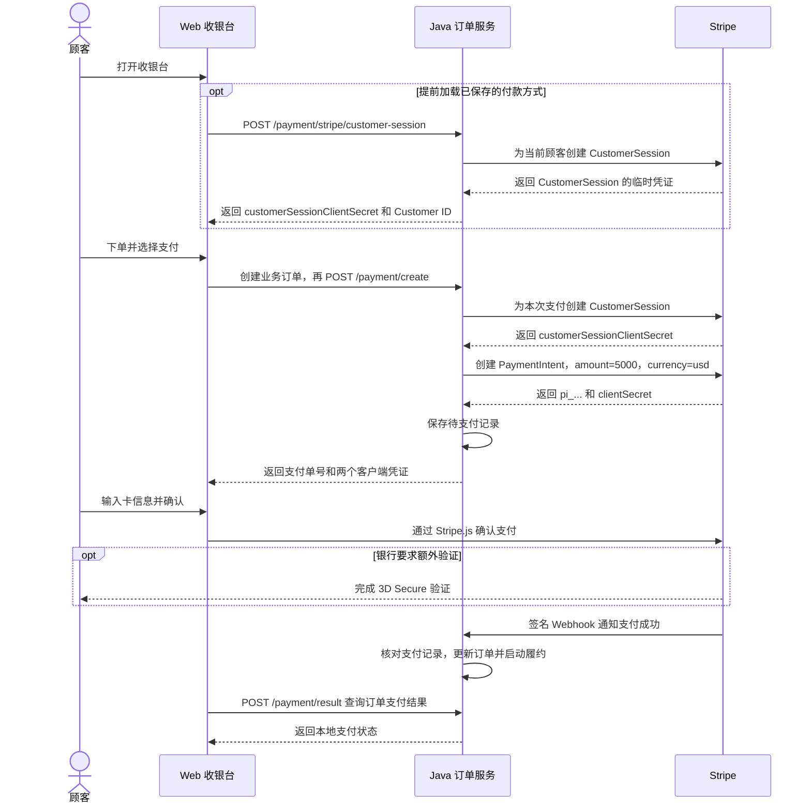

# Stripe 国际支付入门

在本项目里，顾客点下「支付」后，订单服务先用订单里的应付金额向 Stripe 创建一笔待确认的支付。顾客通过 Stripe 的收银台组件选卡并确认，必要时完成银行验证。Stripe 确认成功后，订单服务才把订单推进到已支付，开始履约。

下面用一笔 **50.00 美元的 Web 订单**走完这条链路。读完后，你应该能在代码里找到三个答案：收多少钱由谁决定、扣款成功由谁确认、用户关掉支付页面后订单怎么更新。

## 1. 一笔支付里的几张单

| 对象 | 用途 | 在项目里怎么找 |
| --- | --- | --- |
| 订单 `Order` | 记录顾客买了什么、应付多少钱、是否可以发货 | `trade_order`，用 `orderId` 查 |
| 支付单 `Payment` | 记录这张订单用哪个渠道尝试支付，以及支付结果 | `trade_payment`，用 `paymentId` 查。一张订单可以有不同渠道的支付单 |
| Stripe PaymentIntent | 记录 Stripe 侧这次支付的金额、币种和进度 | ID 形如 `pi_...`，通常保存在支付单的 `payNo` |
| Stripe Charge | 记录 Stripe 侧的一次扣款 | ID 形如 `ch_...`，支付成功后取 PaymentIntent 的 `latest_charge` 写入 `tradeNo` |
| Stripe Customer 和 PaymentMethod | Customer 代表顾客，PaymentMethod 代表一张卡等付款工具 | `cus_...` 与本地用户的对应关系在 `trade_payment_user_mapping`，`pm_...` 是 Stripe 的支付方式 ID |

例如，客服给你一个 `orderId`，你可以先查本地支付单，再拿 `payNo` 对应的 `pi_...` 去 Stripe Dashboard 查。反过来，Stripe 通知携带 PaymentIntent 的 `metadata.payment_id`，后端就能找到本地支付单。 [本地支付记录](../trade-order-service/src/main/java/cn/mathmagic/jjewelry/business/payment/entity/Payment.java) · [Stripe PaymentIntent](https://docs.stripe.com/payments/payment-intents)

## 2. 从下单到已支付



### 打开收银台时预拉 CustomerSession

`/stripe/customer-session` 是 Controller 上的方法路由。拼上 Controller 的前缀和应用默认的 `/aigc/trade` 后，得到下面的地址。通过网关访问时，以实际暴露的路径为准。 [普通支付入口](../trade-order-api/src/main/java/cn/mathmagic/jjewelry/business/controller/payment/PaymentController.java#L59) · [Hi3D 支付入口](../trade-order-api/src/main/java/cn/mathmagic/jjewelry/business/controller/hi3d/Hi3dPaymentController.java#L59) · [应用路径配置](../trade-order-api/src/main/resources/application.yml#L6)

| 场景 | 应用默认 HTTP 路径 |
| --- | --- |
| Builda | `POST /aigc/trade/payment/stripe/customer-session` |
| Hi3D | `POST /aigc/trade/hi3d/payment/stripe/customer-session` |

顾客打开收银台时，可以先调用这条接口，让 Stripe 的支付组件取得当前顾客的临时访问凭证。接口从请求的用户上下文取 `userId`，不需要请求体或 `orderId`。后端按用户和租户查找 Stripe Customer，首次调用时可创建 `cus_...` 并记录映射，然后为这个 Customer 创建 CustomerSession。这一步没有应付金额，也不会创建 PaymentIntent 或发起扣款。 [预拉会话服务](../trade-order-service/src/main/java/cn/mathmagic/jjewelry/business/payment/service/StripeCustomerSessionService.java#L68) · [Stripe 用户映射](../trade-order-service/src/main/java/cn/mathmagic/jjewelry/business/payment/service/StripePaymentUserResolver.java#L65)

| 返回字段 | 前端用途 |
| --- | --- |
| `customerSessionClientSecret` | 传给 Stripe 支付组件，让它在本次会话中访问该顾客已有的支付方式 |
| `stripeCustomerId` | Stripe 顾客 ID，形如 `cus_...` |
| `hasSavedPaymentMethods` | 后端是否查到至少一张已挂到该 Customer 的卡，可作界面提示。实际能展示哪些卡由 Stripe 组件决定 |

Controller 根据请求识别 Web 或 App，分别签发 `payment_element` 或 `mobile_payment_element` 会话。项目的 Web 会话允许展示和移除已保存的卡，关闭了组件内的保存卡开关。App 会话的保存和展示开关由 `StripeConfig` 控制。 [渠道识别](../trade-order-service/src/main/java/cn/mathmagic/jjewelry/business/payment/enums/StripePaymentChannel.java#L80) · [会话组件与开关](../trade-order-service/src/main/java/cn/mathmagic/jjewelry/business/payment/service/StripeCustomerSessionService.java#L145) · [查询已保存的卡](../trade-order-service/src/main/java/cn/mathmagic/jjewelry/business/payment/service/StripePaymentUserResolver.java#L133)

**预拉是可选的。** 正常发起支付仍走 `/payment/create`。需要继续确认时，后端会为支付响应创建 CustomerSession，前端可以直接用同一响应里的两个凭证初始化 Web 组件 `stripe.elements({ clientSecret, customerSessionClientSecret })`。其中 `clientSecret` 用于确认本次交易，`customerSessionClientSecret` 用于访问该顾客已保存的支付方式。 [Web 发起支付](../trade-order-service/src/main/java/cn/mathmagic/jjewelry/business/payment/service/StripeWebPayment.java#L143) · [项目创建支付响应](../trade-order-service/src/main/java/cn/mathmagic/jjewelry/business/payment/service/StripePaymentIntentSupport.java#L323) · [Stripe.js 的两个会话参数](https://docs.stripe.com/js/elements_object/create)

### 下单时确定应付金额

结算页可以先用 `POST /price/compute` 试算，查看商品、优惠、运费和税费。完整的请求与响应字段、租户分支和算价流程图见 [结算算价接口说明](算价接口说明.md)。

`POST /order/create` 创建业务订单。以 Builda 的计价路径为例，`PriceService` 先按项目配置换算商品价格，再处理运费和优惠，最后按配置尝试计算销售税。假设一件商品折后 45.00 美元，运费 5.00 美元，这笔订单未另计税，最终应付就是 50.00 美元。 [OrderController](../trade-order-api/src/main/java/cn/mathmagic/jjewelry/business/controller/order/OrderController.java#L46) · [PriceService](../trade-order-service/src/main/java/cn/mathmagic/jjewelry/business/price/service/PriceService.java#L183)

`POST /payment/create` 发起支付。Controller 从登录上下文取用户，从 `Currency` 请求头读取币种。Stripe 校验器检查订单归属和状态，重新从订单取 `payAmount`。订单有币种时，订单币种覆盖请求头。用户即使把请求里的金额改成 0.01 美元，Stripe 仍会收到订单上记录的应付金额。 [PaymentController](../trade-order-api/src/main/java/cn/mathmagic/jjewelry/business/controller/payment/PaymentController.java#L72) · [Web 支付校验器](../trade-order-service/src/main/java/cn/mathmagic/jjewelry/business/payment/service/StripeWebPaymentValidator.java#L35)

Stripe 的 `amount` 用整数表示，单位取决于币种。同样传 `amount=5000`，`currency=usd` 时向顾客收 **50.00 美元**，`currency=jpy` 时收 **5,000 日元**。日元是零小数币种，本项目的转换会拒绝带小数的日元金额。顾客被收取的币种叫支付币种，商家最终收款账户使用的是结算币种。例如顾客可以付美元，商家按其 Stripe 账户配置以另一币种收款。项目自己的商品换价发生在支付之前。 [StripeMinorUnits](../trade-order-service/src/main/java/cn/mathmagic/jjewelry/business/payment/service/StripeMinorUnits.java#L37) · [Stripe 币种与结算规则](https://docs.stripe.com/currencies)

### 收银台确认支付

Java 服务通过 `stripe-java`（本仓库依赖版本为 `33.4.0`）创建 PaymentIntent，并写入 `order_id`、`payment_id`、`pay_method`、`tenant_id` 和 `deploy_env` 等标签。创建成功后，后端保存 `WAIT_PAY` 支付单，再把 `paymentId` 和 `clientSecret` 等字段交给前端。此时 Stripe 已有一笔可以继续操作的支付，订单仍待支付。 [Maven 依赖](../trade-order-service/pom.xml#L76) · [构造 PaymentIntent](../trade-order-service/src/main/java/cn/mathmagic/jjewelry/business/payment/service/StripePaymentIntentSupport.java#L124) · [保存待支付记录](../trade-order-service/src/main/java/cn/mathmagic/jjewelry/business/payment/service/StripePaymentIntentSupport.java#L429)

| 渠道 | `/payment/create` 需要什么 | Java 后端做什么 | 前端接下来做什么 |
| --- | --- | --- | --- |
| Web `payMethod=111` | `orderId` 和 `payMethod`。校验器拒绝非空 `paymentMethodId` | 创建未绑定支付方式的 PaymentIntent | 典型 Web 接法是由 Stripe Payment Element 收集支付信息，再用 `stripe.confirmPayment` 确认 |
| App `payMethod=109` | `orderId`、`payMethod` 和 `paymentMethodId`（`pm_...`） | 检查支付方式属于当前 Customer，尚未挂接时将其挂接，然后创建绑定该 `pm_...` 的 PaymentIntent | 前端从 Stripe 移动组件获得支付方式，之后用返回的 `clientSecret` 继续确认并处理用户验证 |

App 方法名里带 `Confirm`，但构造参数实际只设置了 `paymentMethod`，没有传 `confirm=true`。两条路径都要经过确认步骤。此仓库提供 Java 接口与服务，表中的前端步骤按接口约定和 Stripe SDK 的用法说明。 [App 创建参数](../trade-order-service/src/main/java/cn/mathmagic/jjewelry/business/payment/service/StripeAppPayment.java#L199) · [Web 创建参数](../trade-order-service/src/main/java/cn/mathmagic/jjewelry/business/payment/service/StripeWebPayment.java#L191) · [Stripe 创建 API](https://docs.stripe.com/api/payment_intents/create) · [Stripe.js 确认支付](https://docs.stripe.com/js/payment_intents/confirm_payment)

### Stripe 通知后端，后端更新订单

Webhook 是 Stripe 主动发给后端的 HTTP 通知。它不依赖顾客留在页面上。项目的回调入口用原始请求体和 `Stripe-Signature` 请求头，通过 `whsec_...` 验证通知来源。项目还检查回调路径环境和事件里的 `deploy_env`，用事件 ID 加 Redis 锁，避免同一事件同时进入处理。 [回调入口](../trade-order-api/src/main/java/cn/mathmagic/jjewelry/business/controller/payment/StripeCallbackController.java#L67) · [Stripe Webhook](https://docs.stripe.com/webhooks)

| Stripe 事件 | 项目动作 |
| --- | --- |
| `payment_intent.succeeded` | 找本地支付单并按 `109` 或 `111` 分流，检查订单状态和金额，随后调用 `OrderService.finishPay`，推进订单、创建履约记录，并尝试关闭该订单下其他未支付单。支付单写为 `PAID`，记录 Stripe 扣款 ID |
| `payment_intent.payment_failed` | 把待支付单的失败原因写入日志，顾客可以重新尝试 |
| `refund.updated` | 仅在退款对象状态为 `succeeded` 时进入退款回调处理 |

页面返回后，`POST /payment/result` 可以查询结果。如果本地支付单还在 `WAIT_PAY`，服务会主动查 Stripe。Stripe 已 `succeeded` 时，查单也能补办支付落库。在界面上，银行验证后仍显示待支付可以先等一会儿再查。 [事件分发](../trade-order-service/src/main/java/cn/mathmagic/jjewelry/business/payment/service/StripeCallbackService.java#L55) · [主动查单](../trade-order-service/src/main/java/cn/mathmagic/jjewelry/business/payment/service/StripePaymentIntentSupport.java#L500) · [完成支付](../trade-order-service/src/main/java/cn/mathmagic/jjewelry/business/order/service/OrderService.java#L1446)

## 3. 银行验证、失败和重复点击

| 支付在 Stripe 的状态 | 对顾客意味着什么 | 本项目再次发起支付时怎么做 |
| --- | --- | --- |
| `requires_payment_method` | 等顾客选支付方式，或上次扣款失败后需要重试 | 允许取消旧 PaymentIntent 并创建新的 |
| `requires_confirmation` | 已有付款工具，等确认 | 复用原 PaymentIntent |
| `requires_action` | 银行要求额外操作，例如 3D Secure 验证 | 复用原 PaymentIntent，继续操作 |
| `processing` | Stripe 或银行仍在处理 | 复用原 PaymentIntent，等最终结果 |
| `requires_capture` | 已授权，等商家捕获资金，常见于先授权后扣款的接法 | 复用原 PaymentIntent |
| `succeeded` | Stripe 已确认这笔支付成功 | 用这笔交易补齐本地状态 |
| `canceled` | 这次支付已经取消 | 允许创建新的 PaymentIntent |

同订单的支付发起受 Redis 订单锁约束。若已有同渠道的待支付单，项目先查它在 Stripe 的状态，再决定复用还是替换。已支付的本地支付单在接到成功回调时会被跳过，这样重复通知通常不会再次推动履约。这些做法体现了**幂等**，意思是同一件事收到多次，业务结果仍只生效一次。 [发起支付](../trade-order-service/src/main/java/cn/mathmagic/jjewelry/business/payment/service/PayService.java#L62) · [查旧支付](../trade-order-service/src/main/java/cn/mathmagic/jjewelry/business/payment/service/StripePaymentIntentSupport.java#L159) · [Stripe 状态说明](https://docs.stripe.com/payments/paymentintents/lifecycle)

## 4. 退款、保存卡与税费

- **退款。** 已成功支付后，退款走原支付渠道。项目把 Stripe App `109` 和 Web `111` 都映射到退款渠道 `110`，用原 PaymentIntent 发起 Refund。业务发起的退款通过 `refund_no` 关联本地退款单。Dashboard 手动退款可以用 `pi_...` 反查支付单，项目只对手工全额退款自动推进业务，手工部分退款会告警。Stripe 的 `pending` 表示退款仍在处理，本实现会在收到 `pending` 时执行本地退款完成逻辑。排查顾客是否收到退款时，要看 Stripe 的实际退款状态。 [退款实现](../trade-order-service/src/main/java/cn/mathmagic/jjewelry/business/payment/service/StripeRefund.java#L158) · [处理 Dashboard 退款](../trade-order-service/src/main/java/cn/mathmagic/jjewelry/business/payment/service/StripeRefund.java#L617) · [Stripe 退款说明](https://docs.stripe.com/refunds)
- **单独绑卡。** 顾客只想添加一张供下次使用的卡时，可以调用 `POST /payment/saved-methods/setup-session`。这个接口用 SetupIntent 启动绑卡流程，确认 SetupIntent 时不会扣款。 [保存卡接口](../trade-order-api/src/main/java/cn/mathmagic/jjewelry/business/controller/payment/SavedPaymentMethodController.java#L51) · [Stripe SetupIntents](https://docs.stripe.com/api/setup_intents)

### 结算时怎样算税

**税率由 Stripe Tax 决定。** Builda 和 Hi3D 的站内结算共用试算流程，在 `POST /price/compute`、`POST /hi3d/price/compute` 和正式下单时，先计算商品换汇价、运费和优惠，再调用 Stripe Tax。Hi3D 使用自己的 Stripe 商户号。其他租户即使开启了国际运费和汇率功能，也不会走这段 Stripe Tax 试算。 [结算租户判断](../trade-order-service/src/main/java/cn/mathmagic/jjewelry/business/common/util/Hi3dTenantSupport.java#L65) · [计价顺序](../trade-order-service/src/main/java/cn/mathmagic/jjewelry/business/price/service/PriceService.java#L175) · [Hi3D Stripe 商户选择](../trade-order-service/src/main/java/cn/mathmagic/jjewelry/business/payment/tax/StripeTaxApiClient.java#L35)

#### 试算税费的代码调用链

```text
结算报价或创建订单
  → PriceService.getPrice(...)  算好商品、运费和优惠
  → StripeTaxQuoteService.applyTaxToPrice(...)  检查开关和地址
  → StripeTaxQuoteService.quote(...)  检查国家和本地缓存
  → 缓存未命中时，StripeTaxApiClient.createCalculation(...)  选 Stripe 商户和读超时
  → Calculation.create(...)  Stripe Java SDK 发出 POST /v1/tax/calculations
  → mapCalculation(...) 和 applyResult(...)  将税额加到结算应付价
```

1. `applyTaxToPrice` 在运费和优惠码写入 `PriceDto` 后执行。开关关闭时直接返回。缺少有效收货地址时，写入 `skipped_no_address`，税额为 0。`quote` 先检查 `countries`，目的国不在名单内时返回 `skipped_non_us_jp`。 [价格服务调用点](../trade-order-service/src/main/java/cn/mathmagic/jjewelry/business/price/service/PriceService.java#L199) · [试算入口](../trade-order-service/src/main/java/cn/mathmagic/jjewelry/business/payment/tax/StripeTaxQuoteService.java#L74) · [国家校验](../trade-order-service/src/main/java/cn/mathmagic/jjewelry/business/payment/tax/StripeTaxQuoteService.java#L158)
2. `quote` 用地址 ID、币种、国家、州或省、邮编、折后商品金额、运费和商品税码拼出缓存键。命中 Caffeine 本地缓存时直接返回之前的试算结果。未命中时才组装 `CalculationCreateParams` 并走下面的 SDK 调用。 [缓存判断](../trade-order-service/src/main/java/cn/mathmagic/jjewelry/business/payment/tax/StripeTaxQuoteService.java#L93) · [缓存键](../trade-order-service/src/main/java/cn/mathmagic/jjewelry/business/payment/tax/StripeTaxQuoteService.java#L353)

   ```java
   CalculationCreateParams params = buildCalculationParams(command);
   Calculation calculation = stripeTaxApiClient.createCalculation(params, taxSettings().getTimeoutMs());
   TaxQuoteResult result = mapCalculation(calculation, command);
   quoteCache.put(cacheKey, copyResult(result));
   ```

3. `buildCalculationParams` 填写 `currency`、`customer_details` 和 `ship_from_details`，把折后商品金额放到 `line_items`，正数运费单独放到 `shipping_cost`。`StripeTaxApiClient` 根据请求租户选商户密钥，配置读超时，然后以 `Calculation.create(params, options)` 发出请求。 [试算参数组装](../trade-order-service/src/main/java/cn/mathmagic/jjewelry/business/payment/tax/StripeTaxQuoteService.java#L170) · [Stripe SDK 调用](../trade-order-service/src/main/java/cn/mathmagic/jjewelry/business/payment/tax/StripeTaxApiClient.java#L35) · [Stripe 试算 API](https://docs.stripe.com/api/tax/calculations/create)
4. `mapCalculation` 读取 Stripe 返回的 `tax_amount_exclusive`、试算 ID 和税率明细。`applyResult` 把这些结果写回 `PriceDto`，并用 `税前应付 + 税额` 更新 `payPrice`。若请求失败或超时，`quote` 记录告警，返回 `stripe_fallback`，结算按税额 0 保留税前应付。 [映射 Stripe 响应](../trade-order-service/src/main/java/cn/mathmagic/jjewelry/business/payment/tax/StripeTaxQuoteService.java#L223) · [异常处理](../trade-order-service/src/main/java/cn/mathmagic/jjewelry/business/payment/tax/StripeTaxQuoteService.java#L116) · [税额写回](../trade-order-service/src/main/java/cn/mathmagic/jjewelry/business/payment/tax/StripeTaxQuoteService.java#L302)

#### 计税数据从哪里来

结算请求提供 `productId`、`skuId`、`quantity`、`addressId`、`shippingMethodCode` 和可选的 `promotionCode`，`Currency` 请求头提供结算币种，用户 ID 由接口从请求上下文取得。价格和运费由后端算好写入 `PriceDto`，再交给 `StripeTaxQuoteService`。 [结算算价入口](../trade-order-api/src/main/java/cn/mathmagic/jjewelry/business/controller/price/PriceController.java#L29) · [Hi3D 算价入口](../trade-order-api/src/main/java/cn/mathmagic/jjewelry/business/controller/hi3d/Hi3dPriceController.java#L41)

| 数据 | 实际来源与取值规则 |
| --- | --- |
| 收货地址 | 用请求里的 `addressId` 和当前 `userId` 查 `biz_user_shipping_address`。取 `countryCode`、`province`、`city`、`postalCode`，街道行优先取 `detail`，其次取 `street`，两者都空时用 `Address`。 [地址表](../trade-order-service/src/main/java/cn/mathmagic/jjewelry/business/user/entity/UserShippingAddress.java#L16) · [按用户查询地址](../trade-order-service/src/main/java/cn/mathmagic/jjewelry/business/user/repository/UserShippingAddressRepository.java#L17) · [街道行取值](../trade-order-service/src/main/java/cn/mathmagic/jjewelry/business/payment/tax/StripeTaxQuoteService.java#L343) |
| 发货地 | 取 Nacos `order/builda-payment.json` 的 `stripeTax.defaultShipFrom`，Builda 和 Hi3D 共用这块配置。整块缺省时，代码用 `CN`、省代码 `44`、`Guangzhou`、邮编 `510000`。 [默认值](../trade-order-service/src/main/java/cn/mathmagic/jjewelry/business/payment/config/BuildaPaymentRootConfig.java#L77) · [发货地选择](../trade-order-service/src/main/java/cn/mathmagic/jjewelry/business/payment/config/BuildaPaymentRootConfig.java#L155) |
| 商品税务分类 | 取同一 Nacos 配置的 `stripeTax.defaultProductTaxCode`，缺省为 `txcd_99999999`。试算把这笔商品金额合成一条 `merchandise` 明细，统一使用这个税务分类。 [税务分类默认值](../trade-order-service/src/main/java/cn/mathmagic/jjewelry/business/payment/config/BuildaPaymentRootConfig.java#L133) · [生成商品明细](../trade-order-service/src/main/java/cn/mathmagic/jjewelry/business/payment/tax/StripeTaxQuoteService.java#L199) |
| 折后商品金额 | `skuId` 对应 `trade_pd_sku.price`。后端按购买数量和结算币种得到 `PriceDto.productTotalPrice`，减去营销定价算出的 `discount` 和有效优惠码算出的 `promotionCodeDiscountAmount`，最低取 0。优惠码规则按提交的 `promotionCode` 从 `trade_promotion_code` 查询。 [读取 SKU](../trade-order-service/src/main/java/cn/mathmagic/jjewelry/business/productdomain/service/TradeSkuService.java#L211) · [营销定价](../trade-order-service/src/main/java/cn/mathmagic/jjewelry/business/marketing/service/MarketingService.java#L33) · [商品金额换算](../trade-order-service/src/main/java/cn/mathmagic/jjewelry/business/price/service/UsdExchangeRateService.java#L110) · [优惠码试算](../trade-order-service/src/main/java/cn/mathmagic/jjewelry/business/promocode/service/PromoCodeQuoteService.java#L57) · [扣减公式](../trade-order-service/src/main/java/cn/mathmagic/jjewelry/business/payment/tax/StripeTaxQuoteService.java#L137) |
| 运费 | `CheckoutDeliveryService` 根据目的地、结算币种和选中的 `shippingMethodCode` 算出 `PriceDto.shippingFee`。金额大于 0 时才作为 `shipping_cost` 发给 Stripe Tax。 [选择运费来源](../trade-order-service/src/main/java/cn/mathmagic/jjewelry/business/checkout/delivery/service/CheckoutDeliveryService.java#L78) · [生成运费参数](../trade-order-service/src/main/java/cn/mathmagic/jjewelry/business/payment/tax/StripeTaxQuoteService.java#L212) |

Stripe 后台可以在 **Settings → Tax** 设置账户的 **Preset product tax code**，也可以在 **Product catalog → 编辑商品 → Tax code** 为单个 Stripe 商品选分类。这个项目在试算请求的 `line_items[].tax_code` 显式传入 Nacos 的值，所以本项目要换商品分类，需要改 `stripeTax.defaultProductTaxCode`。当前源码的缺省代码 `txcd_99999999` 在 Stripe 目录里叫 **General - Tangible Goods**。 [设置账户默认分类](https://docs.stripe.com/tax/set-up#select-your-preset-tax-code) · [设置单个商品分类](https://docs.stripe.com/tax/products-prices-tax-codes-tax-behavior#tax-code-on-product) · [Tax API 如何使用商品分类](https://docs.stripe.com/tax/standalone-tax-api#use-an-existing-product-object) · [Stripe 商品税码表](https://docs.stripe.com/tax/tax-codes)

运费有两条取值路径。租户命中 Nacos `order/order-common.json` 的 `i18nCheckoutTenants` 且请求有 `productId` 时，按商品的 `trade_pd_product.i18n_freight_template_id` 查 `trade_i18n_freight_template`，用 `trade_i18n_freight_zone_country` 匹配收货国。命中有效国家分区时取 `trade_i18n_freight_zone` 的分区价，未命中时取模板通用价，再把所选档位的美元运费换成结算币种。其他请求按国家、州或省、配送档位和币种，从 `builda-checkout-delivery.json` 或 `hi3d-checkout-delivery.json` 的 `feesByCurrency` 直接取金额。 [运费启用条件](../trade-order-service/src/main/java/cn/mathmagic/jjewelry/business/i18nfreight/service/I18nCheckoutGate.java#L19) · [数据库模板与分区](../trade-order-service/src/main/java/cn/mathmagic/jjewelry/business/i18nfreight/service/I18nFreightQuoteService.java#L101) · [运费表结构](sql/trade_i18n_freight_and_exchange_rate.sql#L1) · [Nacos 配送金额](../trade-order-service/src/main/java/cn/mathmagic/jjewelry/business/checkout/delivery/service/CheckoutDeliveryConfigService.java#L137) · [配送配置按租户选择](../trade-order-service/src/main/java/cn/mathmagic/jjewelry/business/checkout/delivery/service/CheckoutDeliveryConfigService.java#L236)

商品和运费都按**价外税**申报，意思是传入金额尚未含税。Stripe 结合地址、商品税务分类和商户有效的税务注册等信息，决定哪些金额应税以及适用的税率。比如，同是美国订单，收货邮编不同，税额也可能不同。 [构造试算参数](../trade-order-service/src/main/java/cn/mathmagic/jjewelry/business/payment/tax/StripeTaxQuoteService.java#L128) · [Stripe 计税规则](https://docs.stripe.com/tax/calculating)

运费大于 0 时也参与试算。项目在 `shipping_cost` 中传运费金额和 `tax_behavior=exclusive`，由 Stripe 判定这笔运费是否应税以及适用的税率。需要单查时可看 Stripe 原始响应中的 `shipping_cost.amount_tax`。项目把整单价外税 `tax_amount_exclusive` 写入 `PriceDto.taxAmount`。 [项目运费参数](../trade-order-service/src/main/java/cn/mathmagic/jjewelry/business/payment/tax/StripeTaxQuoteService.java#L212) · [Stripe 运费计税](https://docs.stripe.com/tax/standalone-tax-api#calculate-tax-on-shipping-costs) · [Stripe 试算响应](https://docs.stripe.com/api/tax/calculations/object)

项目直接把 Stripe 返回的 `tax_amount_exclusive` 换算成 `taxAmount`，然后计算 **最终应付 = 税前应付 `taxExclusivePayPrice` + 税额 `taxAmount`**。税率明细是展示数据。比如 Stripe 返回 `percentage_decimal="8.875"`，代表 `8.875%`，项目把它转成小数 `0.088750` 放进 `taxBreakdown[].rate`。收款使用 Stripe 返回的税额，避免用展示税率重新乘整单金额。 [税额和税率转换](../trade-order-service/src/main/java/cn/mathmagic/jjewelry/business/payment/tax/StripeTaxQuoteService.java#L223) · [更新应付金额](../trade-order-service/src/main/java/cn/mathmagic/jjewelry/business/payment/tax/StripeTaxQuoteService.java#L302) · [Stripe Tax Calculation 字段](https://docs.stripe.com/api/tax/calculations/object)

例如，商品原价 100 美元，活动减 10 美元，优惠码再减 5 美元，运费 5 美元。项目向 Stripe 传 `8500` 美分的商品和 `500` 美分的运费。假设本例只有商品应税，税率为 8%，Stripe 返回 `680` 美分的税。订单应付就是 `85 + 5 + 6.80 = 96.80` 美元。

这笔税由顾客随订单付款，商家代收。上例中，顾客一次支付 96.80 美元，其中 6.80 美元是税。支付后项目通过 `Tax Transaction` 登记这笔税务交易，向税务机关申报和缴纳由商家通过单独的流程办理。 [订单支付金额来源](../trade-order-service/src/main/java/cn/mathmagic/jjewelry/business/payment/service/StripeWebPaymentValidator.java#L49) · [Stripe 税务申报与缴纳](https://docs.stripe.com/tax/filing)

### 税额为零时先看税费状态

税费开关和允许试算的国家来自 Nacos `order/builda-payment.json` 的 `stripeTax` 配置。源码缺省关闭，下面按提供的当前配置解读。 [Stripe Tax 配置](../trade-order-service/src/main/java/cn/mathmagic/jjewelry/business/payment/config/BuildaPaymentRootConfig.java#L27)

| 当前配置 | 结算时的作用 |
| --- | --- |
| `enabled: true`，`countries: ["US", "JP"]` | 开启试算。Builda 和 Hi3D 结算时，收货国为美国或日本且地址有效才进入 Stripe Tax 试算 |
| `defaultProductTaxCode: "txcd_99999999"` | 商品明细使用 Stripe 的 **General - Tangible Goods（一般实体商品）** 分类 |
| `defaultShipFrom` | 将 `CN`、省代码 `44`、`Guangzhou`、邮编 `510000` 和 `Guangzhou fulfillment center` 作为试算发货地址 |
| `cacheTtlSeconds: 90`，`timeoutMs: 2000` | 相同请求的成功试算结果缓存 90 秒，Stripe Tax API 的读超时设为 2 秒 |
| `importFeesNoticeKey` | 将 `builda.checkout.import_fees_notice` 作为进口费用提示文案的键返回给前端 |

`countries` 决定项目对哪些收货国发起试算。Stripe 再按收货地址、商品分类及对应商户的税务注册返回结果，因此美国或日本的订单也可能试算出 0。 [Stripe 零税额原因](https://docs.stripe.com/tax/zero-tax)

| `taxStatus` | 含义 |
| --- | --- |
| `calculated` | Stripe 完成试算。税额仍可能为 0，例如商户在相关地区未配置有效税务注册 |
| `skipped_no_address` | 缺失有效收货地址，项目跳过试算 |
| `skipped_non_us_jp` | 目的国未列入当前配置的允许名单，项目跳过试算 |
| `stripe_fallback` | Stripe 调用超时或失败，服务记录告警并按税额 0 保留税前应付 |

正式下单时，项目再次走结算算价，将最终 `payAmount` 写入订单，并把税额、状态和 `taxcalc_...` 保存到订单扩展的 `salesTax`。`/payment/create` 从订单取这个应付金额。支付成功后，符合条件且税额大于 0 的订单会用已保存的试算 ID 登记 Tax Transaction，无需重新试算。 [创单算价](../trade-order-service/src/main/java/cn/mathmagic/jjewelry/business/order/service/OrderService.java#L429) · [保存税务快照](../trade-order-service/src/main/java/cn/mathmagic/jjewelry/business/order/service/OrderService.java#L489) · [支付后登记](../trade-order-service/src/main/java/cn/mathmagic/jjewelry/business/payment/tax/StripeTaxTransactionService.java#L37) · [Stripe Tax Transaction API](https://docs.stripe.com/api/tax/transactions/create_from_calculation)

## 5. 在测试环境动手跑一笔

### 准备商户号、密钥和回调地址

在 Stripe Dashboard 进入沙箱，使用同一个沙箱的 `pk_test_...` 和 `sk_test_...`。`pk_` 是给前端 Stripe SDK 用的公开密钥，`sk_` 给 Java 后端调用 Stripe API，`whsec_` 只供对应 Webhook 入口验签。两种 `clientSecret` 只交给当前顾客的客户端。当前端收银台决定要展示什么付款方式时，Stripe 会根据 Dashboard 设置和币种等条件筛选，测试时先确认沙箱已启用卡支付。 [Stripe API 密钥](https://docs.stripe.com/keys) · [PaymentIntent 客户端密钥](https://docs.stripe.com/payments/payment-intents) · [Customer Session 客户端密钥](https://docs.stripe.com/api/customer_sessions/object) · [Stripe 动态支付方式](https://docs.stripe.com/payments/payment-methods/dynamic-payment-methods)

项目配置前缀是 `payment.stripe`。默认商户 Builda 使用 `secret-key`，Hi3D 使用 `hi3d-secret-key` 与独立商户号。前端公开密钥、后端商户密钥、回调地址和签名密钥要选同一套。应用默认路径前缀是 `/aigc/trade`，经过网关时使用实际对外路径。 [应用路径配置](../trade-order-api/src/main/resources/application.yml#L1) · [StripeConfig](../trade-order-service/src/main/java/cn/mathmagic/jjewelry/business/payment/config/StripeConfig.java) · [商户号选择](../trade-order-service/src/main/java/cn/mathmagic/jjewelry/business/payment/util/StripeCalls.java#L48)

| 商户 | Controller 回调路由 | `payment.stripe` 下的签名密钥配置 |
| --- | --- | --- |
| Builda | `POST /stripe/callback/{env}` | `webhook-key`，预发可单配 `pre-webhook-key` |
| Hi3D | `POST /stripe/callback/hi3d/{env}` | `hi3d-webhook-key`，预发可单配 `hi3d-pre-webhook-key` |

在 Dashboard 注册 HTTPS 回调地址，选择 Snapshot 事件格式并订阅第 2 节的三个事件。项目会从事件的 `data.object` 读取 PaymentIntent 或 Refund。如果在本地联调，可以用 Stripe CLI 转发。将下面的 `8080` 和 `dev` 换成实际监听端口和应用的 `env`，把 `stripe listen` 打印的签名密钥放入对应的本地配置。Hi3D 测试时选同一 Hi3D 沙箱，并使用该商户的回调路由和配置项。 [Stripe Webhook 与本地转发](https://docs.stripe.com/webhooks#local-listener)

```bash
stripe login
stripe listen --events payment_intent.succeeded,payment_intent.payment_failed,refund.updated \
  --forward-to http://localhost:8080/aigc/trade/stripe/callback/dev
```

### 提交订单并确认支付

1. 先用项目的测试账号下单，拿到 `orderId`。下单入口是 `POST /order/create`，Hi3D 用 `POST /hi3d/order/create`。
2. 在同一测试账号下发起 Web 支付。下面是 `POST /payment/create` 的请求体示例，`orderId` 换成上一步的实际值，请求头可带 `Currency: usd`。Hi3D 发起支付用 `POST /hi3d/payment/create`。

   ```json
   {
     "orderId": "你的测试订单号",
     "payMethod": 111
   }
   ```

3. 在搭配项目接口的测试收银台输入 `4242 4242 4242 4242`、未来有效期和任意三位 CVC，确认付款。看到 `/payment/create` 返回 `stripePaymentIntentId` 后，可在 Dashboard 观察它从待确认到 `succeeded` 的变化。 [Stripe 沙箱测试卡](https://docs.stripe.com/testing#cards)
4. 对照 Stripe 事件记录和服务日志，用 `orderId → paymentId → pi_... → evt_...` 串起来查。确认 `trade_payment` 和 `trade_order` 都已支付，再查履约记录。练习时可以先暂停本地 Webhook 转发，确认付款后调 `POST /payment/result`（请求体带 `orderId`），观察主动查单能否补齐状态。
5. 另开测试订单验证三条分支。用 `4000 0025 0000 3155` 在收银台练习 3D Secure 验证，用 `4000 0000 0000 0341` 模拟可绑卡但扣款失败。完成一笔成功支付后，从 Dashboard 重发原成功事件，检查业务是否只处理一次。 [Stripe 验证与拒付测试卡](https://docs.stripe.com/testing) · [Stripe 重发事件](https://docs.stripe.com/webhooks#manual-retries)

`stripe trigger payment_intent.succeeded` 适合检查回调线路。默认示例事件由 CLI 自己创建，缺少本地订单关联的 `payment_id` 和 `deploy_env`。要验证订单最终更新成功，用系统自己创建的那笔支付来测试。 [事件过滤逻辑](../trade-order-service/src/main/java/cn/mathmagic/jjewelry/business/payment/service/StripeWebhookPrefilterService.java#L32)

### 支付卡住时从哪里查

| 看到的现象 | 第一处检查 |
| --- | --- |
| `/payment/create` 报参数错误 | 核对订单归属和状态，再看 Web 是否误传 `pm_...`、App 是否漏传 `pm_...` |
| Dashboard 有 `pi_...`，但没有成功事件 | 看 PaymentIntent 是等支付方式、等确认、等银行验证，还是已失败 |
| Stripe 已成功，本地还待支付 | 查成功事件的投递记录，核对回调路径、商户、签名密钥和事件 `deploy_env`，再用 `metadata.payment_id` 对上本地支付单。HTTP `200` 也可能是项目主动跳过了该事件 |

## 6. 读懂之后，接自己的系统

从测试环境的一种币种、一种支付方式开始。后端确定订单金额和币种，创建并记录 PaymentIntent，前端完成确认和银行验证，后端接收并核对回调。最后用同一个 `pi_...` 把查单和退款跑通。

下面演示 Web 端最小接法。页面先用商户公开密钥初始化 Stripe.js，拿到 `/payment/create` 的 `clientSecret` 后挂载表单，再在提交按钮的事件里调用 `confirm`。`returnUrl` 指向你的支付结果页，结果页用原订单号向后端查状态。 [初始化 Elements](https://docs.stripe.com/js/elements_object/create) · [确认支付](https://docs.stripe.com/js/payment_intents/confirm_payment)

```javascript
const elements = stripe.elements({ clientSecret });
elements.create('payment').mount('#payment-element');

async function confirm() {
  return stripe.confirmPayment({ elements, confirmParams: { return_url: returnUrl } });
}
```

前端确认时应显示等待状态，收到错误时提示顾客并允许重试。结果页和 Webhook 两条路径都可能先到，服务端负责确认订单是否已经进入已支付。 [Stripe.js 确认支付](https://docs.stripe.com/js/payment_intents/confirm_payment)

直接借鉴项目代码时，有三个实现细节值得单独核对。

- **重试跨不过 Stripe 和本地数据库的边界。** 这个项目会先查旧 PaymentIntent，创建支付和退款的调用里未见按业务操作显式传入稳定的 `Idempotency-Key`。例如 Stripe 收到了创建请求，而本地尚未来得及记录 `pi_...`，单靠本地锁未必能识别这次创建。新接入应给同一次业务操作固定幂等键，并处理超时后的查单和对账。 [项目 Stripe 调用封装](../trade-order-service/src/main/java/cn/mathmagic/jjewelry/business/payment/util/StripeCalls.java#L48) · [Stripe 幂等请求](https://docs.stripe.com/api/idempotent_requests)
- **成功落库前应把币种也核对一遍。** 项目的回调金额校验按 Stripe 返回的币种换算本地金额，再比较整数金额。接新系统时，建议独立核对订单币种、金额、Stripe 商户和当前关联的 `pi_...`。 [项目金额校验](../trade-order-service/src/main/java/cn/mathmagic/jjewelry/business/payment/service/StripePaymentIntentSupport.java#L714)
- **支付凭证和标识分开处理。** 项目把 `clientSecret` 和 `customerSessionClientSecret` 写入了支付扩展字段。Stripe 建议这些凭证避免持久化和写日志。日常查单和排查可使用 `paymentId`、`pi_...` 和 `evt_...`。 [项目支付扩展字段](../trade-order-service/src/main/java/cn/mathmagic/jjewelry/business/payment/service/StripePaymentIntentSupport.java#L429) · [PaymentIntent 客户端密钥](https://docs.stripe.com/payments/payment-intents) · [Customer Session 客户端密钥](https://docs.stripe.com/api/customer_sessions/object)
