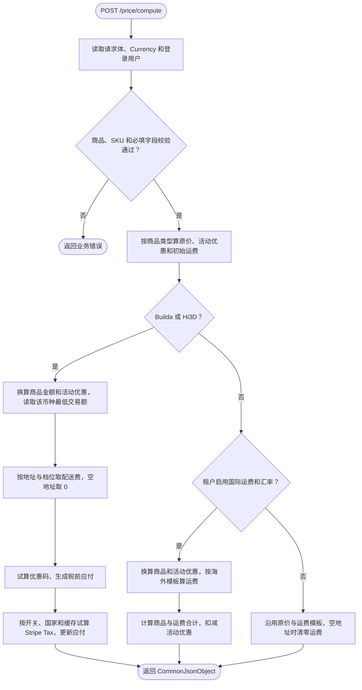

# 结算算价接口说明

`PriceController#detail` 给结算页返回当前 SKU 的报价。调用方提交商品规格、数量，以及选中的地址、配送档位和优惠码。服务端根据当前用户和租户算出商品金额、优惠、运费、税费和最终应付 `payPrice`。这个入口提供试算结果，正式下单由创单流程保存订单金额。 [接口实现](../trade-order-api/src/main/java/cn/mathmagic/jjewelry/business/controller/price/PriceController.java#L29) · [正式创单算价](../trade-order-service/src/main/java/cn/mathmagic/jjewelry/business/order/service/OrderService.java#L429)

## 1. 请求怎么发

| 项目 | 取值 |
| --- | --- |
| 方法和 Controller 路由 | `POST /price/compute` |
| 应用默认访问路径 | `POST /aigc/trade/price/compute`。经过网关时使用网关实际暴露的路径 |
| 请求体 | `application/json`，绑定到 `PriceRequest` |
| 响应 | `CommonJsonObject<PriceDto>` |

普通入口需要通过应用的登录鉴权。Web 按当前环境的会话 Cookie 传登录票据，App 使用 `aigc-app-token` 请求头。鉴权过滤器写入请求的用户 ID，`ApiControllerAOP` 把它填进 `BaseApiDto.userId`。Controller 再将该用户 ID 交给算价服务。 [应用路径](../trade-order-api/src/main/resources/application.yml#L6) · [鉴权配置](../trade-order-api/src/main/java/cn/mathmagic/jjewelry/config/WebSecurityConfig.java#L67) · [用户 ID 提取](../trade-order-api/src/main/java/cn/mathmagic/jjewelry/config/auth/token/TokenAuthenticationFilter.java#L40) · [BaseApiDto 注入](../trade-order-api/src/main/java/cn/mathmagic/jjewelry/config/ApiControllerAOP.java#L92)

Hi3D 另有 `POST /aigc/trade/hi3d/price/compute`。它会额外校验 `quantity > 0` 以及商品属于 Hi3D，再调用同一个 `PriceService.getPrice(...)`。下面的请求体和字段表主要说明普通入口。 [Hi3D 算价入口](../trade-order-api/src/main/java/cn/mathmagic/jjewelry/business/controller/hi3d/Hi3dPriceController.java#L41)

### 请求头和上下文

| 字段 | 必填 | 含义 |
| --- | --- | --- |
| `Content-Type` | 是 | JSON 请求体使用 `application/json` |
| 登录票据 | 是 | 按客户端的登录方式携带。用户 ID 由服务端提取，供活动和地址查询使用 |
| `appid`、`x-client` | 按客户端约定 | 用于应用识别。App 请求沿用其已有的应用头和登录票据，以匹配对应鉴权分支 |
| `Currency` | 否 | 结算币种。换汇分支要求三位小写代码。省略时基础报价为美元，当前枚举有 `usd`、`cny`、`jpy`。解析和回退规则见第 3 节 |
| `Accept-Language` | 否 | 影响配送文案和优惠码提示的语言。优惠码结果文案支持日文和英文，其他语言走英文 |

[币种定义](../trade-order-client/src/main/java/cn/mathmagic/jjewelry/enums/CurrencyEnum.java#L13) · [优惠码文案语言](../trade-order-service/src/main/java/cn/mathmagic/jjewelry/business/price/service/PriceService.java#L509)

### 请求体 PriceRequest

| 字段 | JSON 类型 | 必填 | 含义 |
| --- | --- | --- | --- |
| `productId` | `string` | 是 | 商品业务 ID。服务端先查商品，再校验所选 SKU 属于该商品 |
| `skuId` | `string` | 是 | 商品规格 ID，例如某款商品的材料或尺寸规格。后端读取规格单价并校验在售 |
| `quantity` | `integer` | 是 | 购买件数，调用方传正整数。普通入口这里检查非 `null`，Hi3D 入口还显式检查大于 0 |
| `addressId` | `string` | 否 | 用户选中的收货地址 ID。省略或传空串时，最终报价的运费为 0，Stripe Tax 分支会按缺地址跳过试算 |
| `promotionId` | `string` | 否 | 活动或优惠上下文 ID，传入营销定价作为匹配条件 |
| `shippingMethodCode` | `string` | 条件必填 | 配送档位编码。Builda、Hi3D 和启用海外运费的租户，在传了地址时需传入可选配送档位接口返回的 `code`，例如新运费模板的 `STANDARD` 或 `EXPRESS` |
| `promotionCode` | `string` | 否 | 用户输入的优惠码字符串。Builda 和 Hi3D 共用的结算分支会试算这张码，省略时按未使用优惠码处理 |

Builda 查询档位用 `GET /checkout/shipping-options`，启用商品海外模板时一起传 `productId`。Hi3D 提供 `GET /hi3d/checkout/shipping-options`，该查询入口按 `addressId` 和 `Currency` 获取配送档位。这些是 Controller 路由，请求时按环境拼接应用路径或网关前缀。 [请求 DTO](../trade-order-service/src/main/java/cn/mathmagic/jjewelry/business/price/dto/PriceRequest.java) · [配送档位入口](../trade-order-api/src/main/java/cn/mathmagic/jjewelry/business/controller/checkout/CheckoutDeliveryController.java#L43) · [Hi3D 配送档位入口](../trade-order-api/src/main/java/cn/mathmagic/jjewelry/business/controller/hi3d/Hi3dCheckoutController.java#L37)

## 2. 算价流程图

[打开流程图 PNG](算价接口流程图.png)



## 3. 后端怎么算

### 商品原价和活动优惠

1. `PriceService.getPrice(...)` 校验 `productId`、`skuId`、`quantity` 非 `null`，读取商品和 SKU。`requireOwnedOnSale(...)` 校验 SKU 存在、属于指定商品且在售。库存检查在这段代码中已注释，正式下单时再走订单的校验流程。 [入参校验](../trade-order-service/src/main/java/cn/mathmagic/jjewelry/business/price/service/PriceService.java#L143) · [SKU 归属与状态校验](../trade-order-service/src/main/java/cn/mathmagic/jjewelry/business/productdomain/service/TradeSkuService.java#L183)
2. `PriceStrategyFactory` 按商品类型选择策略，众筹 `WANT=1`、模板 `TEMPLATE=2`、商城 `SHOP=3` 分别对应各自的算价策略。用 `trade_pd_sku.price` 作为基础单价，`MarketingService.getDiscountV2(...)` 根据用户、商品、SKU、数量和 `promotionId` 调用营销定价服务。 [策略选择](../trade-order-service/src/main/java/cn/mathmagic/jjewelry/business/price/service/PriceStrategyFactory.java#L27) · [商品类型枚举](../trade-order-client/src/main/java/cn/mathmagic/jjewelry/enums/TradeProductTypeEnum.java#L11) · [营销定价入口](../trade-order-service/src/main/java/cn/mathmagic/jjewelry/business/marketing/service/MarketingService.java#L33)
3. 营销定价准备用户标签和活动范围，匹配出 SKU 可用的活动。多个候选按活动优先级 `precedence`、折后价 `discountedPrice`、活动组 `activityGroup` 依次升序选取。`PriceStrategy` 再用活动的实际减免构建 `discount`，按 SKU 单价乘件数得到 `productTotalPrice`，并填入初始运费。 [候选活动匹配](../trade-order-service/src/main/java/cn/mathmagic/jjewelry/business/pricing/flow/PricingFlowManager.java#L103) · [最优活动排序](../trade-order-service/src/main/java/cn/mathmagic/jjewelry/business/pricing/util/BestDiscountSelector.java#L23) · [基础金额构造](../trade-order-service/src/main/java/cn/mathmagic/jjewelry/business/price/service/PriceStrategy.java#L151)

### 按租户选择结算分支

| 分支 | 运费、优惠和税费 |
| --- | --- |
| Builda 或 Hi3D | 按请求币种换算商品单价和活动减免，取得该币种最低交易额，清理初始运费。用地址和配送档位取实际运费，试算优惠码，计算税前应付，再按配置试算 Stripe Tax |
| 其他租户且命中 `i18nCheckoutTenants` | 按请求币种换算商品金额和活动减免，用海外运费模板计算配送费。最终金额为商品合计加运费，再减活动优惠，最低为 0。优惠码和 Stripe Tax 字段通常省略 |
| 其他租户且未命中 `i18nCheckoutTenants` | 使用商品原始算价和旧运费模板结果。有地址时保留旧运费明细。没有地址时清零运费并重新计算应付。该分支的 `currency` 通常省略 |

[租户分支](../trade-order-service/src/main/java/cn/mathmagic/jjewelry/business/price/service/PriceService.java#L175) · [国际结算名单配置](../trade-order-service/src/main/java/cn/mathmagic/jjewelry/business/common/config/NacosOrderCommonConfig.java#L77) · [旧运费模板](../trade-order-service/src/main/java/cn/mathmagic/jjewelry/business/price/service/ShippingFeeService.java#L46)

### 汇率与运费

- **换汇。** 命中 `i18nCheckoutTenants` 时，汇率优先读 `trade_currency_exchange_rate`，未找到时读 Nacos `order/order-common.json` 的 `usdExchangeRate`。商品先换算单价，再乘件数。换算按币种精度 `HALF_UP`，日元零位小数。空币种、合法格式但不支持的币种、缺少可用汇率都会让商品报价回到 `usd`。像 `JPY` 这种格式会被换汇分支拒绝。 [币种解析](../trade-order-service/src/main/java/cn/mathmagic/jjewelry/business/price/service/UsdExchangeRateService.java#L47) · [换算金额](../trade-order-service/src/main/java/cn/mathmagic/jjewelry/business/price/service/UsdExchangeRateService.java#L103) · [汇率来源](../trade-order-service/src/main/java/cn/mathmagic/jjewelry/business/price/service/UsdExchangeRateService.java#L319)
- **海外运费模板。** 有 `productId` 且租户命中 `i18nCheckoutTenants` 时，按商品绑定的模板查收货国分区，优先取有效分区价，未命中取模板通用价。美元运费按同一换汇服务转为结算币种。商品模板缺失或无效会抛业务异常。 [选择运费路径](../trade-order-service/src/main/java/cn/mathmagic/jjewelry/business/checkout/delivery/service/CheckoutDeliveryService.java#L78) · [模板、分区和换汇](../trade-order-service/src/main/java/cn/mathmagic/jjewelry/business/i18nfreight/service/I18nFreightQuoteService.java#L101)
- **Nacos 配送价。** Builda 或 Hi3D 未走海外模板时，按租户读 `builda-checkout-delivery.json` 或 `hi3d-checkout-delivery.json`，按国家、州或省、档位和币种从 `feesByCurrency` 取配置金额。档位缺目标币种会回退到 USD 配置。此分支运费返回的是一个金额，`PriceDto.currency` 来自商品换汇结果。排查币种不一致时，应同时核对汇率和所选档位的币种配置。 [按租户选配送配置](../trade-order-service/src/main/java/cn/mathmagic/jjewelry/business/checkout/delivery/service/CheckoutDeliveryConfigService.java#L236) · [配送币种回退](../trade-order-service/src/main/java/cn/mathmagic/jjewelry/business/checkout/delivery/support/CheckoutDeliveryFeeDisplayFormatter.java#L63)

### 优惠码与税费

优惠码先匹配有效期、用户、商品或 SKU、门槛、使用次数和可叠加规则，再按优惠类型计算实际减免。立减和一口价的配置金额以美元计，参与换汇。百分比的配置值是付款比例，例如 `0.80` 表示付 80%。最低交易额用于限制优惠码能减多少，限额按折后商品计算，运费不计入。此接口只试算优惠码，创单时才执行预占。 [优惠码规则与校验](../trade-order-service/src/main/java/cn/mathmagic/jjewelry/business/promocode/service/PromoCodeQuoteService.java#L57) · [优惠类型计算](../trade-order-service/src/main/java/cn/mathmagic/jjewelry/business/promocode/service/PromoCodeQuoteService.java#L173) · [减免上限](../trade-order-service/src/main/java/cn/mathmagic/jjewelry/business/promocode/service/PromoCodeQuoteService.java#L222) · [下单时预占](../trade-order-service/src/main/java/cn/mathmagic/jjewelry/business/order/service/OrderService.java#L429)

Stripe Tax 分支先检查开关、收货地址和目的国名单。缓存未命中时，通过 Stripe SDK 调用 `POST /v1/tax/calculations`，把折后商品和正数运费分开提交。响应中的 `tax_amount_exclusive` 转回主货币单位后加到税前应付。调用失败时按零税额返回 `stripe_fallback`。 [试算代码](../trade-order-service/src/main/java/cn/mathmagic/jjewelry/business/payment/tax/StripeTaxQuoteService.java#L74) · [写回金额](../trade-order-service/src/main/java/cn/mathmagic/jjewelry/business/payment/tax/StripeTaxQuoteService.java#L302) · [试算细节](Stripe%20国际支付入门.md)

## 4. 响应字段逐项说明

标准 JSON 序列化会省略 `null`。可选字段随租户分支、活动、优惠码和税务状态而变化。金额按货币主单位表达，例如美元的 `7.20` 表示 7.20 美元。Nacos 运费的币种回退规则见第 3 节。 [Jackson 配置](../trade-order-api/src/main/java/cn/mathmagic/jjewelry/config/JacksonConfig.java#L20) · [PriceDto](../trade-order-service/src/main/java/cn/mathmagic/jjewelry/business/price/dto/PriceDto.java)

### 外层 CommonJsonObject

| 字段 | JSON 类型 | 含义 |
| --- | --- | --- |
| `code` | `integer` | 业务状态码。`200` 表示 `ErrorCodeEnum.SUCCESS` |
| `msg` | `string` | 结果说明。标准成功响应为 `success`，业务失败时可能返回本地化错误文案 |
| `success` | `boolean` | 由 `isSuccess()` 派生，表示 `code` 是否为业务成功码 |
| `data` | `object` | 成功时为 `PriceDto`。发生业务错误时可能省略 |

### data 中的金额与币种

| 字段 | JSON 类型 | 含义 |
| --- | --- | --- |
| `price` | `number` | SKU 原单价。进入换汇分支后是换算后的单价 |
| `currency` | `string` | 报价币种的小写代码，如 `usd`、`cny`、`jpy`。旧分支可能省略 |
| `productTotalPrice` | `number` | 商品原价合计，通常为 `price × quantity` |
| `shippingFee` | `number` | 税前运费。地址省略时为 0 |
| `totalPrice` | `number` | 优惠前的税前合计，等于商品原价合计加运费 |
| `discount` | `number` | 活动或营销优惠的实际减免总额。优惠码减免由独立字段表示 |
| `payPrice` | `number` | 本次报价最终应付。结算分支先得到税前应付，Stripe 税试算有结果时再加税额 |

### data 中的营销活动字段

| 字段 | JSON 类型 | 含义 |
| --- | --- | --- |
| `discountId` | `string` | 命中的优惠记录 ID。存在 `wantItLogId` 时，算价策略优先返回该记录 ID |
| `bizType` | `string` | 命中优惠记录上的业务类型，来自 `PromotionRecord.bizType` |
| `discountOrigin` | `integer` | 命中优惠记录的来源编码，来自 `PromotionRecord.origin` |
| `channel` | `integer` | 营销优惠渠道编码，如 `0` 为无活动，`6` 为券价，`9` 为单品直降 |
| `channelName` | `string` | `PromotionChannel` 的枚举名，如 `NONE`、`COUPON_PRICE`、`SINGLE_PROMOTION_ACTIVITY` |
| `couponId` | `integer` | 本次营销活动实际使用的券 ID，Java 类型为 `Long` |
| `couponCode` | `string` | 上述营销券的券码，与请求的 `promotionCode` 是两个字段 |
| `activityId` | `integer` | 命中的营销活动 ID，Java 类型为 `Long` |
| `discountValue` | `number` | 活动折扣展示值。普通活动取规则配置值，阶梯活动取表达式解析结果。实际减免看 `discount` |
| `discountType` | `integer` | 营销优惠类型。`1` 立减、`2` 百分比、`3` 一口价、`4` 阶梯百分比、`5` 阶梯立减、`6` 阶梯一口价 |
| `uniqueTopicId` | `string` | 命中活动关联的社区话题 ID，随作者权益上下文透传 |
| `enableActivityAuthorQuota` | `integer` | `1` 使用单活动作者配额规则，`0` 或空沿用历史单次免单规则 |
| `expectFree` | `boolean` | 作者配额新规则下，算价判定是否处于可免费额度内。用于对应的营销权益和运费判断 |
| `accountLevel` | `string` | 算价时取到的作者身份等级快照 |

[营销字段来源](../trade-order-service/src/main/java/cn/mathmagic/jjewelry/business/marketing/dto/DiscountDto.java#L78) · [PriceDto 写入](../trade-order-service/src/main/java/cn/mathmagic/jjewelry/business/price/service/PriceStrategy.java#L151) · [优惠渠道枚举](../trade-order-service/src/main/java/cn/mathmagic/jjewelry/business/common/constant/PromotionChannel.java) · [活动折扣类型](../trade-order-service/src/main/java/cn/mathmagic/jjewelry/business/pricing/enums/DiscountTypeEnum.java#L14)

### data 中的优惠码字段

| 字段 | JSON 类型 | 含义 |
| --- | --- | --- |
| `promotionCodeStatus` | `integer` | `0` 可用，`1` 本人使用次数已满，`2` 不可用或未填码，`3` 总使用次数已满。进入优惠码试算分支时写入 |
| `promotionCodeDiscountType` | `integer` | `1` 立减，`2` 百分比，`3` 一口价。可用时返回 |
| `promotionCodeDiscountValue` | `number` | 优惠参数。立减为每件减多少钱，一口价为每件付多少钱。金额在报价币种下展示。百分比为应付比例，如 `0.80` |
| `promotionCodeDiscountQuantity` | `integer` | 用于展示百分比码的实际优惠件数。配置大于 0 时与购买件数取较小值，`0` 表示整单计算 |
| `promotionCodeDiscountAmount` | `number` | 应用限制规则后的实际优惠码减免总额。可用时返回 |
| `promotionCodeDisplayName` | `string` | 优惠码配置中的英文展示名，取 `extra.displayName.en`，配置缺失时可能省略 |
| `promotionCodeDiscountText` | `string` | 面向顾客的结果文案。可用时提示优惠，失败时按无效或次数已满展示。空码时省略。支持日语和英语 |

[优惠码返回字段](../trade-order-service/src/main/java/cn/mathmagic/jjewelry/business/price/service/PriceService.java#L441) · [优惠码状态枚举](../trade-order-service/src/main/java/cn/mathmagic/jjewelry/business/promocode/enums/PromotionCodeApplyStatus.java#L11)

### data 中的运费明细 shippingFeeDto

`shippingFeeDto` 为旧运费路径的可选对象。Builda、Hi3D、新国际运费分支以及无地址清零的路径会清理它，页面可以直接读顶层 `shippingFee`。 [清理明细的逻辑](../trade-order-service/src/main/java/cn/mathmagic/jjewelry/business/price/service/PriceService.java#L243) · [ShippingFeeDto](../trade-order-service/src/main/java/cn/mathmagic/jjewelry/business/price/dto/ShippingFeeDto.java)

| 字段 | JSON 类型 | 含义 |
| --- | --- | --- |
| `shippingFeeDto` | `object` | 旧运费金额及来源 |
| `shippingFeeDto.shippingFee` | `number` | 旧运费模板或策略算出的金额 |
| `shippingFeeDto.deliveryProvince` | `string` | 配送省或州。DTO 保留该字段，当前旧运费服务通常不填 |
| `shippingFeeDto.deliveryCity` | `string` | 配送城市。DTO 保留该字段，当前旧运费服务通常不填 |
| `shippingFeeDto.deliveryDistrict` | `string` | 配送区县。DTO 保留该字段，当前旧运费服务通常不填 |
| `shippingFeeDto.feeSourceCode` | `integer` | 运费来源编码，见下表 |

| 编码 | 来源 | 编码 | 来源 |
| --- | --- | --- | --- |
| `0` | 未知 | `6` | 命中地址对应的运费规则 |
| `1` | 无可用运费模板 | `7` | Want It 用户权益 |
| `2` | 未登录时用模板默认运费 | `8` | Want It 作者权益 |
| `3` | 无可用用户地址时用模板默认运费 | `9` | 优惠券价渠道 |
| `4` | 有效地址下包邮 | `10` | 内容作者权益 |
| `5` | 地址未匹配模板规则，取模板默认运费 | — | — |

### data 中的税费字段

| 字段 | JSON 类型 | 含义 |
| --- | --- | --- |
| `taxAmount` | `number` | 整单间接税总额，来自 Stripe `tax_amount_exclusive` 换算后的金额 |
| `taxExclusivePayPrice` | `number` | 税前应付，已扣活动优惠和优惠码、已加运费。结账可作为 Subtotal 展示 |
| `taxCalculationId` | `string` | Stripe 试算 ID，形如 `taxcalc_...`。正式下单可将它记录到订单扩展，支付后用于登记税务交易 |
| `taxStatus` | `string` | `calculated` 试算成功，`skipped_no_address` 缺少有效地址，`skipped_non_us_jp` 收货国不在允许名单，`stripe_fallback` 试算失败或超时。税费开关关闭时通常省略 |
| `taxBreakdown` | `array` | Stripe 税费展示明细。没有可展示条目时可能为空数组或省略 |
| `importFeesNoticeKey` | `string` | 进口费用提示文案的 i18n 键。前端按对应语言展示提示 |
| `taxBreakdown[].type` | `string` | 项目统一填 `sales_tax`，供结账展示 |
| `taxBreakdown[].rate` | `number` | 小数税率，例如 Stripe 的 `8.875` 表示 `8.875%`，返回 `0.088750` |
| `taxBreakdown[].amount` | `number` | 该明细行税额，单位为报价币种的主单位 |
| `taxBreakdown[].displayName` | `string` | 明细展示名。优先用 Stripe 返回的州或省代码，其次国家代码，再回退到税种 |

[税费响应映射](../trade-order-service/src/main/java/cn/mathmagic/jjewelry/business/payment/tax/StripeTaxQuoteService.java#L223) · [税率与展示名](../trade-order-service/src/main/java/cn/mathmagic/jjewelry/business/payment/tax/StripeTaxQuoteService.java#L264) · [税费状态枚举](../trade-order-service/src/main/java/cn/mathmagic/jjewelry/business/payment/tax/TaxQuoteStatus.java#L11)

## 5. 一笔含优惠和税的报价示例

下面用虚构 ID 演示 Builda 的请求。假设后端得出单价 100 美元、活动减免 10 美元、有效且可叠加的优惠码再减 5 美元、运费 5 美元。示例假设 Stripe 对折后商品和运费均按 8% 计税。

```http
POST /aigc/trade/price/compute
Content-Type: application/json
Currency: usd
Cookie: <会话 Cookie 名>=<有效登录票据>

{
  "productId": "PRODUCT_EXAMPLE",
  "skuId": "SKU_EXAMPLE",
  "quantity": 1,
  "addressId": "ADDRESS_EXAMPLE",
  "promotionId": "PROMOTION_EXAMPLE",
  "shippingMethodCode": "STANDARD",
  "promotionCode": "PROMO_EXAMPLE"
}
```

| 展示金额 | 演算 |
| --- | --- |
| `productTotalPrice` | `100 × 1 = 100.00` |
| `totalPrice` | `100 + 5 = 105.00` |
| `taxExclusivePayPrice` | `105 − 10 − 5 = 90.00` |
| `taxAmount` | 折后商品 `85 × 8% = 6.80`，运费 `5 × 8% = 0.40`，合计 `7.20` |
| `payPrice` | `90 + 7.20 = 97.20` |

```json
{
  "code": 200,
  "msg": "success",
  "success": true,
  "data": {
    "price": 100.00,
    "currency": "usd",
    "productTotalPrice": 100.00,
    "shippingFee": 5.00,
    "totalPrice": 105.00,
    "discount": 10.00,
    "activityId": 101,
    "channel": 9,
    "channelName": "SINGLE_PROMOTION_ACTIVITY",
    "discountType": 1,
    "discountValue": 10.00,
    "promotionCodeStatus": 0,
    "promotionCodeDiscountType": 1,
    "promotionCodeDiscountValue": 5.00,
    "promotionCodeDiscountQuantity": 0,
    "promotionCodeDiscountAmount": 5.00,
    "promotionCodeDiscountText": "$5 off applied",
    "taxExclusivePayPrice": 90.00,
    "taxAmount": 7.20,
    "taxCalculationId": "taxcalc_example",
    "taxStatus": "calculated",
    "importFeesNoticeKey": "builda.checkout.import_fees_notice",
    "payPrice": 97.20
  }
}
```

响应摘取了这笔报价常用的字段。前端展示折后、运费和税各项时，用上述金额和状态字段。下单后如果需要确认最终金额，以订单服务写入的 `payAmount` 为准。 [订单应付金额](../trade-order-service/src/main/java/cn/mathmagic/jjewelry/business/order/service/OrderService.java#L438)

## 6. 排查报价差异

| 现象 | 对照的代码分支 |
| --- | --- |
| 收到业务错误或没有 `data` | 核对登录、三个必填字段、商品存在、SKU 归属和在售状态。服务端业务异常统一包装为结果对象，接口调用方应检查业务 `code` |
| 有地址但运费报价失败 | 检查地址属于登录用户、档位编码仍有效，以及租户命中的运费模板或 Nacos 配置是否完整 |
| `Currency: jpy` 但 `currency` 返回 `usd` | 换汇分支缺少有效日元汇率时回退美元。已换汇的 Builda 或 Hi3D 分支还需要配置目标币种最低交易额 |
| `discount` 有值，优惠码减免字段缺失 | `discount` 来自营销活动。看 `promotionCodeStatus` 和 `promotionCodeDiscountText` 判断独立优惠码是否有生效 |
| 明明传了地址却没有税费 | 先看租户分支和税费开关，再检查 `taxStatus`。`calculated` 且税额为 0 代表 Stripe 返回了零税额，`stripe_fallback` 对应试算失败后按 0 返回 |

[异常返回](../trade-order-api/src/main/java/cn/mathmagic/jjewelry/config/GlobalExceptionHandler2.java#L61) · [配送错误条件](../trade-order-service/src/main/java/cn/mathmagic/jjewelry/business/checkout/delivery/service/CheckoutDeliveryService.java#L78) · [最低交易额校验](../trade-order-service/src/main/java/cn/mathmagic/jjewelry/business/price/service/UsdExchangeRateService.java#L91)
